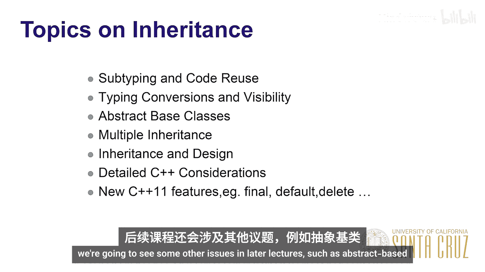
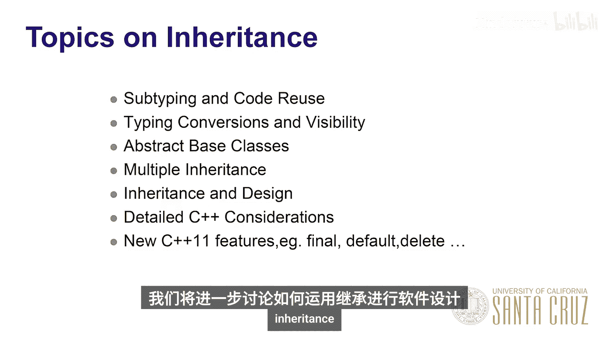
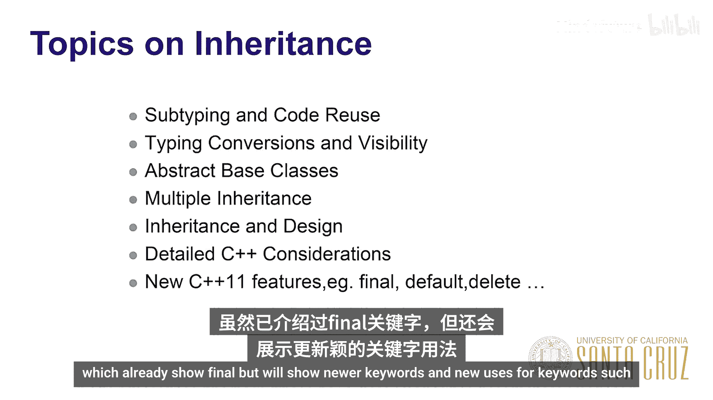
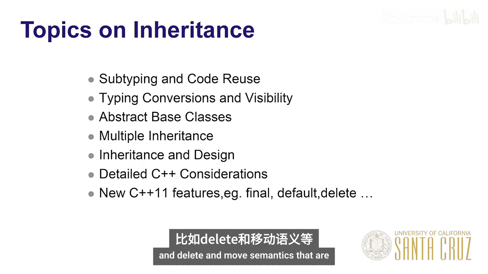
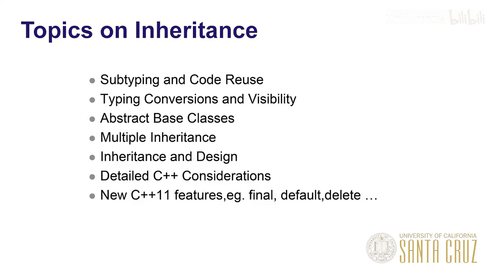

**C++编程：P23：继承专题：核心概念与高级议题** 🧬

在本节课中，我们将深入探讨C++继承机制中的核心概念与即将学习的高级议题。我们将回顾已学知识，并展望后续课程中会遇到的更复杂的设计模式和语言特性。

---

上一节我们介绍了子类型化、代码复用、类型转换以及可见性控制（如公有继承与私有继承）等基础概念。本节中，我们来看看继承在软件设计中的其他关键议题和C++的现代特性。

以下是后续课程中将涵盖的几个重要主题：

*   **抽象基类**：我们将学习如何定义不能实例化、仅作为接口蓝图的类。
*   **多重继承的复杂性**：我们将探讨当一个类从多个基类继承时可能引发的歧义和设计挑战。
*   **基于继承的软件设计**：我们将讨论如何有效地运用继承来构建健壮、可维护的软件架构。
*   **C++的现代特性**：我们将深入了解一些新的关键字和语义，例如：
    *   `final` 关键字（用于防止类被继承或虚函数被重写）。
    *   `default` 和 `delete` 关键字（用于控制编译器自动生成的特殊成员函数）。
    *   **移动语义**：这是一种优化资源管理的新实践，非常有趣且重要。

---

本节课中我们一起回顾了继承的基础，并预览了后续将深入学习的抽象基类、多重继承的陷阱、基于继承的软件设计方法，以及C++11及之后版本引入的 `final`、`default`、`delete` 和移动语义等现代特性。掌握这些内容对于编写高效、现代的C++代码至关重要。