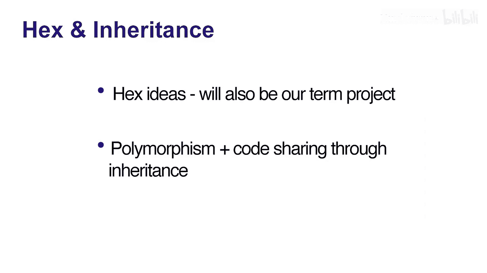
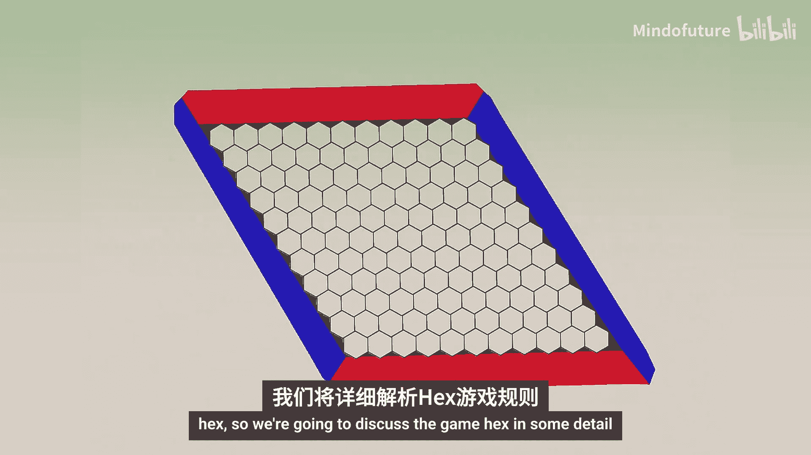
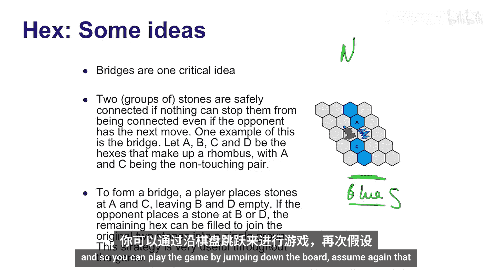
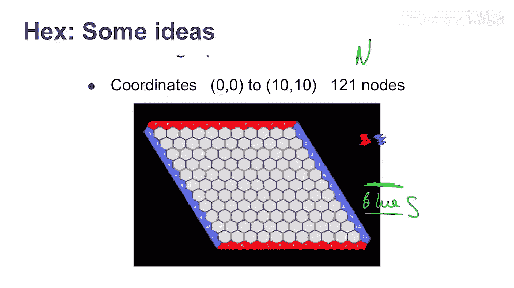
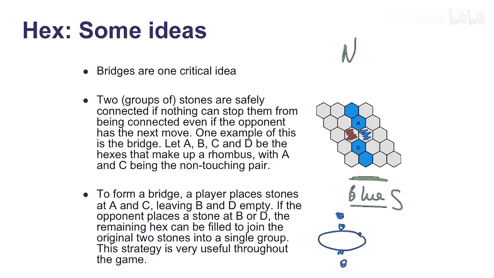
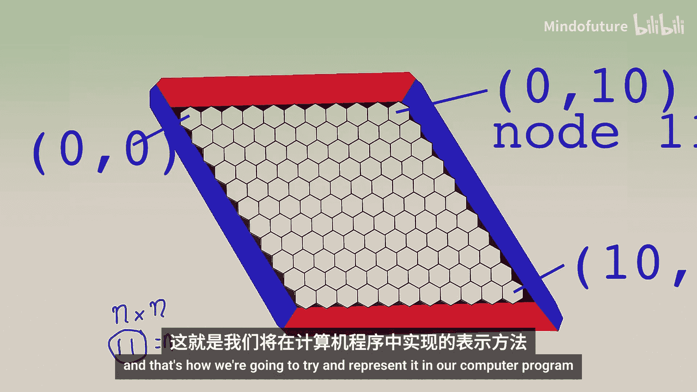
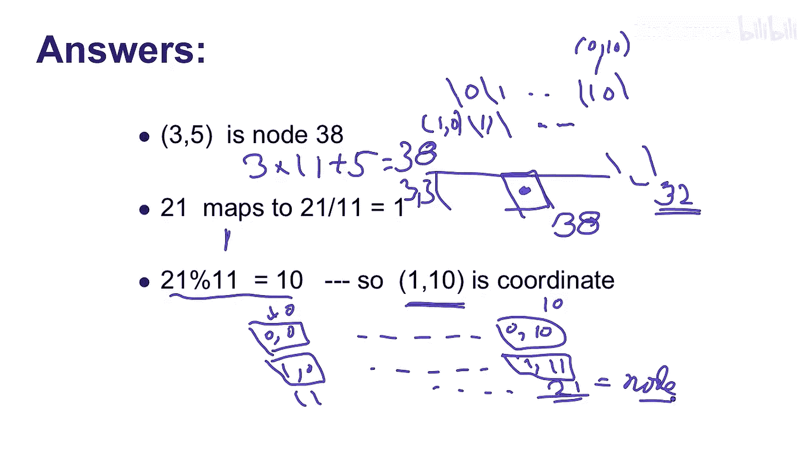

# 【加州大学】C++编程-｜-C-Plus-Plus-B-p24-P24_2-8-六边形棋概述_02_05_01--BV1KseJzqEbZ_p24-

This session， we're going to go into detail in our term project， which is implementing。

The game of hes and using AI techniques to produce。An intelligent opponent。

And as the techniques we're going to use in the C++ world。We're going to talk about inheritance。

 inheritance is the hallmark feature of object oriented programming。So the hex idea。

Are the ideas that relate to our term project as sort of our final project？P the resistanceists。

 all of you out there are going to。Become a game designer。

And know how to do things that allow the machine to play intelligently。And among the critical。

Software and methodology techniques in a language like C++。Is the use of。Polymorphism。

 code sharing through inheritance。

Hex， so we're going to discuss the Game X in some detail。

The first thing I want you to be able to do in your。Next assignment。

Is to produce a working program that plays legal hes。Makes legal moves。

 your program needs to be able to check。That。The move。

That's being made as legal and that it can make a legal move。

So it has to know that the opponent is making a legal move。And knows how the game is won。

And then in this first version of the code。I want you to use some fairly elementary。Playing strategy。

And recall that hex is a game of connectivity。It's what might be called a more complicated variant of the toe and when you're playing connectivity games。

 namely I have to make a path。Across a map。And I have to block you for making a path across a map。

The two critical strategies are offense， where I extend my path and defense。

 where I keep you from making your path。 So one place to look for ideas in how to conduct。

In some intelligent way gameplay in this environment is to see how to detect。

What makes longer pass for you and what blocks longer pass for your opponent。

And here are some of the hex ideas and there are many sites where both you can play Hex。

 so if you haven't played Hex， you should get on a site that lets you play an app。

And give you some experience。And you can also read about the game and one of the critical ideas in the game that you'll find。

 and it is again， a very good place。To build into your program。

 the kinds of moves it needs to look for are what are called in Hes bridges。

So two groups of stones can be safely connected on the boardroom， showing over here。

So one of the players is the blue player and the blue player is going from north to south。

And the red player。Might attempt。To block the blue player。In their next move。

But if the red player tries to block by putting。A stone here。They can only block in one position。

 And then when it's the blue player's turn， the blue pair can immediately。Do a connection。

So in some sense， it's okay。For the blue player to skip this row for the moment and only respond to the red player。

When the red player makes a blocking attempt。And the character here is that this is called a bridge。

 And so you can play the game by jumping down the board。 As again that you're the blue player。

And you're going down the board。

So you're making connections on the board like this， and then you're leaving some spaces。

And then you're making further connections and over here。

 you know you can always respond to some blocking attempt。

So when you write your program。We've so far in the course done a lot with graph theory。

So a natural kind of representation。Of the hex board is as a graph。Now here on this slide we see。

And 11 by 11。Hex game。 So normally， when people play hex， they play hex on boards that are。N by N。

And。Very typical for championships is n equals 11。And sometimes it's larger than 11。

It actually turns out that if F is nine or less， computers at this point can play perfectly。

But if we make the game large enough。The game gets combinatorily too large for even really supercomputers to figure out best moves。

Now， we're going to， in our homework， represent this already as a graph。 why。

 because lots of what we're doing is exploring paths。 And remember。

 we already did way back when Dyketras shortest path algorithm， Some sense。

 Dyketra's shortest path algorithm is foundational in exploring an intelligent way to move across the board。

So again， we have two players， in this case， the red and blue players and blue is going。

East to west and red in here is going north to south。

And they're trying to connect the two boundaries。The game can't be a draw， it turns out that。Whoever。

Makes the path blocks the other player's path， and there's no way to have a mutual blockage。

So there can't be a tie。And in this case， we have 121 nodes。 So we need a representation。

 and it's very useful to think of this as a two dimensional space in which。We have coordinates。

 and the upper。Left hand corner is 0，0。So that's this node。And then we go all the way down here。

And that's。A no，10 by 10。So again， we're using C conventions we're starting our indexing at zero。

Moving along， we can go from this node would be。0， comma 10。

And that would actually be node if you want to think of it， the 11th node。So this is the first node。

 second node， third node， fourth node， fifth node。And so on。

And that's how we're going to try and represent it in our computer program。

When you try to accomplish this mapping and this mapping should work for an arbitrary and by and board so you should think it out so that it works not just for 11 by 11。

 but here we're going to show you how to do it for 11 by 11。

And one of the things I want you to think about when you do this on your own is think about what you need to do for end by end。

Critical to doing this two dimensionional mapping is going to be the use of the remainder operator。

 so again， people are always making mistakes with the remainder operator they always forgetting how remainder works。

 so you really want to make sure you fundamentally understand the percent operator or remainder operator。

So this is a binary operator， it's a binary ametic operator， it's a binary integer ametic operator。

 and the idea is three remainder 10 is 3， 35 remainder 10 is 5 why if you divide 10 into 35。

The whole number part would be 3。 And then there's a remainder of five。 It's just。

How you learned in elementary school to do division。Now。When we look at mapping from I and J。

Into a square。We can use this formula for a node number， so recall。If we have zero，0。Then I is 0。

 and j is 0。 So you'd get0 times 11 plus 0。 So the first node。Would be labeled 0， be equal to 0。

 The last node， which is 10 by 10， would be 10 times 11， which is 1 10 plus 10， which is 120。

So you end up with 121 nodes again， labeled starting at0， the 121 nodes in this description。

 if you implement your hex game away I'm suggesting you should。

 you can end up with a graph for an 11 by 11 board of 121 nodes。

 and it' will be really easy to go between the two dimensional representation。

 which you probably want for purposes of drawing the board。

Because you want to be able to play against your program。

 and that means you're going to have to develop。A drawing program that will show you where the pieces are placed and that will probably be naturally done with the two dimension。

Representation and then you'll want to do all of these internal computations like a diktra or path algorithm computation using your graph representation。

Okay。So let's see if you understand this。Here's a brief quiz。What node is the square35？

And conversely。What square is the node 21？Take a second。Rightrite in your answers。3，5。

Is the 38th node。Recall， you're going to start here at node 0。 There'll be node 1。

 You're going to go to node 10。This is going to be the square 0，10。And then。

You will have in the column 10， you'll have the 11th node。So this will be the 11th node。And so on。

So 35， why does 35 get you 38 Well， you have three rows。And they go。wo。33 nodes。

 and that will mean that the last node on the third row that gets labeled will be node number 32。

And then you'll start the fourth row。And 3，5 will be6 into the fourth row。

 It's going to be that node， and that will be node 38。And again， if you were to multiply。

Three times 11。Plus，5。Just using the formula youd also see that you get node 38。

So you can either do it by counting physically on the board and finding your it。Noode position 38 or。

Showing that the formula works， you just use three times 11 plus5。Now the other way。

 the mapping works in the other direction， so 21 divided by 11 gets you integer part1。

So the 21st node。Israeli node。And then the other part of that is to do your integer remainder and that remainder of 21 remainder 11 is 10。

 and so the coordinate there is 110。And again， you can see that that's the 21st node。

 This is the CRF node。At'0 come as 0。You move over to0 comma 10。You go over to。1 comma 0。

You move over to。1 comma 10。This is the。Noode number 10， this is node number 11 and so on。

 and this is node number 28。So indeed， the formula， the inverse formulas also work。

Make sure you understand that and make sure you can do that for the general and by end case。

