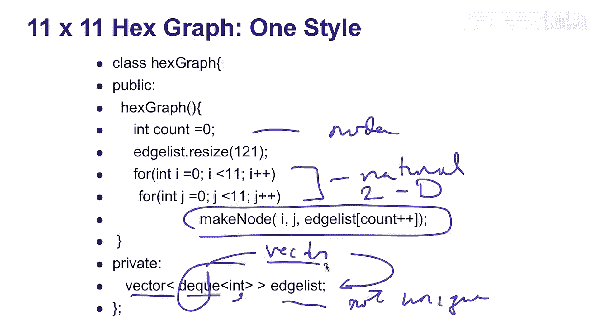
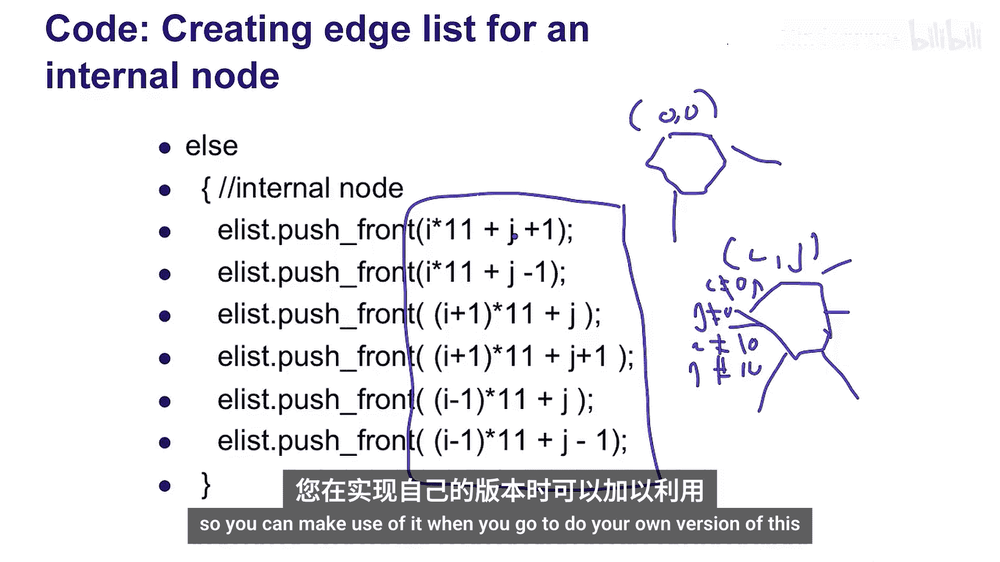
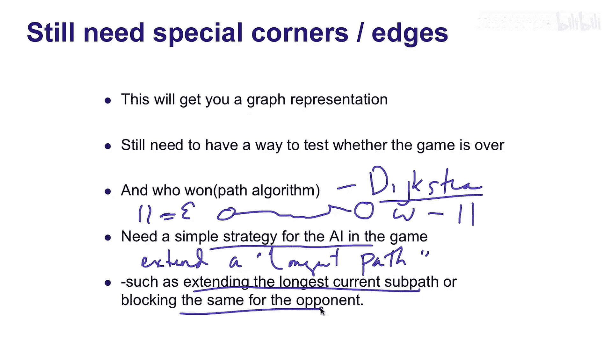
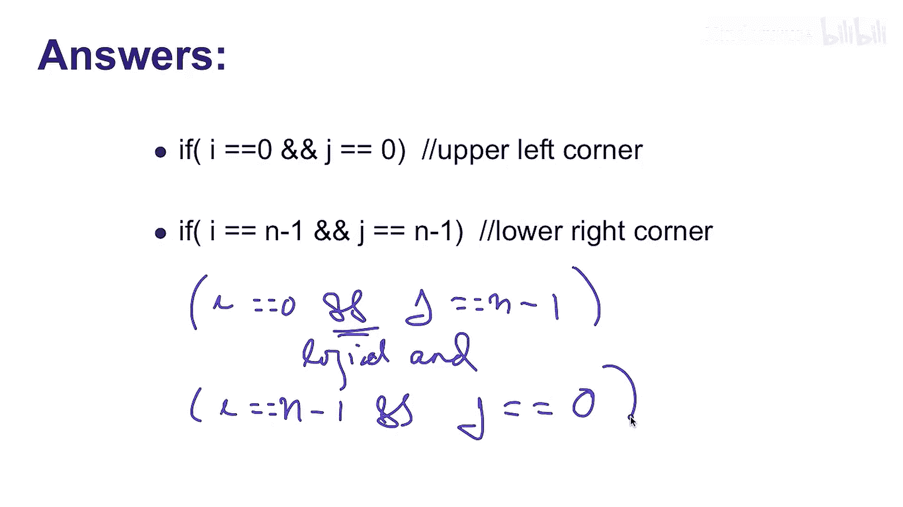

# 【加州大学】C++编程-｜-C-Plus-Plus-B-p25-P25_2-9-11x11六边形棋图的一种风格_02_05_02--BV1KseJzqEbZ_p25-

If we were doing the 11 by 11 case and we were trying to build our graph。

We can see that we'd have 121 nodes there。Then we'd use this natural mapping。

 the natural two dimensional mapping。And then we'd make a list of nodes。

And each node would be connecting a pair of IJ coordinates。

And we're going to privately store this in this data structure， a vector， a ge of in。

 not this is not unique。Actually， this could just as well have been a vector。

And here's the critical thing for creating an edge for an internal node。

Recall that when we have corner nodes， like zero， zero。So if this is a zero， zero node。

It only has two nodes that it connects to。But if I have an internal node。An Ij。

Where they're not equal to 0。And they're not equal to， and they're also not equal to 10。

So they're not on the perimeter。So there， because it's a hexagon。

 you have the six possible connections。The two above。The two on the same row and the two below。

And that's what all of these index。Show you， this is how to connect。

And this is a mapping of the I J coordinates into the node numbers。 So this is saying。

 push onto the node， a particular。Edge connection。So I just give you a piece of code like that so you can make use of it when you go to do your own version of this。

You're going to need to do the special cases so the general case is six things in the middle。

 the special cases will not involve all the six things recall that if you have corners。

There's only two nodes if you have there are only two nodes adjacent to a corner node。

 and if you have an edge node， that's not a corner。Then you have four adjacent nodes。

 the edge nodes have， if let's say you're on the side， you have the above one， the below one。

 and then two internal ones。Okay， so you'll still need to test among the things you'll need to be able to do。

Is you'll be able to， from the code we just looked at， get a full graph representation。

You'll need to be able to test when the game is over。And who won。

Here's where you could use your own form of ditra。Who won is somebody who won that created a path from。

 for example。East。There's some path from east to west。East is all the nodes on this boundary。

 So it's collection of， in the case of。The 11 by 11。

 there are 12 There are 11 east nodes here and 11 west nodes。

 and you want to see if there's a path from any of these east nodes to any of these west nodes。

 And if you find a path， doesn't even have to be a shortest path， well it'll be the only path。

 because when it happens， the game will be over。 So it'll be the shortest path from some node on the east to some node on the west。

 and that's where you can use your diyketra。And then the other thing I want is something like a simple strategy。

 like extending a alongest path。Here we go。Or blocking。

So that's your job。So among the things you should be able to already think about is。

How would you test what would be a test for a corner node。Take a sec。

Here's an answer for upper left corner。It's just some series of。Buling expressions。

Now we've left two off。呃。Let's see if on the fly， I can remember one。So there'd be another one like。

This， again， is the logical and。So this would be yet another corner。And the final corner would be。

So that gives you all four corners。Okay。

