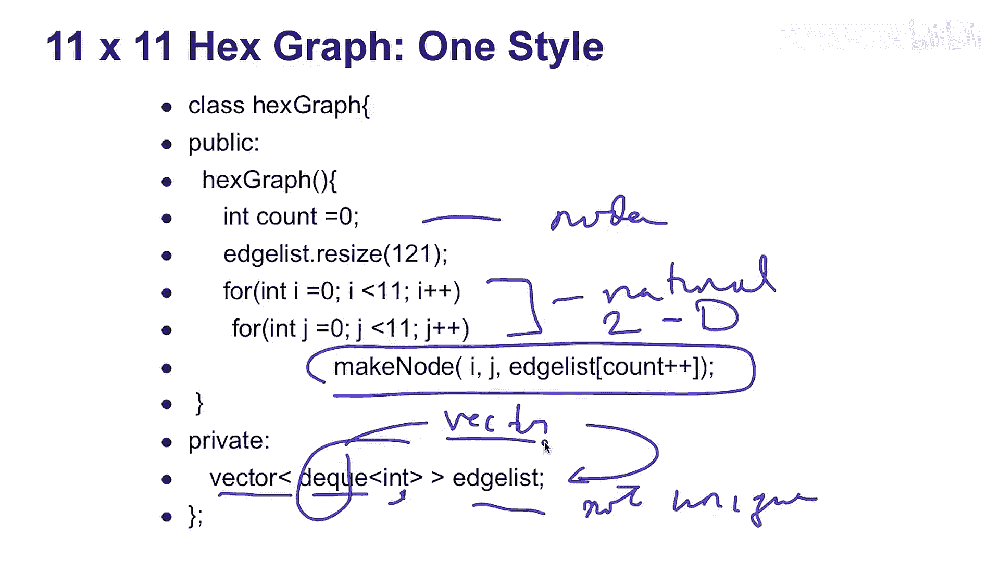
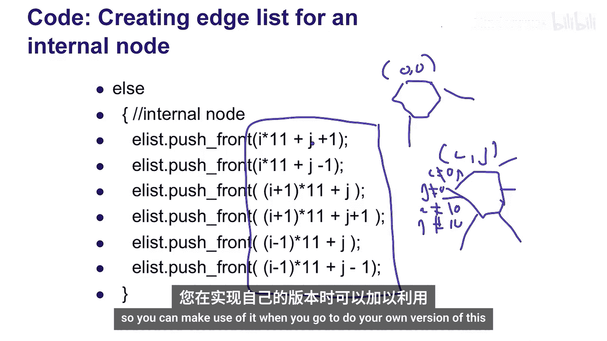
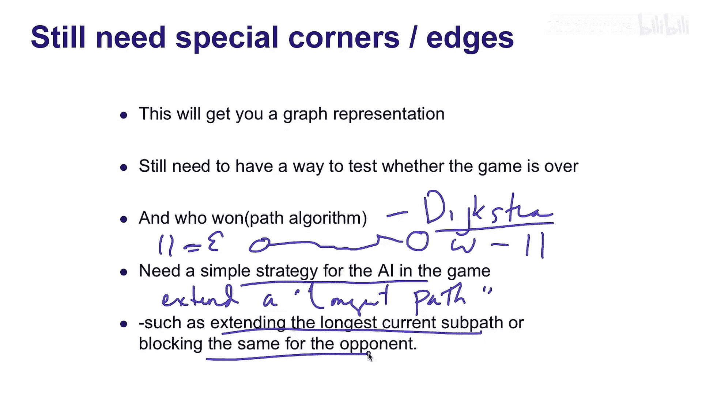
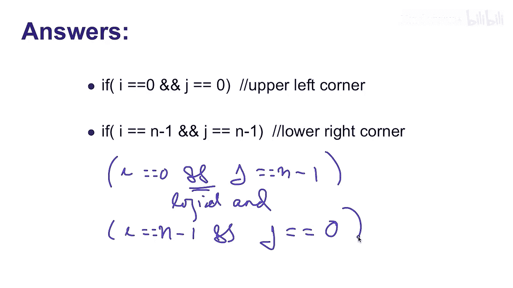

# C++编程：P25：11x11六边形棋图的构建与策略

## 概述

在本节课中，我们将学习如何为11x11的六边形棋游戏构建图数据结构，并探讨游戏结束判定与简单策略的实现。我们将从构建图的节点和边开始，逐步深入到游戏逻辑的实现。



## 构建图数据结构

上一节我们介绍了六边形棋的基本概念，本节中我们来看看如何为11x11的棋盘构建图数据结构。

如果我们要处理11x11的情况并尝试构建图，可以看到我们将有121个节点。我们将使用自然的二维映射。然后，我们将创建一个节点列表。每个节点将连接一对IJ坐标。我们将把这个数据结构私有地存储在一个向量中。实际上，这也可以是一个向量。

以下是创建内部节点边的关键部分。回想一下，当我们有角落节点时，例如(0, 0)。如果这是一个(0, 0)节点，它只连接到两个节点。但如果我有一个内部节点(I, J)，其中I和J不等于0，也不等于10（即不在边界上），那么因为它是一个六边形，它有六个可能的连接：上方的两个、同一行的两个以及下方的两个。这就是所有这些索引所展示的，这是连接的方式。这是将IJ坐标映射到节点编号的方法。这段代码的意思是，将一个特定的边连接推送到节点上。我提供这样一段代码，以便你在实现自己的版本时可以使用它。

```cpp
// 示例：为内部节点(I, J)添加边连接
// 假设节点编号通过函数 getNodeIndex(i, j) 获得
int currentNode = getNodeIndex(i, j);
// 添加上方连接
if (i > 0) {
    adjList[currentNode].push_back(getNodeIndex(i-1, j));
    adjList[currentNode].push_back(getNodeIndex(i-1, j+1));
}
// 添加同一行连接
adjList[currentNode].push_back(getNodeIndex(i, j-1));
adjList[currentNode].push_back(getNodeIndex(i, j+1));
// 添加下方连接
if (i < 10) {
    adjList[currentNode].push_back(getNodeIndex(i+1, j-1));
    adjList[currentNode].push_back(getNodeIndex(i+1, j));
}
```



你需要处理特殊情况。一般情况是中间的节点有六个连接，而特殊情况不会涉及所有六个连接。回想一下，如果你有角落节点，只有两个相邻节点；如果你有一个非角落的边缘节点，那么你有四个相邻节点。边缘节点，假设你在边上，你有一个上方节点、一个下方节点以及两个内部节点。

## 游戏逻辑实现

从我们刚才查看的代码中，你将能够获得完整的图表示。接下来，你需要能够测试游戏何时结束以及谁赢了。

以下是你可以使用自己的迪杰斯特拉算法的地方。谁赢是指有人创建了一条从东到西的路径。例如，东边界是所有位于这个边界上的节点的集合。在11x11的情况下，这里有11个东节点和11个西节点。你想看看是否存在从任何东节点到任何西节点的路径。如果你找到一条路径，它甚至不必是最短路径，实际上它将是唯一的路径，因为当这种情况发生时，游戏就结束了。所以，它将是某个东节点到某个西节点的最短路径，这就是你可以使用迪杰斯特拉算法的地方。

然后，我想要的另一件事是像扩展最长路径或进行阻挡这样的简单策略。

## 节点类型判断

这是你的任务。在你应该已经能够思考的事情中，如何测试一个节点是否为角落节点？花点时间想想。

以下是左上角角落节点的答案。它只是一系列布尔表达式。

```cpp
bool isUpperLeftCorner = (i == 0) && (j == 0);
```

现在我们还漏掉了两个。让我看看是否能立刻想起一个。所以还会有另一个像这样的表达式，这同样是逻辑与运算。这将是另一个角落。而最后一个角落将是：



```cpp
bool isUpperRightCorner = (i == 0) && (j == 10);
bool isLowerLeftCorner = (i == 10) && (j == 0);
bool isLowerRightCorner = (i == 10) && (j == 10);
```

这样就给出了所有四个角落。

## 总结



本节课中我们一起学习了如何为11x11六边形棋构建图数据结构，包括内部节点和边缘节点的连接方式。我们还探讨了如何利用图算法（如迪杰斯特拉算法）来判断游戏胜负，并思考了实现简单游戏策略（如扩展路径或阻挡对手）的基础。理解节点坐标映射与邻接关系是实现游戏逻辑的核心。