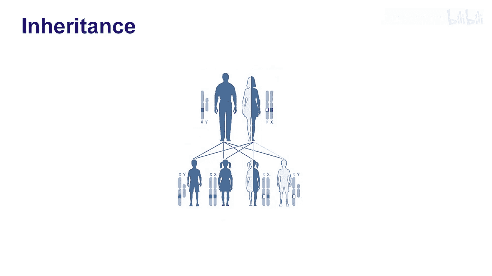
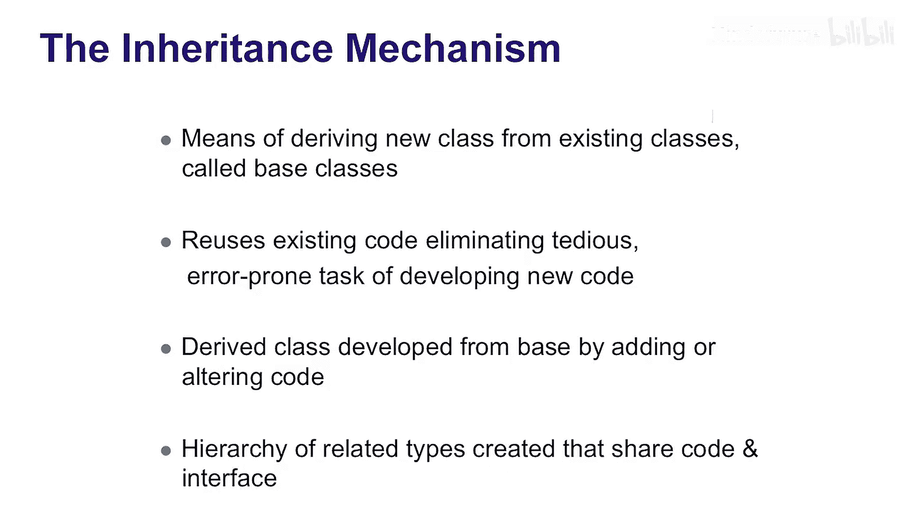
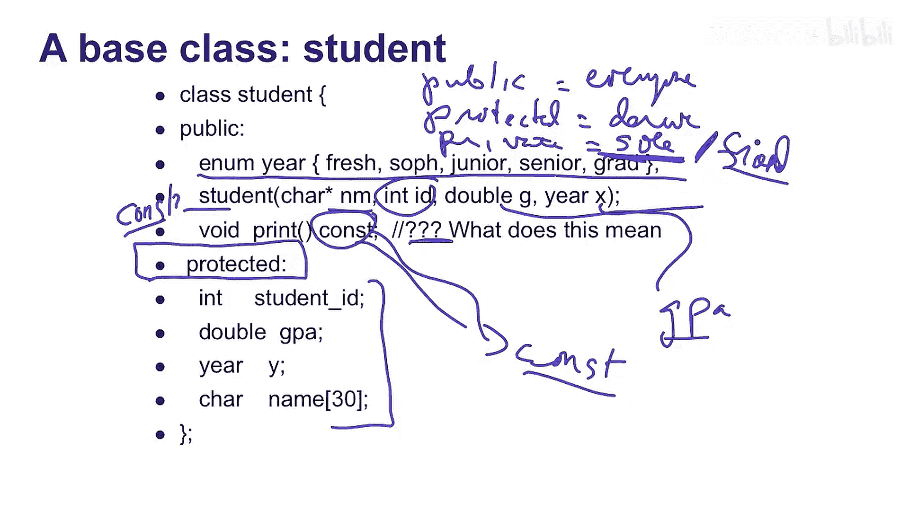
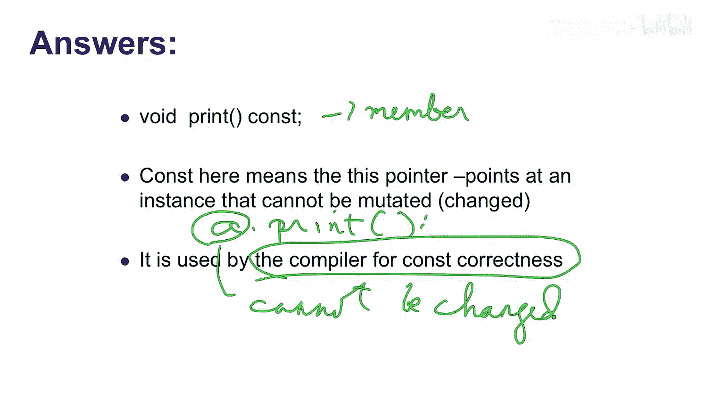

# 【加州大学】C++编程-｜-C-Plus-Plus-B-p26-P26_2-10-继承机制_02_06_01--BV1KseJzqEbZ_p26-

So now we're going to treat our major topic。In programming and C plus plus today。

 and that's going to be。Inheritance， and we're all used to inheritance， Inheritance is。

One of the foundational ideas。Fact is the fundamental dogma of biology。We all inherit。

We inherit and the replication occurs because of our DNA， we have genes， we have parents。

And this is showing how some kind of disease gets transmitted。A disease gene。

Shown here and showing what the likelihood of transmission is。

Critical understanding biology， but it shows up。In object oriented programming， languages like Java。

 languages like C++。Became the dominant ways to do programming starting in the late 80s。

Because this was a way to do code sharing。 And this was a way to get a polymorphic。A。

Dynamic response。To behaviors。If you were using small talk terminology。

 there would be methods getting messages and the right methods would be selected depending on the characteristics of the underlying type。

 all of this is part of inheritance in OOP and object or languages。

I am expecting that you already came to this class knowing these basic concepts。

So what inheritance gets us is means of deriving new classes from existing classes。

 terminologically those existing classes。Are called base classes。When we get this strivation。

 it is a way of reusing existing code。Re'using existing code again。

The software world is the magic bullet。 How do you。Keep software development costs down。

 You keep it down by not using not having to write unique code。

 anytime you have to write unique code to produce a next product or a next implementation。

 you have to do exhaustive testing。You have to make sure that that is correct。

If you have pre existingisting carefully tested code。And then it just becomes a component。

 plug in a Lego component of building a bigger system。You have great cost savings。

 so error prone this and developing new code is existed because this is。A critical reuse。Technology。

The ri code， so we have this inheritance relationship parent。Decant offspring。

The offspring code is generally an extension of the parent code where some new stuff has been added to the preexisting stuff。

 if we didn't need anything new， there would be no reason for inheritance。

 we would just use the old thing。So the new thing there has to be a reason for the new thing。

And that's usually that some code is altered， some behavior is changed。

 or some additional features are added。And the example will show in the next few lessons will。

 I think。Give you a good insight into。How this all works。

When you're finished with this data structure， you have a tree， it's your inheritance tree。

 you can go back and you know go back to Ana Ave， and you can see in the human inheritance structure。

 how did different characteristics， how did things end up being？

By looking at the previous generations。 So there's a hierarchy of related types created that share code。

 and they share。As well， interface。

So。What we're going to see is an example in which we're going to have as a base class。A student。

And we're going to think about this from a point of view。

 well of course I've been at the University of California forever when you build a big database for something like university。

 university has all different categories of people on the campus， there are students。

 there are special kinds of students， sos generic students。

 but then there might be a graduate students， there might be even further subdivisions of students。

 there may be students or in special categories， like professional students like online students that are。

Have different characteristics。 and indeed， you could even think of something more basic if you were building some big database for your university。

 such as person。So if you had person， then you would have not only student。

 but you might have employee and among employees you'd have different categories again。

 this would give you a development。Model for building a system that would reflect and model and let you implement stuff you needed for working with everybody on the university campus so you'd have employees。

 some of the employees would be academic in the academic employee there would be possibly tenure track and non tenure track faculty and then on the employee staff。

 there might be professional staff， business staff。

Maybe police and fire department service staff again。

 you'd have different categories if the category was significant。

 it would require its own class and that class would inherit from something more basic。

So here's a class student。Stent， one of its characteristics says。Oh， you can have a freshman。

 a sophomore， a junior graduate student。A student would have a name， there might be a student ID。

 maybe it's like a Social Security number， maybe there would be a GPA。What year the student was in？

So this is， again， a constructor。Let's say we want to print out an instance of students。E。By the way。

 I'm putting three question marks here。Just so you know， you should know what Ks means。

In that position， right？That means that this pointer， the instance。

Will not be affected by this method， by this member function。Wang change。And then now we have。

When we do inheritance。Typically we no longer we generally stay away from private and now stuff that was private is instead made protected。

And by protected it when you inherit it。When the derived class inherits it。

 it's visible to the derived class， derived class methods can directly make use of any of this information。

So。The overall。Data。Privacy scheme and C++ is public。That's everyone。Protected。That's derived。

Private。That's。Sou。😔，That's the most restrictive。And you can， of course， avoid。

 you can also use a friend logic here if you want to get at private parts as well。

So with with inheritance， we now see this important third class of data hiding protected。

 so within the inheritance hierarchy， within the family。Protected is going to have heavy use。

Okay， just recall from what I just said。What is the use of cost at that point。

And the point of this is this is a。This is a member function。Remember。

 it gets activated with something like A dot print。So this would be its activation。

And that means that。The compiler can check for Kant's correctness that means。A A cannot be mutated。

 A cannot be changed。

