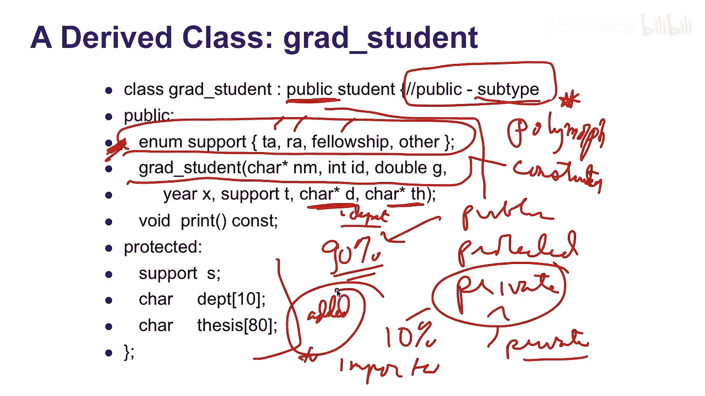
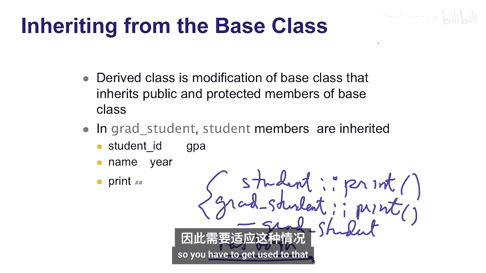
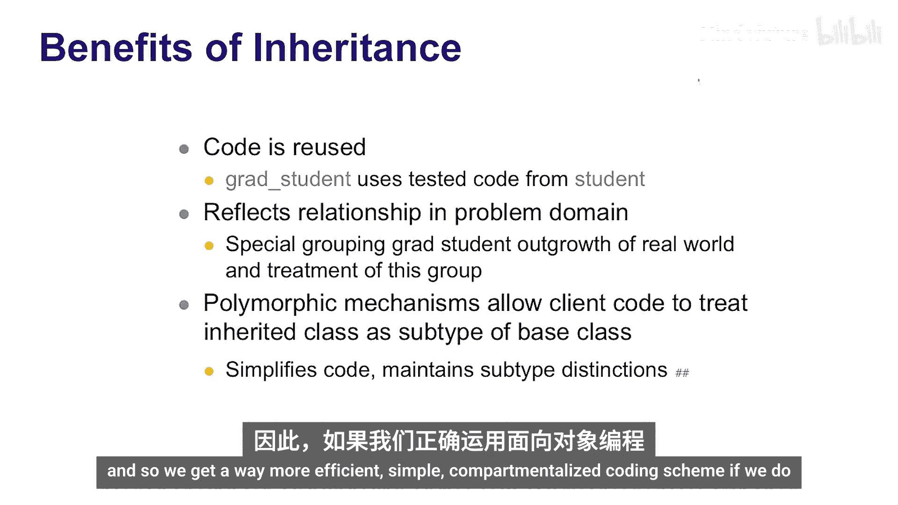
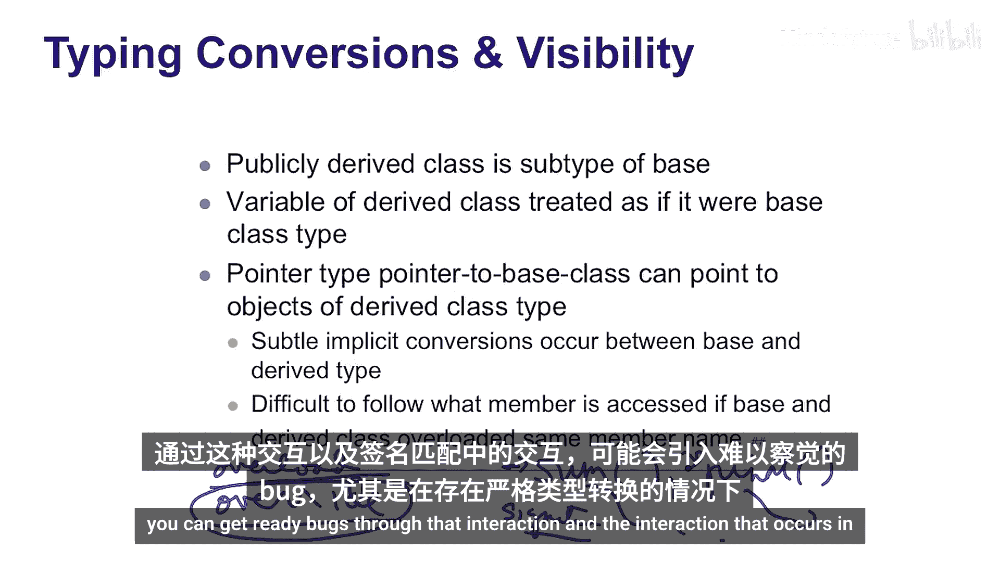
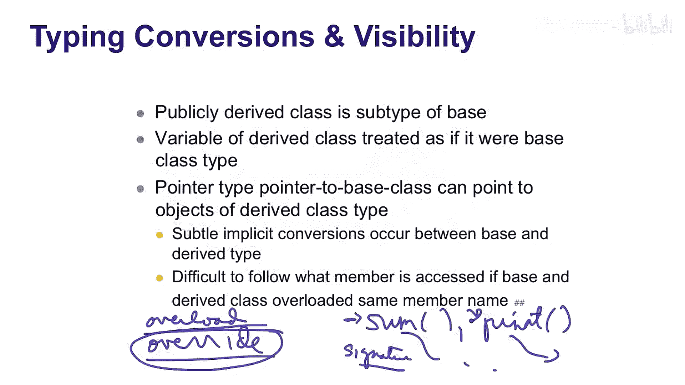

# 【加州大学】C++编程-｜-C-Plus-Plus-B-p27-P27_2-11-派生类-研究生_02_06_02--BV1KseJzqEbZ_p27-

So let's see how we have code reuse。Nowo。Recall in the past， I've always told you about 90% rules。

 Sometimes there are many ways to do things in C++。

 but one way is overwhelmingly the important way to look at stuff。And， again。

We're going to see that here。Inheritance comes in three flavors。the kind of inheritance is。

3 flavors are public。Protected。Private。And public is the 90% rule。

 So really what's crucial for you to understand is public inheritance。 that's overwhelmingly。

What is useful？Probably。The other， largely 10%。Is involved when you inherit privately。Theres very。

 very little reason to inherit， protect it that sort of。Intermediate form， and generally not。

Particularly useful。When we have public inheritance。We have a subtype relationship。

 so that's also what's crucial here。That's crucial， because。That allows for polymorphism。

So anytime we have public inheritance， it says a grad student may be thought of as a student。

A law student， a business student， whatever were to inherit publicly from。Student。

So you can imagine a much bigger system， other kinds of students。

That means they're universally students。 and so any place a student can be。啊。Computed on。

The derived classes can use that designation， that type。Now we've seen that in the native language。

 where do we see that in the native language？Think about the integral types。Anytime we have an int。

And we can work with an end。We can also work with a short and we can also work with a long。

 And there's even some other things where we can possibly consider。

Int without having to mess with conversion opportunities。So again， in the native language。

There is an effect。呃。Type relationships that allow for polymorphism， all the integral types。

Can be used。Interchangeably， that doesn't mean you still want to select them because you need a certain amount of precision。

 for example， for the integral types， so you would probably select the integral type that is most efficient for your particular。

Job at hand。And that's going to be true with these artificial hierarchies。

 the hierarchies you're building yourself when you're designing your code base。

So the inheritance structure means that everything connected with student。Gets publicly shipped in。

 imported。 It's as if it's all there， anything in that prior slide on student was there。

And then other things might be redefined， so again， we have a constructor。

And then typically we have additional information。Student wasn't enough。

 so almost all graduate students have some form of support。 graduateradu students might have Ts， RAs。

 fellowships。Maybe some other kind of maybe their self。Supporting。They have jobs。

And then they have other characteristics。Like they may have a dissertation title。

Or they may have that， this is a dissertation title， this is a department。

So you have all this additional， this is added。To the imported information。Addit。

So now we have a bigger collection。Of material。

The derived class modifies the base class and inherits its public and protected members。Priv members。

Are not considered visible， but public and protected members。Are going to be inher。

So when you there's a good programming point here， when you move to think about classes that are going to be used in inheritance hierarchy。

 you want to start thinking， oh， I don't really want that to be private， I want it to be protected。

It's protected， serves as private。If you don't use。A class is a base class。

 there's no nothing lost by calling it protected。And when we have to derive class。

 all of the student members get inherited， recall that you had stuff like the GPA。

 which was in the student member， and that means automatically the grad student。

Gets an inherited GPA。In the student member， there was a student ID number。

 the graduate student inherits that in the student class， there was a way to do print。Well。

 that gets inherited。 There's a form of print in the student class。But as we saw。We're redefining it。

In the derived class， so there's a second form of print， and that's going to be very important。

Some behaviors who you want to modify them we're going to see how that works。

 and that's really critical to your understanding of how to do object oriented programming。

So student ID， GPA， name and year， they all get included。The print function gets included。

But this is the print function。This is the student member scope resolution operator。

And that's going to sit next to。The graduate student print。

So both of these are going to be available in the grad student。

And that's something that can be confusing， so you have to get used to that。

So the typical thing again， is in the derived class。

 we add new members to the existing class members which come in automatically。

The grad student had three new data members and redefined one of the member functions。

There were department。There was a thesis， there was a support level。

So support department thesis were all new and they did not exist。For the more basic student class。

 And then we had in this case。The grad student form of print。So what are the benefits。

 what do we gain by doing this， after all， we could have a graduate student class that didn't derive from students and we could have made it from scratch。

We could have just written it out to be what we wanted to be。But there are several benefits。

There's code reuse。 We didn't have to write it again。 Now。

 you could make an argument that code reuse， in this sense would have happened anyway。

 I could have just grabbed。With my editor。I could have just done a copy。

And then basically just caught and paste。The old student software into the grad student， that's true。

But here。If we make changes， there's a linkage， so in some future version。

 if we decide there was an era in the grad student in the student software。

 or we have an efficiency and improvement， it automatically flows in to the grad student software。

So we get really important code reuse benefit， and it's not just the benefit that you can obtain from a cut and paste style with an editor。

The graduate student would use tested code from student。Here's another critical thing。

 There's a relationship in the problem domain。Sometimes I want to call that。Texonomic。

A grad student is a student。A mouse。Is a mammal。And indeed， a mammal。Is a vertebrate。So this。

Taxonomic。AScheme that we come up with is a way to divide up our coding responsibilities。

And get maximum reuse and get an effective design for code。

The special grouping grad student is typically an outgrowth of some real world observation。

A fellow who is brilliant in object oriented design， Grady Booch， who is largely responsible for。

A scheme for identifying and designing software that you use what is called rational rows。

 they used to be high demand。Going around and explaining the mysteries of。Getting good O0 design。

And he had wonderful rules。And。Certainly worth studying it many of his things have become bestseller texts。

 and so that's one place to go and look and see what a serious guru in this area proposes and we'll also see that this gave rise to things called design patterns as well。

 however。The key to getting a good OO design is to map whatever the real world situation is。

Into the software。So if I'm going to design a system for my campus。

 I want that to reflect the preexisting things that a campus administrator would talk about about the campus。

 if you went to the chanceancellor and he talked about the campus。

 he would be talking about students and graduate student， so to understand how to build the software。

 you have to understand what is it that you're modeling。And sometimes that's not easy。

If I'm not a chemist， then I'm asked to design a stereochemistry system and software。

I'm going to be flustered。 So you do need somebody who really understands the semantics。

That's a lot of the mystery。Mystery is not that these designs are hard to come by。

 the mystery is that the typical software engineer isn't necessarily going to know the domain and might have to work with a domain expert to get and properly build the critical relationships。

Another key benefit。Is。That there's polymorphic mechanisms。That allows the。codeode。

And the subtypes to be treated as base class types and we're going to。

And when you start doing this a lot。If you have some base class like student。

And then you have a pointer。It turns out， this pointer。Can point to not only students。

But also to graduate students。And then when you publicly inherit and you use this base class pointer。

 you can treat objects anywhere in the hierarchy that are students。And get。Dynaically。

 dispatch behaviors。That are appropriate to the different instances， the different kinds of students。

That sounds somewhat mysterious， but we will see that as we do more coding of this kind。Ultimately。

 what provides to us is simplifies our code， maintaining subtype distinctions。

 And so we get a way more efficient， simple， compartmentalized coding scheme if we do。

O O P， right if we do object oriented programming right。To understand this again。

 when we have type hierarchies， we also have typing conversions and we have questions of visibility。

 what can be seen by what？So 90% rule， publicly derived classes are a subtype of the base class。

 not privately derived。Protectically derived， publicly derived。

It's a subtype that means there's an automatic conversion opportunity。

A variable of a derived class can be treated as if it were the base class type。

A pointer type to the base class can point at any kind of object in the entire Harer。This is， again。

 critical to polymorphic dispatch。And there are some subtle implicit conversions that occur between base and derived class。

So that needs to be pay attention to。This can lead to some difficulty， I'll show a lie of this。

In a later example， where you have to be careful about。Remember， and C plus plus。

We can have a function like some。Or a function like print。And it can refer to a large number。

Of different。Functions， depending on signature。And the way we decide which some function or which print function to use is a question of the signature matching algorithm。

Now when we add inheritance。We also have the ability。To override these names。

 and when we override names like print， which we just did with graduate student or。

Where we have two different prints， there's a student print and a graduate student。

 and the overridden method gets called。Through the this pointer。

 so that this pointer is what is going to activate。An overrite， an overridden function。

And overloading and overriding。Both effects occur when we have class hierarchies in which we have multiple names and multiple signatures。

 that can lead to some difficulty。 And one has to be very careful in your coding rules to avoid getting into situations where。

You can get ready bugs through。

That interaction and the interaction that occurs in signature matching where you also have tight conversion。

Just make a point of that now。