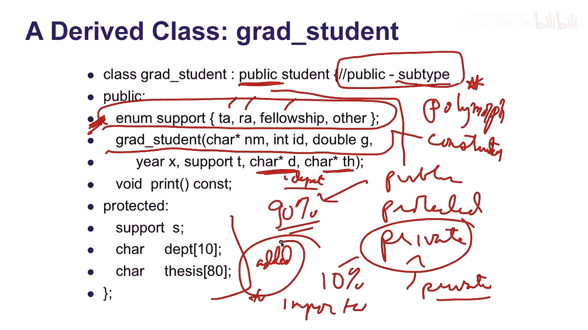
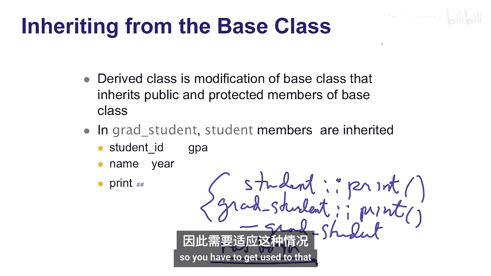
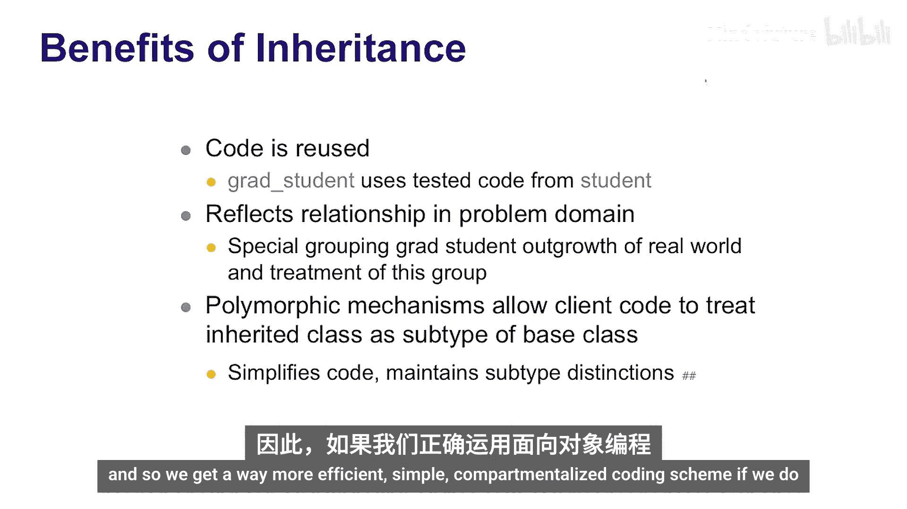
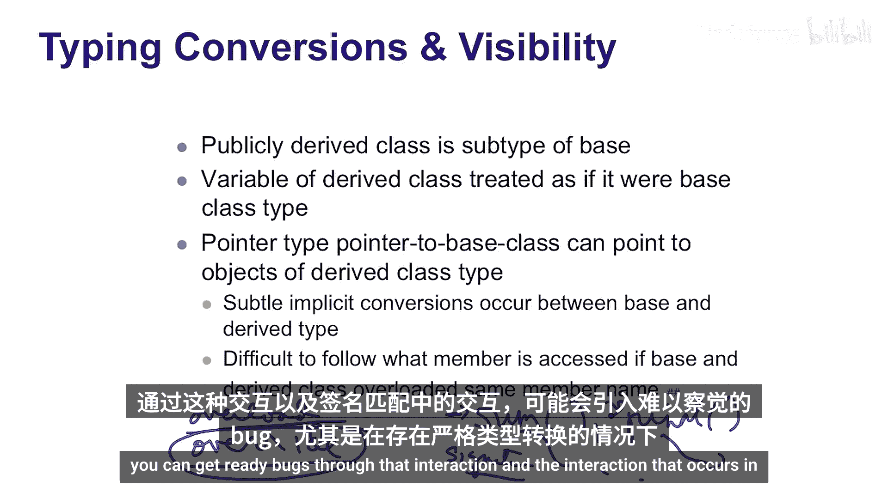
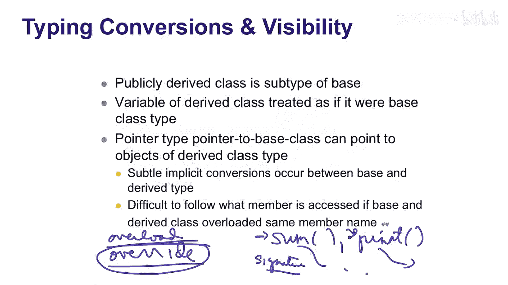

# C++编程：P27：派生类

## 概述

在本节课中，我们将学习C++中继承的核心概念，特别是**公有继承**。我们将探讨继承如何实现代码复用，建立子类型关系，并最终支持多态。课程将解释继承的三种形式，但重点在于理解占主导地位的公有继承及其在面向对象设计中的关键作用。

## 代码复用与“90%规则”

上一节我们介绍了继承的基本思想，本节中我们来看看它是如何具体实现代码复用的。

在C++中，有时完成一件事有多种方法，但通常有一种方法是压倒性的重要方式。这就是所谓的“90%规则”。在继承中，这一规则同样适用。

继承有三种形式：
*   **公有继承**
*   **保护继承**
*   **私有继承**

其中，**公有继承**就是那“90%规则”。理解公有继承至关重要，因为它是最常用、最有用的形式。私有继承大约占10%，而保护继承作为一种中间形式，通常并不特别有用。



## 公有继承与子类型关系

当我们使用公有继承时，我们建立了一种**子类型关系**。这一点非常关键，因为它正是实现**多态**的基础。

任何使用公有继承的地方，都意味着派生类可以被视为基类。例如，`GradStudent`（研究生）可以被视为`Student`（学生）。在一个更大的系统中，可能还有`LawStudent`（法律学生）、`BusinessStudent`（商科学生）等，它们都公有继承自`Student`。这意味着它们都是`Student`，因此任何可以处理`Student`的地方，都可以处理这些派生类。

在C++原生语言中也能看到这种关系。例如，整型类型之间：任何可以使用`int`的地方，也可以使用`short`或`long`（尽管可能需要考虑精度和效率）。这同样是一种允许一定程度多态性的类型关系。

## 派生类的构成



继承结构意味着所有与`Student`相关的内容都被公开地“导入”到`GradStudent`中。这就像它们原本就存在于`GradStudent`中一样。

然后，派生类可以添加新内容或重新定义某些行为。例如，`GradStudent`类有一个构造函数，并且通常包含额外的信息。因为`Student`的信息可能不够，几乎所有研究生都有某种形式的资助（TA、RA、奖学金等），或者他们可能有工作。此外，他们还有论文标题、所属院系等特性。这些都是**新增**到从基类导入的信息之上的。

因此，派生类最终拥有一个更大的信息集合。

```
class Student {
    // ... 成员如 GPA, studentID, name, year, print() ...
};

class GradStudent : public Student { // 公有继承
public:
    // 继承了 Student 的所有公有和保护成员
    // 新增成员
    std::string department;
    std::string thesisTitle;
    std::string supportLevel;

    // 可以重新定义基类函数
    void print() const;
};
```

派生类修改了基类，并继承了其公有和保护成员。私有成员不可见。这里有一个重要的编程要点：当你设计一个可能被用于继承层次的类时，应该考虑将一些成员设为`protected`而非`private`。`protected`对于非派生类来说就像`private`，但如果这个类被用作基类，派生类就能访问这些成员，而不会损失封装性。

在`GradStudent`中，所有`Student`的成员都被继承。例如，`Student`中的GPA、学号、`print`函数都被`GradStudent`继承。但是，正如我们所见，`GradStudent`重新定义了`print`函数。因此，现在有两个`print`函数可用：`Student::print()`和`GradStudent::print()`。理解这一点对于掌握面向对象编程至关重要。

## 继承的好处

我们通过继承获得了什么？毕竟，我们可以从头开始编写一个不继承自`Student`的`GradStudent`类。

以下是继承带来的几个关键好处：

*   **代码复用**：我们无需重写`Student`已有的代码。虽然可以通过复制粘贴实现类似效果，但继承提供了更强大的链接。如果未来`Student`类有错误修复或效率改进，这些更改会自动流入`GradStudent`，实现了真正的、可维护的代码复用。
*   **问题域关系映射**：研究生就是学生。这是一种分类学（Taxonomic）关系。好的面向对象设计的关键在于将现实世界的情况映射到软件中。通过继承，我们的代码结构反映了真实世界的概念关系，这有助于划分编码职责，实现最大程度的复用和有效的代码设计。
*   **多态机制**：这允许将派生类（子类型）视为基类类型进行处理。当你开始大量使用它时，你会发现：一个指向基类（如`Student*`）的指针，不仅可以指向`Student`对象，还可以指向任何公有继承自`Student`的派生类对象（如`GradStudent`）。通过这个基类指针，你可以动态地调用适用于不同具体学生类型的行为。这极大地简化了代码，使我们能够维护子类型区别，同时获得更高效、简单、模块化的编码方案。

## 类型层次、转换与可见性



要深入理解继承，我们还需要了解类型层次、类型转换和可见性问题。

重申“90%规则”：**公有派生类是基类的子类型**（私有和保护派生则不是）。这意味着存在自动转换的可能性：
*   派生类类型的变量可以被视为基类类型。
*   指向基类类型的指针可以指向整个继承层次中的任何对象。

这对于**多态分发**至关重要。基类和派生类之间会发生一些隐式转换，需要注意，这有时可能导致问题。

此外，当引入继承后，我们获得了**重写**基类方法的能力（如`GradStudent`重写`print`）。重写的方法通过`this`指针调用。同时，C++中还存在**重载**（同一作用域内函数名相同，参数不同）。在具有多重名称和签名的类层次结构中，重载和重写可能同时发生，这可能导致一些困难。在编码时必须非常小心，避免因签名匹配和类型转换的交互作用而引入难以发现的错误。

## 总结





本节课中，我们一起学习了C++继承的核心，特别是公有继承。我们理解了它如何通过建立子类型关系来实现代码复用，并作为多态性的基石。我们探讨了派生类如何继承并扩展基类的功能，以及继承在映射真实世界关系、简化代码结构方面带来的巨大好处。最后，我们指出了在类型层次结构中需要注意的类型转换和函数重载/重写交互可能带来的复杂性。掌握这些概念是进行有效面向对象编程的关键。