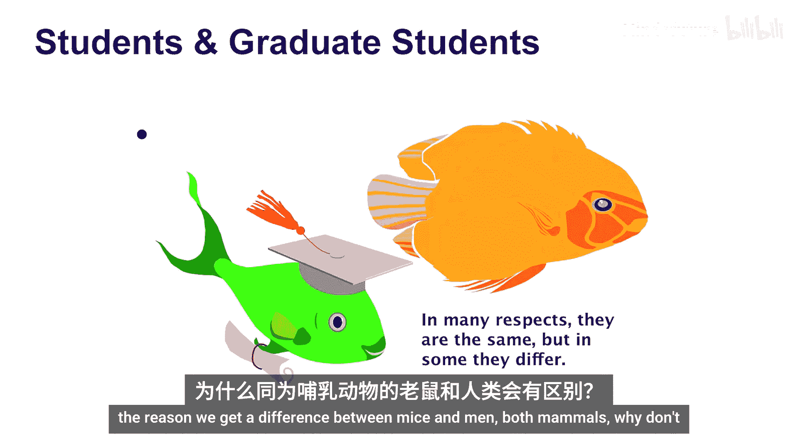
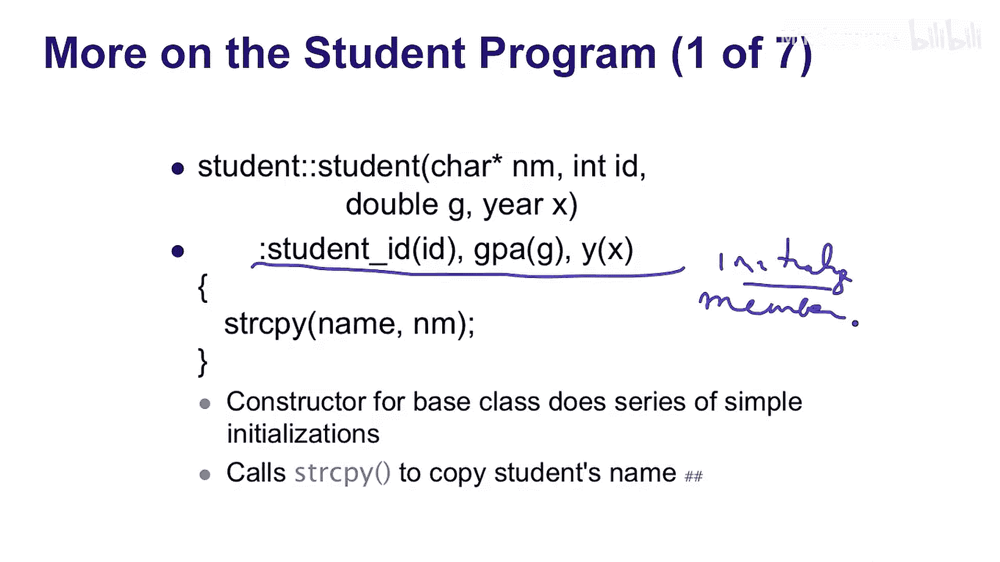
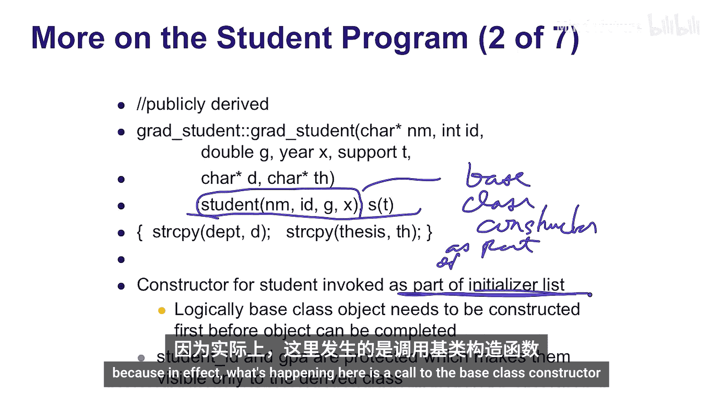
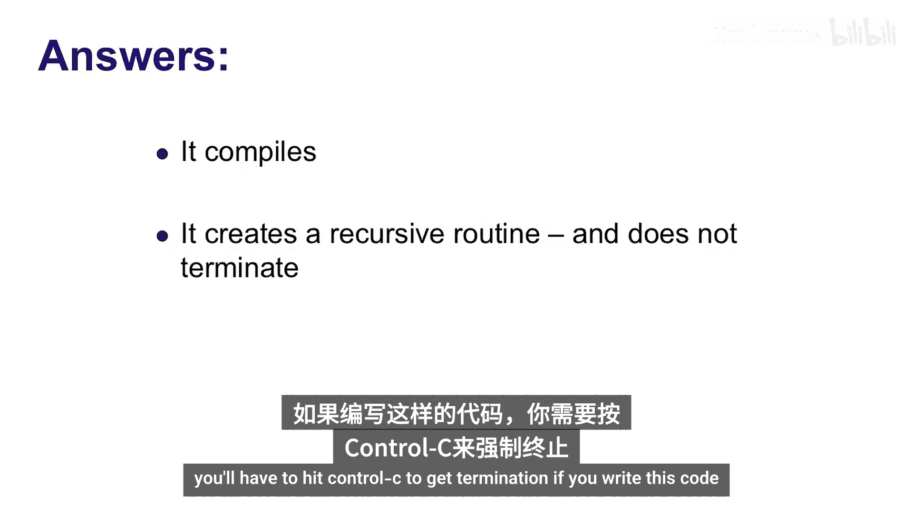
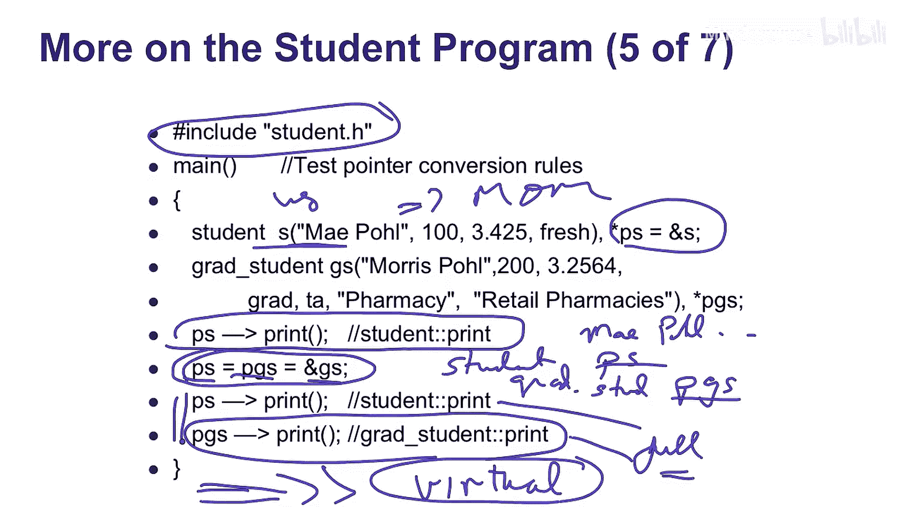
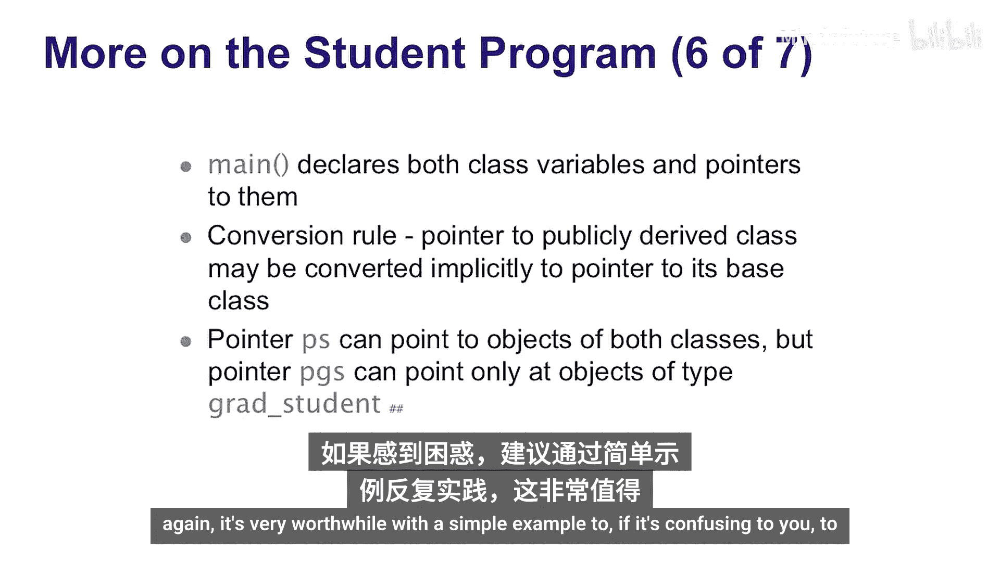
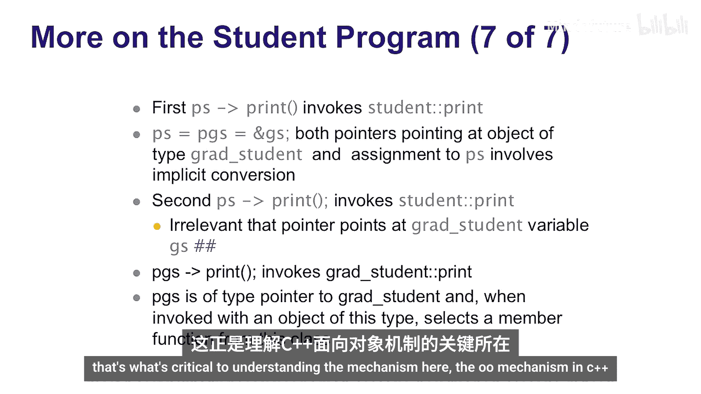
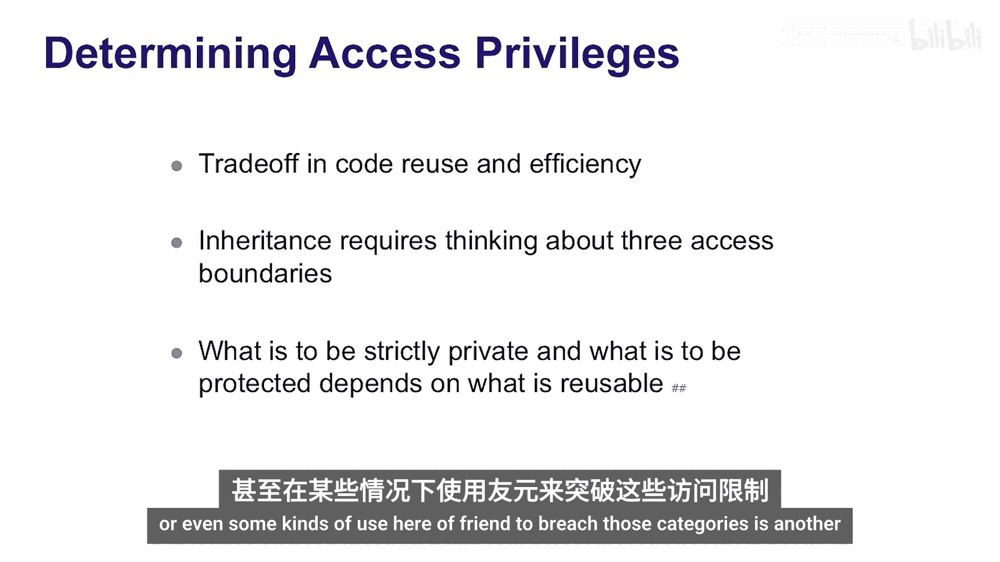

# 【加州大学】C++编程-｜-C-Plus-Plus-B-p28-P28_2-12-学生和研究生_02_06_03--BV1KseJzqEbZ_p28-

So again， we have。As we did in this inheritance hierarchy。Students and graduate students。These are。

 in many respects， the same kind of object or instance， but then they also differ the reason we get。

A difference between mice and men， both mammals。 Why don't we just stick with mammals and just have them all instances of mammal。

 We create special categories because they're rich enough and important enough to add。

The additional information you need so that you can call something a mouse as opposed to also calling it a mammal。

And not just have。A mammal who individually happens to be a mouse。

So let's look at more detail between the student， graduate student code architecture。

Here's our student constructor。There's some simple initializations that occur。

 I think we've seen enough of this kind of code to not dwell on it， so we have a student。

 we have a name of the student， we have an integer ID， we have a grade point average。

 we have a class called year where we can say that the student is a soft。And then， again。

Is our initialization syntax？We initialized these members。And that gives us。Our basic constructor of。

Of a student。

Now here's our derived type， a little more interesting because it has something a little novel to it。

So we have a bunch of stuff that we still need for the grad student， namely we need a name an ID。

 a GPA year， but now we have a support， we have this additional information。

 support department thesis。But here is the new element in the initializer list。

We can call the base class construct。Part of the initial item list。And so that。

Is part of how we initialize。And again， you get code reuse because in effect。

 what's happening here is a call to the base class construct with the items that it needs。

So again， it completely makes sense。A graduate student is a student。

 that means all the elements of a student have to be built into the graduate student。

 that means we have to have a way to initialize those elements。

So here are some of the ways we can use the information。Hes a graduate student， GS。

And it's been initialized to be Mars Pole， an ID number of 200， a GPA of 3。25hi。

Mris is a graduate student， has TA support， the department is phharmacy。

And a thesis is retail pharmacies。Otherwise known to me as dad。

 my dad was indeed a retail pharmacist。Now here's an alias to that graduate student。It's a reference。

To that graduate student。And here's。A student pointer pointing at the graduate student from the perspective of this student pointer P S。

This is now a type student that's saying， ah， what I'm pointing at is a type student。

So anything that can be applied to a student can be applied to in effect this particular instance GS。

 namely Mars Pole。So there is an appropriate conversion。

 this graduate student is converted to an address of a student， that's what's really happening there。

Now let's look at the overridden method of this is where we see some of the distinction here。

 the overridden method of print and the derived class graduate student versus print in the base class。

So the print of the base class is just going to print out the name， the student ID， et cetera。

 grade point average。All of that occurs through scope resolution here。

So the derived class print calls on the base class print。And then adds this extra stuff。

That's what it meant as an overridden method。Indeed， if this was left off。this would be a big era。

The big arrow would be。A。An infinite recursion。So again， when you do overriding。

 you're going to see some use。Of scope resolution。So that you can avoid the base。

calling the overridden function repeatedly through a recursion。Ha。Quas， I've given you the answer。

So here's Vo graduatera student print and the overridden method， I've gotten rid of scope resolution。

Does this compile？And what goes wrong。And if this is confusing to you， try and run it。

It does indeed compile。But it now creates a recursive routine and does not termerminate。

You'll have to hit control C to get termination if you write this code。

So now let's see us use this simple hierarchy。Let's say， Ive。Put all that code in student。h。

I import it in domain。Here's Maypole， a simple undergraduate。Otherwise known as mom。Freshman。

Here's Morriss Pole that previously shown graduate student。Here we do P S that print。Now。

 when we do PS。 print。And P S was set to。May poll， we're going to print out。Ma poll here。

With appropriate information。ow we sent p s to p g s。To the address of Gs。So that's intrinsically。

 P S is being set to。Marris。And there are two types here， one is the student type。That's PS。

 as's a student type pointer。And the other is the grad student type pointer， DgS。

And we're going to get two different responses in terms of this overridden function。

If we print with PS。Then we'll get a limited amount of information on Mars Pole。

 we'll just get his base information， we'll get Mars Pole is number 200 has a 3。25 GPA。

And his status is year is gra。Do it through PgS。We'll get the full information on Mars。

Now we're going to see。That later this can be changed in the way it's going to be changed。

 they'll eat。Forwarn you， because some of you may。Be used to other languages。Unlike Javava。

C plus plus requires。A special keyword， virtual to change。This default behavior。

 this is the default behavior when overridden methods。Are not virtual。

Okay， so again， we have to understand conversion rules pointer to publicly derived class may be converted plusly to pointer to a space class。

 that's what we've just done。We had P equal PgS， and we had an implicit point of conversion。

PS can point to classes of both objects， instances of both classes。

 PGS could only point to the instances of grad student otherwise itd be a type error。

 and as a consequence we would get。啊。Different behaviors when we use the two different pointers because they have different base class attributes when we tried to invoke。

The print function。Again， it's very worthwhile with a simple example to if it's confusing to you to play with it。

Because these are foundational， so PS print invoke the student print function。Now we could have both。

PS。 print invoke student print。And it was irrelevant that the pointer。

 the underlying object was either a grad student or an undergraduate student， that did not matter。

And that did not matter because again， we have yet to use the keyword virtual。Pgs。

Because it's a pointer to graduate student would invoke。

The print that gave us more information that would print out the thesis and department and support level of Mars。

So PGS。Seex。A method or member function from the graduate student to derived class， whereas PS。

Selected a method from the base class that's what's critical to understanding。The mechanism here。

The O mechanism。

In C++。So again， we have public。Protected in private boundaries。

And you're going to have to think a lot more carefully about those。When you design。Harchies。

The trade off and code reuse and efficiency， in other words， if you maintain strict access。

Making things as private as possible， which is generally a good rule。For correctness。

That can make things a little less efficient。So you have to give some more thought as to what you want。

To be public and what you want to be protected or even some kinds of use here。

 a friend to breach those categories as another。

Way to go stylistically。