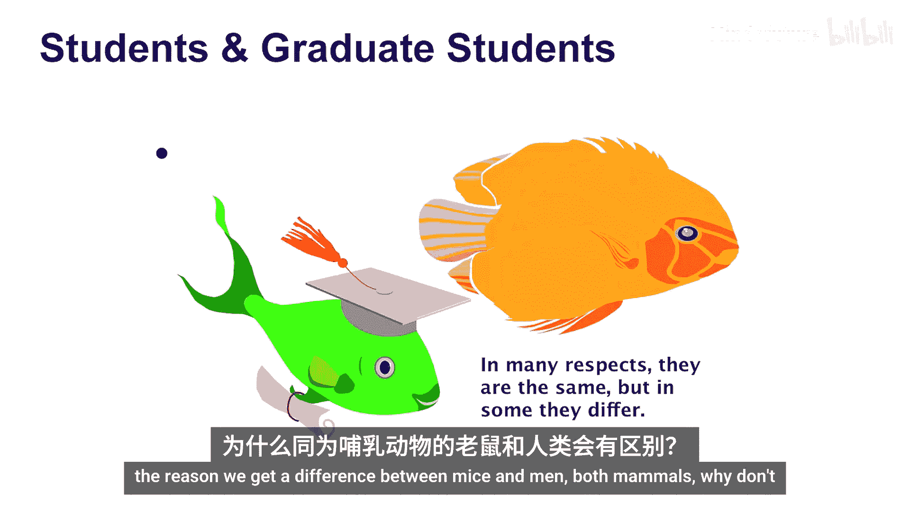
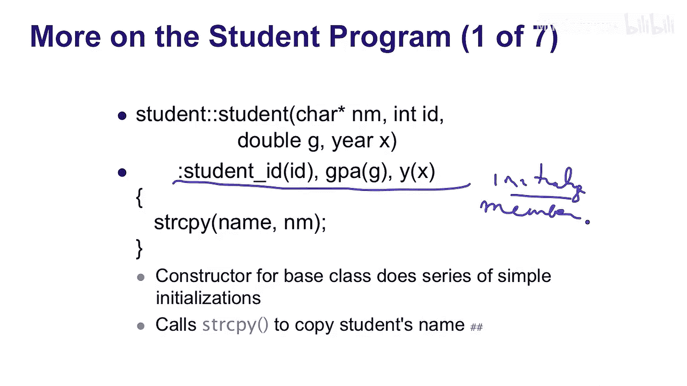
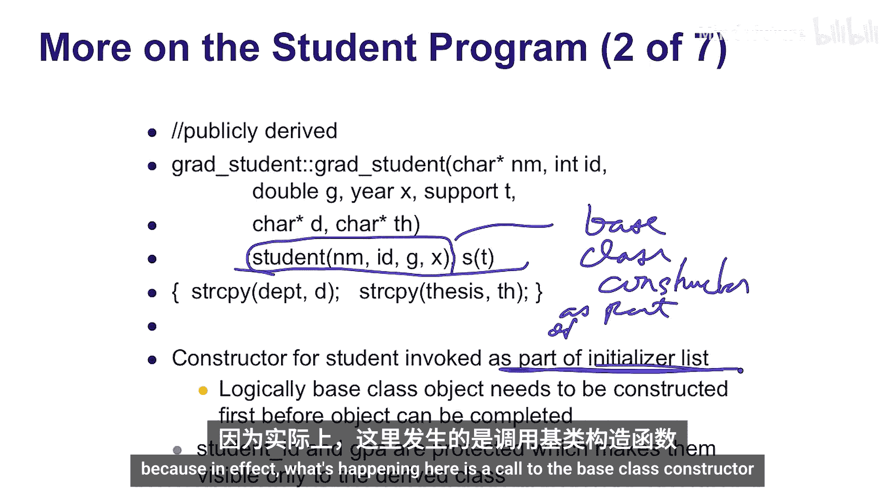
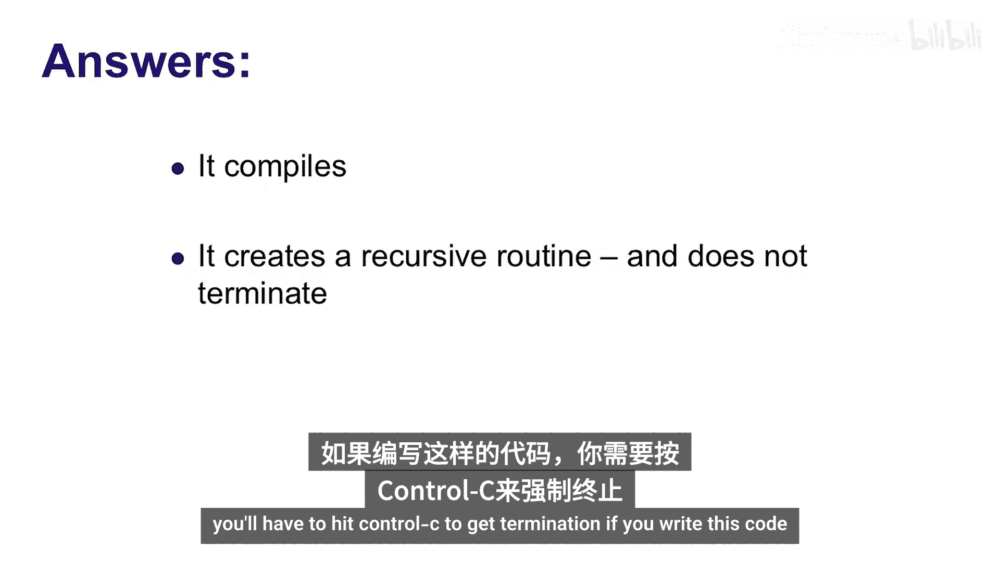
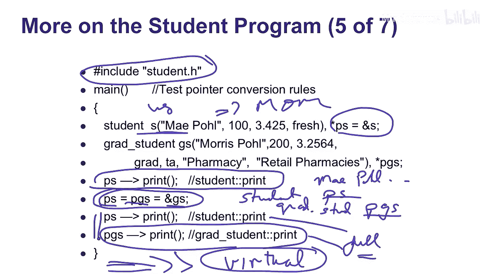
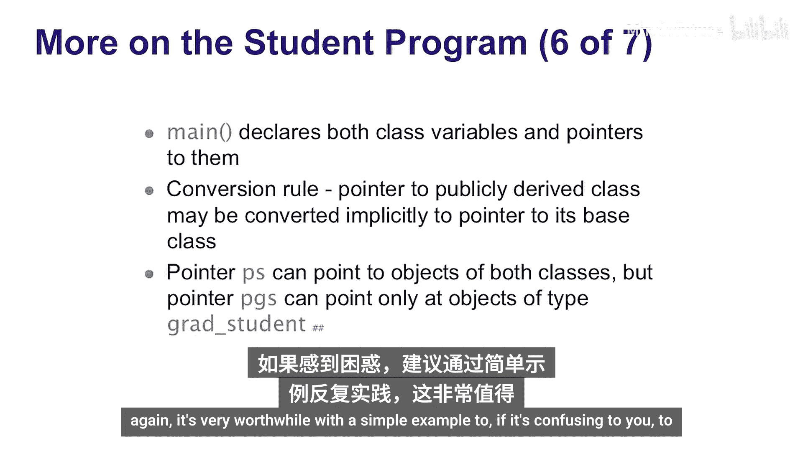
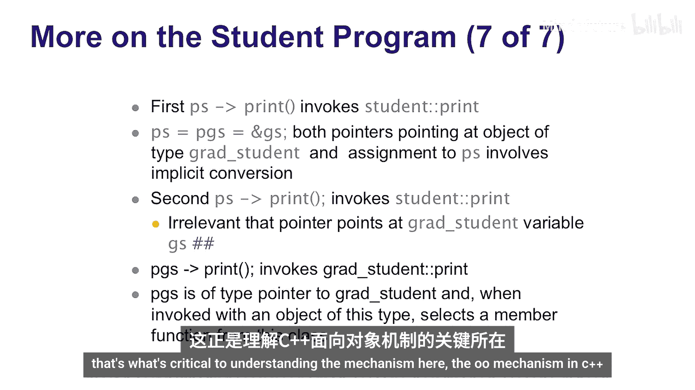
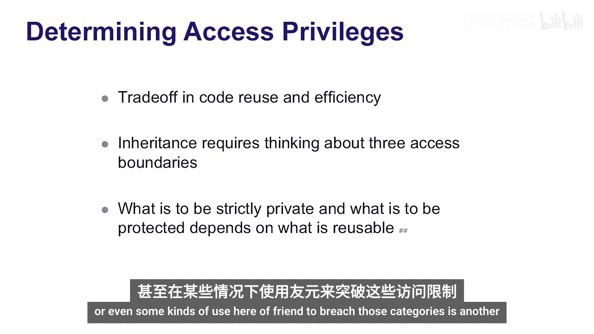

# C++编程：P28：继承与派生类详解

在本节课中，我们将学习C++中继承与派生类的核心概念，通过学生和研究生这个具体的例子，理解如何构建类层次结构、初始化派生类对象以及方法重写的机制。

## 概述



我们将分析一个包含`Student`（学生）基类和`GraduateStudent`（研究生）派生类的简单层次结构。通过对比这两个类，我们将理解为何需要创建特殊的派生类别，以及如何通过继承实现代码复用和扩展功能。

---

## 继承层次结构的设计动机

上一节我们介绍了继承的基本概念，本节中我们来看看为何需要设计类层次结构。

学生和研究生在许多方面是相似的对象或实例，但它们也存在差异。这种差异类似于老鼠和人类都是哺乳动物，但我们仍会创建“老鼠”和“人类”这两个特殊类别。原因在于，这些派生类别足够丰富和重要，需要添加额外的信息，以便我们能明确地称某物为“老鼠”，而不仅仅是“一个碰巧是老鼠的哺乳动物”。



因此，让我们更详细地查看学生和研究生之间的代码架构。

---

## 基类：Student 构造函数

以下是我们的学生构造函数。其中进行了一些简单的初始化操作。

```cpp
Student::Student(const string& name, int id, float gpa, Year year)
    : name(name), studentID(id), GPA(gpa), studentYear(year) {
    // 构造函数体
}
```



我们有一个`Student`类，它包含学生姓名、整型ID、平均绩点（GPA）以及一个表示年级的`Year`枚举类（例如，学生是大一新生）。这里再次使用了初始化列表语法来初始化这些成员变量。这构成了`Student`类的基本构造函数。

---

## 派生类：GraduateStudent 构造函数

现在来看我们的派生类型`GraduateStudent`，它更有趣，因为包含了一些新的元素。

```cpp
GraduateStudent::GraduateStudent(const string& name, int id, float gpa,
                                 Support support, const string& dept,
                                 const string& thesis)
    : Student(name, id, gpa, Year::GRAD),  // 调用基类构造函数
      supportLevel(support),
      department(dept),
      thesisTopic(thesis) {
    // 构造函数体
}
```

研究生仍然需要姓名、ID、GPA和年级这些信息，但现在新增了`support`（资助类型）、`department`（院系）和`thesis`（论文题目）。初始化列表中的新元素是：**我们可以调用基类的构造函数**。这是初始化过程的一部分。

这完全合乎逻辑。一个研究生**是一个**学生，这意味着学生的所有元素都必须内置于研究生对象中。因此，我们必须有一种方法来初始化这些元素。通过调用基类构造函数，我们实现了代码复用，本质上是用它所需的参数来构建基类部分。

---

## 对象创建与指针转换

以下是使用这些信息的一些方式。

```cpp
GraduateStudent gs("Mars Pole", 200, 3.25, Support::TA,
                   "Pharmacy", "Retail Pharmacies");
Student* ps = &gs; // 基类指针指向派生类对象
```

`gs`是一个被初始化的研究生对象。`ps`是一个指向该研究生对象的**基类指针**。从这个`Student`指针`ps`的视角来看，它现在指向的是一个`Student`类型。因此，任何可以应用于`Student`的操作，实际上都可以应用于这个特定的实例`gs`（即Mars Pole）。这里发生了一个适当的转换：这个研究生对象被转换成了一个学生对象的地址。

---

## 方法重写（Override）与作用域解析

现在让我们看看重写的方法，这里我们能观察到一些关键区别：派生类`GraduateStudent`中的`print`方法与基类`Student`中的`print`方法。

基类的`print`方法只打印姓名、学ID、平均绩点等信息。派生类的`print`方法通过作用域解析运算符（`::`）调用基类的`print`方法，然后添加额外的信息。



```cpp
void GraduateStudent::print() const {
    Student::print(); // 调用基类的print方法
    cout << "Support: " << supportLevelToString(supportLevel) << endl;
    cout << "Department: " << department << endl;
    cout << "Thesis: " << thesisTopic << endl;
}
```

这就是重写方法的意义。实际上，如果省略`Student::`，将会导致严重错误——无限递归。因此，当你进行方法重写时，会看到作用域解析运算符的使用，以避免通过递归反复调用被重写的函数。

**思考题**：如果`GraduateStudent::print`方法中去掉了作用域解析，如下所示，会发生什么？

```cpp
void GraduateStudent::print() const {
    print(); // 错误：缺少作用域解析，导致递归调用自身！
}
```

这段代码可以编译，但会创建一个递归例程并且不会终止。如果你写了这样的代码，将不得不按`Ctrl+C`来强制终止程序。

---

## 使用类层次结构：静态绑定

现在让我们看看如何使用这个简单的层次结构。

```cpp
Student mayPole("May Pole", 100, 3.8, Year::FRESHMAN);
GraduateStudent morrisPole("Morris Pole", 200, 3.25,
                           Support::TA, "Pharmacy",
                           "Retail Pharmacies");

Student* ps = &mayPole;
ps->print(); // 调用 Student::print()



ps = &morrisPole; // ps 现在指向派生类对象
ps->print(); // 仍然调用 Student::print()！ (非virtual情况下)

GraduateStudent* pgs = &morrisPole;
pgs->print(); // 调用 GraduateStudent::print()
```

当我们通过基类指针`ps`调用`print`时，无论`ps`实际指向的是本科生（`mayPole`）还是研究生（`morrisPole`），都会调用基类`Student`的`print`方法，输出有限的信息。

而通过派生类指针`pgs`调用`print`时，则会调用`GraduateStudent`的`print`方法，输出包括论文和院系在内的完整信息。

这里的关键在于，我们**尚未使用`virtual`关键字**。在C++中，与Java等语言不同，非虚函数的重写遵循**静态绑定**（或早期绑定）规则。函数调用在编译时根据指针的类型（而非指向对象的实际类型）决定。



---

## 指针转换规则与访问控制

我们需要理解指针转换规则：指向公有派生类的指针可以隐式转换为指向其公有基类的指针。这正是我们刚才所做的（`ps = &morrisPole`）。

*   `ps`（`Student*`）可以指向两种类的对象实例。
*   `pgs`（`GraduateStudent*`）只能指向`GraduateStudent`的实例，否则会产生类型错误。

因此，当我们使用两个不同的指针调用`print`函数时，会得到不同的行为，因为它们在尝试调用时具有不同的“视角”。

`ps->print()`调用的是基类`Student`的`print`函数。`pgs->print()`调用的是派生类`GraduateStudent`的`print`函数。理解这种机制对于掌握C++的多态性至关重要。



最后，在设计类层次结构时，需要仔细考虑`public`、`protected`和`private`访问权限的边界。通常，为了正确性，尽可能将成员设为`private`是一个好规则，但这有时可能会牺牲一些效率。因此，你需要更多地思考哪些成员应该公开，哪些应该被保护。`friend`（友元）是另一种突破这些访问类别限制的方式。

---

## 总结

本节课中我们一起学习了：
1.  **继承的动机**：通过创建派生类来扩展和特化基类，添加重要的额外信息。
2.  **派生类构造函数**：如何使用初始化列表调用基类构造函数来复用初始化代码。
3.  **基类与派生类指针**：基类指针可以指向派生类对象，这是实现多态的基础。
4.  **方法重写**：如何在派生类中重写基类方法，并使用作用域解析运算符（`::`）调用基类版本以避免递归。
5.  **静态绑定**：在未使用`virtual`关键字时，函数调用根据指针的编译时类型决定，这是C++的默认行为。
6.  **访问控制**：在设计类层次结构时，需要权衡`public`、`protected`和`private`访问权限对代码封装和效率的影响。



理解这些基础概念是掌握C++面向对象编程和后续学习动态多态（虚函数）的关键。建议通过编写和运行简单的示例代码来加深理解。