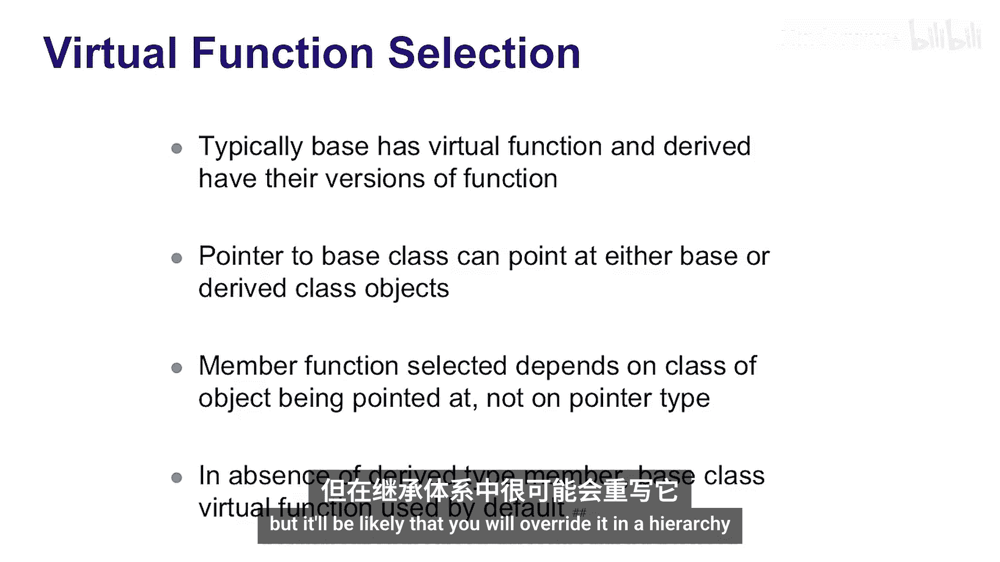
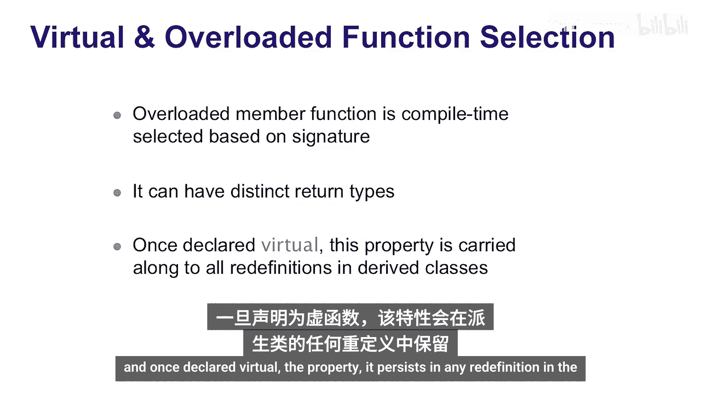
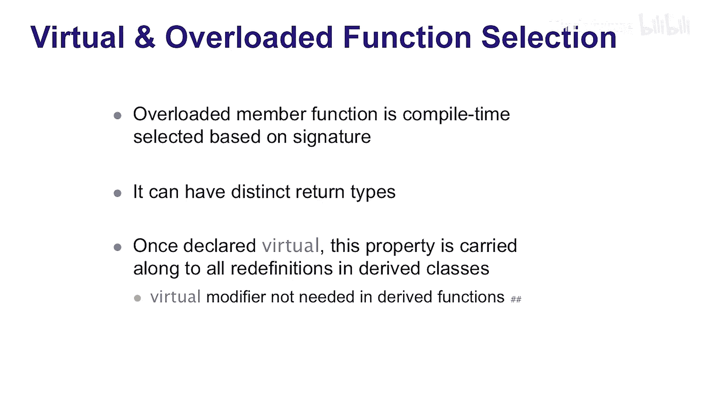
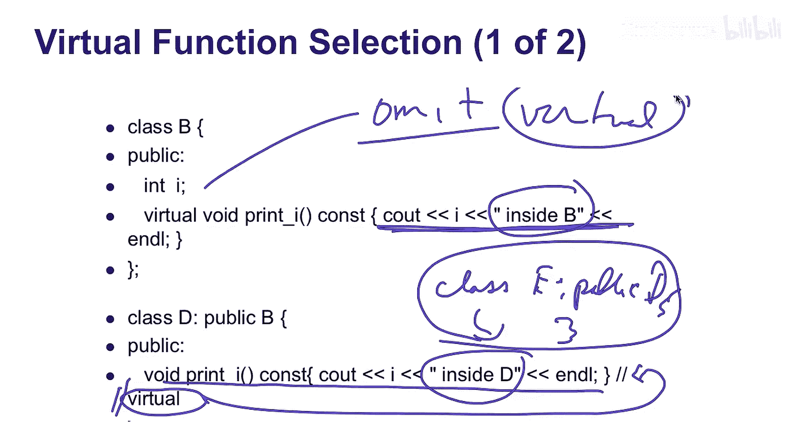
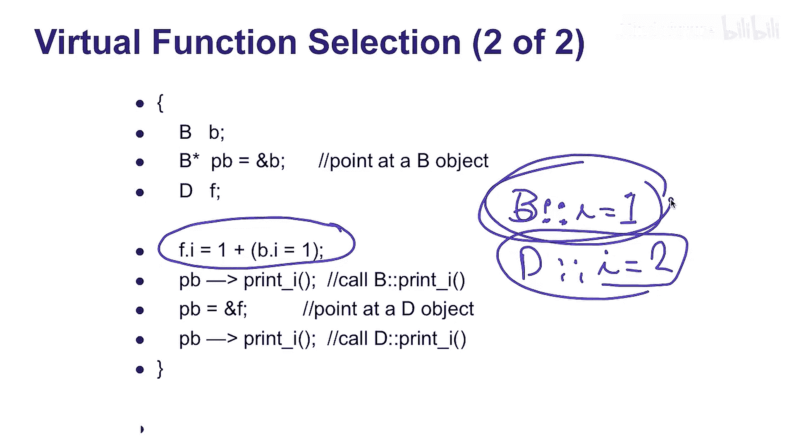
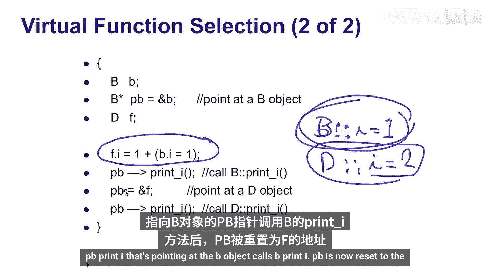
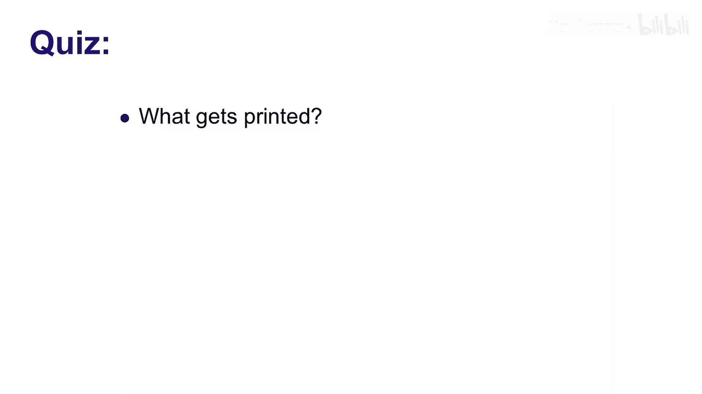
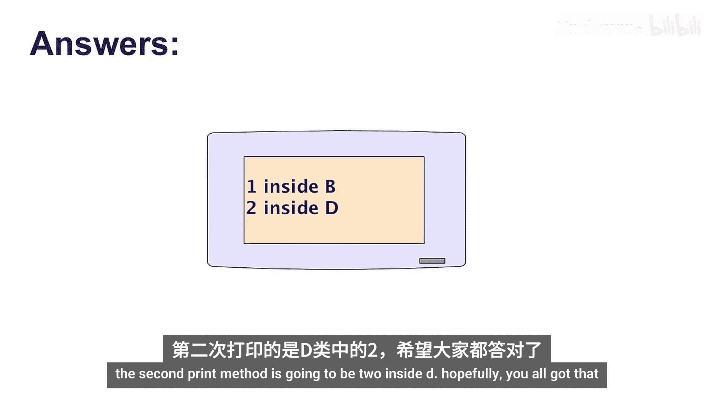
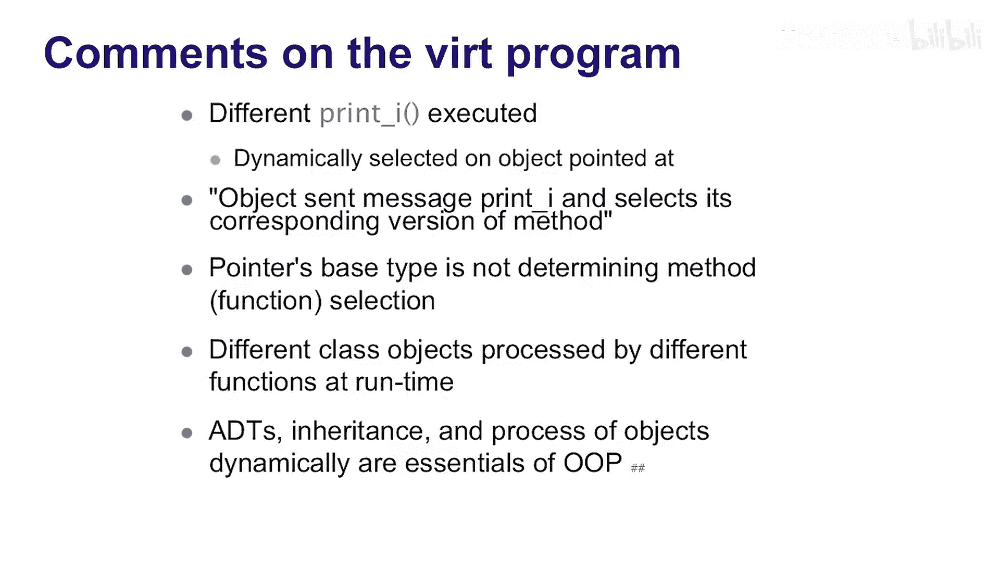

# 【加州大学】C++编程-｜-C-Plus-Plus-B-p29-P29_2-13-虚函数选择_02_06_04--BV1KseJzqEbZ_p29-

Now。Recall in that last little segment。We had print function behavior。

The overridden print function in the derived class got selected。

Based on not the instance being pointed to。But instead， the。Type of pointer。

And if you're used to a language like Java， you're used to。polymorphic response， where its。

The actual instance that determines what function is selected。Sometimes called dynamic dispatch。Now。

 this is， again， an area in which。You're way more sophisticated and complicated in C++ than in some other OO languages。

 some other OO languages are sort of automatically defaulted to virtual function behavior because by the 90% rule。

 that is almost always what you want to happen。So you will find yourself coding using virtual functions in all of your base classes and then letting those virtual functions be overriden into derived classes。

And then the behavior selection will not depend on the pointer type。

 but it will depend on the instance the pointer is pointing at。

So a graduate student will print graduate student information， pure and simple。

Rather than possibly print only student information。

Poiner to base class will again be critical because the pointer to base class will allow you to have universal access to any kind of item in the type hierarchy。

But member function will be dynamically selected。And indeed， there is an efficiency issue here。

 How do you get dynamic dispatch， You get dynamic dispatch by having a table that is looked at at runtime。

 So it asks a couple of。Operations to function call。 In other words， you can't just select。

The right function at compile time， you have to defer to run time。

 The run time is going to be look up the instance。Depending on the type of the instance。

 which is going to have to be stored with the object。You then go to。A virtual function table。

And pick the correct overridden function。The virtual function at the base class will always be used by default。

Absolutely have to override it。But it'll be likely that you will override it in a hierarch。

 By the way， once you make something a virtual function， the virtual property does persist。

 you don't have to continually。

Use virtual function， declaration。Now。There can be a lot of confusion between overloading and overriding。

Overloading means that a member function is compiled time selected based on signature。

And don't forget， this also and affect templates。So templates also are a compiled time。

Signature matching。That the compiler is。Doing your work for you where it sort of says， okay。

 let me match type with the template and then generate uniquely code based on that signature。

So templates。Overloading， overriding all of that is going to。

Be in the mix it can be a pretty pretty messy mix， something that can be hard to follow。

 something that you can have very， very tricky test questions on。

It's possible for virtual functions to have distinct return types。

 so you don't have to keep the return types completely distinct。

 that makes sense because let's say you want student a member function in student to return a student object。

 you certainly probably want in a graduate student to return a graduate student object。

It's not so much that the overriding will be that I want to return an int versus a double。

 It'll probably be only in relation to things like。

The base class object would be part of the return type。

That you would want to have distinct return types。And once declared virtual the property。

 it persists in any redefinition in the derived classes。

So it would be redundant to write virtual that you can。

Maybe that would make it clearer you can， but you don't need to。So here's a very simple instance。

Of virtual function selection， we're again using something like print， we have a class B。

 it has a public member and I， this is just something you can use to play with to see what the semantics are。

So we have print eye being virtual。This is part of the comment。 It's not on a new line。

So this is automatically implicitly virtual if we then had class。He publicly derives。From D。

We continue。Print， eye would continue to have this virtual property。So you might。

 if you want you might want to try doing yet another level of derivation to understand this better。

So notice what I'm saying here in order to get you to understand what's happening。

 here we're going to say print I's value inside B， here we're going to say print I's value inside D。

So this is something you can run on your own system and you should see how the virtual function behavior works。

And you could compare it to。Omitting。And see what the behavior would be if it's omitted。

Here's where we call these objects。

So we have a base object。We have a pointer to a base class， we have a derived object。We said。

So the B object。The I inside of the B object。That's going to be one。

And the eye inside of the D object。That's going to be two。

PB。Print eye。That's pointing at the B object calls B print I。

BB is now reset to the address of F points at the D object。

And now， because of virtual。Uses the redefined print method。

 the overwritten print method that's found in the derived class。So what would get printed？

You can either run the program or follow what I've just said， hopefully it was clear enough。

 but if it isn't clear， run it。And indeed， try it where you've omitted virtual just to make sure you really understand。

 if you understand that foundationally， you'll understand everything you need to know about polymorphism and dynamic dispatch。

And here's the answer。The first print method is going to be one inside B。

 the second print method is going to be two inside D， hopefully you all got that。

Two different prints got executed。They were dynamically selected at runtime by the object pointed at by the pointer。

Sometimes an OO speak， an object oriented speak， which was largely pioneered like people like Adele Goldberg at Sirerox Park。

We had things like objectject got sent the method print I and selects the right overridden version of that method。

The Boyner base class is not determining the method in vocation。Remember， grad student print。

And student print。In that case， we had virtual omitted。

So you can go back to grad student and student play with that and make print virtual and you'll see different behavior。

So you are going to get different behaviors based on runtime decisions that is going to lead to a slight overhead in virtual function activation。

All of these ideas， the notion of abstract data types， the notion of inheritance。

In the process of object instances dynamically， these are all the essentials of object oriented program。

 So hopefully if you've had a weak background in object orientation before this class。

 this is going to strengthen。

Conceptually strengthen。How you understand object joint programming， but as I said。

 you're already supposed to have some of the ideas and it's very worthwhile reading some more about them。

