# 【加州大学】C++编程-｜-C-Plus-Plus-B-p30-P30_2-14-与重载的混淆_02_06_05--BV1KseJzqEbZ_p30-

Remember， I promised to explain a little bit about confusion with overloading。So member functions。

Can be overloaded， meaning they can be given different signatures with different meanings。So。

Here we have traditional overloading。These are the signatures。Which gets activated， is based on。

The signature， if something is class B。So here the signature is an int。

And we would pick out that method。And otherwise， we would do something like beef， food。If we had 2。

5 and we'd use a second method and that's overloading based on signature matching。

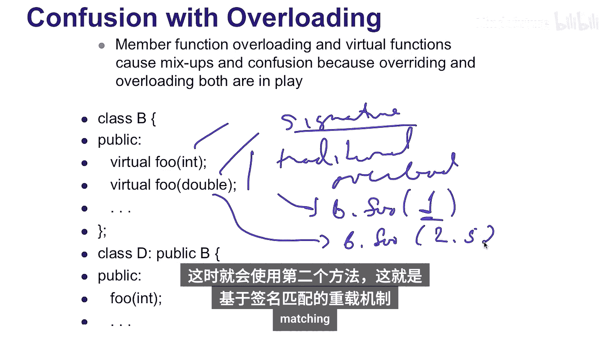

Done by the compiler at compile time。But here we have these things as virtual。

 So they also are overridden。 So in the derived class D。

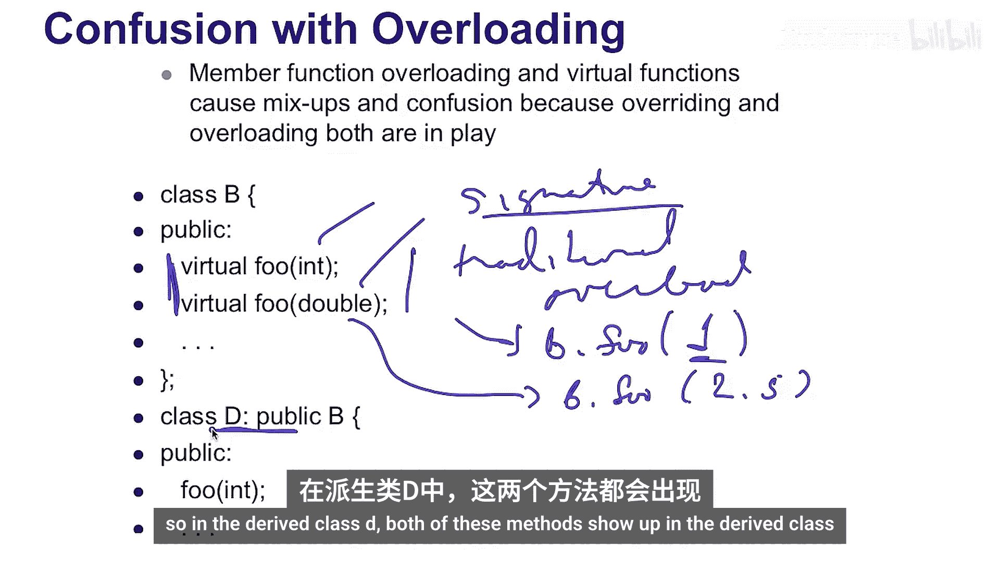

Both of these methods show up into the drive class。But here， we've only。Reefined one of them。

And this is where we get into trouble because now in a derived class。Both methods got brought in。

 but now there's an effect。A base class and derived class。Fu event。

But only a base class full of double。And so we can get very confused about whether the overridden full of double is used。

Or an overloaded。F of int is used。Generally， this should just be。

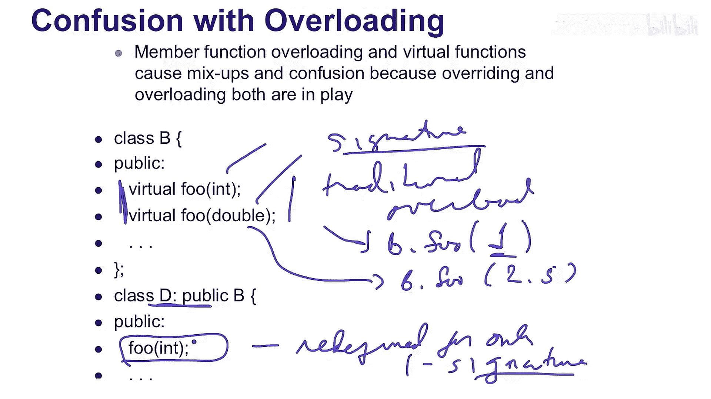

Avoid it by not having this kind of inconsistency in your design。

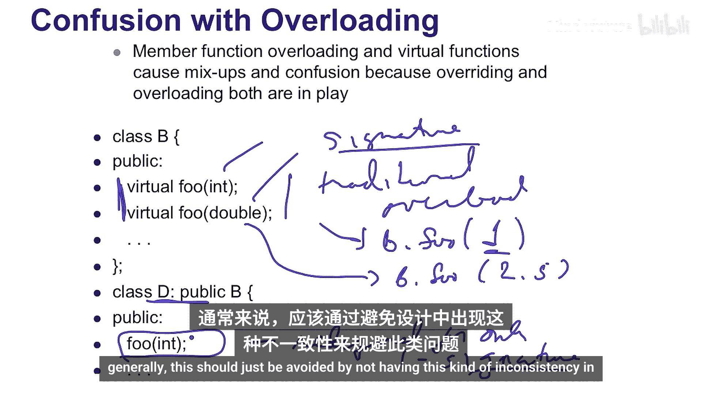

It's legal。

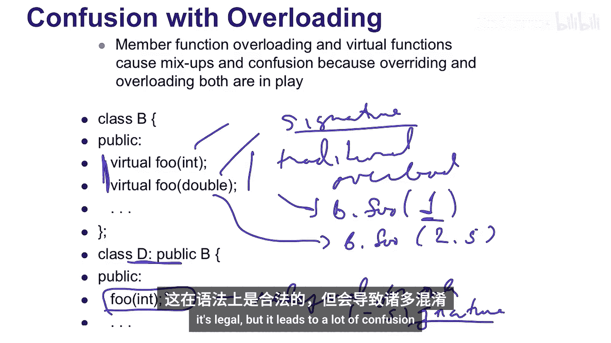

But it leads to a lot of confusion。

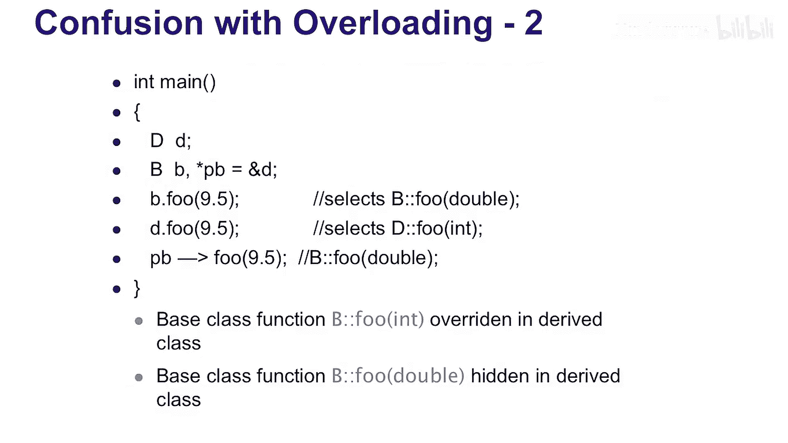

So if you were to try the following。

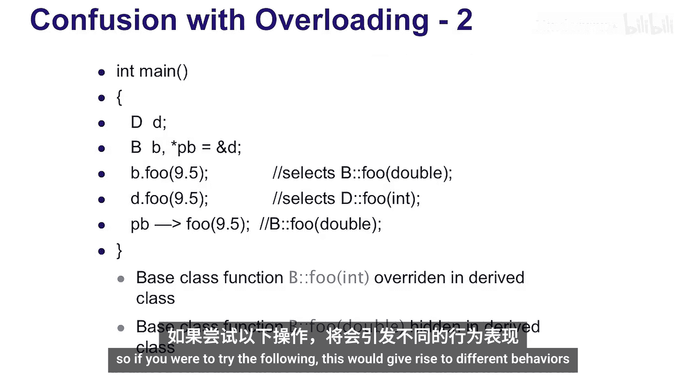

This would give rise to different behaviors。And you can see it with the different pointer types。

And I'll leave it to you to go off and play with this example and even extend it and try and make sure you understand。

Which happens？Based on overriding versus overloading。

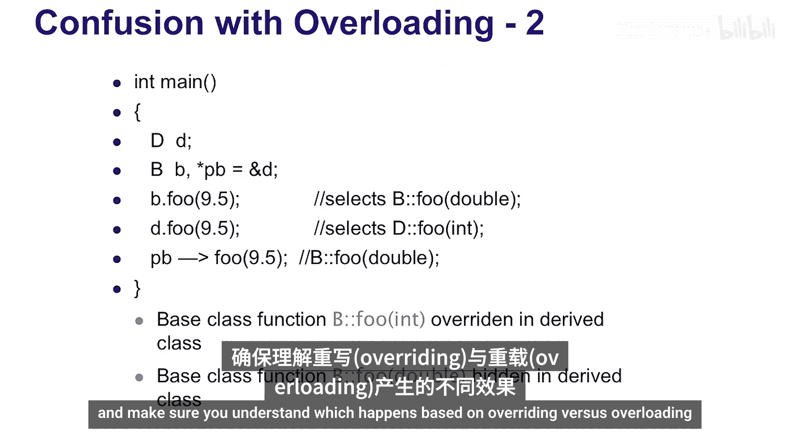

When we use virtual functions。We can only use them with nont member functions。

 remember we can have static member functions， but what is a static member function。

 it's one that's not attached to an instance。So if it's not attached to an instance。

 it doesn't have a this point or argument， if it doesn't have at this point or argument。

 there's no way of selecting it dynamically at runtime。It's not attached to an object。

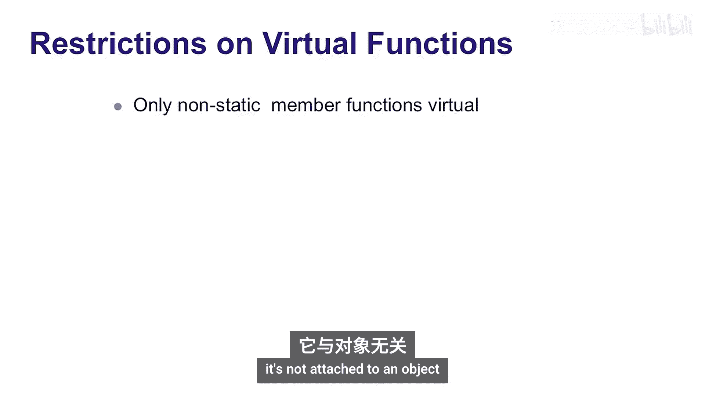

So it makes perfect sense that static methods。which are sort of universal methods to the class and not based on instances。

 could not have a virtual behavior。The virtual characteristic is inherited。

 so it persists without needing to write it out。And constructors can be virtual。

 so generally automatic virtual works for。All kinds of members， but not for constructors。

 but will work for des， so des can indeed be virtual and that's indeed a very important。Case。

 most of the time when we have type hierarchies。We will want the des to be virtual。呃。

Because the constructors cannot be virtual。There's an artificial means。The end of the course。

 I'll talk about this。There's something called a factory pattern。That can produce。

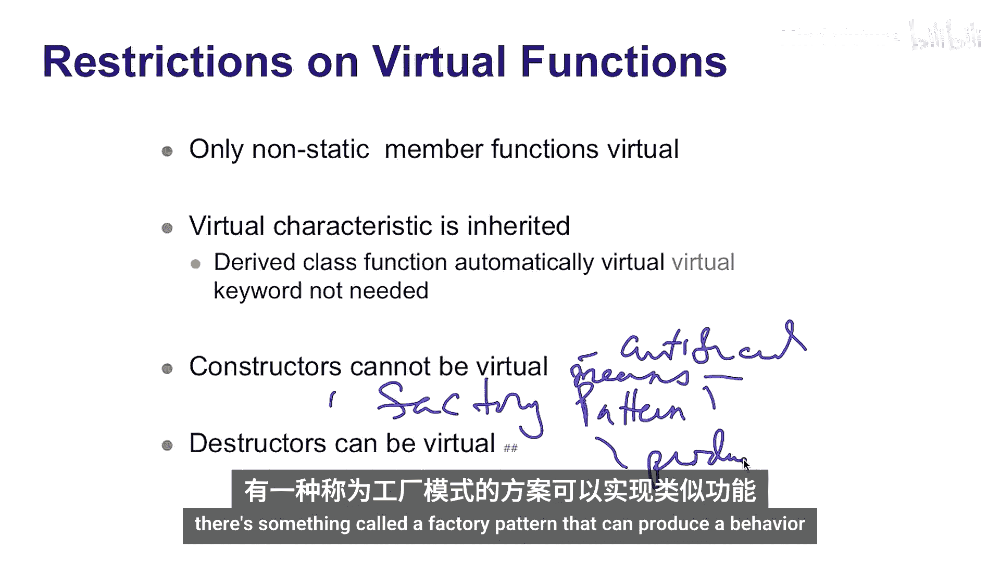

A behavior。It's like a virtual。Instructor。

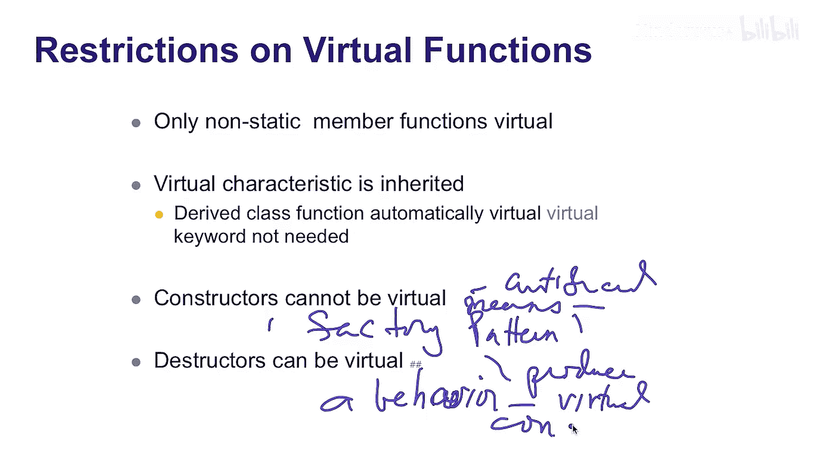

So it's not that virtual constructors wouldn't be useful。

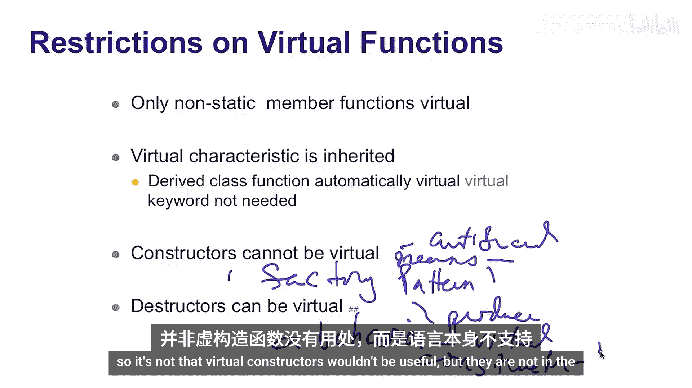

But， they are。Not in the language， but the idea of them。

Can be coded in the language using something called a factory pattern。

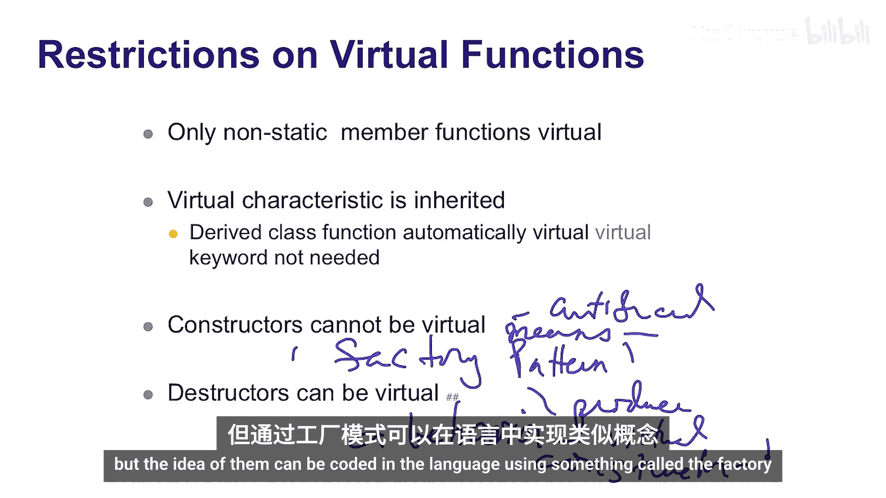

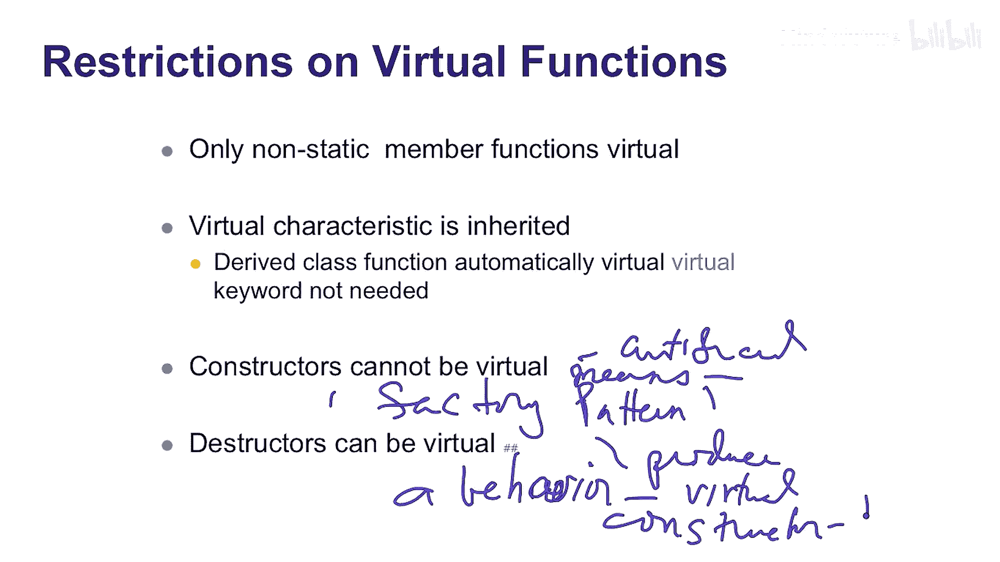