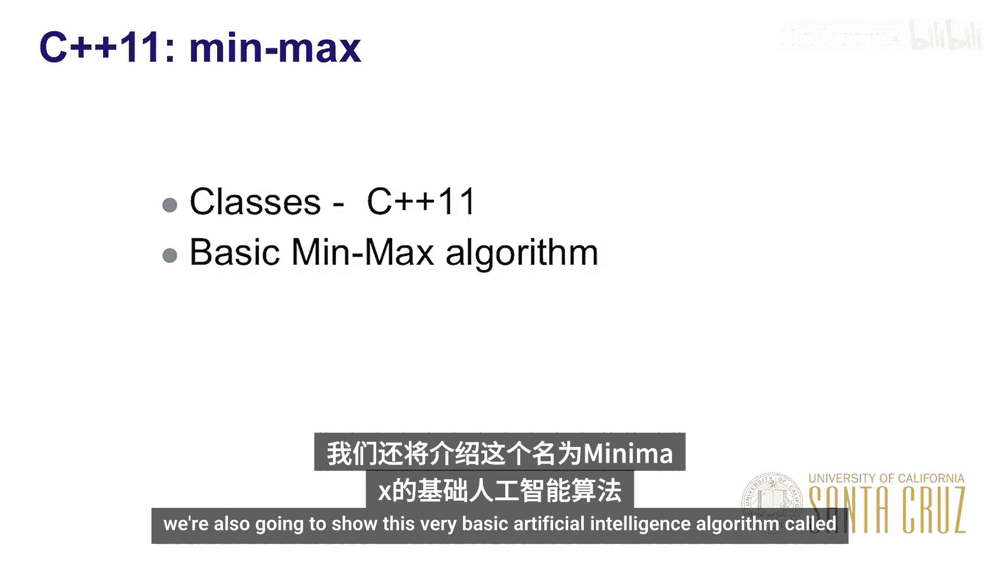
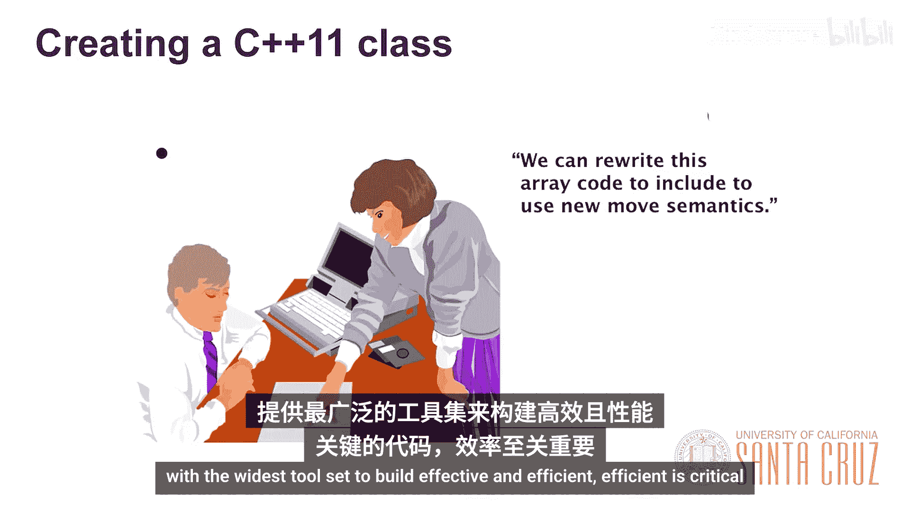
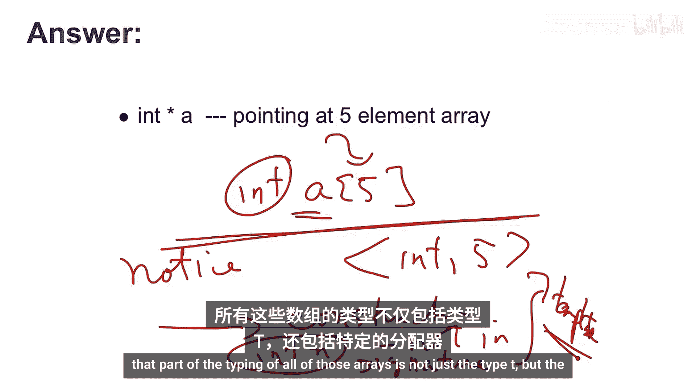

# 【加州大学】C++编程-｜-C-Plus-Plus-B-p31-P31_3-1-创建C++11类_03_02_01--BV1KseJzqEbZ_p31-

🎼The。🎼，🎼拜。

Okay， now today we want to look at。Some more algorithms for building our AI into our heX program。

Remember our term project？We're going to use all our technique to really have a first rate。

Hex playerer and Minax is the basic algorithm for doing that。 And then we're also going to show。

Remember， we did a lot of the last few times with inheritance， but now we want to show how C++ 11。

 the new standard。Is going to influence how to build those classes。

 so I want to look at some critical new features that'll affect your coding style。

 if not already in the next couple of years， so hopefully you already have a compiler capable of compiling C 11 code。

 C+ plus 11 code。But if you don't， you'll shortly be able to。

So we're going to show some of the major effects of the new standard on class design and class coding。

And we're also going to show this very basic artificial intelligence algorithm called the Minmax algorithm。

All right。One of the very biggest deals and no question， even if you came into this class。

Knowing a fair amount of C++ or Java， this is going to be entirely new。

It's entirely new because the ideas in it are actually new ideas。At the high level language level。

For most languages， and this is something calledMo semantics。So recall。

 C++ is about providing the professional。With the widest tool set to build effective and efficient。

Efficient is critical。 Eic code。 we are not。A interpretive system。 remember， Python Lisp。Java。

 they were based on interpreters。Interpreters are another layer of software that comes between you and the machine。

 and therefore you're not using every cycle。And solving or executing your algorithm。C plus plus。

Grow out of sea a system implementation language， which was not meant to hide。The hardware。

 the metal。So this is supposed to let you put the pedal to the metal， as they say。

 and write the most efficient code。And Mo semantics are a new idea to get you even more efficient。

 Now， most of you may not need to use Mo semantics because largely Mo semantics were incorporated to very much improve the libraries。

 especially the standard template libraries。But we're going to get some ideas there。

So the code I'm going to look at is code that's going to allow you to design a sequential container class and the sequential container class is a class。

That。Is already in C+ plus 11， it's called the array class。

 and it allows as a template that you can specify a template。That， in effect。

 is a fixed length array。Now， why should you want to do that， you already have a vector。Well。

 a vector is an expandable length container class， an expandable sequential container class。

That gives you a ray like semantics。It gives you more stuff。

You don't get that extra stuff without some price。So generally speaking。

 while you get more flexibility with。A vector， than you do with an array。It comes at a cost。Now。

 of course you can go back to what might be called the native array class。

 your basic allocated array， one dimensional array in C。However， that one dimensional array。

doesn't get you a lot of extra stuff。It's very raw。

So you have to discipline yourself to not have off by one arrow。To not have。Addressing errors。

So this kind of array class， fixed length array。Gets you something intermediate。

 it maintains the high level of efficiency of a raw array， but gives some extra functionality。

We're going to see how to design our own version of that。

And we want to see what Mo semantics will give us when we are typically move semantics are used for things like container classes。

 for things in which large aggregates are going to be stored。So instead of array。

 I'm going to do my primitive form of array， I'm going to call it my container。

 it's going to be a class template。And notice that。 it has。Two template arguments。Right。

It's going to be a template again， it's just like。If you want something like this。

 include sharp include array， and you will get a fixed length array。This is。Again， a C plus plus 11。

STL feature。And we're seeing how to build that。We have two parameters。To the template。

One is the type to be stored。So here's a base pointer。Have it private。And the other is a size。

The fixed size。My instructoror。should really have。The signature should have been in end there。

Because we want the size of our array to go in there。And we don't have it defaulted。And then。

Traditionally， we want to be good citizen。 And so the destruct recall again that since we are。

Allocating an array of objects。 we decate using the。The lead。With the brackets。

 that means delete an array。So what's going to be built here is an array of a particular size。

 if N is 100， we're going to have T star。Of a and effect。It'll have 100 elements there。Right。

And it'll be whatever type this is， so it could be like an integer array or a double array。

Or an array of。Whatever we want it to be based on the template structure。Okay。

 so given that piece of code。What would the declaration of。My container。Data end of5 produce。

The answer is。It would produce basically some array where。I had five elements。

Those elements were ints that were being stored。A A is the pointer to the base of that array。Notice。

That since declaration is going to involve int and five。I made a mistake about that constructor。

InAnd was not in the signature。Had forgotten。It was actually a parameter to the template。

So hopefully you've all caught that。But that was。Useful mistake that I made。

So here we had a parameter。That wasn't a type parameter。

 it was an actual parameter of an insger type， and that is part of the typing。

So that's another thing critical to this。That part of the typing of all of those arrays is not just the type T。

 but the specific allocator。

The specific size of the allocated array， so a size。10 array integer is going to be different。

 a different type than a size 20 integer array。That's different again than a vector。

 and it's different again than the native pointer types in C。

