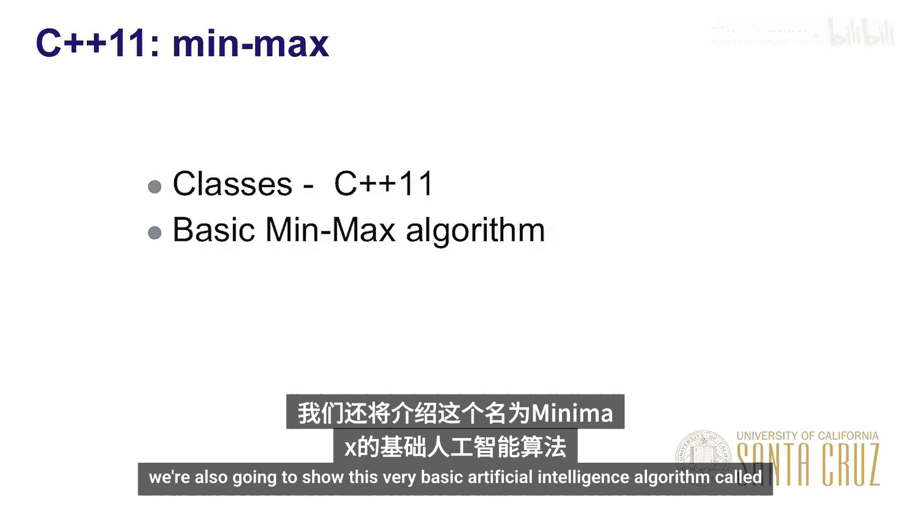
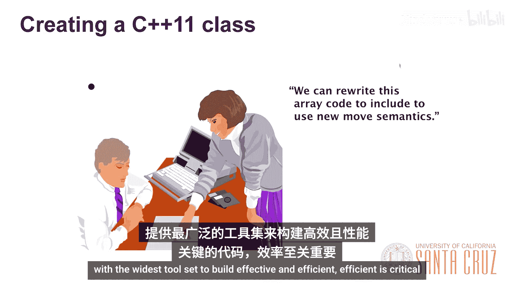
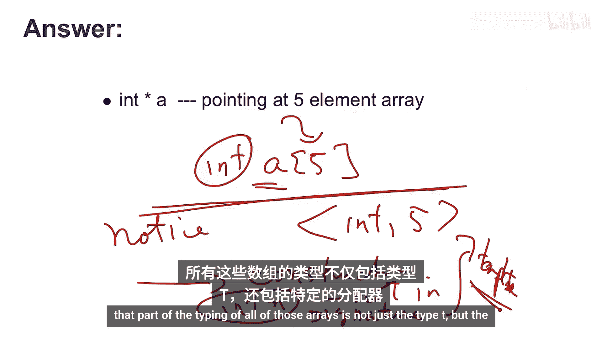

# C++编程：P31：创建C++11类


在本节课中，我们将学习C++11标准中影响类设计的关键新特性，并探讨一个基础的人工智能算法——Minimax算法。我们将重点关注移动语义如何提升代码效率，并通过构建一个简单的固定长度数组容器类来演示其应用。



---



上一节我们介绍了课程的整体目标，本节中我们来看看移动语义这一核心新特性。

## 移动语义

移动语义是C++11引入的全新概念，旨在帮助开发者编写更高效的代码。C++的设计哲学是为专业人士提供最广泛的工具集，以构建高效的程序。与Python、Lisp或Java等基于解释器的语言不同，C++源自C语言，是一种系统实现语言，其目标是不隐藏硬件细节，允许开发者充分利用计算资源。移动语义正是为了进一步提升效率而引入的。

虽然许多开发者可能不会直接使用移动语义，但它已被深度整合到标准模板库（STL）中，极大地改善了库的性能。移动语义尤其适用于处理大型聚合数据的场景，例如容器类。

为了理解移动语义，我们将尝试设计自己的顺序容器类。C++11 STL中已经提供了`std::array`类，它是一个固定长度的数组模板。你可能会问，既然已经有了`std::vector`，为什么还需要固定长度的数组？`std::vector`是一个可扩展长度的顺序容器，提供了类似数组的语义和更多功能，但这种灵活性是有代价的。相比之下，原生的C风格数组虽然高效，但非常原始，容易导致“差一错误”或寻址错误。固定长度的数组类（如`std::array`）则提供了一个折中方案：它保持了原生数组的高效性，同时增加了一些额外的安全功能。

我们将构建一个自己的简化版本，称之为`MyContainer`。它是一个类模板，有两个模板参数：一个是存储的类型`T`，另一个是固定的大小`N`。

以下是该类的部分代码框架：

```cpp
template <typename T, int N>
class MyContainer {
private:
    T* data; // 指向数组基地址的指针
public:
    // 构造函数应接收大小N，但注意：N是模板参数，而非构造函数参数。
    MyContainer() : data(new T[N]) {}
    // 析构函数
    ~MyContainer() { delete[] data; }
    // ... 其他成员函数
};
```

请注意，构造函数本应接收大小`N`，但这里`N`是模板参数，因此它直接用于`new T[N]`的分配。析构函数使用`delete[]`来正确释放数组内存。

基于这段代码，声明`MyContainer<int, 5> data;`会产生什么？答案是它会创建一个包含5个`int`类型元素的数组，`data`是指向该数组基地址的指针。

这里有一个关键点：模板参数`N`（一个整型值）是类型的一部分。这意味着一个大小为10的整型数组（`MyContainer<int, 10>`）与一个大小为20的整型数组（`MyContainer<int, 20>`）是不同的类型。它们也不同于`std::vector<int>`和原生的C风格指针类型。

---



本节课中我们一起学习了C++11的移动语义概念及其对效率提升的意义，并通过设计一个固定大小的容器类模板，了解了模板非类型参数的使用。下一节我们将深入探讨Minimax算法及其在AI中的应用。