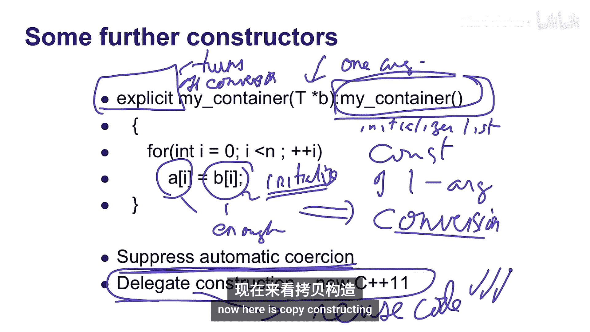
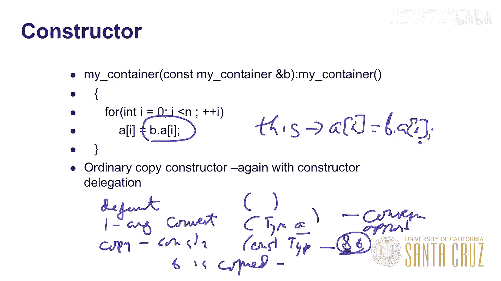
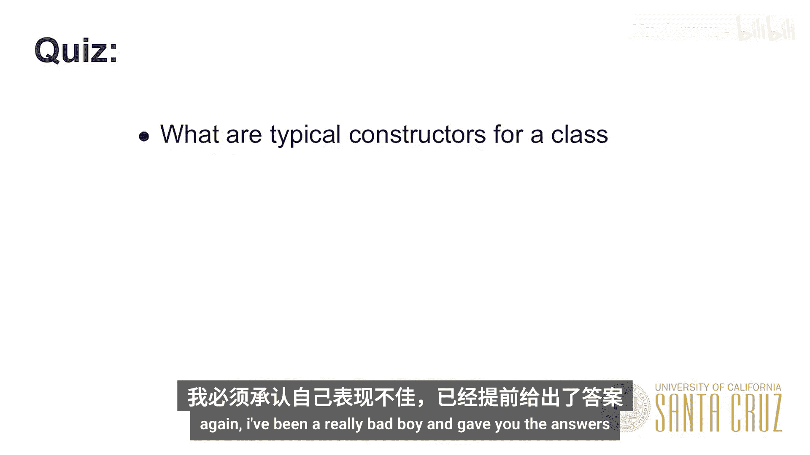
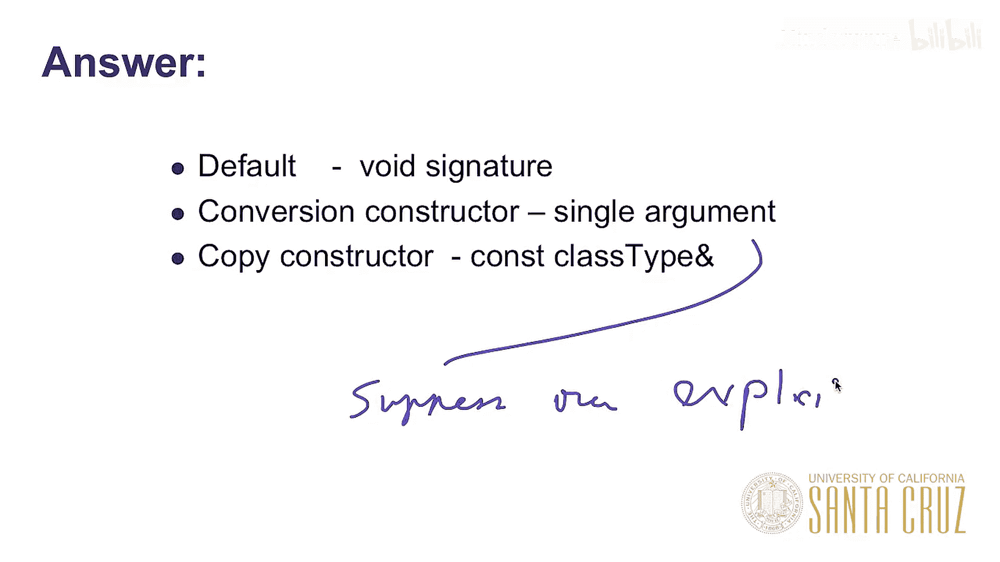

# 【加州大学】C++编程-｜-C-Plus-Plus-B-p32-P32_3-2-一些进一步的构造函数_03_02_02--BV1KseJzqEbZ_p32-

Here's the constructor。What does this constructor do？It shows a couple of things that are。

New to C++ 11。And。Recall。This is a single argument。If we have a constructor of one argument。

Typically， we have a conversion。Express it。Turns off。The conversion。So remember。

 conversion opportunities。Are very important to the C++ language。

 they're a huge part of the polymorphism of the C++ language。

But we don't want conversion silently happening。Every which way。

So we did not have an intention that an arbitrary array of things。This is a means to。Initialize。

What this constructor is really intending to do is to initialize from some preexing array B。

To an existing my container whose underlying contents will be stored in。Appointed at by a。

And we're assuming that we have enough values。And we want to suppress automatic conversion。Now。

 the other thing that's really new about this is we have something called De construction。

That's occurring here。That couldn't be done in old C+ plus pre C+ plus 11。

This is saying as part of the constructor。This looks like a based derived class idea。

So the old idea based derived class now can be used in the initializing。Initializer list。This says。

 make use of an already defined constructor for this class。

 namely the deor that builds the default of the class。 What was built in the default。

 There was an allocation from new of an elements of type int。So we reuse code， this is code reuse。

Reuse code， very， very good。So it's code sharing， code factoring， all good things。

So that's that delicate idea。That is now allowed in C+ plus 11。

Now here is copy constructing。And this is the ordinary copy constructor， so recall。It should be。

What are our standard constructors when we go to build classes？Default。

That's where the signature is empty。One org。Or conversion。That's where there's some type。

And it provides a conversion。And then copy。And that's what's shown here where we have const。type。

Blah， Ampersan。Reference2。And this thing， B is copied over， B is copied。

So these things tend to be always the universal things we think about when we're building our new class。

And here's what the semantics might look like， we take the preexisting B dot A of I。

And copy it into the this pointer。This is really this。Pointing at a of I。Is equal to B dot A of I。

And that's where we're getting our copy。So that's traditional copy constructor。

What are typical constructors for a class？Again， I've been a really bad boy and gave you the answers。

 So if you're paying attention。

You just got to tell me what we just talked about。Default， void， signature， conversion。

 single argument。Again， recall that we can suppress conversion。We want to suppress conversion。

We use explicit。

