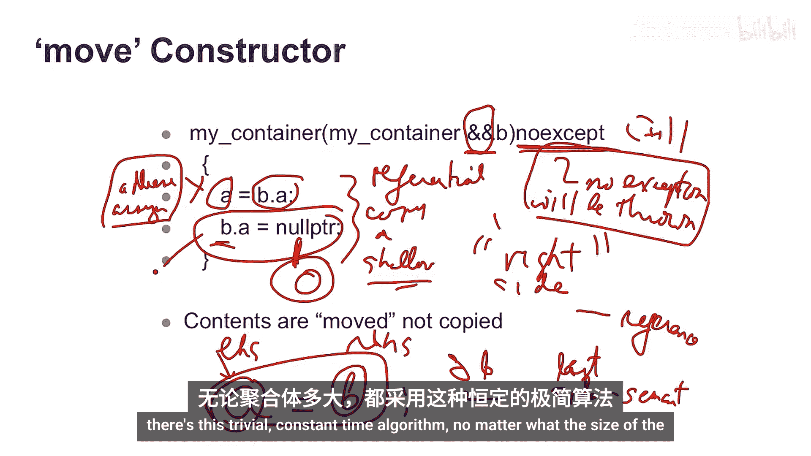
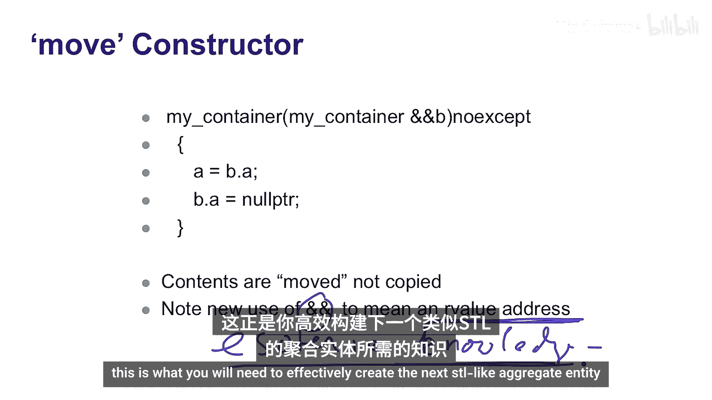
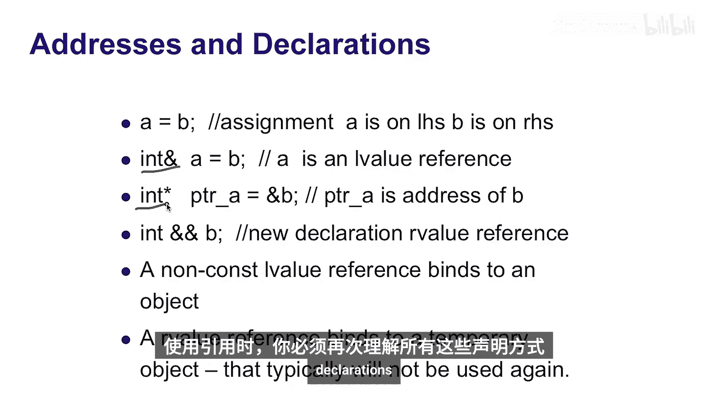
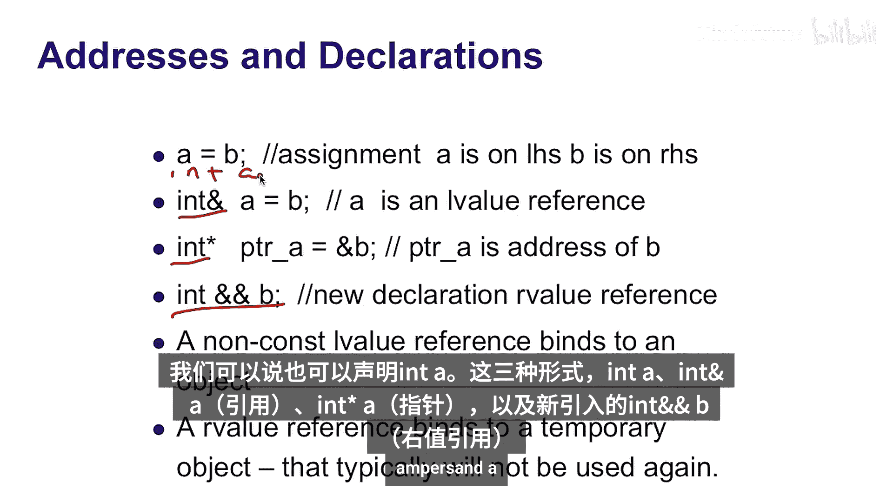
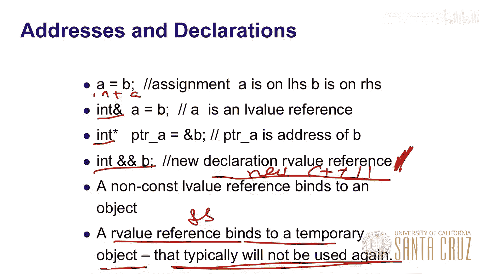
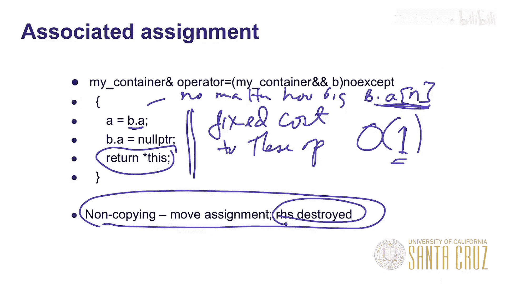
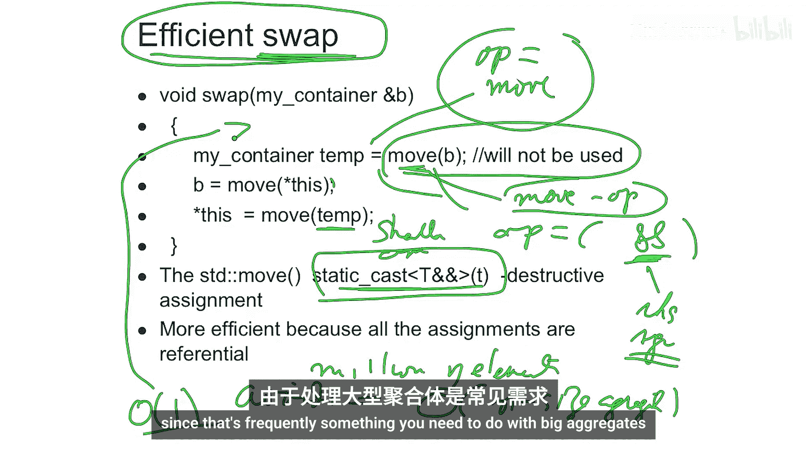
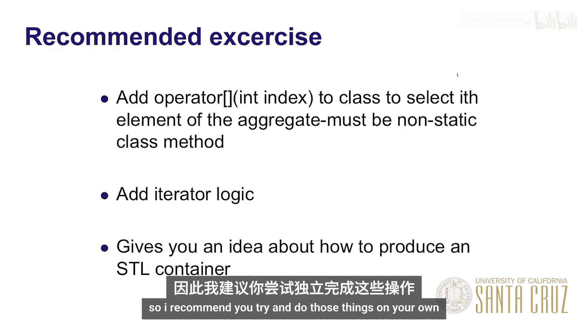

# 【加州大学】C++编程-｜-C-Plus-Plus-B-p33-P33_3-3-移动构造函数_03_02_03--BV1KseJzqEbZ_p33-

And now we're going to have yet a new and surprisingly interesting。New idea in C+ plus 11。

It's going to be called the move Conor。And lo and behold， you're going to get some more。Completely。

Confusing syntax。So again， one of the hallmarks of the great CNC+ programmer is we have one of the most obscure esoteric languages。

 and here's yet more esotea， so for anybody who really loves this kind of language。

This is a great addition。What's going on here？What's going on is you can now use double ampers set。

And it no longer means。Reference to， instead， it means。啊。What might be called right side reference。

So the traditional ampersand of B is what we call。A left side。Semantics。

And what you have to think about is a equals B。When you have an expression A equals B。

 this is the left hand side， and this is the right hand side。And they mean different things。

 the B over here and the B the A over there mean two different things。

So this has a different meaning to the ordinary copy constructor and adds now something called the move constructor。

And let's see some of the ideas。First off， I'll just explain the no accept keyword。

 another C+ plus 11。And this just means that I promise no exceptions will be thrown。

I do not want exceptions thrown with this constructor because it would lead to a big mess。

It will be too hard to clean up。So I'm going to promise that I won't do anything that'll create an exception。

Now， this stuff is what we call referential copying or shallow copying。Notice what happens。

The new A points at the material in the old A。The old A， which was really the B of A。

Is going says again， null pointer。 null pointer is what we used to use as a zero。 The null pointer。

 again in C plus plus 11 is a special key word that's universal and meant to be the null pointer。

Special value， the universal special value， meaning null pointer or the zero address。

And it's more typea than just using an ordinary zero， you could' use an ordinary zero there。

So by referential copy， it means what was in B is moved to a， what was in？B disappears。

That's why it's a shallow copy。B disappears， B is made no。A retains the information。

 what happens in this instance？Well， this is very efficient。

 Let's say I had a million elements sitting in。B。How many operations am I executing？

I'm executing a simple address。Assignment。So I have a single assignment operator here。

So there are a few cycles on a machine。And then a second assignment， access。

 so I have two very simple assignments。They're typically going to be executed at machine level with low store。

So they're going to occur。In nanoseconds， there'll be a few nanoseconds。

 so I could have a billion elements。Sitting in memory。

And the copy is occurring in a couple of nanoseconds。

 it's not occurring proportionly to how large an aggregate are moving。What's the price I paid。

 The price is， I have to know。That the old name for the thing。It's no longer applicable。

It's like I gave this thing a new name， I moved it。I didn't recreate it。 I didn't clone it。

 I moved it。The ordinary copy constructor clones it。The old stuff is retained。

 remember in the pre existinging copy constructor， I had a big force statement that big force statement acts proportionally to the size of the aggregate。

So move semantics。Are extraordinarily efficient。It is trivial。Constant time。Algorithm。

No matter what the size of the aggregate is。So， again。One thing that you now can take away。

Is our value semantics， and that's your new piece of esoteric knowledge。And indeed。

 if you really understand this。You're going to be very。

 very valuable to a company that wants to do SL like libraries。

 This is what you will need to effectively create the next。StL like aggregate entity。

Here are some of the things to review to really understand Mo semantics。呃。Addres and declarations。

You have to really understand what is it when you write in C or C plus plus A assigned B。

On the left hand side。We have a。 that really means an address of。On the right hand side， you have B。

 that means the value stored at。And you get the values stored at B。

Assigned to the item whose address is being pointed at by a。

So A and B are not symmetric when you have assignment。

 It's not a mathematical operation that's going on here。

 It's what in computer technical talk is a side effect operation。

And it's indeed what makes these kinds of languages hard to debug。When you use。Reference。

So you again， have to understand。All of these kinds of declarations， now there is yet another one。

We could say that we could also have int A， all three of these things， int A。

 int ampersand A in star。

Pointer A int ampersand， Ampersand B， which this is the new one。All have important different uses。

And when we use this new R value reference。Think of it as binding to a temporary object。

And that object is going to go away。 It will not be used again。 It's going to go away。

 That's when we want it used。Otherwise， we want to stay with what we had in the sea world and in the early C++ world。

Now， when we have move semantics with a move constructor。We almost always also add to our class。

 so this is again， telling you how to build your new C11 classes。

 you also typically want to overload the assignment to have move semantics associated with assignment。

We're going to see why and this is a non copying move assignment where the right hand side gets destroyed。

So。Again， look at this。It's a fixed cost to these operations。

In technical terms is what we call constant order one。Efficiency。

So we do an assignment of a from the preexisting B， no matter how big。

D dot a of n could be very large and could be。Whatever size it want to be。

 but all we're doing is assigning。A base pointer value。 And then we。

Get rid of the right hand side through the null pointer。And then。

Because the assignment operator can be used repeatedly， we return the de referenceenced object value。

 the this pointer value， and this is a non copying move assignment with the right hand side being destroyed。

So again， take away。If I'm building with move semantics and I'm building a big aggregate。

 I'm not going to use this for a non aggregate， wouldn't make sense。

It was then copying an assignment。They're， in essence。The same whether we。

 if we have a simple aggregate， like a single inth。There is no value to using Mo semantics。

There wouldn't be， you wouldn't get any efficiency out of that。

Let's see where all this sufficiency can work。And this is the classic case。

It's going to be an efficient sense of swap。So we're always swapping things。Quick sort， Quick sort。

 we swap two elements continuously to get a sorted order。

Swaing is one of the foundational operations you find。In algorithms。Now。Generally speaking。

 when we're swapping two simple values and A and B。It's a fixed amount of computing cost。

We tend to have a temporary。We assign to the temporary the value of the first object。

 then we reassign the first object value from the second object so the temp is holding the original value。

 and now we use the original value and assign it to the second object。

So that's why we need the temporary。We can't instantly interchange the two objects。

We could if we were like in the old。Genie movies or genie TV series， you know。

 you could sap your fingers and they both jump into the other box， that doesn't happen。

In the real world and the sea world， you need this intermediary。 So first copy it。

Place it safely here， now do the interchange from one。

 now take the copied thing and do the interchange， and that's a fixed set of operations on a simple data type like an int。

But now if we have a huge aggregate。Where do Mo semantics show up？Move semantics。

 let us get rid of the efficiency of using this little temporary box。

Because we know that what's placed in there has no final use so it can disappear on us without cost。

Perfect for semantics， so let's think about that。We move。And by using the。Move。Operator。

That means that this equals is now going to use。The overloaded up equals move semantics。

 that's what this does for us。This basic move is actually。啊。A disguised way of saying that。呃。

Operator equals is going to use。The right hand side signature。So。This gets moved into the container。

It's going to disappear。B is now moved with the original what you might call A。And then， a。

Gets the value that got placed in the temporary。Everything gets done via shallow copy。

So something with millions of elements。Avoids。Proportal to N the size of the aggregate。In the swap。

For each of these steps。That's a great， great saving。Here， by the way， you can see what the move。G。

I iss really using， it's really using that kind of cast to get you the right type。

All the assignments are referential， meaning they're all order one， they're all order one。

This is an order one swap routine。That's just a fabulous saving since。

That's frequently something you need to do with big aggregates。

 and SD D L library is littered with big aggregates。

 And now that we have all this big data that we're processing continually。

 this is going to lead to highly efficient code。

So it's a really great improvement。Okay。Let me recommend some things for you in order to test out these very novel ideas。

Take the my container array and try to modify the code。

And try and overload it so that you can select out an element。And when you go to overload this。

It has to be overloaded as a non static class methods。K to。Overloading operator selection。

Add iterator logic into my container。This will again give you some sense of how to build an SDLite class。

Okay， so that I recommend you。Try and do those things on your own。

