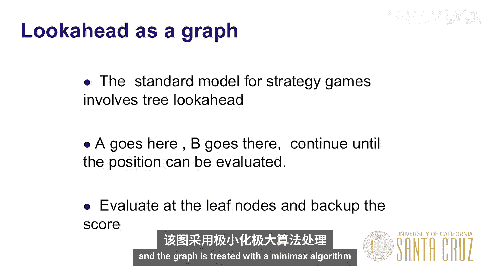
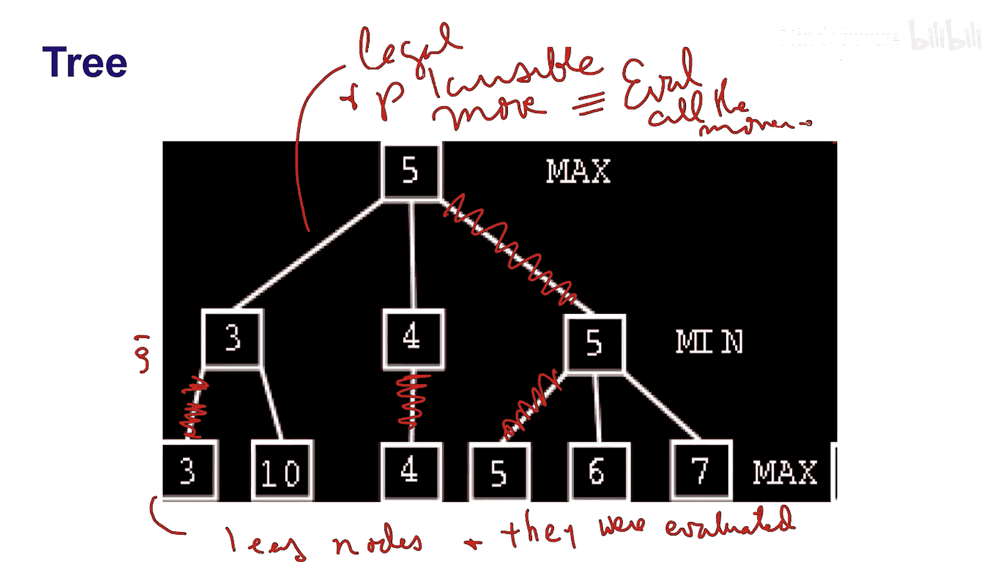
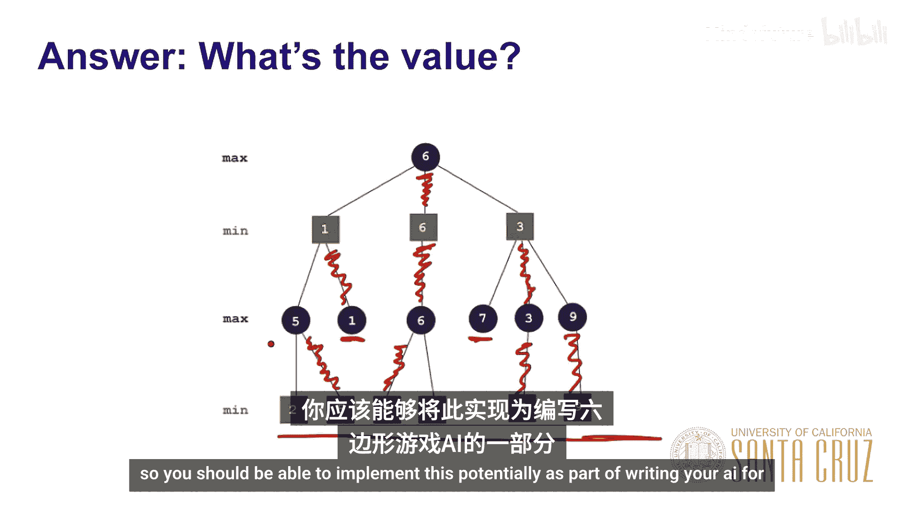

# 【加州大学】C++编程-｜-C-Plus-Plus-B-p34-P34_3-4-前瞻_03_03_01--BV1KseJzqEbZ_p34-

So we're going to delve into。How to build an AI into these game playing programs such as X。

They're critical。To making the games interesting， to have an automated opponent。That can play well。

And。A huge part of that in these very complicated games that can't be solved。

Is to have some form of look ahead。And the basic look ahead algorithm that we're going to investigate is called the Minax algorithm。

This is the standard model for many strategy games。So if you're playing chess or checkers。Backgammon。

There's a notion of there are two players， a player A， the player A goes somewhere。

And then B response。And then you continue until the game is over。Now， when you have。

An artificial intelligence， or for that matter a human intelligence。

How do you decide what move a should make？A。Has。A choice of however many legal moves are available on the board。

 and that could vary quite a bit can vary from。American checkers。

 which generally has 20 or less moves。Chess games and where the average in the middle game position is about 40 moves。

To go。Where in the middle game。There's well over 200 moves。

Each of those moves can't necessarily be investigated or evaluated readily。

 and so there have to be means in the AI to suggest what's called a plausible move and then think about what your opponent's going to respond and then have some means of evaluating the result。

And that's what I call a standard view of doing a strategy game。And all of that involves。

Look ahead and the look ahead is in a graph and the graph is treated with a miniax algorithm where the endpoints of the algorithm and the endpoints of the tree。

Are evaluated with。Either the game's known result， if you could go to the end of the game like you could readily in simpletic O or。

In cases like chess or checkers， there might be a way of。Coming to a position。

For which you can apply very good judgment。And in that position。

 you give what's called a static evaluation， and then those evaluations are backed up to select what your best move is。

So here's such a tree。Classically in the Minax。Ci。These are notions that go back to the middle of the 20th century with people like Van Neuman。

You have a maximizer， the maximizer is assumed to be a rational player。

 the maximizer is trying to make a move that gets a maximum payoff。The opponent is a minimizer。

So the maximizer is trying to win the game， the opponent is trying to win the game。

 the maximizer wants to make a move that wins， the opponent wants to defeat that move and make the player lose。

So there's this asymmetry， maximizer is going for a larger score。

 a minimizer is going for a smaller score。So here's a tree in which maximizer has。th3e。Branches。

And those branches have， in turn。Further moves， those are the leaf moves， so on the bottom。

We have what I'm calling the leaf nodes。And we got a value。

So here we see the maximizer could have a three or a 1。The minimizer looking at a three or 1 clearly。

It's going to pick the three。This branch。Now over here， the minimizer has no choice。

 so it's going to be a four。And over here， there's a five， six， or seven。

The maximizer looking at those three choices。I's going to go this way。

So if the analysis of this game。Is correct， we would expect。A maximizer to make this third move。

 a minimizer to make this first move。And that would be how the game would proceed。

And we would invoke this algorithm。In turn， every time the machine has to make a move。

 So every position in which the machine is called on to make a move， there's going to be some set of。

Legal。And plausible move， what I'm calling plausible moves。And this could be。

 if the game is small enough， evaluate all。Or they may be too many。

Depending on the complexity of the game。So that's your basic miniax。

A little terminology。Again， this is going to apply to all sorts of intelligent games， all the games。

 role playing games that somehow use。The machine to select moves over some combination of possibilities。

First， we want to know how deep we go into the tree， the deeper we can go into the tree。

 which is called thely。The more we can get towards a endpoint， a way where we can have a。

Accurate evaluation， so if we could go all the way to the end， we could find out who wins。

 loses or draws。That would be optimal。 So if the game was。Finite。And small enough。

We could just run that tree to all the bottom nodes。

 the bottom nodes would be determined by the rules of the game in which。A final result occurred。

 as I say， you could do that in Tto。And then you'd use Minax to back up and select。In that case。

 you would get。A perfect game player。And you can， as I say， in several games。呃。

Even some with some complexity。like Othello or what was called Reersi。

 which was a game of a fair amount of complexity， and yet， oh， for 30 years now。

 computers have been powerful enough。To exhaust that space in combination with some mathematical ideas on what positions really need to be investigated。

So there's a apply a depth of the tree， give example。

 if you're playing a chess game and you're playing， if you see how two world champions play。

 the typical chess game runs 40 or 50 moves between two such grandmas。A move is actually in chess。

To ply because it's really what white makes and then how black responds so the chess。

Game an average chess game between two grandmas generally runs 100 ply now think about that if you're running a game that's 100 ply and you have typically 40 legal moves。

Well， you have。40 to the hundredth。Nos to examine。At the bottom of that tree。

 and that's far too much to calculate。 so there's a game where a naive approach would not allow us to exhaust the possibilities。

InOther games， there might be a much smaller branching rate。

 and certainly there is in small games like a limited sizetic ta toe game。So whatever you have。

 you typically have some kind of exponential rate of growth in that tree。

 and you have to practically constrain how much search you're going to do。Okay。

 so let's get back to Minax， we've seen how Minm works。Take a second for this quiz。

Here's a Minax tree。Here are the terminal nodes at the bottom。Where。We've got the static evaluations。

 2，5，6。1，3，9。Here's the maximizer， minimizer， maximizer。How do you go about evaluating that？

And here's the answer。Again， the maximizer。As a choice between。2 and5。It's going to take five。

The maximizer has a choice between six and one。Go to take six。

 maximizeimr has no choice in these two cases。The minimizer has a choice between five and one。

Minimizer is going to take。Take one。Maxim the minimizer has no choice here。

So it's got to be six and here the minimizer has three possibilities and we'll take three and of course the maximizer is going to come over here and take six。

 so the value the maximizer is fairly high。It means there's a fruitful path for the player going first。

And the expected value in some sense of that move is a plus six。嗯。Notice in this tree。

 not everything ends up at the bottom level。 There are leaf nodes。That are different places。

 And we'll see， for example， in chess， there are places where。

You can what are called static evaluation features where you have finished。A set of exchanges。

 let's say you exchange two pieces at that point， the position becomes what's called quiescent。Quiet。

So in a quiet position， it a quiet position might occur here。

 but a position that's more dynamic in which there are a lot of captures or checks might go deeper into the tree。

So that's why not everything， that's a leaf node is on the same level。

So you should be able to implement this potentially as part of writing your AI for your he game。

