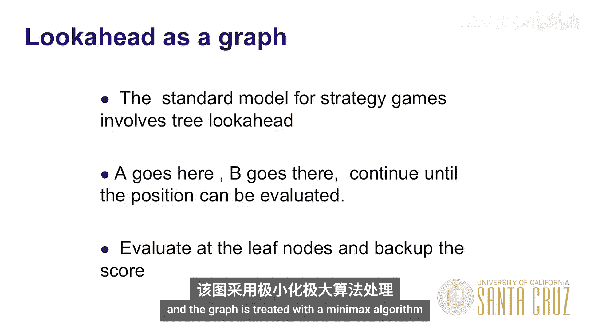
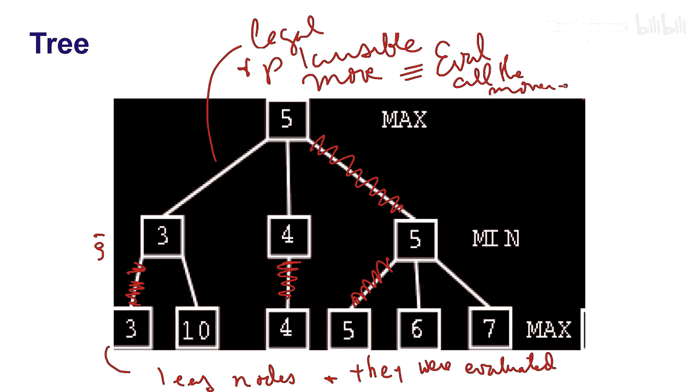
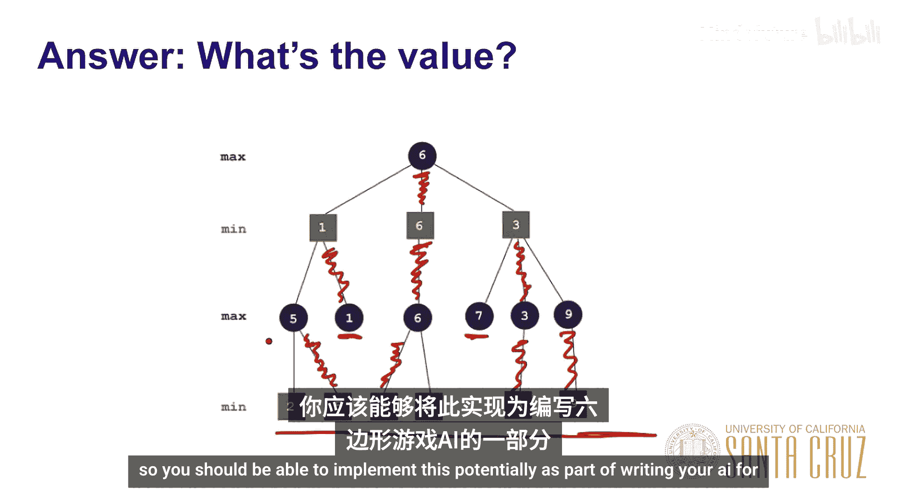

# C++编程：P34：前瞻与Minimax算法

在本节课中，我们将学习如何为井字棋等游戏程序构建人工智能。核心在于创建一个能够出色对弈的自动化对手。对于无法完全求解的复杂游戏，实现某种形式的“前瞻”至关重要。我们将重点研究一种基础的前瞻算法——**Minimax算法**。

## 前瞻与Minimax算法

上一节我们提到了前瞻的重要性，本节中我们来看看其标准模型——Minimax算法。这是许多策略游戏（如国际象棋、跳棋、双陆棋）的标准模型。

游戏通常涉及两名玩家：玩家A和玩家B。玩家A走一步，玩家B回应，如此交替直到游戏结束。那么，人工智能（或人类）如何决定玩家A应该走哪一步呢？

玩家A在棋盘上有若干合法走法可供选择。这个数量变化很大：美国跳棋通常少于20步；国际象棋中局平均约40步；围棋中局则超过200步。由于无法轻易地调查或评估所有走法，人工智能需要方法来确定“合理的走法”，思考对手的回应，并评估最终结果。这就是策略游戏的标准思路，整个过程都涉及前瞻。

前瞻在树状图中进行，并通过Minimax算法处理。该算法的终点（即树的叶节点）通过以下方式评估：
1.  如果游戏能像简单的井字棋一样走到终局，则使用已知的游戏结果。
2.  对于国际象棋或跳棋等游戏，可能需要对某个局面应用良好的判断，给出**静态评估值**，然后通过这些评估值回溯以选择最佳走法。

## Minimax算法原理

理解了前瞻的基本概念后，我们来深入Minimax算法的核心机制。该概念可追溯到20世纪中叶冯·诺依曼等人的研究。

算法假设存在一个**最大化玩家**和一个**最小化玩家**。最大化玩家是理性的，试图走出能获得最大收益的着法；最小化玩家则试图让对手输掉游戏。因此，最大化玩家追求更高的分数，最小化玩家追求更低的分数，形成一种不对称性。

以下是一个Minimax树示例：

在此树中，最大化玩家在顶层有三个分支。每个分支下又有进一步的走法（叶节点），底部标有评估值。

分析过程如下：
*   在左侧分支，最大化玩家可在值3和1中选择，最小化玩家显然会选择3。
*   在中间分支，最小化玩家别无选择，结果为4。
*   在右侧分支，最大化玩家在值5、6、7中选择，会选择7。

因此，如果分析正确，我们会预期最大化玩家选择第三个分支，最小化玩家则选择第一个分支。游戏将按此进行。每当机器需要走棋时，都会调用此算法。

## 算法深度与复杂度

我们已经了解了Minimax的基本流程，现在讨论一个关键约束：搜索深度。我们希望尽可能深入树中（即增加**深度**），以接近能进行准确评估的终局。如果能走到终局，就能确定输赢或平局，这是最优情况。

如果游戏是有限且足够小的（如井字棋），我们可以穷举所有可能，在叶节点根据游戏规则确定最终结果，然后使用Minimax回溯选择。这样就能得到一个完美的游戏玩家。例如，黑白棋（Reversi/Othello）虽然有一定复杂度，但借助数学方法减少需要调查的局面，计算机在约30年前就已能穷举其空间。

然而，对于国际象棋这样的游戏，两位世界冠军间的典型对局约有40-50步。由于一步棋实际包含白方走棋和黑方回应，因此平均对局约有100层深度。如果每层平均有40种合法走法，那么需要检查的节点数是 `40^100`，这是一个天文数字，无法通过朴素方法穷举。

因此，无论何种游戏，树的规模通常呈指数级增长，我们必须实际限制搜索的深度。

## Minimax算法练习

为了巩固理解，我们来做一个小测验。以下是另一个Minimax树：

底部是静态评估值为2、5、6、1、3、9的叶节点。树的结构是：最大化玩家 -> 最小化玩家 -> 最大化玩家。如何评估这棵树？

以下是解答过程：
1.  在最底层的最大化玩家选择中：
    *   在2和5之间，选择5。
    *   在6和1之间，选择6。
    *   在单个值3和9处，没有选择，值分别为3和9。
2.  上一层的**最小化玩家**选择中：
    *   在5和1之间，选择1。
    *   在6和3之间，选择3（因为3 < 6）。
    *   在单个值9处，没有选择，值为9。
3.  顶层的**最大化玩家**最终在值1、3、9之间选择，会选择9。

因此，这棵树对先手玩家有利，其预期收益值为+9。

注意，在这棵树中，并非所有叶节点都在同一层。例如在国际象棋中，当完成一系列子力交换后，局面会变得“静止”，此时可以在较浅的层进行静态评估；而对于存在大量吃子或将军的动态局面，则需要搜索得更深。这就是为什么叶节点可能出现在不同深度。

你应该能够将这一算法实现为你游戏AI的一部分。

## 总结

本节课中，我们一起学习了为游戏程序构建AI的核心——前瞻技术，并深入探讨了标准的Minimax算法。我们了解了最大化玩家与最小化玩家的对抗思想，学习了如何通过静态评估和回溯来选择最佳走法。同时，我们也认识到由于组合爆炸问题，在实际应用中必须限制搜索深度。掌握Minimax算法是编写策略游戏人工智能的重要基础。