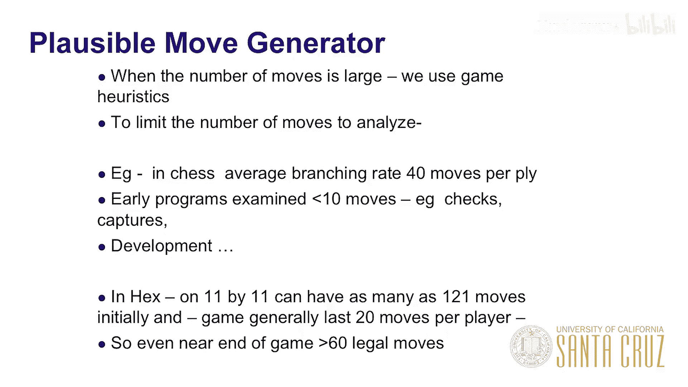
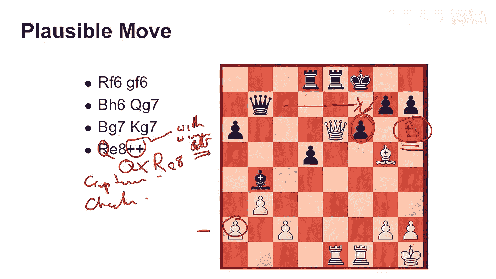
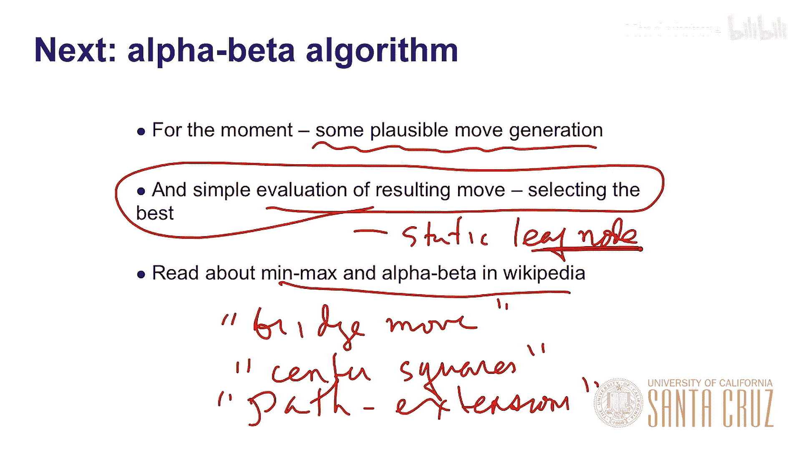

# 【加州大学】C++编程-｜-C-Plus-Plus-B-p35-P35_3-5-合理的移动生成器_03_03_02--BV1KseJzqEbZ_p35-

Now again， Hex is going to be a very large game， why is it going to be a very large game？Well。

We're expecting to play tournament Hex on an 11 by 11 board， an 11 by 11 board has 121 positions。

So that means initially。A player has 121 legal moves， and that decreases one by one。So。

For the longest time in the game， your branching rate。

 your legal branching rate in the game is over 100。Moves。That means even a relatively short p。

Like10 ply， making10 moves。S's going to be 10 to the 100th， very large number。So in most instances。

 we're not going to be able to take such a tree， develop it， and then apply some evaluation。Criteria。

 even a simple evaluation criteria， the number of moves and possibilities are too large。

 so we have to limit them。And typically， you limit them with something called。

A plausible move generator。Now， in early chess game programs。Chess。As programmed on the computer。

Goes back to the 50s or actually programs written in the 50s that。Would play the game of chess。

 not very well。There were。Paper algorithms for playing chess。

 even before some of the most famous computer science and information scientists like Van Neumman。

 like Shannon， like Turing。All wrote papers on ideas in playing chess algorithmically。

 they were all interested， all these creative thinkers。

That really are the foundation thinkers for computer science like Turing。

We deeply ammeshed in thinking about how you could create。An intelligent chess player。

Chess has this average 40 mo to reply the early chess programs。

That number plausible move generator was typically something around 5 to 7 moves。

 How would you decide to pick those moves， Well， you would go to the literature。

 You would do what chess players do。 chess players themselves。

A very famous study by a Dutch master and cognitive theorist to grat。

Found that even chess masters possibly only look at a few hundred physicians in making an evaluation。

So they generally are very selective in their plausible moves and the plausible moves in the beginning manuals talk about。

Capturing material， which is also true in checkers。So you'd examine captures。And chess。

Critical moves are check。The old chess saying is。Why not check it could be made。

 so even beginners occasionally beat better players by using these very simple ideas because chess。

Humans playing chess make many mistakes。And they may overlook that there's a check in the position。

Conceivably， the check is made。And then in different phases of the game in the early phase of the game。

There are typically special rules， so in the early phase of the game。

 special rules include move your paws to the center， why？

Because control of the center is one of the important theoretical elements of chess play。

Add when you move your paw to the center， not only do you gain control。

 but you give more space to your background pieces so at different phases in the game。

 there might be different rules for generating plaus moves in the later phase in the final part of the game in the end game there's a lot of attention played paid to advancing pawns called pass pointss and so in that phase of the game。

 if you have a protected pass paw， there may be a plausible move because。

Converting a pass to what's called Queening square on the opposite row would again be a very high value and a game changer。

Hex， you have to examine。Similar things。 So what what would be useful in Hex Well again。

 you can consider it part of your homework， there are many hex playing programs already on the Internet。

If you don't know the game。Try and play one of those programs and get a sense of。

How the program plays and some of these programs are very good， it'll be frustrating。

 they'll beat you over the head， but maybe you'll get some idea about what they're doing and you can develop some of your own ideas and plausible plays。

which is analogous to play in an extendedtic ta toe game is play towards the center of the board。

 the center of the board center of the he board， lets you have more opportunities or more ways to extend paths and block your opponent's path。

Okay， so let's try and study plausible move。Here's a position game in 2011 between Gary and Hall。

Random game I found on the internet。And the question here is。Whites to move。And what's a good move？

So again， if you try to look around at all the legal moves， well。

 there are legal moves like moving this。You could think about moving this pawn， that's a legal move。

Could move at one or two。You couldn't move this paw， one or two。So that's already Ford moves。

There are two porn moves here， so that's eight moves， there's one， two， three， four， five， six。

 seven， eight bishop moves。And then the queen has a whole bunch of diagonals。So there's about three。

 four，5，6，7，8，9， 10，11， 12， 13， 14，14 queen moves， this says about five rook moves。

 this says about 10 rook moves。So you're looking at again， as I say， roughly speaking。

 30 to 40 moves in this position。Well。Pusible move generators in the early style of chess would say。

 look at captures。Look at checks。Now， if you're a chess player of any kind。

 you'd recognize this is a very dynamic position。Queen is being threatened， not a great thing。

 the bishops being threatened， though there's a pin on the king。But white has some form of attack。So。

A reasonable。Attempt would be a capture。Anna check。

And that capture and check accomplishes a couple of things。What does it accomplish。Well。It's forcing。

 so that's another thing it makes it easy to evaluate。Once there's a check， the king must。

Either block the check， have the check blocked。Or。Take the checking piece。Or move out of check。

So if we look at this rook， takes pawn capture。We can't move the king away because the queen is protecting the one square that could be moved away。

 that's critical to this combination。We could place。The opponent's queen here。And block。

But then all that we'd have to do is queen takes queen and we'd be made。So we wouldn't do that。

 So the obvious thing to do。Is to capture。Because this leads to immediate mate。

Capture and the only capture opportunity is pawn takes pawn。And here's where there is。

 if you're a chessma。A standardly known theme， once that captures happens and is the recapture this way。

This square becomes available for the bishop。The bishop placed over here。Has。

The king under a check again。 So again， notice the checks and captures。Our very powerful moves。

At this point。There's only one way for。They are。Game to be saved。 And that's moving the queen over。

And blocking that square。And then the bishop can take the queen check， and it's still check。

Now again， the only move is a force move King takes。And now we have a relatively easy。诶。Winning。

Procedure， we can just play。Queen takes。Rook。Check， on not check， excuse me。

With this rook being the last piece of any significance， the bishop is here。And then Rok takes Queen。

Rook takes Rok， and now。This player has an extra rook， a bishop， and extra healthy paw。

 so the game is over。So。I see that this is actually the wrong idea。King takes。A。

This should have been。Gin。Queen captures Rok。1 E 8。And plus， plus just means。With winning advantage。

So at this point， it would be very easy。To have。A static evaluator because you're up a full rook。

 a full rook in the general theory of chess is worth five paws。

And that's by far in a simple position like this。Easily converted to a win。

So that's how both a master would play and a computer program， and actually this is a very simple。

Dynamic situation that almost any computer program starting in the mid70s would have played correctly。

Before that， it may have been more variable as to whether the early programs would play if you recall some of the history of。

Chess programs。They got to a master status in the '80s。They got to average。Club player status。

In the early 70s。And then they got to World championion。

Caalliber in the 90s with the famous match with Kasparrov， IBM。呃。

Deep blue beat Kasparrov in this famous $1 million match in 1996。So now turning to Hes。

How am I going to think about Hex？ That's your assignment。 You have to produce。

This kind of AI for a X player。Can I make a winning move。

 here are some of the questions you might say that would generate plausible moves。

A winningning move is a move that completes a path if you're a north to south player。

 is there a move on the board that lets you link up a path？Do I have。My opponent。

Almost ready to win that I need to make a blocking move， so if I don't have a winning move。

 but my opponent has in their next turn a winning move， I'm going to make a blocking move。

If I don't have something that critical， then is there a way for me to extend my longest partial path？

Similarly， there's the inverse， can I block my opponent's longest path？

And then if you've looked at the X literature at all。

 you'll see there are things called fancy moves that involve what are called bridge positions。

And you may want to try to make or extend with a bridge move， a potential path。

so that would be a way to build some AI into your first version of your hex program by trying to generate moves of this sort。

Again， another overall rule in this kind of game is moves in the center are of more value than moves on periphery because they lead to more possibilities。

Now， evaluating， well。In some games， the games are fairly simple， so in Tit toe。You just see who won。

So if you can identify。对。End of the game。 That's one way to go about evaluation， not always possible。

 because to say if the trees are deep enough， you may not get to a point in which you would have such an end point。

 and then you might need some other evaluation function。For example。And chess。

A typical evaluation function taught to beginners is adding up material so and there was a famous book that I learned chess from at the very beginning。

 which was called point count chess and a point count chess you're taught a paw is one a Nider bishop is three。

 a rook is five， a queen is9， you can't place a value on the King because you't losing the king in effect checkmate it the end of the game so you just。

Addd up。Your pieces。And subtract your opponent pieces if you have a material balance of zero。

 So by that rule of thumb exchanging a bishop for a k night is。Leavs the balance。

 but if I could exchange your bishop for a rook， I'm up two points。

 or if I can outright capture a piece like a queen， I'm up nine points。

 which is in almost all cases a winning advantage。If we were playing back ammon。

 the back ammon game is a game where men race around the board and try to bear off on the ends of a board。

 And so a typical measure of who's winning is counting how many。

Squarees remain to complete the race and。Whoever's ahead in the race at a simple level is typically thought to be winning the game。

 but those are very simple when you get into either more advanced back at and a more advanced chess。

 there are other factors that come into play， like in chess。 There's the factor of the initiative。

 There's the factor of space advantage。Backhammon there's factor of。Blocking situations on the board。

啊。So these very simple ideas。While they give you some insight into how to play。

 you have to be modified if you're going to create a better and better AI to play those games。

So here's a usual model， you have new generation。You have something called look ahead。

And this is what I'm going to focus on。诶。In this course。We've already seen miniax。

In the next segment， I'm going to show you a more refined and algorithmically efficient way。

That implements the equivalent。To Minax called alpha beta。 So alpha beta is just。It's like sorting。

 there are several ways to get the same result alpha beta。Is a way that you can do minims。

 but do it way more efficiently。So that's to be preferred。

The menax is a little simpler to understand。And then we're going to look at a much radically different。

Approach。Called the Monte Carlo approach。 We've already seen Monte Carlo algorithms。

 These are algorithms in which we're simulating with some。Set of probabilities， situations。

 And it turns out we can use a Monte Carlo simulation on the board to get an evaluation。

 That's actually startling。 We'll talk some more about that When we come to the Monte Carlo approach。

So the usual model， you have to have some way of evaluating static positions。That， of course。

 will depend on the game and you get that out of the literature。

 so what might be the game in Hex is who has the longest potential path across the hex board？

That's the person in the lead， if I have a longer path than you， I'm probably ahead of you。

 if you can't block that path， I'm going to win。So a longer path is a critical。Way to evaluate。

A hex position。In checkers or chess as material count， and backhammon， we just talked about it。

 there's some kind of notion of who's ahead no race。Its also， this is also backgamon。

Something called points made on a backhamment point if you have。To。Checkers of your color。

 you own that point。And owning that point allows you to block the other players opportunities。

 so points made。Become a more sophisticated view of what you're doing。And playing back。In Hex。

 as we say， if we're on a standard board， we're looking to see who's got a path that's nearly on an 11 by 11 board 11。

So that's our usual model。Now， in implementing your first version of the X program。

 I want you to think about。Some effective way to do plausible move generation。To say read about。

 you can read about Nax and alpha beta， get more information on how to。Do the evaluation。

 do the algorithms。And applausible move generation。

 you can also read on Hex and look at bridge moves。So bridge moves and center squares。Bath extension。

All of these should give you some ways of generating plausible moves。

And then you need some evaluation。Of， of a resulting static。What might be called leaf node。

And in Hex， that's probably going to be something based on。呃。Viewing what the longest。A。

Potential paths are for you versus your opponent。

So next time we're going to go into the details of the alpha beta algorithm and show how to implement a more efficient algorithm than a simple miniax。

