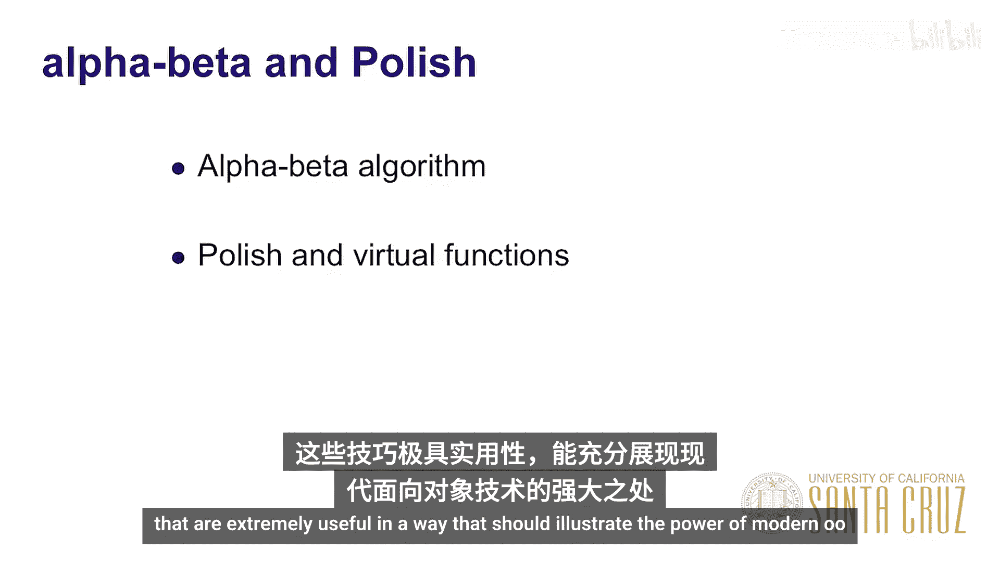
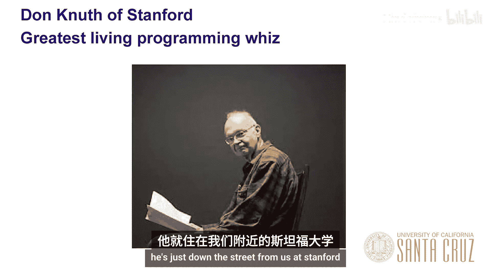
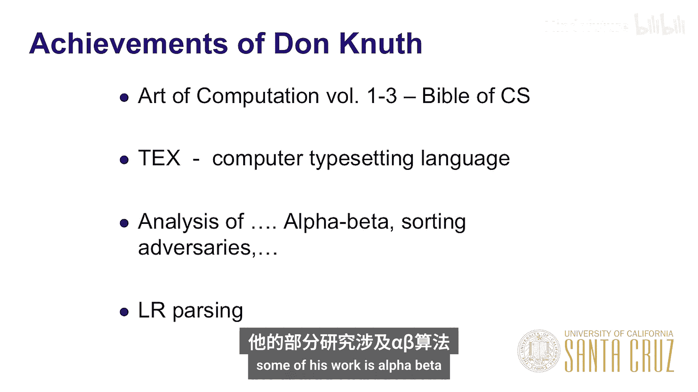

# 【加州大学】C++编程-｜-C-Plus-Plus-B-p36-P36_3-6-Alpha-Beta算法预览_03_03_03--BV1KseJzqEbZ_p36-

Okay， our lessons now are。An。A computational efficient version of Min Maxax called alphapha beta。

And then I also want to do a fair amount with。Pure polymorphism in C++。

 so we're going to get back to a lot of C+ plus。I'm going to show you today a wonderful example of use of polymorphism。

Through inheritance and virtual functions。啊。That does the evaluation of Polish expressions。

So our two themes are going to be the alpha beta algorithm pretty straightforward。

 not going to spend a huge amount of time on it。And then our major effort is going to be displaying some C++ techniques that are extremely useful in a way that should illustrate。

The power of modern O O techniques。

So， alpha beta。Alpha beta。Has a history that goes back to， again， at least the 50s。

When trying to research a little bit of who invented it， there are three or four or five different。A。

People or groups who may have invented it。It's。One of those things that anybody was intensively doing game programming。

Using Minmax and Minax， of course， as I said， was largely formulated by Von Neummann and Morgangen Stern for games of perfect information。

But then when these things started to get implemented in things like checker and chess programs。

 some of the early implementers of such programs like Art Samuels。

 who implemented a great Checkers program at IBM，He's one of the possible people who invented。

 they probably all invented it because it's just I say。

 it was a computational shortcut rather than some foundational idea， but then。

The details and how important it is computationally the exponential saving you can get out of it was demonstrated in detail mathematically by。

Our greatest living algorithms expert， Don Canth of Stanford， and also just a truly。

Great programmer as well。 So I want a little shout out to Don。

 He's just down the street from us at Stanford。

Just to let you know some of his accomplishments。 And while I won't be going into a lot of that here。

 Don is， of course， extremely well known for his books on the art of computation。

 So many of the things like Quick sort or。Sranom number generation。

His books are where you go to really understand in detail。Those algorithms are again。

 very worth pursuing for any of you out there who wants to get way more deeply into a number of the combinatoric issues and algorithmic issues that we've been talking about all along in this course。

But G is extremely prolific。And in many areas， so he also invented the type setting language tech。

 himself was frustrated when he was typesett his own books。

And teche and lateteEC are standard now for types setting。

 especially theoretical computer science and mathematics papers。A is also known for parsing。

 invented one of the foundational efficient parsing methods called LR parsing。

And he did lots and lots of analysis of things like alpha beta and sorting algorithms and looking at them in the worst case。

 using things like adversaries。So， as I say。Just wonderful to explore any of his work。

Some of his work。Is alpha beta。

