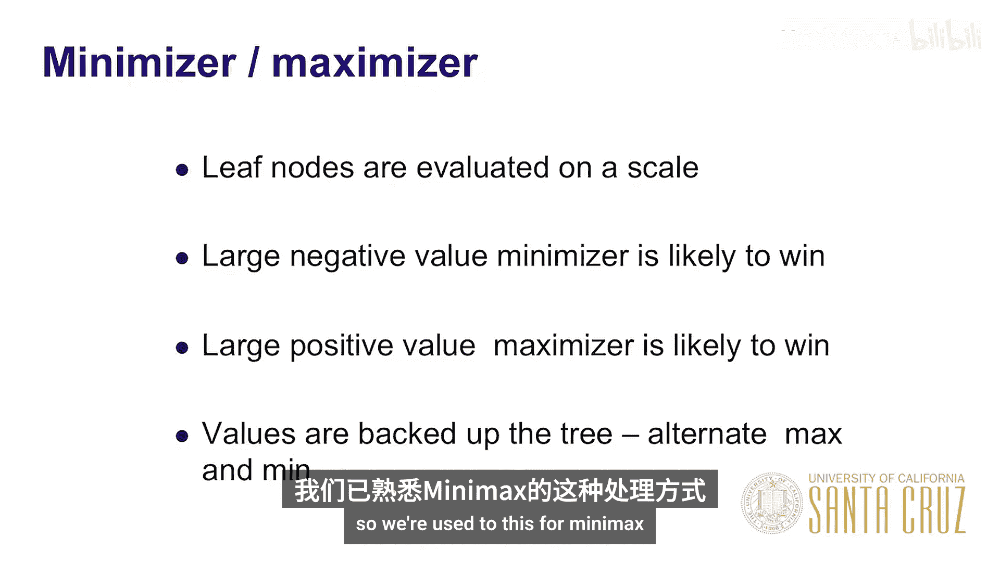
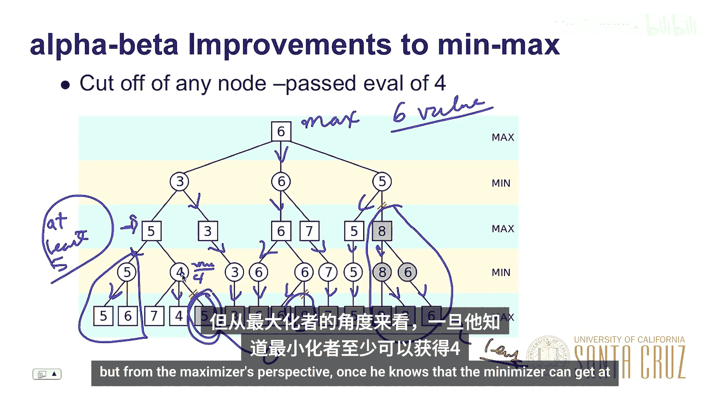
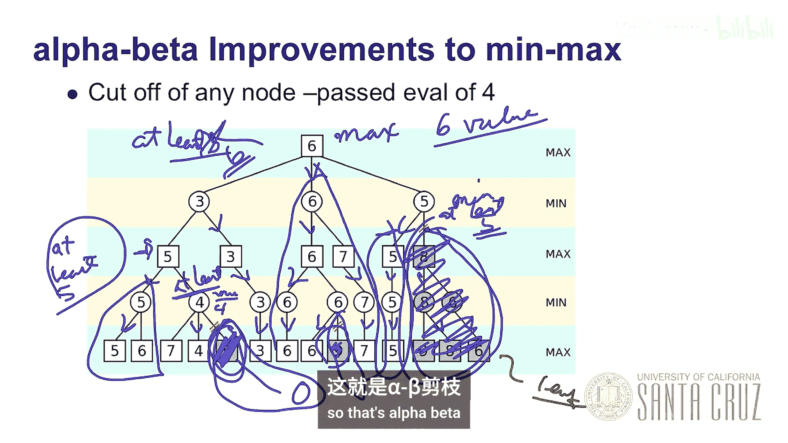
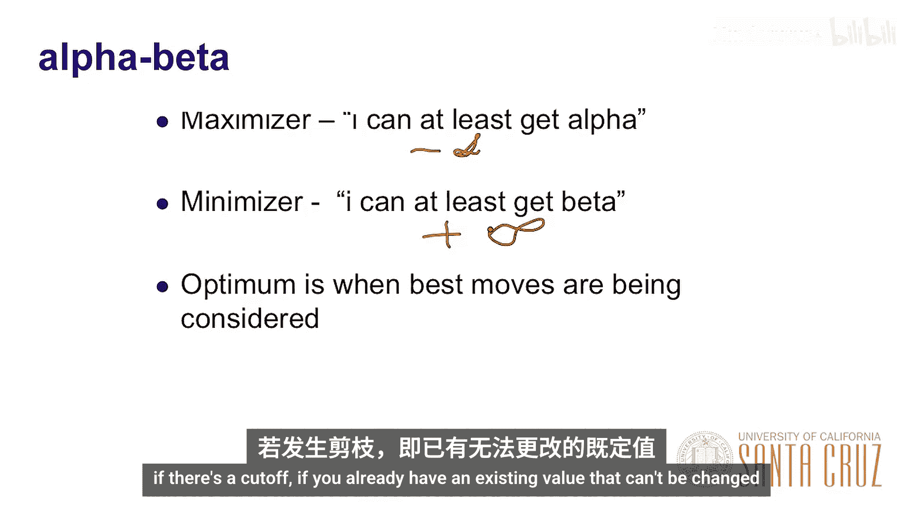
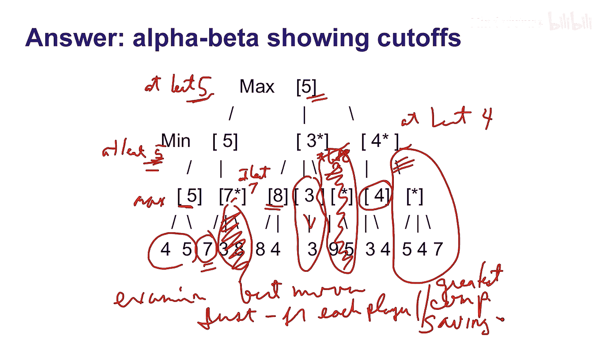

# 【加州大学】C++编程-｜-C-Plus-Plus-B-p37-P37_3-7-Alpha-Beta对Min-Max的改进_03_03_04--BV1KseJzqEbZ_p37-

So in alpha beta， we again have a maximizer minimizer in a tree， we again have leaf nodes。

 and they're evaluated on some scale where the maximizer is going for the largest positive score。

 the minimizer is going for a large negative score。

And then the values are backed up alternatively between the maximizer and minimizer。

 And that's the value of the game。 So if you're thinking of。Hex or chess。

 if I have a large positive score white's going to win if I have a large negative score we're expecting。

Black to win。And we picked those ranges， we could。Assigned probabilities。

 we could say white winning should be one， black winning should be minus one， a draw should be zero。

That would be a way to normalize。But generally speaking， there's some kind of natural scale。

 So with chess， for example， you have this point count chess and historically you would evaluate a position and you might be。

UA few points because you have more pieces， more material advantage。

 maybe there'd be some partial points for space advantage again in thesetict toe games。

There may be advantage in who has the longest pass。

 and so you would use a natural scale within those games rather than necessarily a pure。

Probability of winning。So we're used to this for a miniax。

And here's how we're going to show alphabeta。 I'm going to show it in detail again。

 if you want pseudocode。There's very good pseudocode on the internet， typically in the Wikipedia。

So I'm not going to show you pseudocode， but I'm going to give you a practical example and we're going to see how this works。

So， again， Minmax。And in Minmax， you can see what would happen， and let's step through it。

This is a minimizer， these are the again， these are the leaf nodes。

So you can imagine those intermediate values and the value of the game isn't known yet。

So the minimizer here。Is going to a meet is blue。Minimizer goes over here。Minimizer goes over here。

 minimizeizer goes over here。An minimizeimizer goes over here。Over here。Over here。

And a minimizer would go over here and the minimizer would go over here。

So if this was an ordinary minimax tree。These would be the backup values。 You'd get 5，4，3，6， et cea。

Notice that。On this side， there are these gray in nodes， I'll show them。

We're going to explain that in a second。Now we look at the maximizer。

 maximizer has a choice between five and4。MinimA maximizer here has no choice。

Maximizer here has a choice of sixes。No choice。A maximizeaximizer here has a choice。

 a maximizeizer here has a choice。Minimizer again， the minimizer is going to pick the smallest value。

 that's three， that's a six。That's a 5。And the maximizer at the top is going to。

Pick six or the game value is six。So what's this red cutoff and why did I circle this note5。

 So let's think about this。At this point， what do we know about this maximizer value。

 We've evaluated this subt。It's value five。That means that。At least five。

Is available to the maximizer here， at least five。Here。We come down。

And we find that there is an alternative for the minimizer。And that alternative is a four。Well。

 does it matter if that was a zero？It doesn't matter。Why doesn't it matter？If that was a0。

 the minimizer would pick he at a smaller value， so the minimizer would say， I'll go to0。

 but from the maximizer's perspective。Once he knows that the minimizer can get at least four。

So think of the alpha beta cutoffs at。What can I do as a maxer minimizer at this point？At least。

 what's my。at least value。That's my cutoff， that's my alpha beta cutoff in other words。

4 is cut off because5 can be grabbed over here already。 So it's uninteresting。 And indeed。

 if this was some wholly large scale evaluation， even a sub tree， we wouldn't need to examine it。

Unnecessary to know what this value is， drawing in five there。Is of no interest。

 so we don't need to do an evaluation there， that evaluation。

 which is typically the most expensive thing done in Minax， the backing up of scores。

It's not that hard to do， it's the evaluation， think about computing longest pass in a hex game。

 that's going to be the harderest thing to do。So that was a cut off。 That was a cut off by 4。

 And we could cut off that tree。 Now， we still need to go here。

 And so here we can see that at this point， the minimizer gets a three。

 So that makes this at least three。And then we go and pursue this。Middle tree。

 and that changes to at least six of the maximizer。Can change its alpha beta cutoff value。

And if we notice that the minimizer having six and the minimizer seeing six here。

 and this is at least 6。For this minimizer， this node is no longer of interest。Now。

 when we get to six and we find that there's a path to five here so that minimizer gets at least five。

So it's going to be five or less， then this whole subre is not of interest。

We no longer need to know any of this。So all those node。

Need not be evaluated to get the true value of the tree based on what we were calling cutoffs。

 notice the higher the cut off， the more work is saved。So that's the alpha beta improvement。

Noticing where at different levels there is。At first， we have no known cutoffs。

 We don't know what the value of anything。 the minute we move some score up the tree。

 we get an at least value。 once we move a score up。

 we get an at value because there are contingent opportunities and we know at different heights in the tree what those possibly are So that's alpha beta。

 that's the alphabeta improvement。

And that， as I say， was discovered in the 1950s by independently by a number of researchers when they were implementing Minax algorithms。

Maximizer is saying I can at least get alpha， minimizer is saying I can at least get beta if you want。

 you can think of that as starting at minus infinity。Plus， infinity。

And you could give an alpha beta value at all the nodes。And then， as you。Implement。

Alpha beta and make the partial evaluation。 The different nodes get an alpha and beta。

And if there's a cutoff， if you already have。

An existing value that。Can't be changed。 You don't have to evaluate。Anything further。

So let's try and see what the alpha beta cutoffs are。In the following， just to test you。Again。

 I recommend if this is not enough information to go and read the Wikipedia treatment。So again。

 we have all of these。Terminal nodes。Static evaluated leaf nodes。

And we have the little places we want you to try and fill in。

And we also want you to do this in an alpha beta way， not just in a miniax way。

 so a miniax should be easy， but you should be able to see what kind of work you're going to save in alpha beta。

Okay， so let's see what the answer is to this。When we first start out。

We're just doing what we would do normally in the miniax mode， we have a maximizer。

Selecting between four and5， so he's going to pick five。And that means that at this point。

 we know the minimizer。At least value here。Becomes at least five。When we come down here。

 the maximizer starts and gets a seven。Whoops。So that's at least seven。

And that7 is greater than this5。So the maximizer knows he doesn't want to look anymore at this。

So that becomes a cutoff。So， at this point。Once you evaluate that node， this subree。

All the other nose hanging off there。A cut off。Going to the next part of the analysis。

We have an eight and a four， so that gives us eight。So that's at least eight。Since that's at least 8。

 the maximizer， by the way， already has in at least5。The maximizer is still interested in that。

The minimizer。Doesn't one in eight sees that there's a three because this is。啊。3。

So that changes from eight to three。Ah at least three， well。Since that's at least three。

 the maximizer has no longer any interest in it because it can at least get fine。

And this whole subt is cut off。We don't really care what its value is。So we still are at least five。

 We come down here， we get a four。This is a four。And again， since this is at least four。

The maximizer is going to cut that off。And that is going to be yet another cutoff。

 So if you notice you're getting increasingly deep trees that are cut off。In this alpha beta search。

And it is a characteristic of alpha beta search that if you examine。Best moves。First。For each player。

You get the greatest computational saving。And the mathematical details of that are in Don Canoeus。

Papers also in papers by Judea Pearl。Another very famous algorithmic computer scientist who's examined how to build intelligence into machines。

Okay， that's alpha beta。That's the detail。That's what I'm going to expect you to use if you want to use alpha beta search in your hex game。

So that's what you should be able to implement。