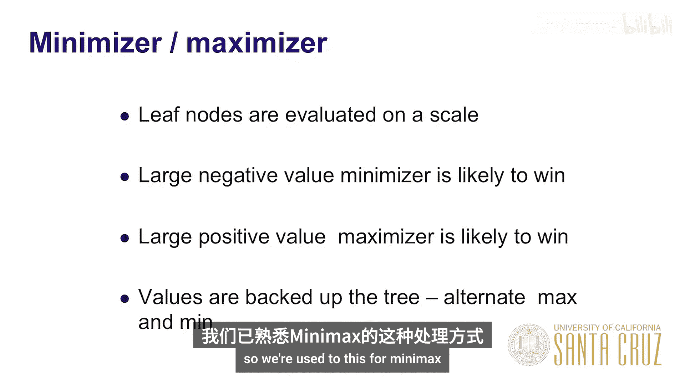
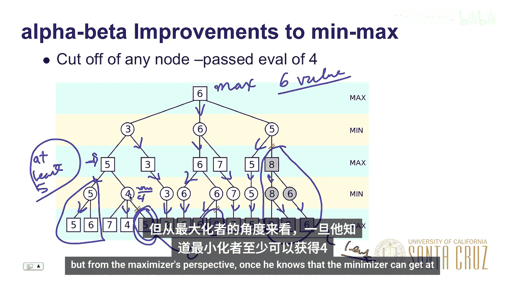
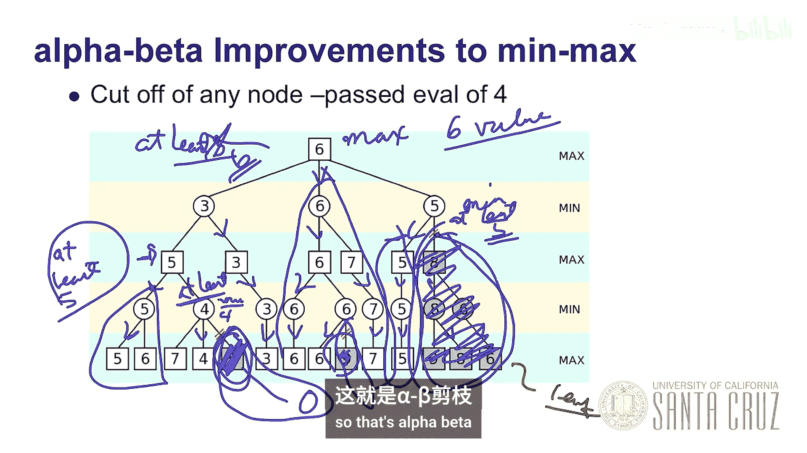
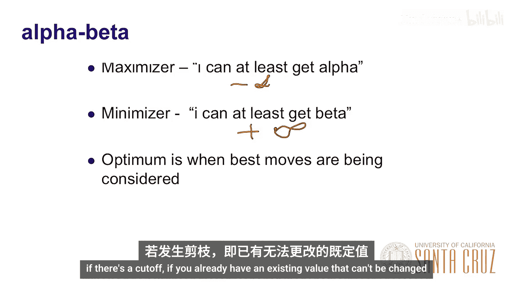
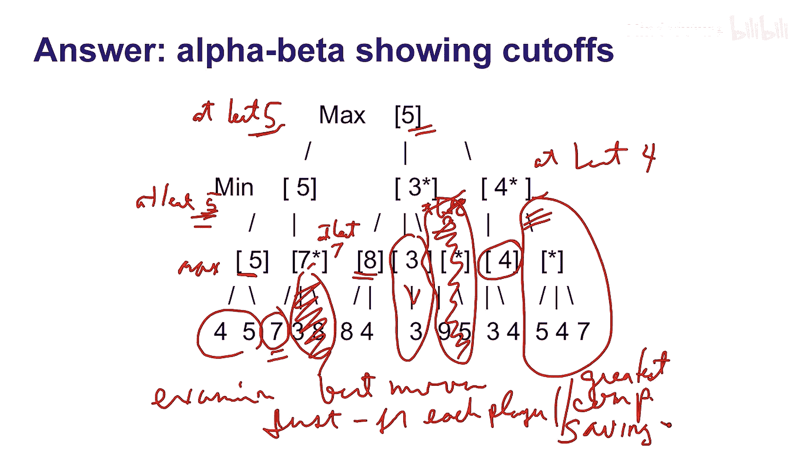

# 人工智能游戏算法：P37：Alpha-Beta剪枝对Min-Max算法的改进

## 概述

在本节课中，我们将学习一种名为Alpha-Beta剪枝的优化技术，它能够显著提升Min-Max算法的效率。我们将通过具体的例子，理解其工作原理以及如何在游戏树搜索中节省计算资源。

## Min-Max算法回顾

上一节我们介绍了Min-Max算法，它通过递归地评估游戏树来决定最佳走法。算法中有两种角色：**最大化者**（Maximizer）和**最小化者**（Minimizer）。最大化者试图获得尽可能高的分数，而最小化者则试图获得尽可能低的分数。

在诸如国际象棋或Hex的游戏中，我们可以为棋盘局面设定一个评估分数。例如，一个大的正分可能意味着白方即将获胜，而一个大的负分则意味着黑方即将获胜。我们可以将分数归一化，例如白方胜为`1`，黑方胜为`-1`，平局为`0`。但在实际中，我们常使用更自然的评分尺度，例如在国际象棋中根据棋子价值和局面优势来评分。

Min-Max算法的核心是**分数回溯**。从叶子节点（即游戏结束或达到搜索深度的局面）的静态评估开始，分数在最大化层和最小化层之间交替向上传递。

**最大化节点公式**：`V = max(children)`
**最小化节点公式**：`V = min(children)`

最终，树根节点的值就代表了当前局面对先手玩家而言的游戏价值。

## Alpha-Beta剪枝原理

本节中我们来看看Alpha-Beta剪枝如何改进Min-Max。其核心思想是：在搜索过程中，如果发现某条分支不可能影响根节点的最终决策，就停止对该分支的深入搜索（即“剪枝”），从而节省大量计算。

关键在于理解“至少值”这个概念：
*   对于一个**最大化节点**，它知道自己**至少**能获得某个分数（称为 **α**）。
*   对于一个**最小化节点**，它知道自己**至多**会让对手获得某个分数（称为 **β**，即对手**至少**能获得β）。

当搜索到一个节点时，如果发现当前节点的α值已经大于或等于其父节点的β值（对于最小化节点），或者当前节点的β值已经小于或等于其父节点的α值（对于最大化节点），那么剩余的分支就无需再搜索了。

## Alpha-Beta剪枝实例分析

以下是Alpha-Beta剪枝在一个具体游戏树上的工作过程。我们将一步步跟踪算法的逻辑。

首先，我们从根节点（最大化者）开始搜索。初始时，α = -∞， β = +∞。

1.  **搜索左子树（路径A）**：我们首先评估最左边的分支。叶子节点值为5和4。在它们的最小化父节点上，会选取最小值4。这个值4被传递到上一层的最大化节点。此时，该最大化节点知道它**至少**能获得4分（α更新为4）。

2.  **发生第一次剪枝**：现在，算法开始搜索中间子树（路径B）。它首先评估得到叶子节点值7。在中间子树的最小化节点处，它看到对手（最大化者）在这个分支上**至少**能得7分。然而，根节点处的最大化者已经知道在左分支（路径A）上自己**至少**能得4分。对于根节点这个最小化者（注意：根节点的父视角是最大化者，但当前节点是根节点的子节点，角色交替）来说，如果它选择路径B，对手将得到至少7分，这比路径A给对手的4分更差（对最小化者而言）。因此，路径B中剩余未搜索的分支（值为0的叶子节点）**不再需要评估**，因为最小化者绝不会主动选择这条让对手得分更高的路径。这就是一次Alpha-Beta剪枝。

3.  **继续搜索并发生更多剪枝**：算法回到根节点，其当前最佳值（对最小化者而言）是4（来自路径A）。接着搜索右子树（路径C）。
    *   在路径C的第一个分支，评估得到8和4，最大化节点选8，传递到其父节点（最小化者）。
    *   该最小化者看到下一个分支的叶子节点值是3，它会将值更新为3（因为3 < 8）。
    *   此时，对于根节点这个最大化者来说，路径C目前只能提供3分，而它已经拥有一个至少4分的选项（路径A）。因此，路径C中剩余的所有分支**被剪枝**。
    *   同理，在评估其他分支时，一旦发现某个分支的临时值不如已知的最佳选项，就会触发剪枝。

通过这个过程，大量灰色的节点无需进行静态评估，从而节省了计算。**剪枝的效率高度依赖于子节点（走法）的搜索顺序**。如果能优先搜索可能最优的走法（即“最佳优先”），就能触发更多、更早的剪枝，从而最大化节省计算量。

## 算法特性与要点

以下是关于Alpha-Beta剪枝的几个关键点：

*   **历史**：该算法在20世纪50年代被多位研究者独立发现。
*   **核心变量**：算法维护两个值——**α**（最大化者至少能保证的分数下界）和**β**（最小化者至少能让对手得到的分数上界）。初始化时，α = -∞， β = +∞。
*   **剪枝条件**：
    *   在**最小化节点**，如果当前β ≤ 父节点的α，则剪枝。
    *   在**最大化节点**，如果当前α ≥ 父节点的β，则剪枝。
*   **搜索顺序的重要性**：为了达到最优剪枝效果，应该尽量将估计较好的走法优先进行搜索。这在理论上可以将搜索深度加倍，即用相同的计算时间，Alpha-Beta剪枝可以搜索到Min-Max算法两倍深的局面。

## 练习与自测

为了巩固理解，请尝试对下面这个游戏树进行Alpha-Beta剪枝搜索，并标出所有被剪枝的节点。

**提示**：按照深度优先、左优先的顺序模拟搜索过程，并时刻更新每个节点的α和β值，在满足剪枝条件时停止搜索该节点的剩余分支。

**参考答案思路**：
1.  从左子树开始，最大化节点在5和4中选5，传递5。
2.  进入中间子树，第一个叶子节点为7，导致该分支的β值变为7。由于根层级的最小化者已经有一个≤5的选择，而7>5对最小化者不利，因此中间子树的其余部分被剪枝。
3.  进入右子树，在第一个分支得到8，随后在下一个分支看到3，最小化者将值更新为3。
4.  此时根节点的最大化者已经有一个≥5的选项，而右子树只能提供3，因此右子树的其余部分被剪枝。
最终，游戏值为5，并且只评估了部分叶子节点就得到了结论。

## 总结

本节课中我们一起学习了Alpha-Beta剪枝算法。它是Min-Max算法的一种优化，通过维护α（下界）和β（上界）值，在搜索过程中识别并剪除那些不可能影响最终决策的分支，从而极大地提升了搜索效率。记住，实现Alpha-Beta剪枝时，**走法排序**是影响其性能的关键因素。在你的Hex游戏或其他博弈程序中应用此算法，可以有效增加搜索深度，做出更智能的决策。