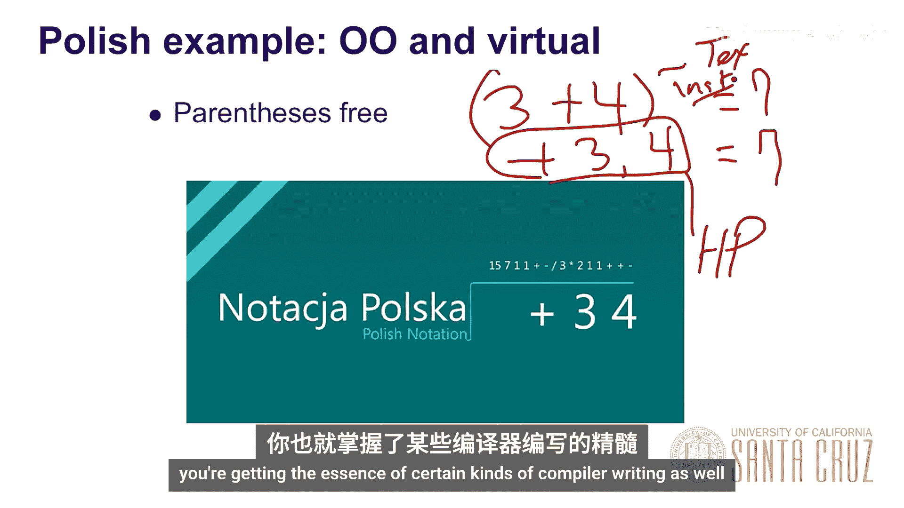
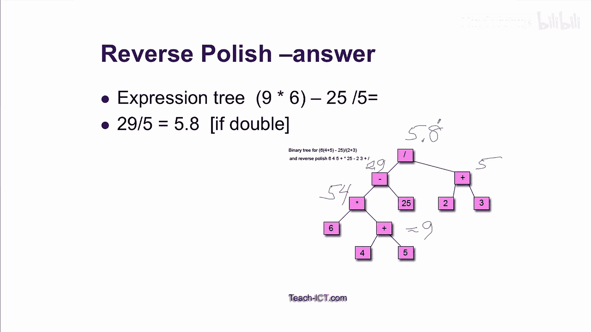

# 【加州大学】C++编程-｜-C-Plus-Plus-B-p38-P38_3-8-波兰表示法_03_04_01--BV1KseJzqEbZ_p38-

So I'm going to turn now to our next big example， a very big example among the biggest examples。

In the course。And I'm going to show you how to evaluate a Polish expression and recall that Polish notation was invented so that you don't have。

Prenheses， what we're used to is。A plus B in parentheses， times C。

And parentheses give us a way to order operations， order the way athmetic operations get done。

And determine order。And the question of Polish notation is。

The ordering hasn't to do with the operators or the expression。

 It's just to do with where they are in a sequence。

 And the Polish notation is the basis of some interesting。Evaluation architectures and hardware。

 so old boroughs machines， a lot of the HP calculators were famous for using and expecting the user to know Polish notation。

 parenthesis， free notation。So， instead of。3 plus four。We have plus three。

I should really show four and that just means apply binary plus to the two arguments three and four。

 and both of these are going to end up evaluating to seven。

This is going to be how you would do it on an HP。In the old days， there。Texas Iments。

Would have what we call ordinary in fixedxed notation。Also， this example is an example of parsing。

So that's a big deal in computer science， how to write a compiler。

A big part of how to write a compiler is how to parse。

 a big part of computer languages are expressions， so this is intrinsically a way to write a compiler if you can follow this logic。

 you're getting the essence of certain kinds of compiler writing as well。

So if you， most of you should have some background in this， but if you're。Forgetting it or。

Never had studied it。Here's what we'd call ordinary notation， it would be 9 plus 6， 15，3 minus2，1。

 so we would end up with it being equal to 15。And here's the equivalent of what's called reverse。

So we have arguments 9 and 6， and then binary plus comes along。 and after binary。

9 and 6 are on the operators Act。 the result is 15。 So at that point， it's reduced to 15。Comment 3。

Coma 2 minus。Star。Times。And the next thing you do is you move along and now you have three。

 two minus。So that changes and now the stack。These were in computer architecture terms。

 put in a stack。And the answer would be this。And then you would get 15。Times 1。

 and the overall result is 15。 And that's how reverse Polish works。

 You generally have everything in a stack。 When you come upon an operaand。

 the operaand executes on whatever values are。Neighbor， it's neighbors。

 And then when you're through the whole expression stack。呃。

You've evaluated the expression in reverse Polish。So an expression is an evaluation tree。again。

 trees show up everywhere they're trees that if we're computer scientists， we're in love with trees。

 we love binary trees， we love miniax trees， we love expression trees， again， parsing。

 expression evaluation， it's all about walking around trees， all about。

Doing walks across nodes and trees。 And again， expression evaluation trees are also trees with leaf nodes。

 Leaf noses are where values reside， and then。The internal nodes tend to be operations。

 and so they give you instructions on how to combine the values sitting at the leaf nodes。Now。

 this method that I'm going to describe is due to Andrew Koick。

I think the article that I originally showed this example was in the OO literature。

 I'm recalling it right， sort of I think 1988， so it was an early article in the C++ community showing the power of virtual function。

 polymorphism and OO ideas， and was just such a beautiful method。

That I've always used it to demonstrate some critical ideas in C++。

And it's very worth knowing Andrew's contributions。Andrew， probably besides Bjorn Strewstrip himself。

 is the。Second most important contributor to the C plus plus。Language。

 its development and its methodology。 And Andrew has written I think， several， more than one。

Super good books about programming N C plus plus。 So' it's well worth for you to get familiar with his work。

Either find it online or purchase some of his interesting books。So again， here is reverse Polish。

Here's an expression of valuation tree。And。What I'd like you to do is。Walk this tree and see what。

Its value would be。This is its fully parenthesized。Version of the tree。 And here is its。

What the reverse Polish would look like。So we get six， four， and 5， and then we have plus。

And when we have plus， we'll get an evaluation and we continue with the topmost evaluation of the tree being here。

 so you can see how this maps into the tree。So take a second。And compute this tree。

So we have the expression tree here to evaluate。And we start at the bottom with the operation plus。

 and we see 4 plus5， and that's going to be equal to nine。And then we have a multiply。

And the multiply is six times9， and that's going to be 54。

And then we have a subtraction and 54 minus 25， that's going to be the node value 29。

And then on the other side of the tree， we have an addition node，2 plus3， so that's5。

 and ultimately we divide 29 by 5 and we have 5。8。

