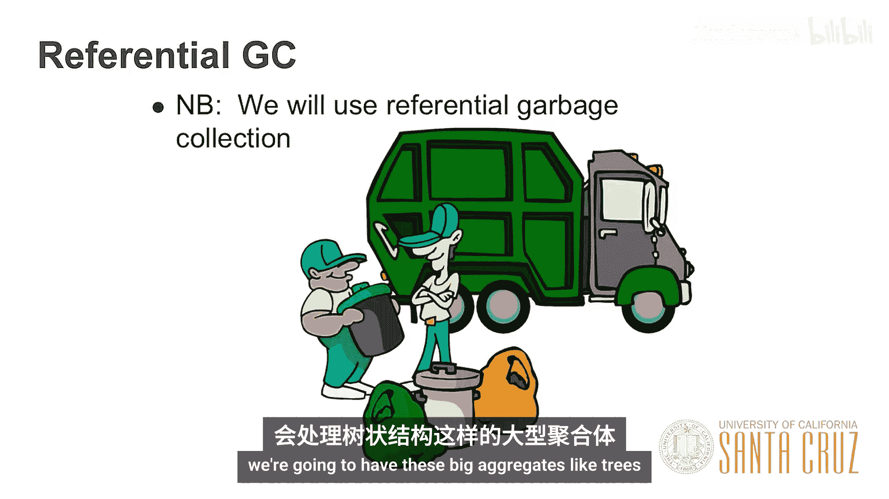
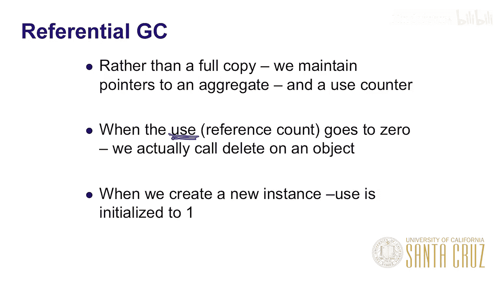
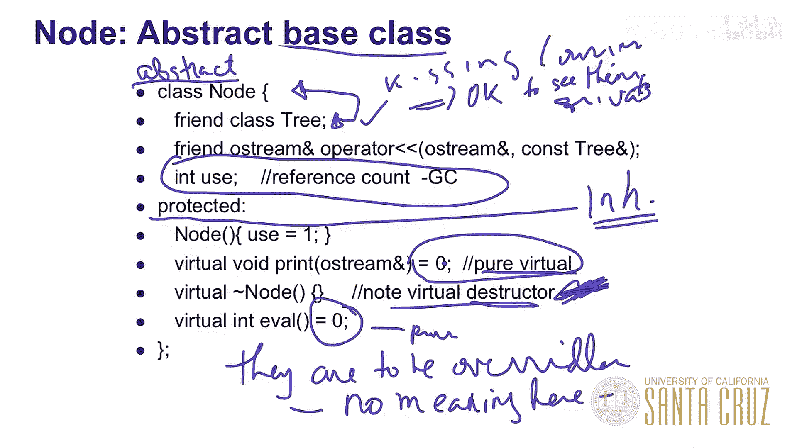
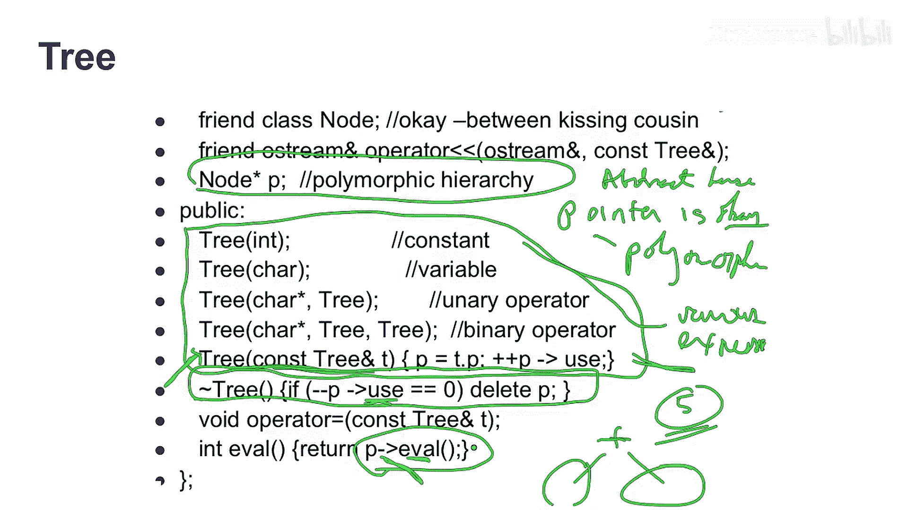
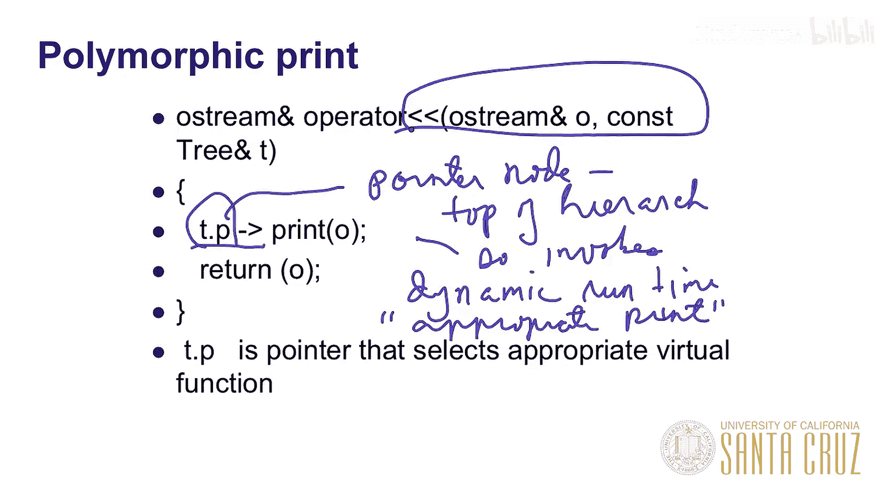

# 【加州大学】C++编程-｜-C-Plus-Plus-B-p39-P39_3-9-引用计数垃圾回收_03_04_02--BV1KseJzqEbZ_p39-

Now。We're going to write a program。That does all of this automatically。

 And I think what you're going to see with this program。

Conic program is how it can also be used to expand on the ideas I've just said can give you a general way to polymorphically evaluate expressions。

Very powerful。There are other ideas buried in this program。 So this one example。

Has several really powerful ideas， and they're all very succinct。

 One of the powerful ideas is we're going to use referential garbage collection。

So the way we're coding this。Referential garbage collection。

 we're going to have these big aggregates like trees。

And we don't necessarily want these trees to proliferate。So， we want。

Efficient mechanism for representing multiple trees。 And if we need to clone a tree for some purpose。

We want that clone to be what's called a shallow copy。Or a referential copy。

 So this example will show you how to do shallow copying and garbage collection that's referential。

In referential garbage collection， rather than a full copy we mean。pointers to aggregates again。

Everybody has come into to this course from C。The hallmark of a proficiency programmer is really understanding pointer。

Pointer is critical。 Pointer and de reference is critical。And also in C， you have to know how to use。

Maalek。And free or analogously in。C++， you I have to use new and delete。

Now we're not going to do a full copy， think about it this way。If you're in the library。

And you need to use the encyclopedia Britannica， and you're still old school。

 so you want to really get a hold of。The paper copy in the library， that's pretty expensive。I think。

 you know the last years of that encyclopedia， your cost for a nicely bound encyclopedia brtanica is something on the order of $1。

000， so it's not like they're going to let it out of the library and it's not like there's going to be multiple copies。

 it's going to be a single copy。But the single copy can service many people， why。

 because this is not being modified。And each person can go and point at the section they need to use。

So since there's no modification and since there's ready access to different sections。诶。

You can have many people using the one library copy efficiently。

Its somewhat the same way that we are going to allow use of multiple copies in a program where we don't need to manufacture a new copy。

 that's a huge saving。So when we don't need to manufacture a copy。

 but we merely need to point at an existing copy， we'll do referential copying。

 we'll just establish a new pointer copying to the right place in the aggregate， just imagine。

Pointing at the right position in the encyclopedia。Now。We may actually modify these aggregates。

 and as we modify them， we may need to discard some。

And there is actually a call on knowing when to delete an object。

And that tends to be what's called the use or reference count。 So there's going to be a。

A special variable in these aggregates called how many people are pointing at me？

I have many people pointing at me。One guy no longer uses the encyclopedia Britannica。

 I can't just close it down。 I still have to use。The aggregate。So until its use goes to 0。

 I don't abandon the aggregate。 So the use counter is keeping track of how many。

People are using it or how many in our case， parts of the program are using it。And only deletes it。

 only does real deletion of the aggregate when the use counter goes to zero。

 And any time we have a new instance， for example， we modify an old instance。

We're going to create a new instance and make its use。Value 1。 So that's referential。

 That's the heart of referential correction。 And we'll see that in this example。

So。Here。And again， think about what we're doing， we're doing evaluation of expressions。

The evaluation of expressions involves。Computing over an expression tree。

The basic element of the expression tree is going to be a node。

The node is going to be represented by something we're calling an abstract base class。

So there's lots of interesting stuff in this particular example。First off。Note is going to。

Work with tree， a tree is going to be some series of nodes。They're going to be intimately connected。

 It's not an inheritance relationship。But because they're intimately connected， I want。

Both of them to be able to access the other one。Even its hidden parts for efficiency purposes。

 so these are what we might call kissing cousins。And that's sort of a。It's okay。2。😔。

See their privates。Here's what I said。That's the referential garbage collection value。

There will be an inherentheritance hierarchy， so I want things to be protected。

And then I have these virtual functions。Notice。Very important。The de is virtual。

 the the was not virtual and again， by the end of running this example for you writing it。

 what you need to understand is why this needed to be virtual。So that's a takeaway。

And then there's this notation。equals zero notation。And equals0 means these are pure meaning。

They are。To be overridden。But here they have no meaning。And this has an effect。

 why we call this abstract is there can be no instances of node。If there were instances of node。

Then we would expect there to be a meaning for for these。Pure virtual functions。

And we could execute them， but since they don't have a meaning， we can't have instances。

So it's sort of a circular reasoning thing， rather than call this some other kind of。

Programming language designer might have decided to just name this abstract。

 It's inherently abstract through this little device。So there's a bunch of takeaways。

Garbage collection through referential use。Pure virtual functions and abstract base classes and the use of。

Virtual deors。

And here's this other。Remember when we were doing the actual evaluation of the Polish expression。

Just a few instances ago。We walked around a tree。 So this is a tree。 and the tree is going to， again。

Here's that kissing cousin relationship。With node。Notice。Remember， node is an abstract base class。

So there can't be concrete instances of node， but there can be pointer to node。Pointer is okay。

Because the pointer is the base class type， and that makes it polymorphic。

 so this is a polymorphic pointer。And that means that depending on what kind of actual node。

It's defined later on in the tree like we'll have binary nodes doing binary plus。

By activating evaluations through this。Base class type。We automatically through polymorphism。

 dynamic dispatch， we call the right evaluation function。

 the right member function in the class hierarchy。This is where all these subtle ideas interact to get you a marvelous solution。

 a very simple solution， and a solution that's readily extensible。Okay。

 so as with many interesting classes， there's a whole bunch of constructors。

And these are for different kinds of trees， like these would be trees in which there was an int。

A tree in which there was a variable which would be a character。

 we're going to use simple characters to talk about variables。

 There could be a tree with a unary operator， there could be a tree who has a binary operator operating on two separate trees。

So these are analogous to the various expressions。I could have the tree that's just five。

So that would be this first one and its evaluation would just end up being five。

Or I could have a tree of two trees with a binary operator like plus。And then some subtrees here。

 and these would both have to be evaluated before plus got evaluated。

And then this is critical here is this is。Again， what kind of constructor？我嘅得啊。Signature。

Everybody should immediately know what that is， it's a copy constructor。

And notice referential copying。And then， notice。The D structure。And this also。

 both are making use of use。I'm also going to overload assignment。

And I'm going to overrode evaluation。And here evaluation is done via the base pointer and recall that that base pointer is going to polymorphically。

 Valal is going to be a virtual function， so this is going to be done polymorphically。

So let's look at。Focus on twoy elements in the last slide。This gives you。The exact way。

 referential copying and deletion work。If I have a preexisting encyclopedia Briittannica。

And somebody else needs it。And I'm not going to modify it。I just provide to that person。

A further pointer。And I increment。Increment the use。

So if one person is already using it and I now copy it， now there'll be two people using it。

So if there's one person using it。And I copied it。 Now there's a second person using it。

 and I could have a third person， et cetera， et cetera。 So this use can keep going up， notice。

What's the order of copying？Constant。To order one。Why。

 because this is just no matter how big the aggregate， how big the encyclopedia。

 how big the tree I only need to increment。Use pointer and do one assignment， one assignment。

 one incrementation。Now。If for some reason。I call a destruct， let's say。

A person in the library is checking out and he's no longer needing his access to the encyclopedia Botannica。

 That person goes away。So we call the deor。It says， ah。Derement use。And test。Is use。0。

And only if use to zero， do we do the concrete， the actual deletion only happens when use goes to zero。

So this protects us。Until we no longer need the aggregate。Okay。

 let's turn to some other things that are interesting about this code。

Part of what we have is a polymorphic。Print routine。Again。

I'm going to do things that are pointer based。P is pointer to node。

It's the top of the hierarchy of nodes。So it invokes。Dynaically， at runtime。The appropriate print。

And then I'll return， this is just our normal way of overloading。our i O operation。

So print acts throughout this tree。Polymorphically。

