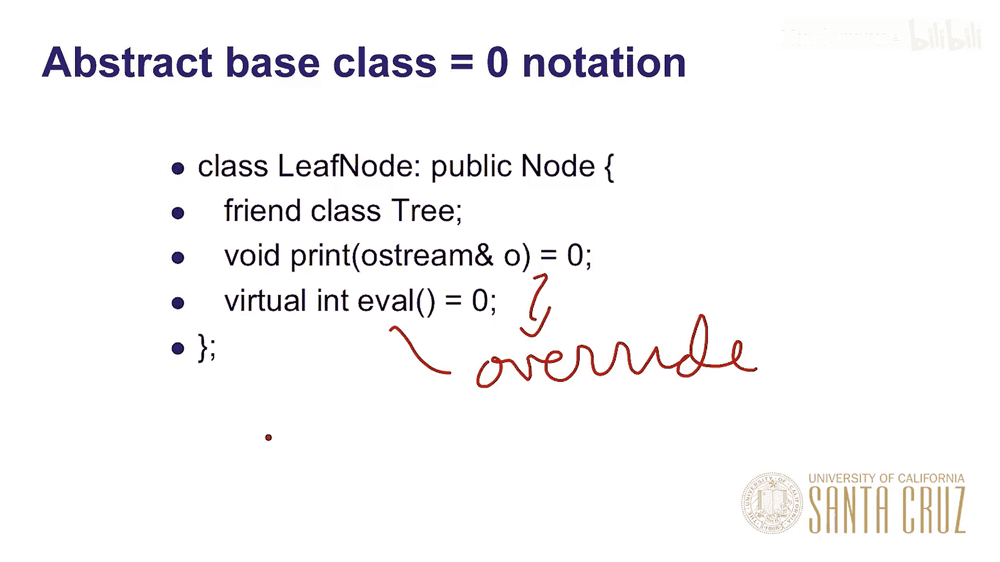
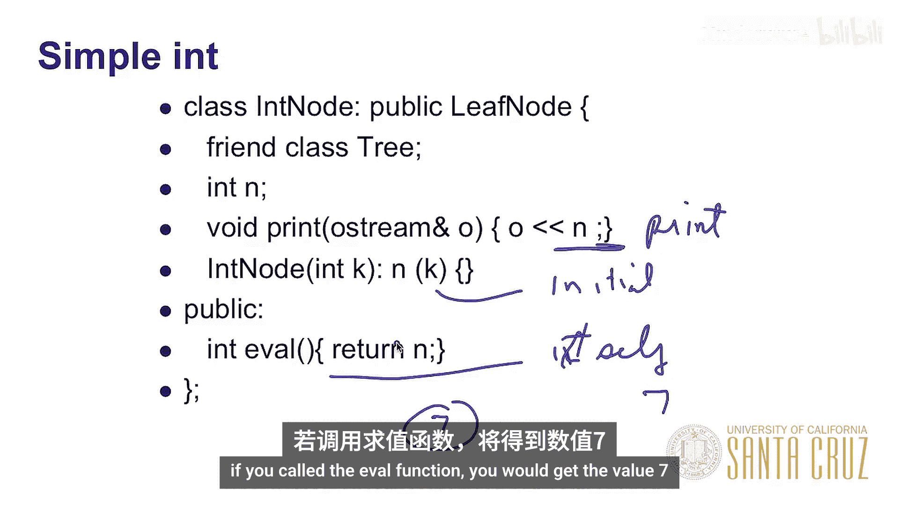
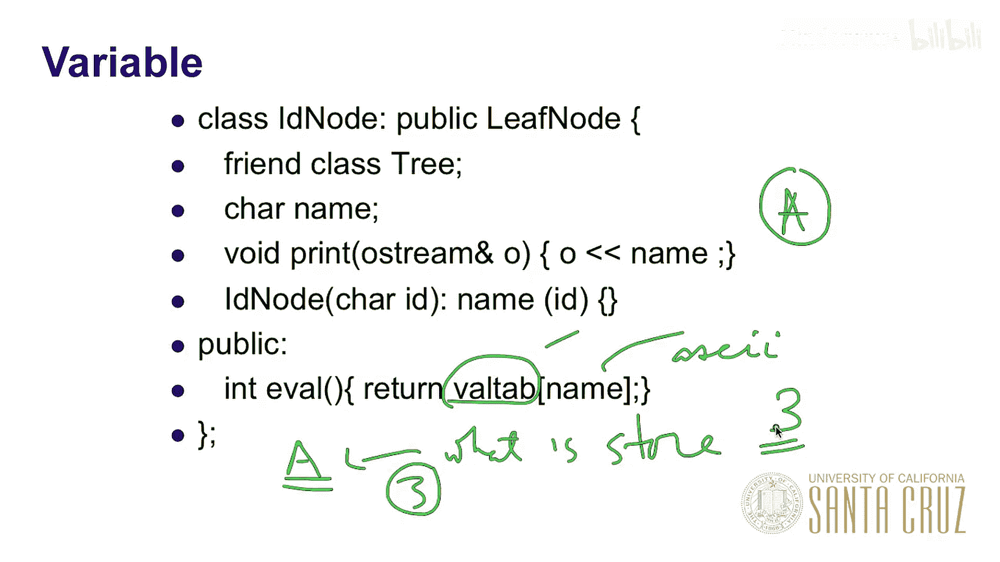
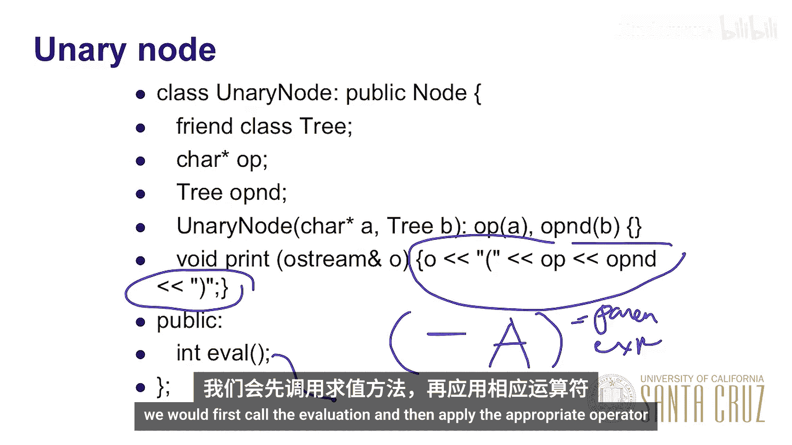
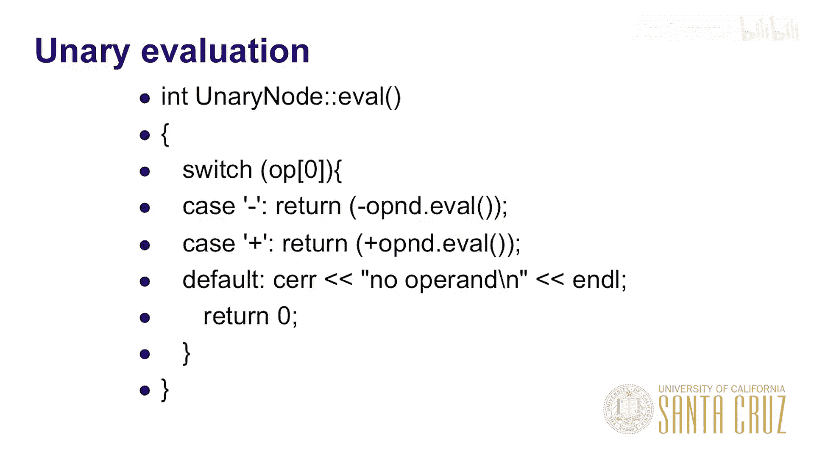
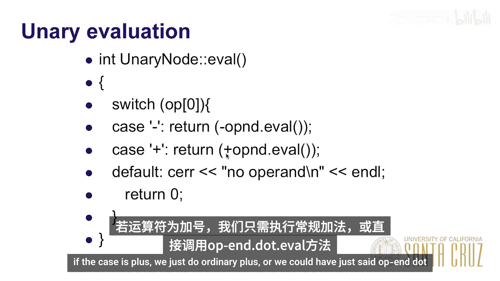
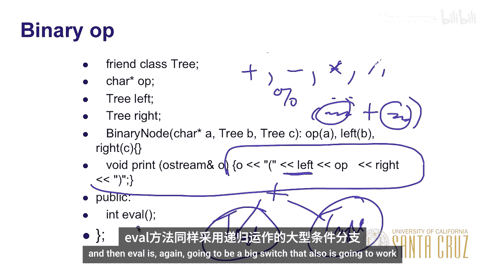
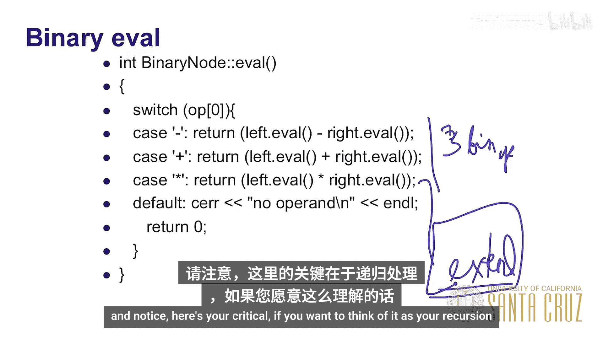
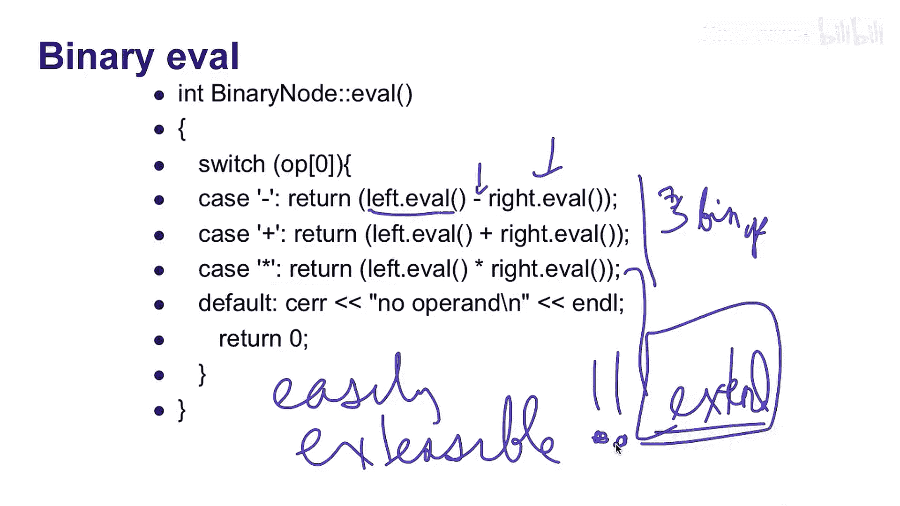

# 【加州大学】C++编程-｜-C-Plus-Plus-B-p40-P40_3-10-抽象基类-0表示法_03_04_03--BV1KseJzqEbZ_p40-

So here we have another abstract base class。It's a leaf node。

It's going to be defining itself in terms of the base class node， another abstract class。

 so you can have an abstract class， an a from an abstract class。And again。

 we see why it's abstract because the print functions。Ba。

And the evaluation functions are still undetermined。There's still without definition。

And leaf nodes are going to be derived from this in which the different kinds of leaf nodes will。

Again， the terminology is we'll need to override。And the concrete， so we need to。

Derive from leaf node to a concrete kind of leaf node。

 And then these will have actual implementations。

Let's look at one， this is probably our simplest one， this is where we have a constant。

 if we have an expression tree which is a constant， it's its own value。

 so imagine having six sitting there without any operations。The value of that expression is6。

And look at what the semantics are for the overridden functions。We just print the value。

We print n to the output。And this is our initializer。For。Instructor of an int node。

 and here's our evaluator， we just return， print the value and the value is itself。

So you're thinking of a node at the tree looking like seven。If we call the print function， we'd see7。

 if you called the eval function， you would get the value7。

Triivvial case。How about a variable and again， variables the way I'm going to do this。It's a very。

Simplified version， and we're going to say that ASCI character， an ASI alphabetic character。啊。

Like a is going to be a variable。 And we're going to show that at some point。

What is stored there is its value。So。It's going to be inside a value。

 and then the index is going to be its name and the name is going to be this ASCI character。

So if I have a， I can look up the value with this， it's almost like an associated array。

And here I print the name， so if I print。This print function， this would look like the tree。A。

But the evaluation would be whatever is stored there if I stored three there。

This would evaluate the three。 It would print as a evaluate the three。

Here's a unary node， the unary node， for example， is unary minus。

So that's a urinary node if we had a larger expression syntax that allowed booleions。

What would be a boolean？Somebody out in the audience where would be a Boolean unary operator。

I could see somebody there。Shouting at me over the Internet that it's negation。

So negation is a unitinary Boolean operator。We're just doing athmetic operators。

 so we're going to probably just stick with minus and plus。Plus， is effectively aO op。

This plus of5 is still 5， minus of 5 is the inverse。To ordinary five。

And let's again look at what things are going to happen。We of course， have a constructor for it。

 and this is what its infi is going to look like， what we're going to print。Cl this is。

Let's say the operator is minus， let's say the operaand is， for example， a。So we would print out。

The parentheized expression。Minus a and the evaluation of it。We'll see in a second。

 we'll end up being minus whatever the value of that expression was。

 We would first call the evaluation。And then apply。

The appropriate operator， so here it is。

We take the upper end， if it's minus。If the case is minus。

We do minus opera and do evaluation if the case is plus we just do ordinary。Plus。

 where we could have just said upend dot eval。

It's just a simple switch。More interesting case， binary operators， so arithmetically， again。

 binary operators think about what they are。Plus。mininus。Times。Lots of binary operators。

In the binary operator case， we're going to apply it to a right tree and a left tree。

 So here's a binary operator， let's try and draw one like plus， and here's going to be one tree。

Tree left。And tree light。And recursively， all of this is going to work both polymorphically and recursively。

 Recursively， we're going to walk the left tree。 We're going to get its。啊。Prenicsized， print out。

And its evaluation。We're going walk。The right tree do the same thing。

 and then we can combine them using the plus operation。So you can see how they print。

Get whatever's on the left。And then fully parenthesizes。 So there's a bunch of stuff。

 Then there's your operator plus， then there's a bunch of stuff。

And so whatever stuff ended up in here， which is probably also parentthesized。Shows up。

And you get an appropriate， fully parenthesized expression。

 And then a vow is again going to be a big switch that also is going to work recursively。

 So here's a vow。

And you can see in this particular case。That I've thought it for free。Binary。Us。

And these examples can be extended。If you have an interest in this。

You can readily extend this to be more a much fuller expression evaluation scheme。First C plus plus。

And notice。

Here's your critical， if you want to think of it as your recursion。You do your lefty vow。

You do your operator， which in this case is minus and here are the actual semantics。

 and then you do your writing eval。So these are going to call appropriate routines。

These are your pointers or your trees。They'll all be done。

 and then they'll go down to whatever level， actually。Typically ends up being a leaf node。

Which could be concretely a constant value or a parameter in which you have to look up the constant value。

So it's all going to work seamlessly and it's。Easily。😔，Extensible。

