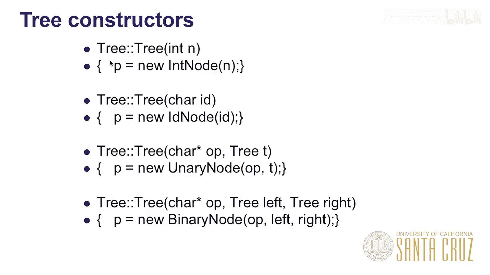
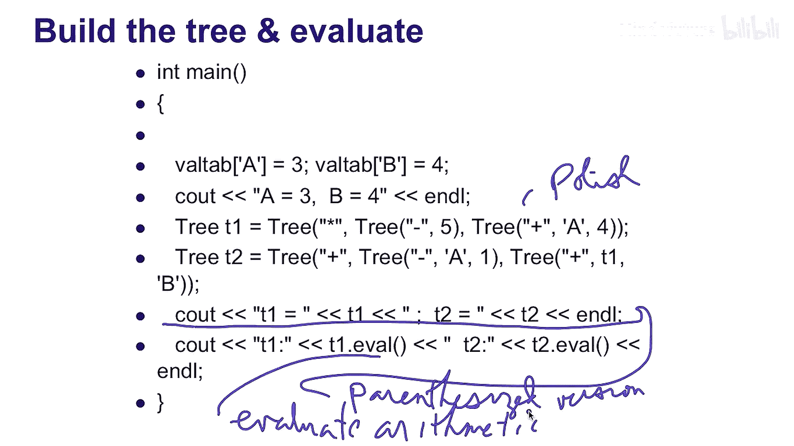
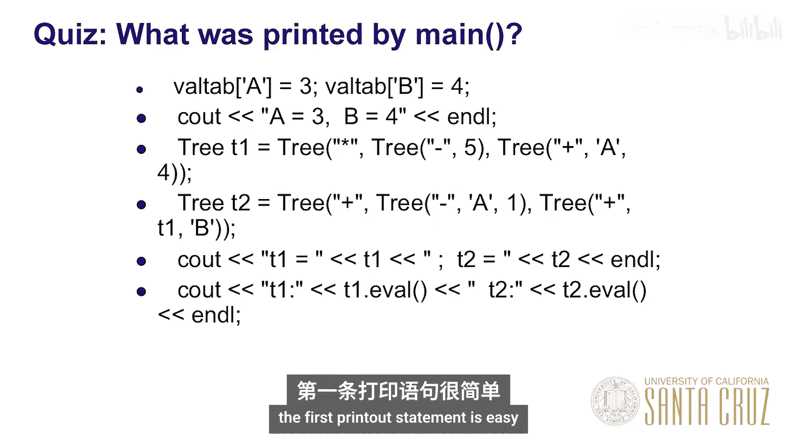
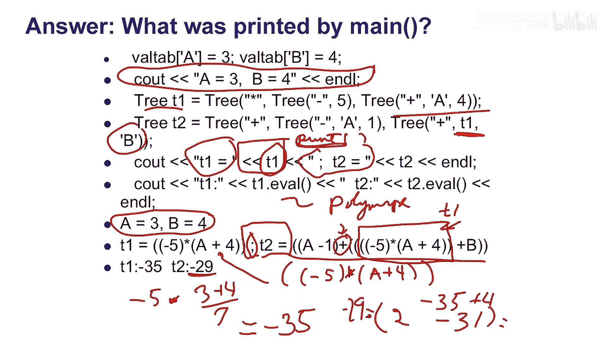
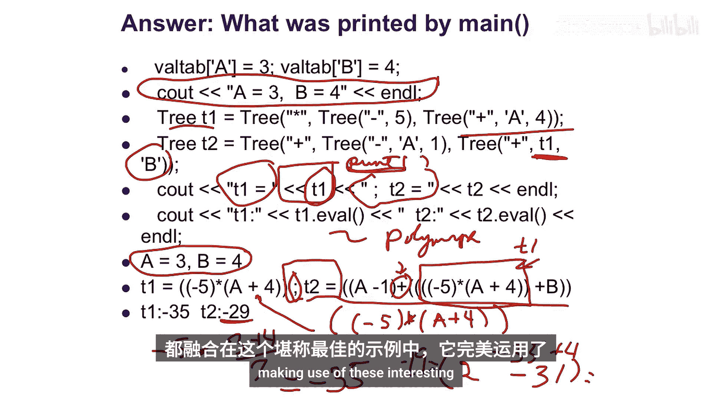
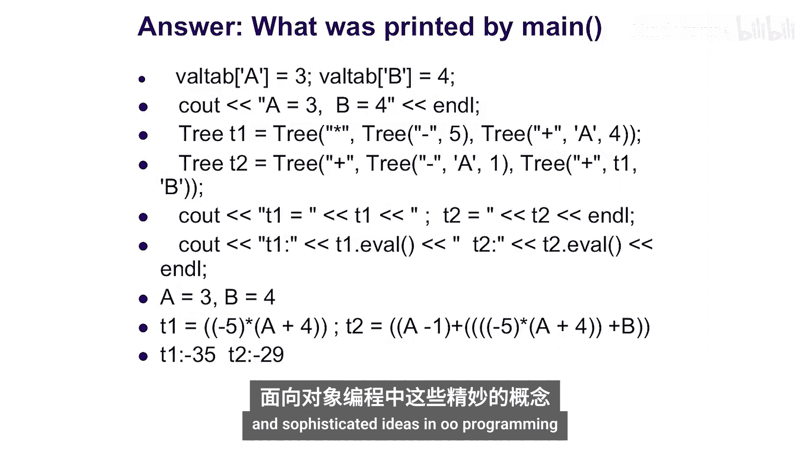

# 【加州大学】C++编程-｜-C-Plus-Plus-B-p41-P41_3-11-树构造函数_03_04_04--BV1KseJzqEbZ_p41-

Whole bunch of tree constructs。They call the appropriate node constructors。And you get this sort of。

Base pointer。

And then， here's。How it all might work。So I have two variables A and B。 I've assigned a the value 3。

Be the value for。Let me print this out， so we'll know that。A has been assigned3 and B4。

And then I want you to compute these two trees。 And here you can see them as。呃。If you want an in。

This is your Polish。And what's going to be produced here？Is。Prenhesized version。

So this is an expression walker， walks along the tree， produces from the parenthesis free notation。

 the fully parenthesized and fixed notation。And it also will do the evaluation。

So you can actually find out what these trees will evaluate to ametically。

Okay。Given that。呃。I want you to be able to do all that so that's。Our quiz on this topic。Again。I very。

 very much want you to play with the example。Take it home。Run a version of it。On your computer。

Try and improve it， try and extend it。So what is this program going to print。

 what's going to be printed by Maine？And we could see all of these。The first one is easy。

 the first printout statement is easy。

See what happens， answer。Well， this is pretty trivial。

So we see that we would get a equals 3 b equals four。Just very explicit。

 we're printing out that string。Then， we。Call the right constructors notice。

 we're going to have a whole bunch of constructors call。This is going to call some copy constructors。

 T1 is going to call a tree constructor， which has two subtrees， is binary tree2。

 as T1 embedded in it。So we're going to use all of those various constructors that we saw。

 we're going to use all this evaluation， all this polymorphism。And here we're going to do T1。

And now we're going to call。What walks the tree。And gets us the right。

 this actually ends up getting us a print call。This operator has been overloaded and implicitly calls print。

Pri walks that tree and does that fully parenthesized stuff。And so if we look at。

Minus5 is the innermost。So we build it first by building minus5。And then we build a second segment。

 which is a plus4。And then that's binary。 and the。Binary operator there is times。

And then its print puts the last pair of parentheses。So that's how we get this。

And then the semicolon comes out of that。And then equal to。So that's that part。

And now we evaluate T2。And T2 has T1 embedded so that's。Look at T1 embedded in there。That's T1。

Remember that's through a copy constructor an appropriate use。Of。Referential copying。

So we get a big saving。And then we add B to it， that's this part。So we get one further set of pars。

And then in the first part of the tree， the left tree， we get a minus1。

 and then the overall tree is a plus。So you should end up。With that fully parenthesized expression。

And then。If we were to evaluate them。T1 evaluates to。min-5。Times。😔，A， which is three。

 because that's a leaf node with a Vt of three。So it's3 plus four， which is seven。

said minus5 times 7 is minus 35。So the inner tree is minus 35。We have to add four。So， that's。inus31。

And on the other side， we have。A。Which is3 minus-1。So we get3 minus1 or two。

And that's equal to minus 29。Okay。So。That should be the answer you get if you had trouble with that。

 as I say， very important to go home。While you may be home already and that's the value of taking this course online so right where you are on your computer。

 play with this example， make sure you fully understand it because this example has great value。

 it has value at the level of O design， inheritance hierarchies。

 it has value in terms of garbage collection， it has value in terms of parsing。

 it has value in terms of understanding tree structure。

It's about。Five or six topics is all embedded in what is among the best。Examples I've ever seen。

Making use of these。

Interesting and sophisticated ideas in OO programming。

Okay。Next time we're going to get back to。What is a relatively amazing development in AI？

It actually pervades lots of AI， so we're going to see it in the context of writing on artificial intelligence for the heX program。

 this is going to be the Monte Carlo evaluation of positions。But。There's a much bigger theme here。

 this AI idea applies to things， for example。Like。Machine translation of natural language even。

And all sorts of problem solving areas。So that will be our next topic in detail。

