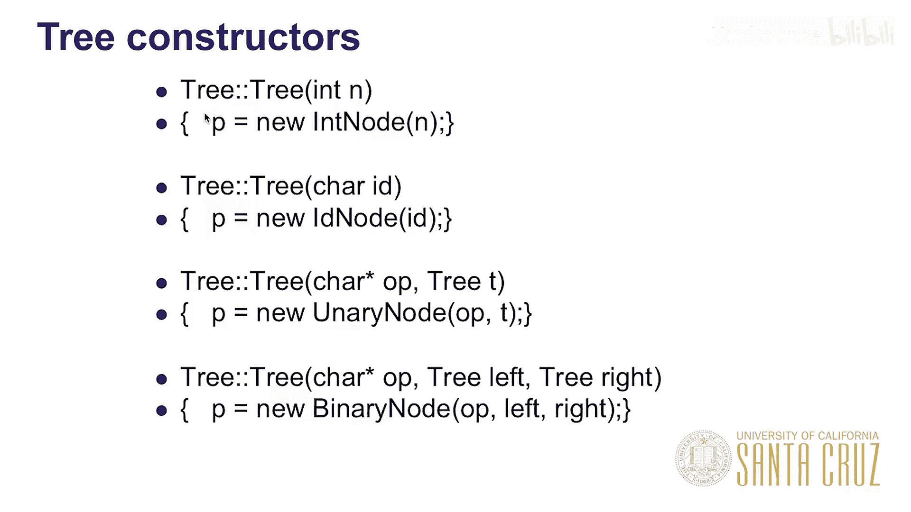
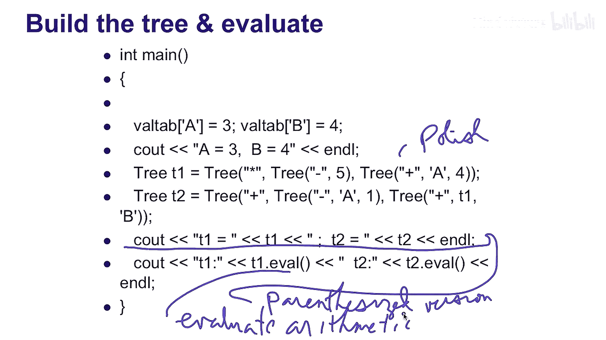
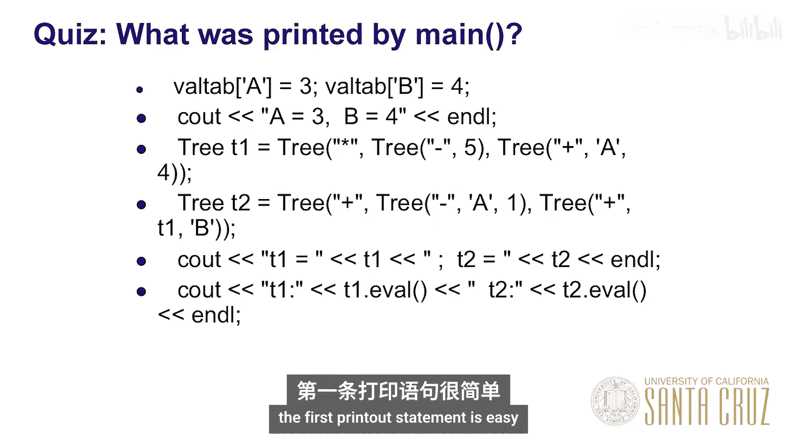
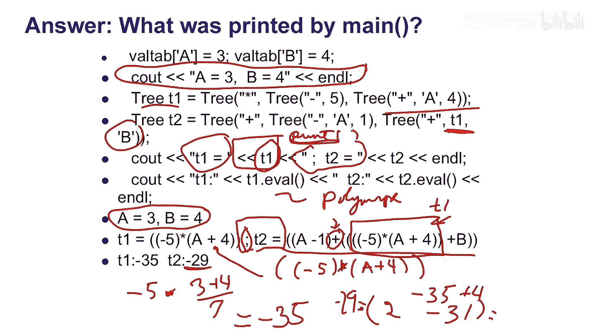
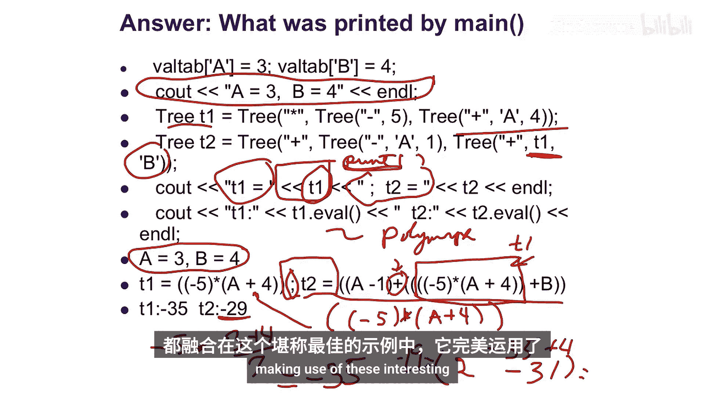
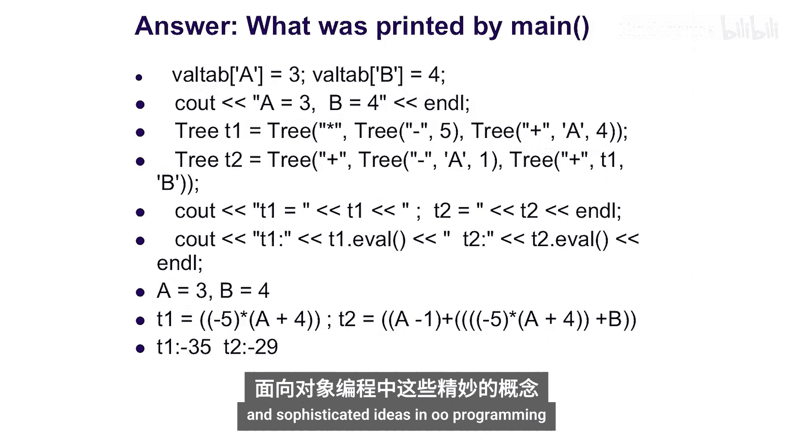

# C++编程：P41：树构造函数与表达式求值



在本节课中，我们将学习如何通过构造函数构建表达式树，并利用多态性来遍历和求值。我们将分析一个具体的代码示例，该示例综合运用了面向对象设计、继承、垃圾回收和解析等多个核心概念。

## 表达式树的构建 🏗️



上一节我们介绍了树结构的基本概念，本节中我们来看看如何通过一系列构造函数调用构建出具体的表达式树。程序会调用相应的节点构造函数。

以下是构建过程的核心步骤：
*   创建表示常量和变量的叶子节点（如 `-5`， `a`）。
*   使用二元运算符节点（如 `*`， `+`）将子树组合起来。
*   通过复制构造函数高效地复用已有的子树。



最终，我们得到一个由基类指针 `Expr*` 管理的树形结构。

## 表达式树的遍历与输出 🔄

构建好树之后，我们需要遍历它以输出表达式并计算结果。这里使用了操作符重载和多态性。

以下是遍历与输出的关键机制：
*   重载的 `<<` 操作符会隐式调用树的 `print` 方法。
*   `print` 方法执行一次树遍历，将波兰表示法（无括号）的表达式转换为完全括号化的中缀表示法。
*   同时，`eval` 方法会递归计算整个表达式树的值。

## 示例分析与逐步求值 📝

现在，让我们通过一个具体例子来理解整个过程。假设有两个变量：`a = 3`， `b = 4`。

我们首先构建表达式树 `t1`，其对应的表达式为 `(-5) * (a + 4)`。

以下是 `t1` 的构建与求值步骤：
1.  构建叶子节点 `-5` 和 `4`。
2.  构建变量节点 `a`。
3.  用 `+` 运算符节点组合 `a` 和 `4`，形成子树。
4.  用 `*` 运算符节点组合 `-5` 和上一步的子树，形成 `t1`。
5.  输出 `t1`：`((-5)*(a+4))`。
6.  求值 `t1`：`(-5) * (3 + 4) = -35`。

接着，我们构建更复杂的表达式树 `t2`，其表达式为 `(t1 + b) + (a + (-1))`。

以下是 `t2` 的构建与求值步骤：
1.  通过复制构造函数复用 `t1` 的树结构。
2.  构建叶子节点 `b` 和 `-1`。
3.  用 `+` 运算符节点组合 `t1` 和 `b`。
4.  用 `+` 运算符节点组合 `a` 和 `-1`。
5.  用最外层的 `+` 运算符节点组合上述两棵子树，形成 `t2`。
6.  输出 `t2`：`((((-5)*(a+4))+b)+(a+(-1)))`。
7.  求值 `t2`：`(-35 + 4) + (3 - 1) = (-31) + 2 = -29`。

因此，程序的完整输出将是：
```
a = 3 b = 4
((-5)*(a+4)) = -35
((((-5)*(a+4))+b)+(a+(-1))) = -29
```

## 核心价值与总结 🎯



本节课中我们一起学习了表达式树的构造、遍历与求值。这个示例虽然代码量不大，但极具教学价值，它巧妙地将多个高级编程主题融合在一起：





*   **面向对象设计**：通过继承体系（`Expr`, `IntExpr`, `VarExpr`, `AddExpr` 等）实现多态。
*   **内存管理**：利用智能指针或引用计数实现高效的垃圾回收，避免内存泄漏。
*   **解析（Parsing）**：将线性表达式转换为树形结构。
*   **数据结构**：深入理解树结构的应用。

理解这个示例对于掌握C++中的面向对象思想和复杂系统设计至关重要。建议你在自己的计算机上运行并修改此示例，以加深理解。

下一次课程，我们将回归人工智能领域，探讨一个影响深远的技术——蒙特卡洛方法。它不仅用于棋类游戏（如六边形棋）的局势评估，还广泛应用于机器翻译、自然语言处理等各种复杂问题求解领域。