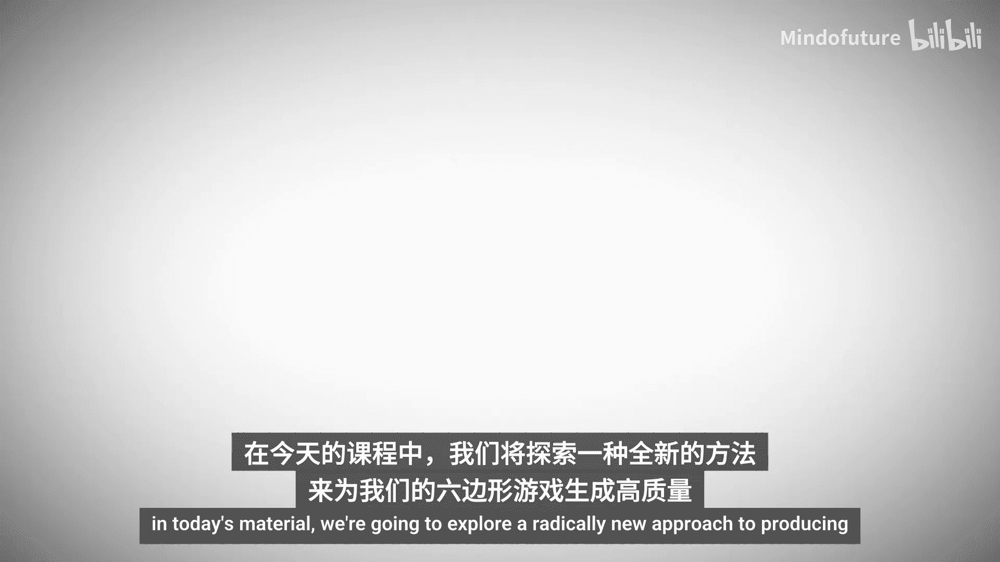
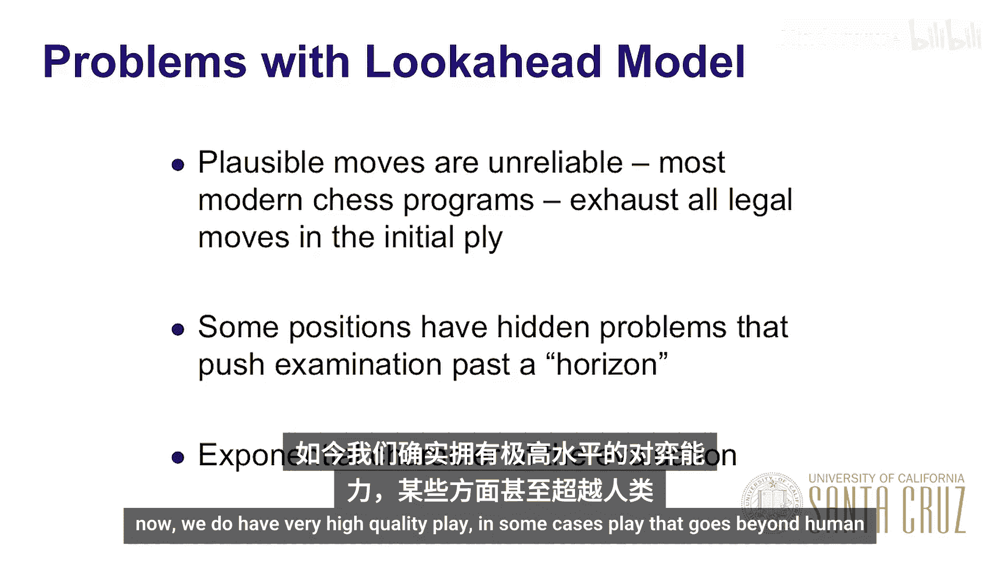

# 【加州大学】C++编程-｜-C-Plus-Plus-B-p42-P42_4-1-断言与异常处理_04_02_01--BV1KseJzqEbZ_p42-

🎼嗯。🎼，🎼あ。

Okay， in today's material we're going to explore。A radically new approach。To producing high quality。

AI。In our hex game。What's remarkable about this is that this was。Discovered。About 2006。

When investigating the game of go。At where。Randomized moves made on the goboard。

LED to a much better way to explore how to produce a good move and what。Was of up to then。

Quite intractable problem。So we're going to。Learn how to use this Monte Carlo scheme and apply it to our term problem。

Hex game。Now， we'll also。Talk a fair amount today about。

How to deal with making sure your code is correct， especially the use of assertions。

Static assertions， which are new to C++ and exception handling。啊。

And those will be our key programming points。Moonnie Carlo again。

We've seen this in other areas its basically a technique for using probabilistic simulation。

To understand a phenomenon。嗯。Typical phenomena that you might try to understand with probabilistic。

Simulation on a computer would be something like weather prediction。And then。

 assertion and exception handling。These are features that go back originally to the C programming language and then an enhanced way。

Got added into the standard library， especially the exception Hierarchy Library。

So if you're familiar with classical AI。Where you're playing a game like Hex or a game like chess or a game like go。

Basically， going back to。Vumen。And Morgan Stern。And this is material in the 1940s。

There was sort of a standard point of view。And Vanon Neummann was great applied mathematician。

 and Morgan Stern was a mathematical economist。And they were sort of looking at how you evaluate。

Situations in order to make optimum moves。And this's a basis behind lots of decision making。

 So what we're talking about isn't just something applying to AI。

But almost any area of decision making， even whole subjects like operations research。

Critically studied。How do you bring rationality to the board。

 How would you run a company rationally any time you have a decision。

 and especially a decision where there are multiple outcomes and some of the decisions can be probabilistic。

And in these classic points of view， one assumes a rational opponent。

Who is capable of selecting a best move？And so you have a whole number of opportunities you have to make。

A move from a large selection of moves。And for example， in chess， in a typical chess position。

 that's around 40 moves。And you have to use some criteria because， especially if you're a human。

40 multiplies exponentially quickly， and so you would be in the many millions of possibilities after just a couple of moves。

Your move， your opponent's reply is already 1600， so in sort of classically two moves or for ply。

 you're well over a million。Distinct。Possibilities。Now。

 Grandmas look at only a few of those because realistically。

 many of these moves are known to be irrelevant。And they use the criteria and these are normally called plausible move criteria。

 and among plausible move criteria and chess would be examination of checks。

 so as always the old adage， if try a check it may be mate and mate win a game。So， checks， captures。

Sometimes advancing pawns， these are criteria， and they may vary during the game。 And similarly。

 there are criterion games like Hex。 Think about hex and in hex， as we've already explained。

 good hex players learn to make bridges。 Bridges are ways to jump across the board and also they make blocking moves。

 So a hex player isn't likely to look at moves around the edge of the board。

 So they may be many moves around the edge of the board。

 but the moves that are rich in hex are going to be in the middle of the board。

 or moves that plausibly extend。Your ability to link up， if you're a north south player。

 you're going to look for links north to south。So after you decide for your plausible moves and don't forget if you're on a big hex board。

 much like O， that number is actually quite a bit larger than 40。

 So in our hex game that we're using an 11 by 11 board， we have something like for quite a while。

 well over 100 moves to consider at each ply。 So at Hex。To p is already 10，000。

And Ford applies 100 million。So you can't routinely in a minimax situation。

 pursue hex to any great depth so you have to。Pair down。Very quickly in the normal， look ahead。

Your plausible moves， you have to select three or four plausible moves and three or four plausible moves to your opponent before you reach a position where you can have in our third point here。

 your static evaluation， so you typically in an AI situation。Decide on plausible moves。

 make your plausible moves， make your opponents plausible moves。

 keep making plausible moves as long as you have computing resources until you get to a situation in which the evaluation is relatively clear。

 these may be called the leaf nodes。 Now in the ideal situation in the abstract situation。

 leaf nodes are going to be nodes in which we know who has won or lost。

Where we have a known final value。But in these very difficult games of interest to humans。

We generally can't get down to the final situation of the board to a known result。

 but we get to a result in which we have a very good guess where what we call the position。

 the nature of the position is static， and we can use some ability to calculate， like with Hex。

 who has the longest。A potentialent path across the board whoever has currently the longest path is the likely winner。

 whoever has the most men born off in backhammon， is the likely winner。

 whoever has the most material in chess or checkers is the likely winner。

 whoever dominates area in a go game。Likely winner。So then we have a big tree。And nowadays。

 those trees can have tens of thousands， even。Tens of millions of nodes。

 and we apply our alpha beta to pick our move。 So we've seen that and so far。

We've concentrated on what you might call the classical techniques in AI for building our。啊。

Game program。So little a quiz。If， for example， you had two plausible movesose and a tree of 20 ply。

 And don't forget， Hex is potentially something that's going to be1 hundred and20 ply。

 Jeess is going to be something that's 100 ply Go is going to be something that's。啊。

On the order of 400 ply， she have a 19 by 19 board。So how many for this kind of simplification。

 approximately how many leaf nodes are you going to have to evaluate if you're classically using miniax。

 take a second and think about that。No， the answer is approximately a million。

Because you're basically getting a two to the 20th。

And if you're a longtime computer scientist like me。

 everybody knows your powers of two and roughly speaking rule of thumb two to the tenth is a thousand。

Give or take24。 So you're having a thousand squared。 Drs a million。 So even where you have。

Narrow down your plausible move。To a fairly simple structure， you could still get a very large tree。

So here are some of the problems with the classic look ahead model。

Plaauusible moves can be unreliable。 Indeed， in the early days of chess programs where you had 7 or 8 plausible moves。

They didn't play very well。And it was frequently the case that it was okay for a while to have a plaible move but。

Insfully。Chess Masters。Figure out something that is。What you might call eccentric。Unseen。

 that's how they startle their lesser opponents。So they might create a sacrifice appearing to give up lots of material。

 well that wouldn't be a plausible move。 Sacrificing your queen is not a good idea。

 most of the time losing your queen loses the game for you。

So if you were to have a fairly rigid plausible move generator。You might be missing critical moves。

 So indeed， it turns out that the later supercomputers， like Deep Blue。

 the computer that defeated Gary Casperro actually had special chess hardware。

That examined at least for a while， every legal move so that they wouldn't miss something。

At least they wouldn't miss it。啊。For a few levels。And that was one of the great。Improvements。

In programs like Cheess and Checkers and Othello， where they discovered that an amazing amount of computation。

Even though it seemed like that wasn't the answer because the trees get too deep。

Was indeed extremely helpful， it was indeed enough to uncover situations that。

The ordinary beginning player would miss， so even if they had poor evaluation functions。

 if they added enough。Exhausive search， it was very helpful。So plausible moves can be unreliable。

Some positions。Have an extremely large what's called the horizon effect。That。

You can examine the board。And not see that 40 or 50 moves later， the game will be won。

And the characteristic here in a chess game。And it probably exists as well and go is。

There are certain porn formations， and those porn formations create a very static situation because they're hard to penetrate。

And in those poor informations where everything is fairly static and certain things can't be changed。

You can， instead of saying， I go here， I go there， you could say， oh。

 if my march my king around that porn chain， even if it takes me 25 moves。

I can get to a place through the opposition man don't worry about all this。

 if you're a chess player of some ability， then you'll know what I'm talking about。

But this can be foreseen by expert players because they know the expert player in Cheser and go know that a certain situation。

Is independent。Of how far ahead。You need to look to take advantage of it。And early chess programs。

Frequently would stop and do a static evaluation， and it would be below the horizon where the chsma knew that this deep structural situation gave him a big edge。

 and the program didn't know。 So indeed。There were。

Anti program strategies so even when the programs on average could play at master level chess in like the 1980s。

Players of world class like Casrovrov still had no problem。

 What they did was they used what was called an anticomputer strategy。

 made sure the game was quite static， so the computer couldn't use as combatorial advantage。

 its short term advantage and stuck to things that they understood to be strategically long term assets that the computer was poor at evaluating。

 and they established those knowing that at some point they would be able to cash in on those。

And then pure and simple with the look ahead model， you still get exponential problems， is still。

 no matter what。啊。Now， we do have very high quality play， in some cases。

 play that goes beyond human ability， but but the exponential character of these games can make them peace space on a large enough boards。

There is no way to get the computer in a reasonable time to play perfectly。

So having this exponential problem。The exponential explosion。

 which happens in all sorts of AI domains。Still means that sometimes decision making。It is poor。

