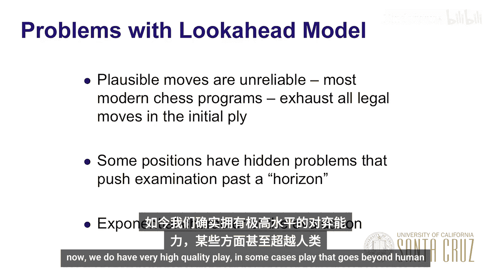

# C++编程：P42：断言与异常处理

## 概述

在本节课中，我们将学习一种全新的方法来生成高质量的人工智能，并将其应用于我们的Hex游戏中。这种方法的核心是蒙特卡洛模拟技术。同时，我们还将深入探讨如何确保代码的正确性，重点学习断言、静态断言以及异常处理的使用方法。

## 蒙特卡洛方法简介

上一节我们介绍了经典AI中基于前瞻搜索的决策模型。本节中，我们来看看一种截然不同的方法：蒙特卡洛方法。

蒙特卡洛方法本质上是一种利用概率模拟来理解现象的技术。在计算机上，你可以用它来模拟天气预测等现象。这种方法大约在2006年研究围棋时被发现，当时在棋盘上随机落子，意外地找到了一种更好的方式来探索如何产生好的走法，从而解决了一个在当时看来相当棘手的问题。

## 经典AI的局限性

在深入蒙特卡洛方法之前，我们先回顾一下经典AI方法的局限性。经典AI可以追溯到冯·诺依曼和摩根斯坦在20世纪40年代的工作，它构成了许多决策领域的基础，不仅限于AI，还包括运筹学等。

在经典观点中，我们假设存在一个理性的对手，他能够选择最佳走法。因此，你需要从大量可能的走法中进行选择。例如，在国际象棋中，一个典型局面下大约有40种走法。由于人类计算能力有限，40种可能性会呈指数级快速增加，仅仅经过两步（你走一步，对手回应一步），可能性就超过了1600种，几步之后就会达到数百万种不同的局面。

因此，棋手通常只考虑其中一小部分，他们使用所谓的“合理走法准则”。在国际象棋中，合理走法可能包括将军、吃子、推进兵等。类似地，在Hex游戏中，优秀的玩家会学习构建“桥梁”和进行阻挡。所以，Hex玩家不太可能考虑棋盘边缘的走法，他们会关注棋盘中部或能够扩展自己连接能力的走法。

在我们的11x11 Hex棋盘上，很长一段时间内，每一步都需要考虑超过100种走法。两步之后就是一万种，四步之后就是一亿种。因此，在极小化极大算法中，你无法在Hex游戏中深入搜索太多步，你必须迅速缩减搜索范围。

在典型的AI场景中，你需要决定合理走法，然后进行搜索，直到达到一个局面评估相对清晰的节点，这些节点被称为“叶节点”。在理想情况下，叶节点是已知胜负的终局。但在人类感兴趣的复杂游戏中，我们通常无法达到已知结果的终局，只能达到一个我们可以很好猜测的局面。例如，在Hex中，谁拥有最长的潜在路径，谁就更可能是赢家。

## 经典前瞻模型的问题

以下是经典前瞻模型存在的一些问题：

*   **合理走法可能不可靠**：在早期国际象棋程序中，如果只考虑7到8种合理走法，程序下得并不好。象棋大师经常会走出一些“古怪”的、出人意料的走法，例如弃子。如果程序有一个僵化的合理走法生成器，它可能会错过这些关键走法。后来，像“深蓝”这样的超级计算机配备了专门的象棋硬件，至少在初期会检查所有合法走法，以避免遗漏，这是一个巨大的改进。
*   **存在“地平线效应”**：有些局面下，你审视棋盘，可能看不到40或50步之后游戏会获胜。在国际象棋和围棋中，某些兵形结构或局面会形成非常静态的态势。专家棋手知道，某些局面带来的优势是独立于你需要前瞻多少步才能利用它的。早期的象棋程序经常会停下来进行静态评估，而评估结果可能低于专家棋手所知的、由深层结构局面带来的巨大优势。因此，即使程序平均能达到大师水平，世界级棋手仍能通过“反计算机策略”来应对，即确保游戏保持静态，使计算机无法利用其组合优势，并建立计算机不擅长评估的长期战略优势。
*   **指数爆炸问题依然存在**：无论采用何种优化，前瞻模型仍然面临指数级增长的问题。在某些足够大的棋盘上，计算机无法在合理时间内达到完美对弈。

## 总结

本节课我们一起学习了蒙特卡洛方法作为一种替代经典AI搜索技术的新途径，并回顾了经典前瞻模型在合理走法可靠性、地平线效应以及指数爆炸等方面的局限性。在接下来的课程中，我们将具体探讨如何将蒙特卡洛方法应用到Hex游戏中，并学习C++中用于确保代码健壮性的断言和异常处理机制。