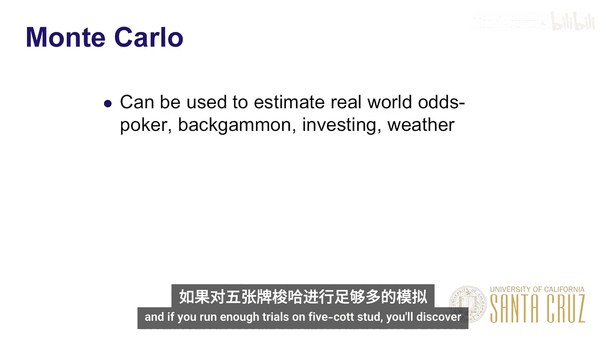
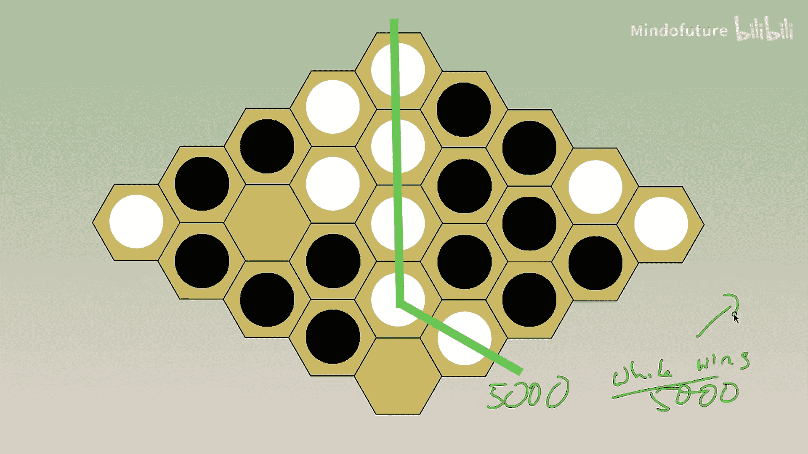
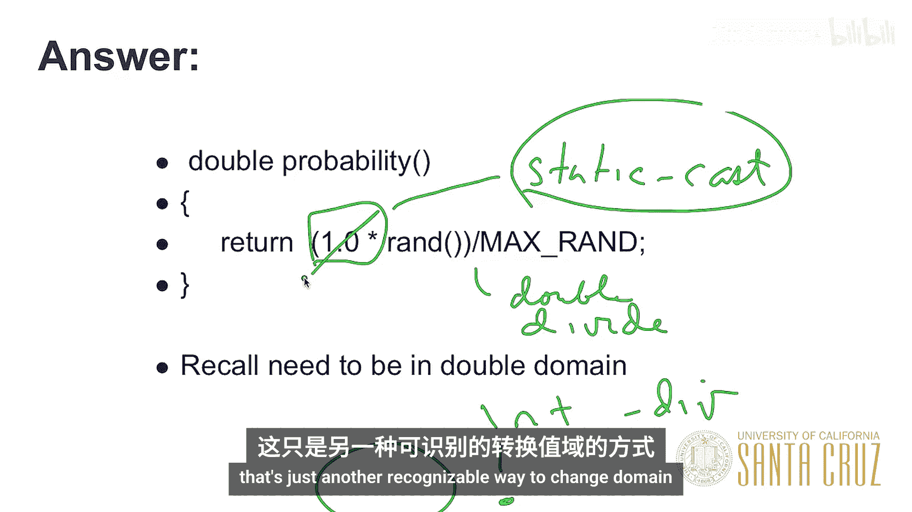

# 【加州大学】C++编程-｜-C-Plus-Plus-B-p43-P43_4-2-蒙特卡洛_04_02_02--BV1KseJzqEbZ_p43-

So what does Monte Carlo bring to the table？Critically。

 Monte Carlo is a simulation where we make heavy use of the ability to do reasonable pseudoran number generation。

 so it's not truly random， obviously， to provide a large number of trials。

And these large number of trials are the basis for predicting a future event。

You could do a Monte Carlo to decide in the next hundred years。

Is an asteroid going to collide with the earth， you'd have to know some probabilities。

 you'd have to know some facts and figures about the solar system。

 and then you could probably make an estimate that hopefully would be that very。

 very small likelihood that we're going to have that kind of catastrophic event indeed。

 people do risk management using Monte Carlo management of， you know。

 what's the case of getting a00 year flood or 10 year hurricane and we're discovering that these things are getting more likely because we're understanding more now about climate change So probabilistic。

Trials can let us get at things that otherwise we don't have ordinary mathematics for。

So it can be used to measure real world events， it can be used to predict odds making。

 we've seen us doing a Monte Carlo trial on dice games on poker， I think we at an early stage。

 try to predict what the odds are of a straight flush and poker for five handed five- handed studt。

 five card stud。And if you run enough trials on five God stud。

 you'll discover that a straight flush is roughly one in 70，000。

And if you tried to ask most poker players what that number was。

 they would probably not be familiar with it， I've actually informally tried that and they have wildly different guesses。

Of course you could look it up in a table and you could calculate it。

 it's not that hard mathematically， but with very little computational experience， you can readily。

 you don't need to know the probabilistic stuff， you readily get abilities to estimate all sorts of things。

So you can use it heavily in an investment。So it's a very useful technique。

So what about Monte Carlo and Hex， here's our Hex board。We're showing a5 by5。

 So it's a relatively small export。 and indeed。When you go to write your code。

 that hopefully have said this already。Don't use the bigger boards right off the bat。

 Use a small board。 Make sure everything is working on a small board。

 A small board will be much easier to debug if you write the code。

The board' size should be a parameter。So it's not going to be hard to scale them。

 but it'll be a lot easier to investigate the quality of the moves whether everything is working in your program so here's a five by five board。

And we want to examine， well， what is a good move in the 555 board？

So we make every possible move on that five by five board， so we have。Essentially， 25 places to move。

And we'll assume that white is the player who goes first。And we have those 25 positions to evaluate。

So we're not going to do just plausible and we's going to do all moves， so if it's 11 by 11。

 you have to examine 121 positions。Now， you could get fancy， and you could assume that。Really。

Some of these moves are。Quite similar to each other。

 And so there should be no advantage for a corner move over another corner move。

 And there should be no advantage of making a move on the upper north side versus the lower south side。

 So you could restrict it sum。 that optimization may be of value。 But for the moment。

Let's forget the optimization， because that goes away pretty quickly when there's。

A position on the board。Once having a position on the board。

 all the squares end up being unique in relation to。Pies being placed on the board。

 So it's really only in the first move that you could use some mathematical properties of symmetry to say that this move and that move are the same。

So we make all those moves。And now。Here's the unexpected finding。By these people examining go。

The rest of the moves to be generated on the board are going to be random。No plausible moves。

 no examination of alpha beta。 No nothing。We're going to make the next 24 moves by flipping a coin。

 so black moves next and black moves at random on the board。White moves at random on the board。

And we fill out the rest of the board。And at the end of filling out the rest of the board。

 we know who's won the game。So here is a winning path。The end of this game， this white path。

 white has one here。So we could stop earlier whenever this here you show that there's still some some。

Moves to be made， there are still some empty places。

 but I'm going to explain today why it's not worth bothering to stop and examine at each move whether somebody has won。

I'll explain it now worth explaining now and repeating later。

 turns out you might as well fill out the board because once somebody is one。

 there is no way to change that result。 fillinging out the rest of the board doesn't matter。Why。

 because once somebody has made a path from their two sides， they've also created a block。

 So there's no way for the other player to somehow also make a path。

 That's the character of the hex game。So it's a very trivial calculation to fill out the board randomly。

 it's not a trivial calculation to decide who's won， Why is that not a trivial trivial calculation。

 because that involves essentially a distra like algorithm we've talked about that before。

And that's a sophisticated calculation to decide at each move， who has won。

 So here you have a very elementary。Only a few operations to fill out the board。

 and then by examining Dyktra once and only once， the big calculation。You get the result。

 so you might as well go to the end of the board， figure out who won。And you do it again。

So for this position， let's say you do it 5，000 times。Sometimes whites going to win。

 Sometimes black's going to win。 That's what you expect。 And you're going to get some ratio。

 white wins。Over。5000， How many trials？And that's now going to be some assessment of that position。

 that's going to be how you evaluate that board。You're not going to have to know anything else。

 you're not going to have to do a static evaluation on a leaf node where you can examine what the longest path is。

 you're going to do this quite simply your evaluation function is merely。

Run your Monte Carlo as many times as you can， given how efficient you write your algorithm and how fast your computer hardware is。

So this is going to be a test for you of how。Clever you're going to be in your C++ programming because you do want maximum efficiency。

And then。If you get a relatively high number。You're basically saying， oh。

 two idiots playing from this move， one idiot seems to do a lot better than the other idiot。

 maybe that means implicitly this is a preferable move。

And that's the insight。 The insight is you don't need two chess grandmasters or two hex grandmasters who have sophisticated ways to seek out bridges。

 Bing strategies， checking strategies in whatever game or go masters in the go game。

territorial special patterns， instead。The character of the position will be revealed by having two idiots play from that position and the one that wins more often intrinsically is playing from a better position。

That's the insight。Okay， take a second and let's think about using random numbers again。

 RAand gives you an integer pseudoran number， that's what RAand in the basic library does for you。

How can you turn this integer？Into a probability。Now this should be review。不。

So here's the way to do it。We manufacture a probability by calling double probability。

 You can actually get probabilities out of the standard library as well。

 And you just say return around。Divide it by the maximum range， max RA。

 which is a library defined max number that's ran。啊。Can be。And in this case， I use 1。0 the double。

 and that turns this expression into a double， I have to watch。

 why do I have to be recall why I need to be in the double domain？

I have to be in the double domain because。I want this to be double。Divide。It's in divideiv。

So if I left out this。Probability would always return0。And that's。Not what will you。

the other way to do this is。To make this a static cast。So if we started cast it， we could。

That's just another recognizable way to change domain。

