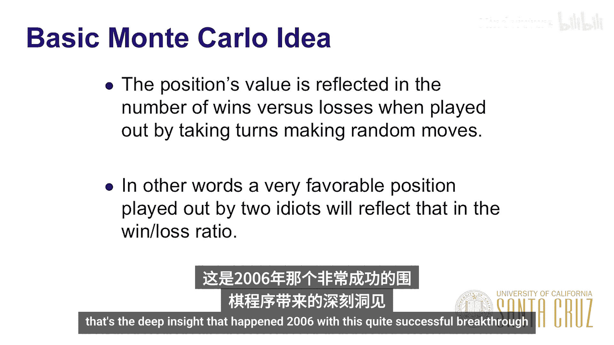
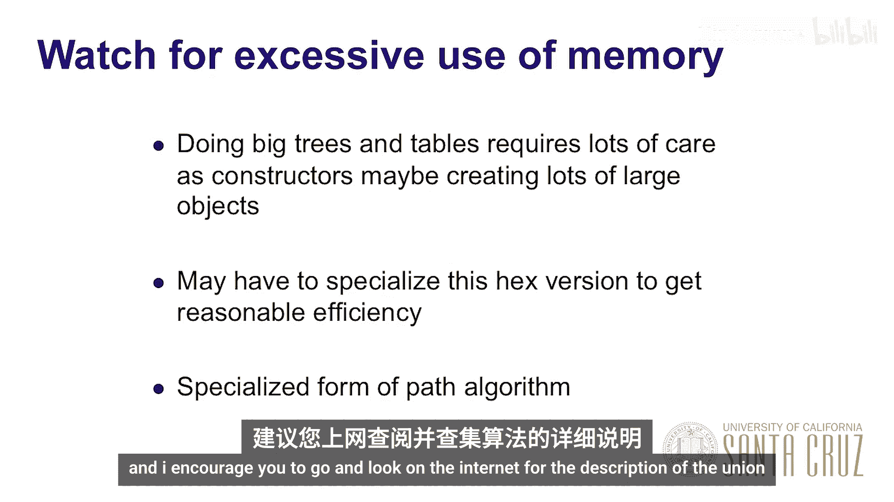

# 【加州大学】C++编程-｜-C-Plus-Plus-B-p44-P44_4-3-蒙特卡洛基本思想_04_02_03--BV1KseJzqEbZ_p44-

So here's that key insight， again， this remarkable insight that just using random。

Moves on the board and then evaluating the ratio of play， to idiots playing。

Gives you an accurate evaluation。Of making that move。

That's the deep insight that happened 2006 with this。

Quite successful breakthrough go program， and indeed it underpins a lot of modern thinking。In。AI。

 whereas in older AI， there was this strong。Idea of modeling how human experts do things。

 And so in the older days in the newel Simon and Sha days of Carnegie Mellon， the understanding was。

 well， we'll get a great physician。 Think of house。On TV。

 we'll get a great digian like him by getting a hold of the human and finding out what rules they use。

And instead， the modern day Googles and Amazons call lots of information， big data。

 do lots of things at random。And then discover equally deep relationships through these many trials and this。

Huge amount of computation。 So AI has had a huge shift。

 It's not that the old cognitive modeling strategy is thrown out the window。

 It's that in many instances。Where it's too difficult and we don't yet understand how to model properly。

 how thinking works。The human perspective works， we can still get that result or better。喂。

Computer models， things that humans wouldn't be able to do just processing vast amounts of information and even using random trials。

Now， this will have things you still have to in your programming。Keep in mind。

You're going to be doing big trees and big tables， remember you have。An 11 by 11 board。

 potentially you're going to have an end by end board。

 and people frequently play the game with larger boards。So you should be able to play the game with。

Boards up to the size of goboard even。And that may require a big analysis in big trees and tables。

 And you want if you're going to do this all in C+ plus to make sure that you're not creating a lot of extra objects If you're doing everything within a graph based data structure。

 your constructors can be doing lots and lots of work。And you may have to specialize。

The graph structure to take advantage of efficiencies that you can have because the hex graph is a very specialized graph。

The same thing will be said of the Dykstra algorithm。

 There's no reason to use the generic arbitrary cost diytra algorithm because the hex graph。

That we're looking for。 The shortest path is a path from one side of the board to the other。

 So we have to decide if one or the other has one。 and that means finding a path。

From one side of the board to the other。And if you have a size 11 board。

 that path is going to be at least。Across the willll take at least。

10 edges to go from one side to the other。But you can actually require more edges because it can。

Snake around the board。 And it's an interesting exercise to see what would be the longest possible such path。

In a game。And the way you can find that efficiently is either specializing diyktra。

Or to use the classic algorithm Union find， and I encourage you to go and look on the internet for the description of the Union find algorithm。

So you don' you want to do huge amounts of trials and you don't want to get bogged down by doing this poorly。

 so the other thing that you're learning out of this。

Is how to be very careful when you're dealing with large aggregates。

 very careful memory is not an infinite resource， it's really easy to do a correct program that's inefficient。

And you'll just worry， why is my program running so slow。

 how can people get 1 thousand00 trials per move they have 120 moves they have to make  a thousand00 trials now you're talking about 120。

000 trials and evaluations you do that poorly on your computer and it'll be hours before you get an evaluation。

