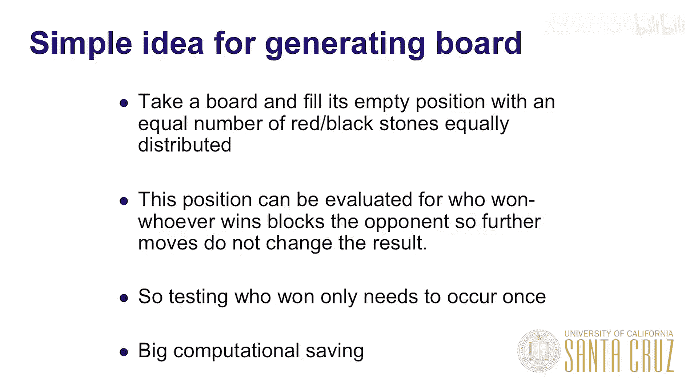
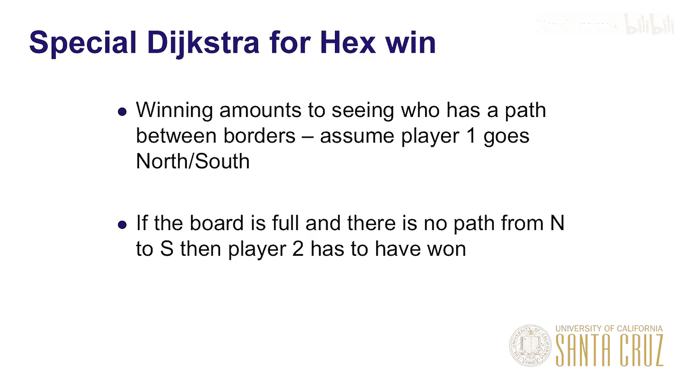
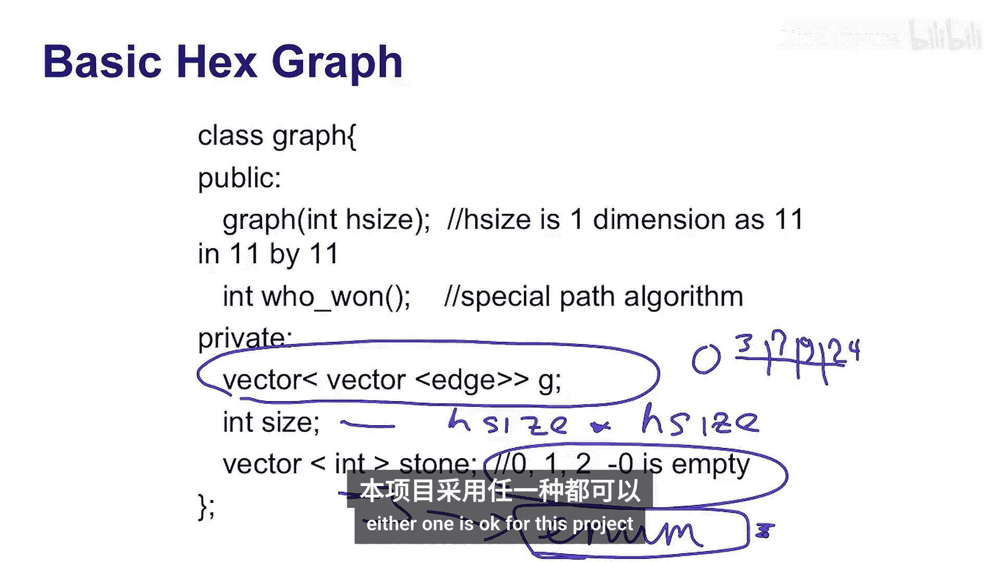

# 【加州大学】C++编程-｜-C-Plus-Plus-B-p45-P45_4-4-生成棋盘的简单想法_04_02_04--BV1KseJzqEbZ_p45-

So here are some simple ideas。Take a board， fill it。

From its empty position with an equal number of red and black stones equally distributed。

That's easy to do， by the way， if you are proficient in the use of the standard library。

 you will notice in the standard library that there is a preex routine called a shuffle routine。And。

If you shuffle all the nodes。And you have a data structure that's keeping track of the nose of the hexboard。

And you shuffle them， and you fill the first half of them with white stones。

And the second half were black stones。Then you've accomplished。

Your random placement on the board of the white and black stones。So let me suggest。

That that is the method you use you don't have to use that method， you could use a method where okay。

 I'm going somewhere at random in the remaining empty squares。

That and placing a white and then placing a black and taking alternate turns of placing white and black stones。

 But then you're going to have to keep track of。All the coordinates of what remains empty。

And we could do that readily， but as I say， you might as well they can manage one of the things you're benefiting from this class and we hope is。

A much better understanding and insight into the standard library and it has relevant routines that let you do this efficiently。

So。The position is going to be one after you fill out the whole board， I've already mentioned that。

 that's an optimization， that's an important optimization。And then the testing。

 the Dkester's algorithm， only needs to occur once。

So rather than have to test 120 times on the 11 by 11 board， you test once at the end。

Even though you have to make more moves， but making moves is cheap， really cheap。

 so this is a big computational win， it's a breakthrough computational win， and it's not obvious。

How do we specialize Dykestra， we've already gone at length into the Dykstra algorithm and the Dykstra algorithm is。

 you know， a critical pathfin algorithm underpinning。Lots of stuff in computer science。

 and it's a canonicaling greedy algorithm。 So understanding it， understanding algorithms like it。

That's a takeaway， I hope that's of real value， though hopefully you came into the class knowing that background already。

So winning a mouse is seeing whether one player， you can just assume on this full up board。

 if North south hasn't won， let's call him player1。Then it had to be east west that one。

That's from the nature of He。 So all we need to do is examine whether there is a complete path from the north boundary to the south boundary。

So here's a basic hex graph that I。啊。Suggest you try to use。呃。Not required。

 So if you write something that's as good or better or your own， fine and dandy。

 I'm not unhappy with that。 But for those of you who need a little more guidance。This may be a value。

So this is code that I generated to do the problem。And again， I have a general graph。

 but I'm going to have a constructor， I'm not going to worry about other constructors for the graph。

 I'm going to have a constructor that's given the heck size of the graph。

And that hex size is one dimension。So it's 11 when you have an 11 by 11 graph now。

Forget when you have an 11 by 11 he board or a 5 by5 he board， let's take the5 by5 case。

 you have 25 nodes， so the graph is really the Xs squared， the graph size。The number of nodes。

 the number of actual squares is the side because it's basically this exagonal square square。

And the other part of our interface is not only the constructor for the Hex board， but who won。

 This is our specialized path algorithm。 And then internally， again， you can do this in other ways。

I chose to。Use。A vector of vectors。And then that will be how I store my graph。

And the graph will be for each node。 there will be a vector of edges。 So here's the zeroth node。

 And here's our vector of edges。 All the edges out of that0 node，3，7，9， whatever。24， however， were。

In our board size， this is the actual board size。 So it's going to in effect when initialized。

From this constructor the。Asi squared。And then we're going to have。A simple representation of。

In each square related to the graph node， each square can be either zero， meaning empty， one。

 meaning a white stone， two， meaning a black stone or whatever colors you like。

So we have those three states。And indeed， one suggestion is to turn this into an anummerator。

So if I wasn't lazy in my own code， I would have probably made this its own class。

And then had three values， empty， white， black。To implement the who won algorithm。

We can either use a specialized form of diktra。That looks for a path between。

North and south or east and west。Or we can use classically the Union Find algorithm。

Either one is appropriate， either one is okay for this project。

