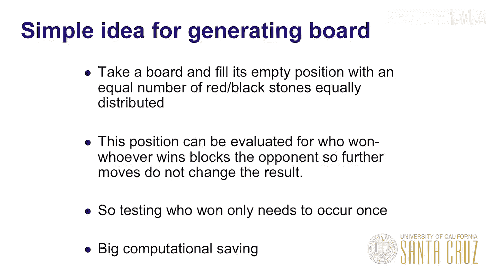
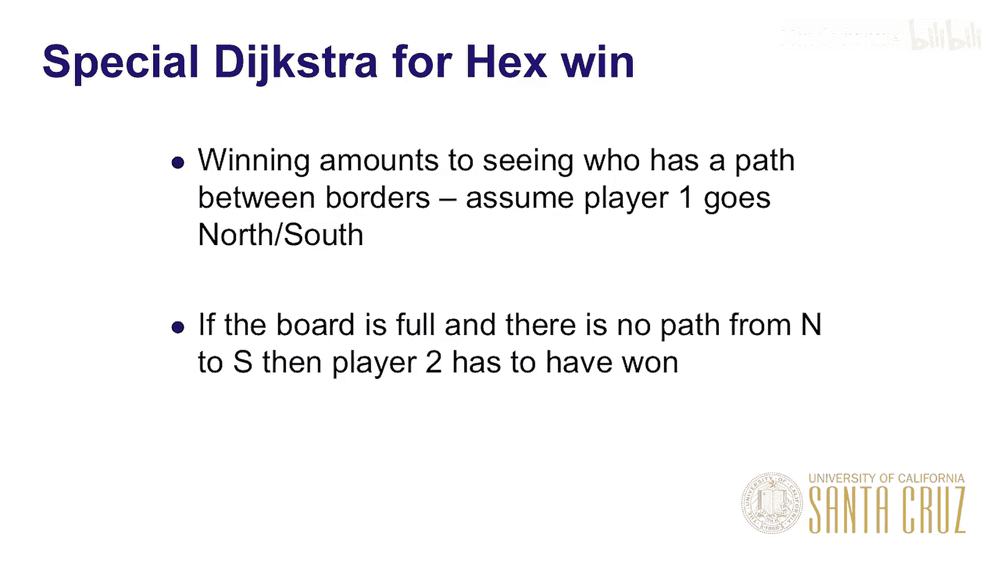
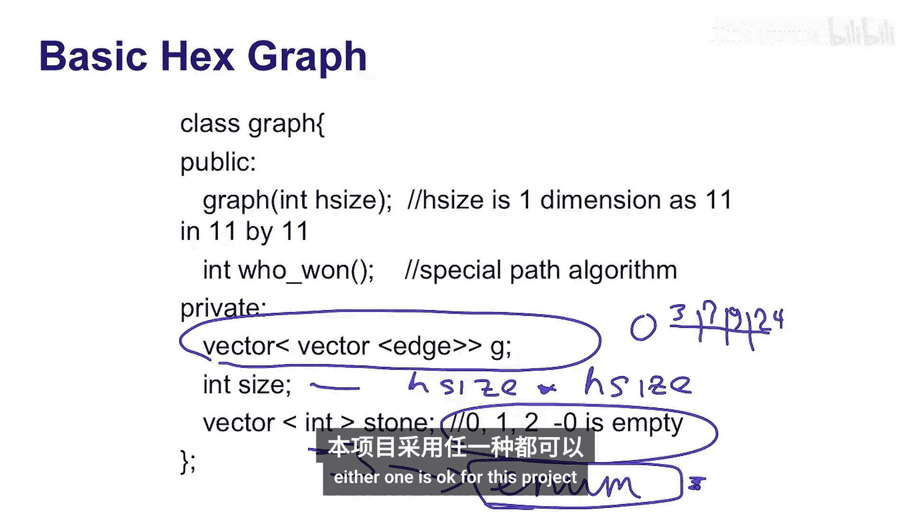

# C++编程：P45：生成棋盘的简单想法

在本节课中，我们将学习如何为Hex游戏生成一个初始棋盘。核心思路是：首先创建一个空棋盘，然后随机、均匀地放置红黑两色的棋子。我们将探讨实现这一目标的高效方法，并介绍如何利用标准库工具来简化流程。

## 棋盘初始化与棋子放置

上一节我们介绍了Hex游戏的基本规则，本节中我们来看看如何构建一个初始的游戏棋盘。

一个简单的想法是：取一个空棋盘，在其空位上均匀地放置数量相等的红色和黑色棋子。

如果你熟练使用标准库，你会发现其中有一个名为 `std::shuffle` 的例程。我们可以利用它来高效地完成随机放置。

以下是实现随机放置的一种方法：
1.  准备一个数据结构，记录棋盘上所有节点的坐标。
2.  使用 `std::shuffle` 随机打乱这些节点的顺序。
3.  将打乱后序列的前一半节点填充为白色棋子，后一半节点填充为黑色棋子。

这样，你就完成了棋子上在棋盘上的随机放置。我建议你使用这个方法。当然，你也可以使用其他方法，例如：在剩余的空位中随机选择一个位置放置白子，再随机选择一个位置放置黑子，如此交替进行。但那样你就必须持续跟踪哪些坐标仍然是空的。虽然这也能实现，但正如我所说，本课程的一个益处是希望你更好地理解和运用标准库中那些能让你高效完成任务的现成例程。

## 优化策略：一次性测试

在完成整个棋盘的填充后，再进行一次性的胜负测试，这是一个重要的优化。

因此，与其在11x11的棋盘上进行120次测试，不如在最后只测试一次。尽管你需要走更多的“步”（即填充所有棋子），但“走步”的操作成本很低，非常低。这是一个巨大的计算优势，一个突破性的计算优化，虽然它并不那么显而易见。

## 迪杰斯特拉算法的特化应用

我们已经详细讨论过迪杰斯特拉算法。该算法是计算机科学中许多应用的基础关键路径查找算法，也是一个经典的贪心算法。理解它以及类似算法，我希望这是你从本课程中获得的有真正价值的收获。

在Hex游戏中，判断胜负就是看是否有一方玩家获胜。在一个已填满的棋盘上，你可以假设：如果南北向的玩家（我们称其为玩家1）没有赢，那么赢家就一定是东西向的玩家。这是由Hex游戏的特性决定的。

因此，我们需要做的就是检查是否存在一条从北边界到南边界的完整路径。

## 代码结构建议

以下是一个基础的Hex图代码结构建议，你可以尝试使用。这不是强制要求，如果你能写出与之相当或更好的、属于你自己的代码，那也很好。但对于那些需要更多指导的同学，这可能会有帮助。

这是我为解决问题而生成的代码框架。我定义了一个通用图类，但会有一个专门的构造函数，它接收棋盘尺寸作为参数。这个尺寸是单边的长度，例如对于11x11的棋盘，这个值就是11。

对于一个5x5的棋盘，你有25个节点。因此，图的节点数实际上是边长 `size` 的平方。

我们的接口除了Hex棋盘的构造函数，还有一个判断谁赢的函数 `who_won`。这是我们特化的路径查找算法。

在内部实现上，我选择使用一个“向量的向量”来存储图结构。对于每个节点，都有一个存储其边的向量。

此外，我们用一个简单的表示法来记录每个棋盘格子（对应图节点）的状态：0代表空，1代表白子，2代表黑子（或任何你喜欢的颜色）。一个建议是将其实现为一个枚举类型。如果我在自己的代码中不那么“懒”，我可能会将其定义为一个单独的类，包含 `EMPTY`、`WHITE`、`BLACK` 三个值。

为了实现 `who_won` 算法，我们可以使用特化版的迪杰斯特拉算法来查找南北或东西方向的路径，或者经典地使用并查集算法。这两种方法都适用于本项目。

---

本节课中我们一起学习了生成Hex游戏初始棋盘的策略。核心内容包括：利用标准库的 `std::shuffle` 实现棋子的随机均匀分布；通过“先填充，后一次性测试”的策略获得显著的计算优化；以及如何将迪杰斯特拉算法特化用于判断棋盘胜负。我们还探讨了可能的代码结构，为实际编程实现提供了清晰的思路。