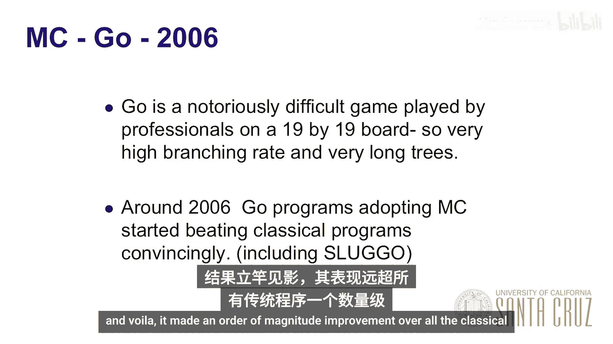
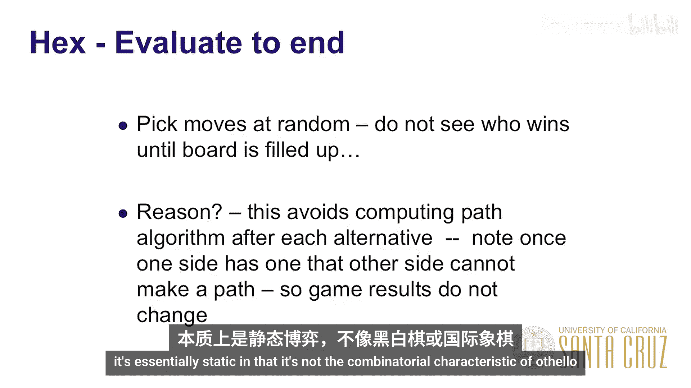
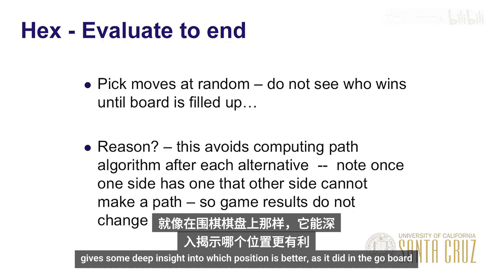
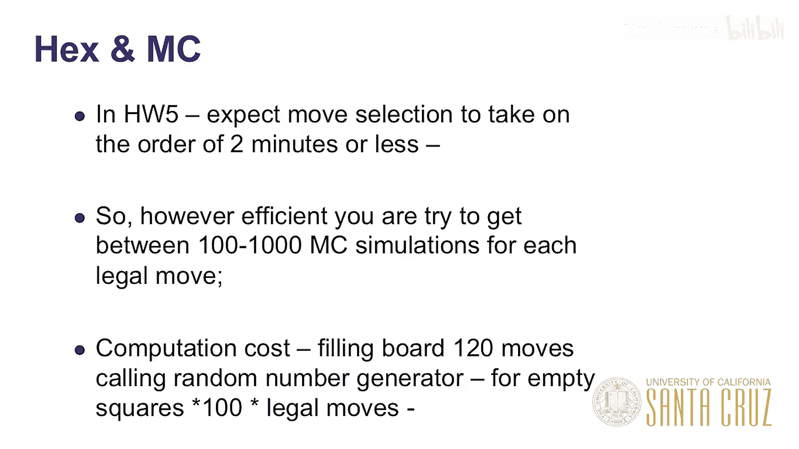
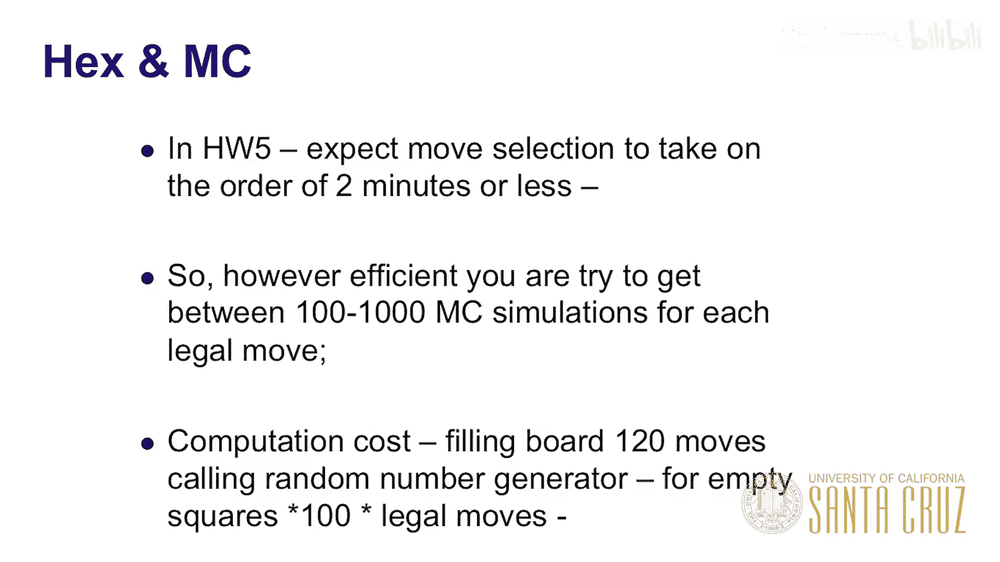
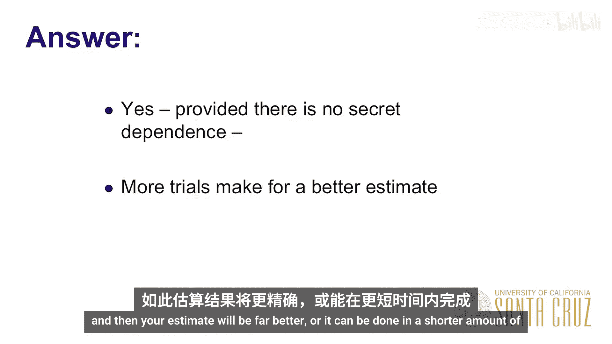
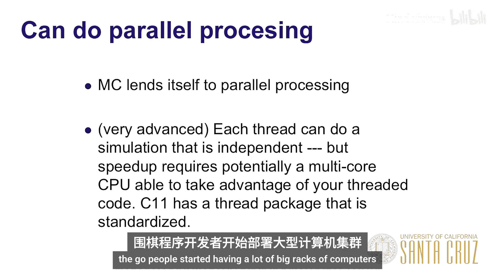
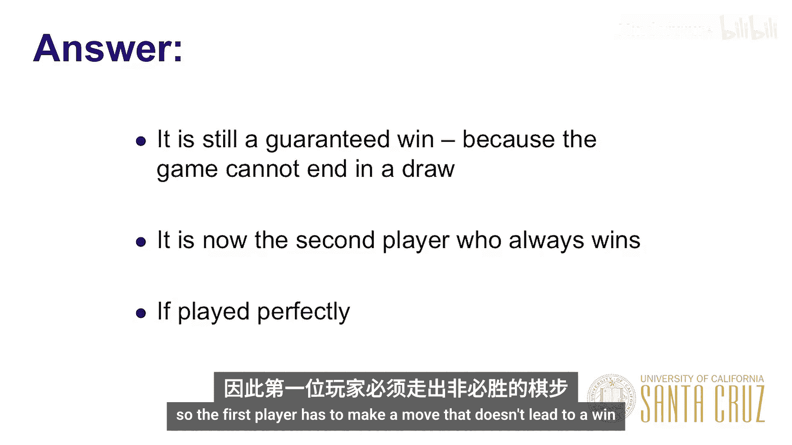

# 【加州大学】C++编程-｜-C-Plus-Plus-B-p46-P46_4-5-MC围棋-2006_04_02_05--BV1KseJzqEbZ_p46-

So as they say， if you look at the history of AI。There was great success。

With games like an early game that was played seriously by。啊。

Humans had human championships was Othello game rev， it was a game in which there were discs on。

 I think an  eight by8 board， so you could have 64 squares。

 it was a placement game in which pieces or rows got captured。And it was highly combinatorial。And。

I don't know exactly what。Time， the reverseers。I think sometime in the early 80s。

The reversey or Othello games got better than human play， and I think。At a little later time。

 they actually got to play perfectly on those size boards。Chess。

We start have master play in the mid to late 80s， we start having Grandma play in the 90s。

 we have world championship play by the end of the 90s。And by now， play is beyond human ability。呃。

We have perfect American checkers， we had reasonable expert play one of the great early AI programs by Art Samuel of IBM。

 where he used this to test machines on the floor that IBM was producing。

 it was just a test program for him， but he still developed in the classic style of AI with the learning component。

 so it was very famous for quote  learning。呃。Something that could play high quality American checkers and later groups。

Were able to develop checkers both mathematically and combinatorially and computationally to the point where they could play perfectly as well。

So， the one。Serious game out in the world and this， oh by the way。

 and there are very high quality games with a probabilistic component。

 so there are backgamon games that are probably I think。

 considered better than ordinary human play at this point。

And very high quality poker playing bots as well， University of Alberta is very well known for many of these developments。

But go was resistant。And the classic AI methodology was being used in go。And。Those programs。

 including a program developed at the University of California。

 Santa Cruz by a colleague Charlie McDowell， would play in local computer tournaments。

 And at the time that program was called Slugo around 2005 it occasionally won one of these tournaments。

 so it was among the classical methodology， it was among the best。Playing programs of its era。

 but those were。Barely better than novice serious players than players who were you might call club players。

 more than beginners， they knew some of the game but。

When playing a serious club player or a low ranked professional。

 they had absolutely no chance that was the level of play and。It'sThe way they were developing。

 you might call the improvement curve。Was very， very slow。 I mean， you know。

 computers were getting faster。 They could do more evaluation。

 They could do multi threaded evaluation， take advantage of parallelism。 The slugo computer， I think。

 was a rack of 64 processors。 If I'm recalling it right。

 So they had much bigger computational advantage， But unlike chess， unlike the notthello， it didn't。

The standard methods with some improved evaluation with a lot of improved computation did not。Get。

The same improvement。And the quality of play so something else is going on。

The game was just too difficult and the criteria that professionals used were not that combinatorial。

 there was deep judgment based on patterns。And it was very hard to replicate。So around 2006。

In Europe， one team decided to try this combinatorial approach。Andvoilah。

 it made an order of magnitude improvement over all the classical programs。

 it immediately was identifiably by far the best computer go praying program。

And in short order， it could play roughly at average。Club playing strength。In a go club。

So the play by 2010 was enough。Of enough quality that with a reasonable handicappped。

 go players have these rankings and low level professionals will give a medium club player so many stones so they'll allow you to make four or five moves on the board of certain kind。

So you start with that much additional space in your hand。

 and that's considered a handicap that equalizes between players。And until then。

 there was no sort of handicap that a reasonable handicap that a gomaster needed to give a computer program。

And still a win， just a gomaster would just win with any kind of reasonable handicap。

 which might be 10 or 15 stones。Now， all of a sudden。

This Monte Carlo based thing allowed for interesting matches。So。Heckx， very similar character to go。

 Big comeant played on a go board is played with essentially black and white stones。

 It's essentially static in that。

It's not the combinatorial characteristic of Othello or chess or checkers with captures changes and the pieces make changes in positions。

And then this method we've just explained， evaluating at random to the end。

 gives some deep insight into which position is better， as it did in the goboard。

So in this homework， which in your class is the last homework， the last major。Programming assignment。

One， I expect you to be able to write your C++ code so that your Mo selection should be roughly on the order of one or two minutes。

 I don't want people playing the game to have to sit there longer than that。

 so you have to try and be highly efficient。And you should be able to get 1 thousand0 or more simulations per position for each legal mode。

 if it's too few。The character of the estimates won't be that good。

So you'll discover if you're making too few evaluations。

Somebody with a good sense of how to play heckx will beat these programs。

But if you're on a small enough board and you have a high enough number of evaluations。

 it'll start being very hard for a human player to be beating the program。

Okay。So one of the things you may want to think about。

 especially while I won't be showing you how to do this in the class。

A little bit beyond the background that most students might have in a course。

 but I know some of you are quite sophisticated and some of you want to try new ideas is。

There are ways now in C++ to use the new standard and do parallel computing。

So what if you had two computers available for you who were independently using the Monte Carlo method for estimating probability。

Winning。Would those two computers benefit you by combining their results？

That's your littlequiz question。The answer is yes， provided there's no secret dependence。By that。

 I mean， let's say were running exactly the same program。

And you started in the same place of a random number generator on the sequence。

Then both programs would produce an identical result。

 and combining those results would not add to the confidence interval。

 You would just get two replications of exactly like running two weather models。

 but you actually ran exactly the same thing。 So one suggesting rain is 60%。

 and the other one will absolutely suggest rain is 60% to the same exact calculation。

 So in order for the two to be combineable the two pseudorandom number generating sequences have to be distinct。

 And then if they distinct， then you have more trials that can be combined。

 and then the estimate indeed improved。So if you do your independent threaded model。

 or you have two computers available， you have two processor where you have now what's very common in your personal computer。

 a quad processor， and you can get it threaded properly， the trials can be quite independent。

 the critical thing is to make sure they're using different random number，Sequences or generators。

 even it' probably be even better to use separate random number generators because you're going to be doing lots of trials。

And then you're going to get your estimate will be far better or it can be done in a shorter amount of time。

So you can do parallel Monte Carlo does indeed lend itself very much so parallel processing。

 so that's again why。This has shown up。The go people started having a lot of， you know。

 big racks of computers， so the way they could get large amounts of additional computation was that everything could be done independently and would still contribute to making a decent evaluation that would not be that helpful。

In a contingent。Sequential evaluation or examination that might be required by Minimax。

 A miniax can be parazed， So there is benefit to also having miniax paraizzable。

 but there is still more distinct sequence points， and you can't be utterly independent。So again。

 you can use C+ plus 11 in a thread package and you can attempt to work with a multi core computer and see if you can improve on。

A single threaded version of this program， but that will not be within the parameters。

Of what we're teaching or expecting。Okay， another little quiz question here。

I think you remember when we were first describing Heckx。啊。

We know from the original inventor of Hex Nash that he also proved that player number one always won Hex if they played perfectly。

Even though he didn't know how they could win， he just knew from an argument that constructive that they that。

Player number one was。Had an advantage that meant that if it played perfectly with so people introduced what was called the pi rule。

 recall the pi rule。It means a second player after seeing the first player's move， can say， wow。

 I love that move。I'll be the first player。So it then becomes the obligation of the first player to make a junkie move。

Now， if the first player can make such a bad move。That the second player says， oh。

 I'll take that junkie move。 And then the first player gets to make。A very good move。

Now the first player gets the advantage again， but the danger is the first player doesn't make a very junky move。

 so I has to make a move that's。Part of the game for two sophisticated players is to make a move that gives each one roughly the same ability to win。

But my theoretical question is with the pie rule。Is it always a win for one player those Nash's proof still hold up。

And if it is a win。Is it now the second player that's guaranteed to win。

 So think about that a second。 It's not a computational question。

A little bit about the logic of the game。Well， the game is still guaranteed to be a win。

There is no way to avoid。Winning or losing X， there's no drawing positions， so that doesn't change。

The export cannot have a drawing position if people alternate。

One side has to be able to win the other side。Has to lose。So the game is still a guaranteed one。

But it is now the second player who always wins。Why does the second player always win？

Ifs the first player has made a move。That objectively， by playing perfectly。

The first player is now going to win。 Well， the smart second player says， aha。

 The first player has made a move that leads to a win。 I'll become the first player。

So the first player has to make a move that doesn't lead to a win and if such a move exists。

Unclear， but let's say such a move exists。The second player will recognize。

 the first player has now made a move that leads to a loss。 I'll leave him the first player。So if。

Both players could play perfectly， and the pie rule is， in effect。

 the second player has the clear advantage。Okay。