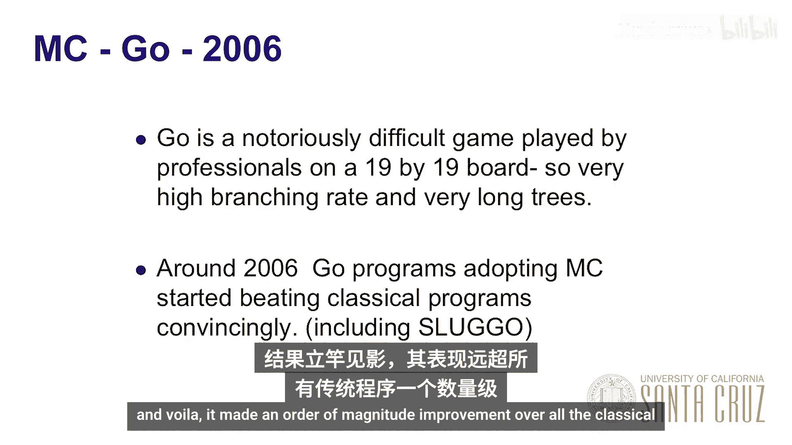
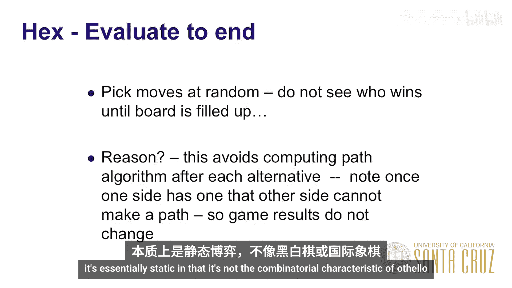
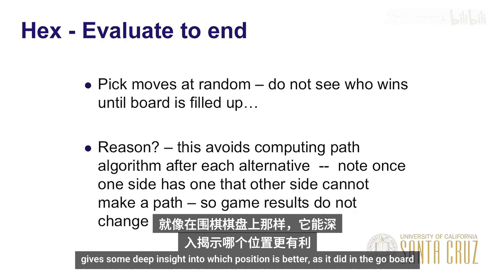
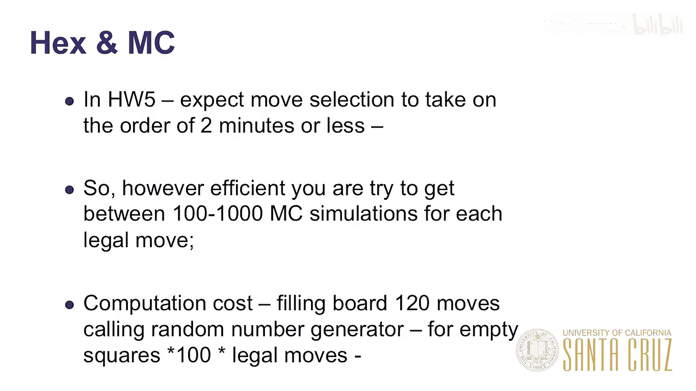
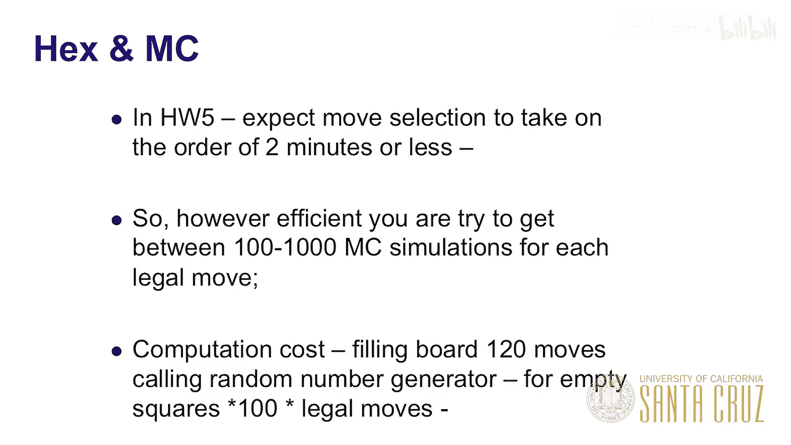
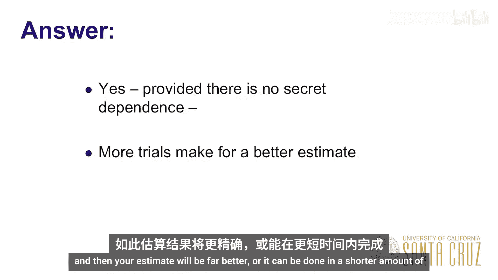
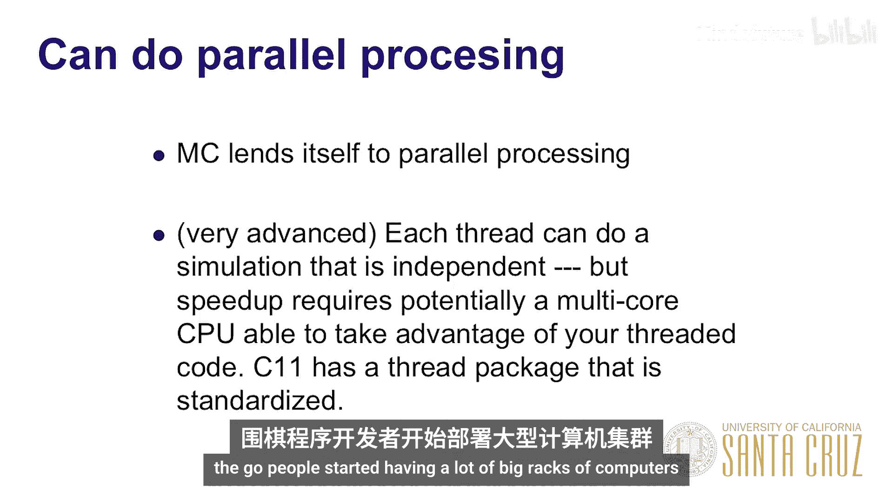
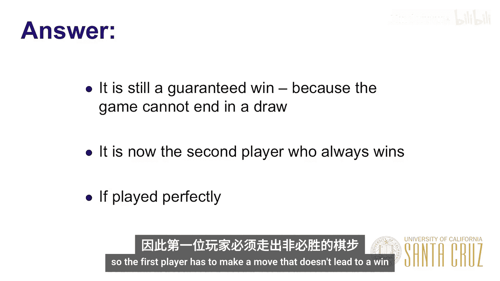

# C++编程：P46：蒙特卡洛方法在棋盘游戏中的应用 🎲

在本节课中，我们将探讨人工智能在棋盘游戏中的发展历史，并重点介绍蒙特卡洛方法如何解决传统AI方法难以攻克的复杂游戏，如围棋。我们将通过一个具体的编程作业——实现一个基于蒙特卡洛方法的Hex游戏AI——来实践这一概念。

## 人工智能在棋盘游戏中的发展历程

回顾人工智能的发展历史，棋盘游戏一直是重要的测试平台。早期取得显著成功的游戏包括黑白棋。

黑白棋是一种在8x8棋盘上进行的放置游戏，共有64个格子。玩家通过放置棋子来翻转对手的棋子行。这是一个组合性很强的游戏。

在20世纪80年代初，黑白棋程序的水平已经超越了人类玩家。不久之后，程序甚至能在该尺寸的棋盘上实现完美对弈。

国际象棋方面，程序在80年代中后期达到了大师级水平，90年代达到了特级大师水平，并在90年代末达到了世界冠军水平。如今，程序的对弈能力已完全超越人类。

美国跳棋也实现了完美对弈。早期著名的AI程序之一是由IBM的Art Samuel开发的跳棋程序。该程序最初只是用于测试IBM生产的机器，但它采用了经典的AI学习方法，因此在“学习”能力方面非常著名。后来，研究团队通过数学、组合和计算的方法，也实现了跳棋的完美对弈。

此外，存在概率成分的游戏也达到了很高水平。例如，双陆棋程序被认为已经超越了普通人类玩家的水平。阿尔伯塔大学在开发高质量的扑克机器人方面也享有盛誉。

然而，围棋一直是个例外。

## 围棋对传统AI方法的挑战

传统的AI方法论被应用于围棋，但效果有限。例如，加州大学圣克鲁兹分校的Charlie McDowell开发了一个名为“Slugo”的程序。大约在2005年，该程序偶尔能在计算机围棋比赛中获胜，是当时采用经典方法论的最佳程序之一。

然而，这些程序的水平仅略高于新手或俱乐部级别的玩家。当面对严肃的俱乐部玩家或低段位职业棋手时，这些程序毫无胜算。程序的改进曲线非常缓慢。虽然计算机速度在提升，可以进行更多评估、利用多线程和并行计算（例如Slugo使用了64个处理器的机架），但标准方法结合改进的评估和更强的计算能力，并未像在国际象棋或黑白棋中那样带来对弈质量的显著提升。

围棋过于复杂，职业棋手使用的判断标准并非纯粹的组合计算，而是基于模式的深度判断，这很难被复制。

## 蒙特卡洛方法的突破

大约在2006年，欧洲的一个团队决定尝试组合性方法（指蒙特卡洛树搜索）。这一方法立即使程序性能实现了数量级的提升，立即被公认为当时最好的计算机围棋程序。

很快，该程序的对弈强度就达到了普通围棋俱乐部的平均水平。到2010年，其质量已经足够高，以至于在合理的让子条件下（例如让4到5子），可以与人类棋手进行有意义的对局。在此之前，围棋大师即使让计算机10到15子也能轻松获胜。蒙特卡洛方法的引入改变了这一局面。

## Hex游戏与蒙特卡洛方法

Hex游戏与围棋有相似之处。它也是在棋盘上用黑白棋子进行的静态连接游戏，其组合特性不像黑白棋、国际象棋或跳棋那样涉及棋子的捕获和位置变化。

我们刚刚解释的蒙特卡洛方法——通过随机模拟到终局来评估位置优劣——为判断哪个位置更好提供了深刻的洞察，正如它在围棋棋盘上所做的那样。

## 编程作业：实现Hex游戏的蒙特卡洛AI

在本次作业（也是本课程最后一次主要编程作业）中，你需要用C++编写代码，实现基于蒙特卡洛方法的Hex游戏AI。

你的程序进行一步蒙特卡洛选择的时间应控制在一到两分钟左右，以避免玩家等待过久。因此，你需要努力实现高效率。

以下是实现高效模拟的关键点：

*   **模拟次数**：对于每个合法走法，你应该能够进行1000次或更多的随机模拟。如果模拟次数太少，评估结果的质量将不会很好。
*   **性能表现**：你会发现，如果评估次数太少，一个懂得如何下Hex的人类玩家就能击败你的程序。但如果棋盘足够小，并且你有足够高的模拟次数，程序将变得非常难以被人类玩家击败。

## 进阶思考：并行蒙特卡洛计算

虽然这超出了本课程大多数学生的基础，并且我不会在课堂上详细演示，但一些学有余力或希望尝试新想法的同学可以考虑以下内容。

现在在C++中，可以利用新标准进行并行计算。

假设你有两台可用的计算机，它们独立使用蒙特卡洛方法来估计获胜概率。那么，结合这两台计算机的结果会对你有益吗？

答案是肯定的，但前提是它们之间没有“秘密依赖”。所谓“秘密依赖”，指的是如果两台计算机运行完全相同的程序，并且随机数生成器的起始序列相同，那么两台程序将产生完全相同的结果。结合这样的结果并不会增加置信度，你只是得到了两次完全相同的复制。

为了让两台计算机的结果可以结合，它们的伪随机数生成序列必须是不同的。如果序列不同，你就有更多的试验可以结合，评估结果确实会得到改善。

因此，如果你实现独立的线程模型，或者有两台计算机（甚至是你个人电脑中常见的四核处理器），并且能够正确地进行线程处理，试验就可以相当独立。关键是要确保它们使用不同的随机数序列或生成器。使用独立的随机数生成器可能更好，因为你要进行大量的试验。

这样，你就能获得更好的评估结果，或者在更短的时间内完成计算。

所以，蒙特卡洛方法非常适合并行处理。这也是为什么围棋程序开始使用大型计算机机架的原因——通过并行计算获得大量额外的计算能力，每项独立计算仍然有助于做出不错的评估。

相比之下，在Minimax等算法所需的连续评估或检查中，虽然Minimax也可以并行化，但仍然存在更多不同的序列点，无法做到完全独立。

你可以尝试使用C++11的线程包，在多核计算机上工作，看看能否改进这个程序的单线程版本。但这不属于本课程教学或要求的范围。

## 关于Hex游戏“Pie规则”的理论思考

另一个小测验问题：还记得我们最初描述Hex时提到的内容吗？

我们知道Hex的发明者Nash也证明了，如果玩家一完美对弈，他总是能赢得Hex游戏，尽管他不知道具体如何赢。

因此，人们引入了所谓的“Pie规则”。回忆一下，Pie规则是指，在看到玩家一的第一步棋后，玩家二可以说：“我喜欢那步棋，我来当玩家一。” 那么，原来的玩家一就有义务走一步“垃圾棋”。

现在，如果原来的玩家一能走一步非常糟糕的棋，以至于玩家二说：“哦，我要那步垃圾棋。” 然后原来的玩家一就能走一步非常好的棋，重新获得优势。但风险在于，原来的玩家一走不出非常糟糕的棋。

对于两个高水平的玩家来说，游戏的一部分就是走出一步让双方获胜机会大致相等的棋。

我的理论问题是：在Pie规则下，游戏是否仍然保证有一方必胜？Nash的证明是否仍然成立？如果仍然必胜，现在是否保证是玩家二获胜？

思考一下，这不是一个计算问题，而是关于游戏逻辑的一点思考。

答案是，游戏仍然保证有一方必胜。在Hex中，如果双方交替走棋，不存在和棋局面，一方必须赢，另一方必须输。这一点没有改变。

但现在，总是玩家二获胜。为什么？

如果玩家一走了一步棋，从客观完美对弈的角度看，玩家一现在将获胜。那么，聪明的玩家二会说：“啊哈，玩家一走了一步会导致他赢的棋。我来当玩家一。” 所以，原来的玩家一必须走一步不会导致他赢的棋。如果存在这样一步棋（这一点尚不明确），假设存在，玩家二会意识到：“原来的玩家一现在走了一步会导致他输的棋。我让他继续当玩家一。”

因此，如果双方都能完美对弈，并且Pie规则生效，玩家二拥有明显的优势。

## 总结

本节课中，我们一起学习了人工智能在棋盘游戏中的演进，重点了解了传统方法在应对围棋等复杂游戏时的局限性，以及蒙特卡洛树搜索方法带来的革命性突破。我们通过Hex游戏的编程作业实践了蒙特卡洛模拟的核心思想，即通过大量随机试验来评估棋局位置。我们还探讨了并行计算如何加速这一过程，并分析了Hex游戏中“Pie规则”对必胜方的影响。希望这些知识能帮助你更好地完成最终作业，并理解现代AI解决复杂决策问题的一种强大思路。