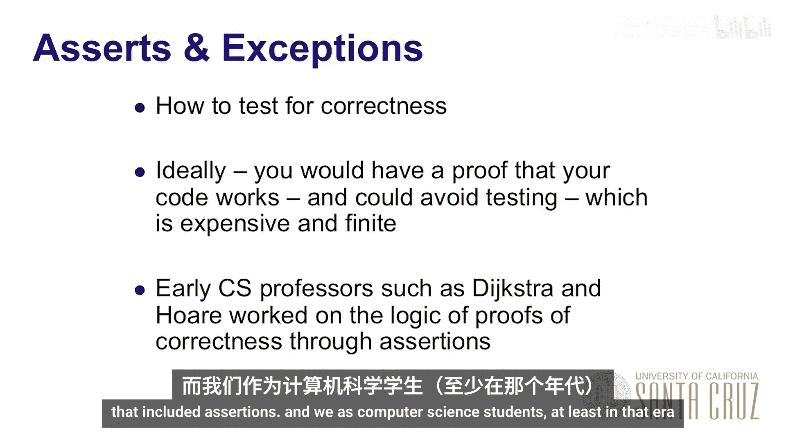
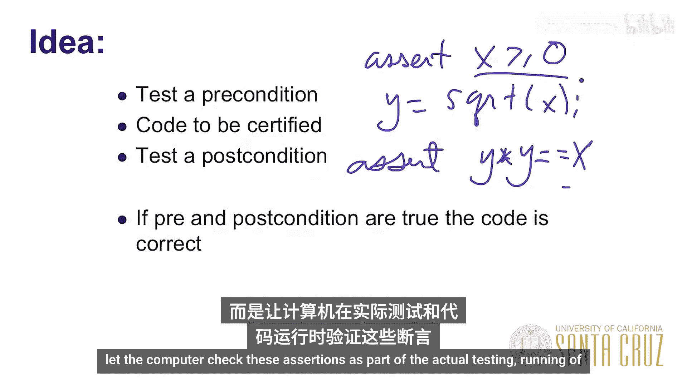
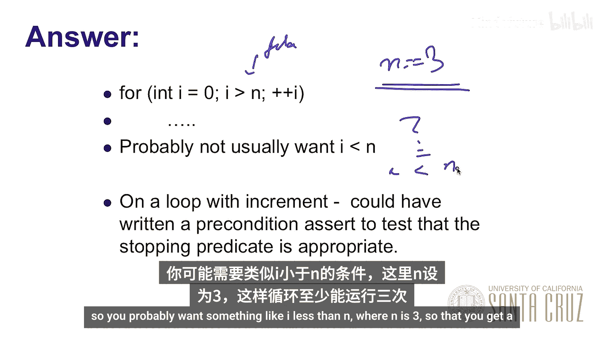
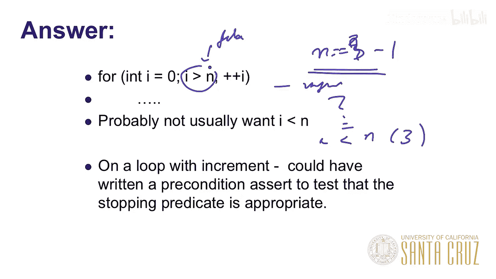
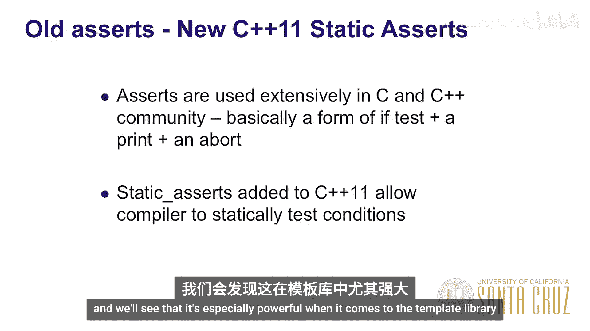
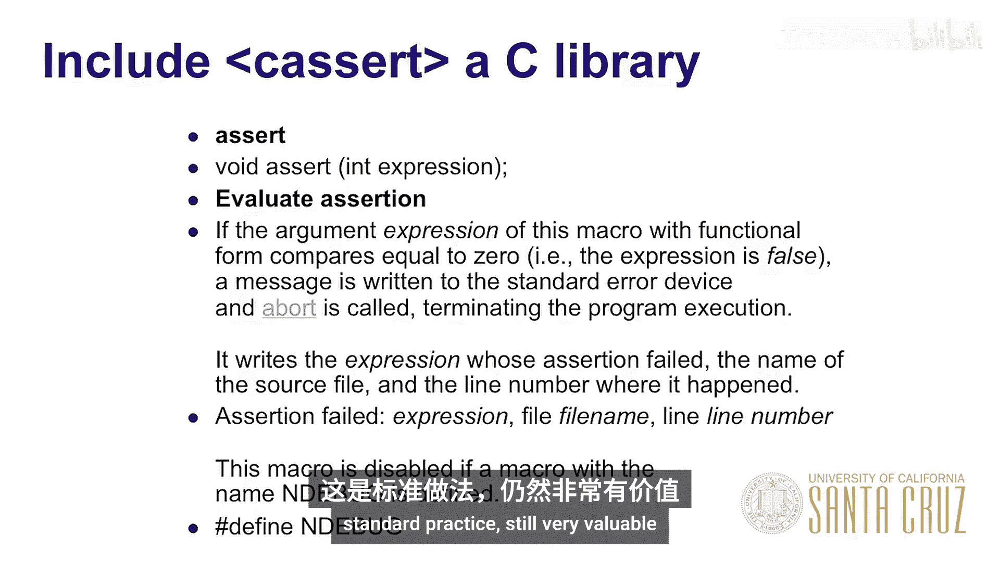
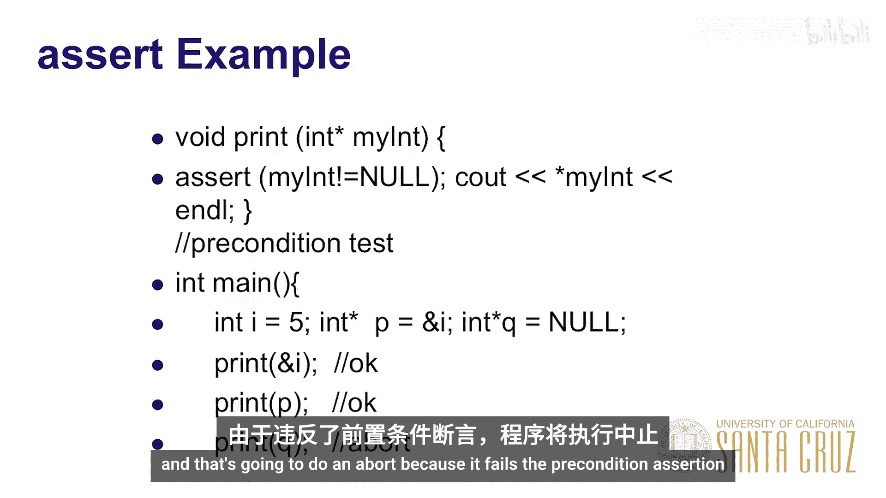
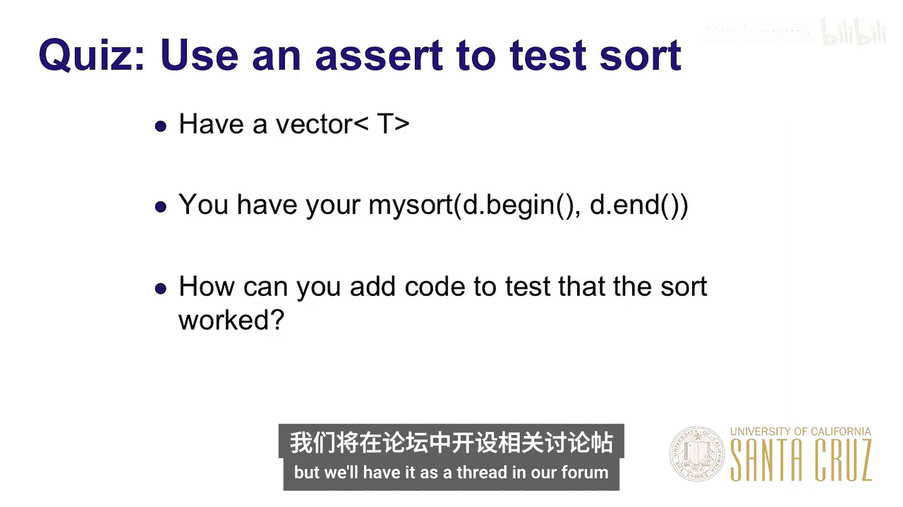
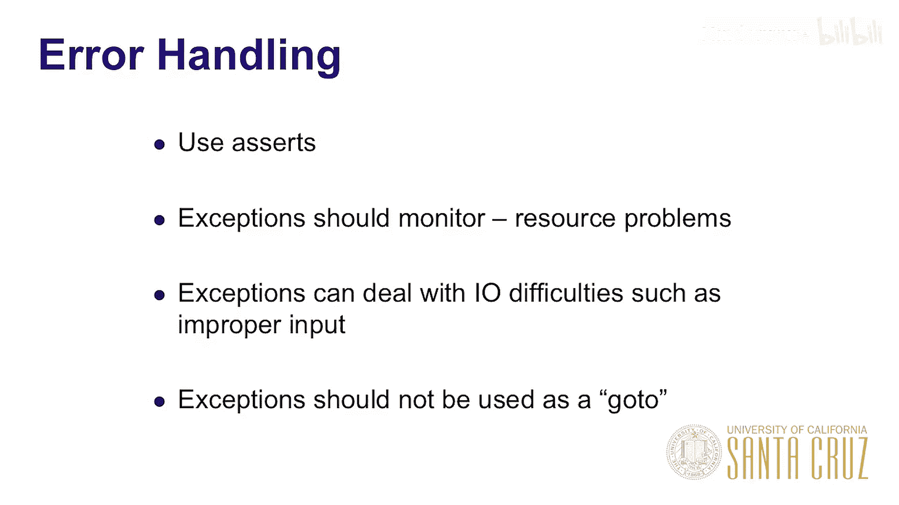

# 【加州大学】C++编程-｜-C-Plus-Plus-B-p47-P47_4-6-断言与异常_04_04_01--BV1KseJzqEbZ_p47-

All right， we're switching gears。And now we're going into back into deep intoice C+ plus。

And we're doing another topic and the topic is assertions and exceptions。

And this is a critical topic。Both assertions and exceptions are underutilized in both the C and C plus plus community。

 and ideally if you。Use them effectively。You're going to write much better code。In。Dyketra's world。

 Dyktra is actually an applied mathematician。His belief was。In the best of all possible worlds。

 I can prove my program is correct， if I can prove my program is correct。

 then it's never going to get into an airful state if it's not going to get into an airful state。

I don't have to test for errors while the program is running。So I'm going to。That's Dyktra。

 Dytra says。I'm going to attempt to prove my programs correct。And improving his programs correct。

 And he was part of a group of such computer science professors， Loians。

 people like Dyke Struck Hore。 Tony Hor was another one in that category。

 another one who had interest in this where people like。John McCarthy。Alan Robinson。

 so these people were saying let's look at。Even mechanized ways to get proofs of correctness。

And in building those proofs of correctness， we basically building that into the logic of the program。

The programmer would be much better trained。And we could avoid a lot of testing now in the real world。

 and many of you are professional programmers。What do you do。

 You write a piece of code for your company， and then you'd debug it。

 You didn't write it correctly and prove it correctly。 You'd debug it。

 and you'd debug it by trying it on different data。

 And hopefully you start with very simple cases and you say。

 a seems to be working on the simple cases now let me look at more complicated cases and maybe you do some stress testing and you look at all the pathways the program can take So you check all its logic and。

Indeed， there are schemes for doing fairly exhaustive testing and even keeping the test modules built into the code so that they can be used anytime the code gets changed。

Okay， so all of that's the real world， but this idealization led these professors like Dyke Strhore to assume a work logic of proof that included assertions。

And we， as computer science students， at least in that era。

 were frequently asked to test preconditions and post conditionsition in the code that gave us insight into the code being correct。

So the idea was。Before we execute some piece of code。

Certain parameters have to be within certain values。Let's say you were going to do a square root。

Well， you know， you can't have a square root of a negative number， square root。

Is expected to be a real double。So you would do an assertion test before。

You did square root of x and say。X is greater than or equal to zero。

And that would be your precondition。And then you might have a post condition。

 what would be a post condition for square root？Well， you get some answer。

 let's say y is the answer to square root of x。So you compute why。

So we're going to call square root of x。And assign it to why。

It's a precondition we're going to say assert。X greater than or equal to 0。

 and a post condition might be assert。Y times y。It's equal to x。

So here are two assertions that give you confidence that you got the code right。

And if the preconditions the post conditionsition are true， we know the code is going to be correct。

 and their idea was to do proofs， but that was pretty hard to do， most of us。

For a serious program could not adequately write out a mathematical proof of its correctness。

So some of the programming community， including the C programming community， decided to。

 instead of statically writing out a proof， let the computer check these assertions as part of the actual testing。

 running of the code。

Okay。I let you think a little bit about this。So here's a typical piece of code that leads to errorss。

 a for loop。We have your standard for inth equals0， we have some test condition highd in。Plus。

 plusify。And is this loop going to make sense？Think about that， see what you think。

The answer is probably not probably the mistake。 and this would be a very common mistake is。

I probably should have been less than it。Why， because you're incrementing I think about it。

Let's say N started as。Let's say n is3。 Well， three wouldn't work。 So then was something like three。

You would have for in I equals0， I greater than n， and that would be。False。

So you wouldn't even have a loop。So you probably want something like。I less than n where n is3。

 so that you get a loop that at least works three times。

And the other problem could be， well。N， for example， was minus1。

Then this would end up being an infinite loop because this would keep having a decrement。

 So normally， if there's an increment here。This should have been a less than anyway。

If you were doing some kind of precondition assert， you would probably have tested for that。

And you could have avoided that。

So asserts were used extensively in C code。And it was good industrial practice they were put into sea fairly early on。

And the C++ community adopted the CSers。And they basically are a runtime test。

In which you run a logical test， and if the logical test fails while the program is running。

 you get an abort。And you get a printed message。Now。

 the new thing in C++ is what are we calling static asserts？And this actually， amazingly enough。

 goes back to Dyktra and Hor's idea。Why not embed？In the compiler。To some extent， a proof checker。

So if I don't have to run the program and I can run some series of tests and the series tests。

 tell me。That the compiled program is going to work。Then I don't have any overhead， asserts。

 the old style asserts are computational， so they are having chronic overhead。

Every time you go through and assert， you're doing a computation。

 the compile time asserts are done at compile time。You can think of it as in the old days。

 there were programs like Linnt that did a lot of checking and testing in addition to whatever the programmer did and gave you warnings about things that looked bad。

So these static asserts are in the new standard and we will also look at how they work。

 they're not comprehensive， it's not a foolproof checker。

 so things have to be statically checkable they have to be logical conditions as fairly minimal but still very。

 very powerful idea and we'll see that it's especially powerful when it comes to the template library。

So first off， we have the old stuff， the old stuff you could get by including sea As。

 the sea library。 And what that provided was essentially a macro。

 And that macro was avoid assert with an in expression。 And remember with。C。

Zero is false and everything else is true。So you did an evaluation of expression and you did you wanted to see if it was zero。

 the expression is false and if it was false。During the running of the program。

 there would be an abhort termination with a simple message。And indeed， the macro could be disabled。

 So if you were working in a company and they didn't want ship code with assertions because there would be too much overhead。

 they might have the end to bug option， meaning not the bug。

The shippable code or compile it without the assertions。Standard practice still very valuable。

 It's almost more valuable for the programmer to stick in asserts so that his own logic。

 So he's checking his own logic。 I always sell my students。

I search seem like nonsense。 Oh I know I got that right。

 so I don't want you bothering to ask me to put this。 I say you think you got it right。

 but it's very easy to make a simple mistake， like a lesson than sign for a greater than sign。

So the actual additional discipline is just like writing comments。

 you should write your comments as you write code because theyre reminders to you of what the code is supposed to do and they give you better design insight and they give you more high quality code and they make the code more readable and the same is just completely true of asserts。

 So if you haven't been using asserts。In your C or C++ coding it' very valuable to move over and start using them and even using them generously。

Here's a simple example。I'm going to print out something which is basically a pointer to an integer type。

I'm going to assert that that it's not an null pointer。

And only if it's not an old pointer am I going go and do the dereferencing operation。

 otherwise I would get a runtime error for the dereferencing operation。

So there is what you might call a simple precondition test。

 And then if we used it here and actually ran it， then at run time， this would be okay。

 We'd get a print out of five。This would be okay， we'd also get a print of five。

So here's a reference to the integer I。 Here's a pointer， and the pointer has been assigned。

 The address of I。 Both are going to print pi。 but here's Q。 here's another pointer initially null。

 And we try to print from that pointer。 And that's going to do an abort because it fails the precondition assertion。

 very straightforward， very simple。

Think about using asserts， what if you have a vector T？And you've done my sort on T。

 you're writing your own sort routine rather than the well tested sort routine from STL。

And your sort is going to be tested on the basic iterator range， begin an end of some data vector。

When what should the pre and post conditions or the post condition assert look like to make sure that the sort worked。

 how would you write that？OkayI'll leave that to you， I won't give you an answer to that， but will。

Have it as a threat in our forum。

So when we use exception handling， especially。Not so much asserts。We want to be very careful。

Don't forget， this is a mechanism。For handling errors。

Writing really high quality professional code is avoiding making errors。

So we don't want to induce you into G， it's okay to make errors as long as the errors get caught。嗯。

Theers are really。Largely intended。For。A pre release version。Now。

Ordinary code is going to be released with。Exception handling。Why， well， there are situations。

In which。It isn't so much an era。 It's that you've written。啊。

Perfectly appropriate piece of code or algorithm。But it's running in a system。That。

Doesn't have the resources to manage that code， very simple example might be。

A machine that has a heap assignment that lets you assign。100，000。Integers。

And if you tried to assign。Off the heat， 200，000 integers， you would run out of memory。

And you've written code， it's perfectly well tested， it's running fine on your big system。

And somebody intends to run it on something in which the resources。Are not quite as generous。

You want the code to say， wait a minute， not enough available memory。 and indeed。

 heat allocation has its own。Exception。Which lets you monitor that frequently a call to new if it returns。

Without。Having available memory will throw that exception or will return an address of zero。

So exceptions should be able to deal with resource constraints。

 Excepts should be able to deal with I O difficulties。 For example。

 you're asking the user to input a hex position when you're playing your hex program。

 And what if they input a hex position in which a stone is already。Sitting on that position， well。

 that's an illegal move， you can't put a second stone on top of a first stop。

 so that position not only has to fit the hex board。So they have to have entered properly。

 the X coordinates。And they have to enter properly a stone that's on that's going to be on empty hex。

 an empty square， an empty he hexagonal sort of hard to say， hexagonal square， you might want to say。

 however。There are big arguments in the programming community and one of the arguments goes that exceptions。

Are another way to write go tos， exceptions our alternate flow of control。

And if you remember what we called spaghetti code when we were talking in the really old days of Alg。

 Pascal。See。Forrann。You just didn't want to have go tos and test conditions that flipped your code all over the map。

That was unstructured code。Very hard to follow， very hard to test， very hard to not be buggy。

And so indeed， many organizations would ban go， gos were。

You should write go to lists programming and indeed lots of programming languages went to the point of eliminating the go to。

So exceptions are a sneaky way to write in a go to because you can do a throw and change or alter the ordinary flow of control。

So the argument goes。Don't encourage。Programmers to think that exception laden code is somehow high quality code。

 I'm actually a believer in that I would rather you minimize your use of exception and keep it to very。

 very clear uses like IO difficulties。