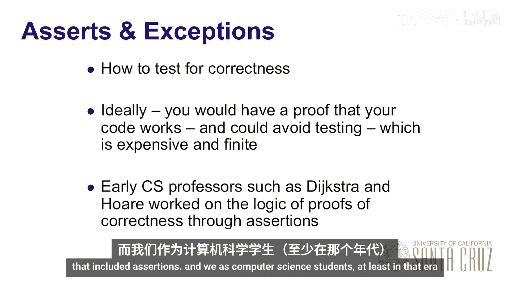
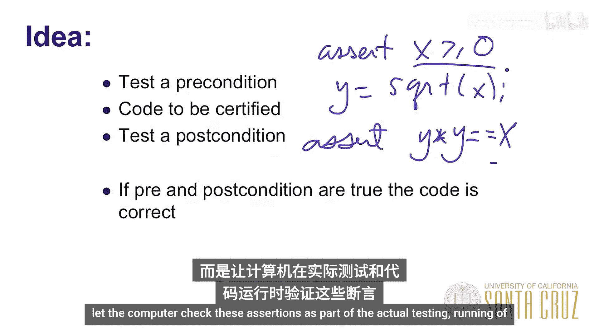
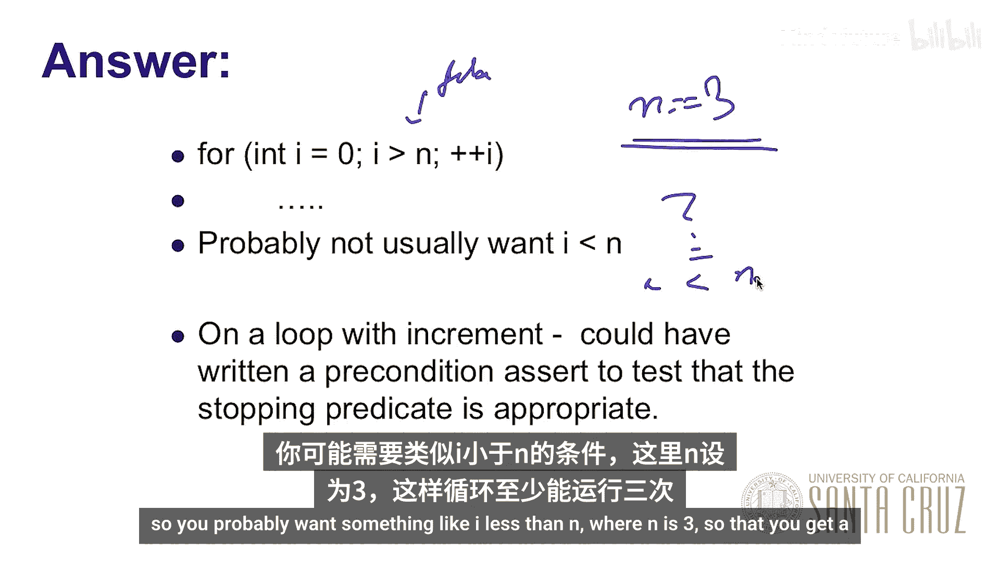
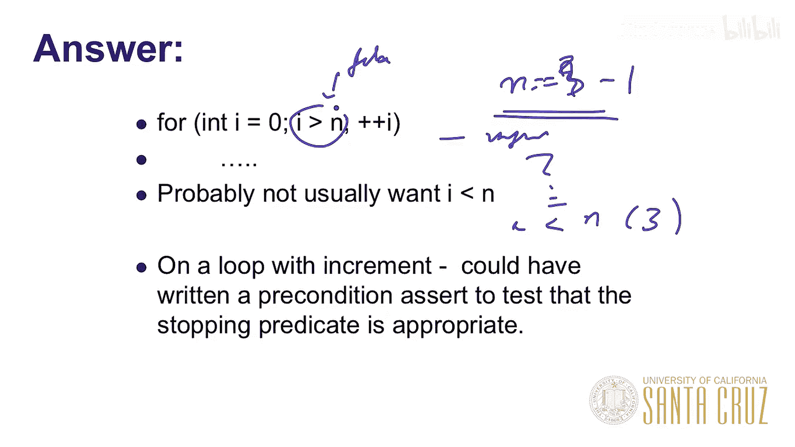
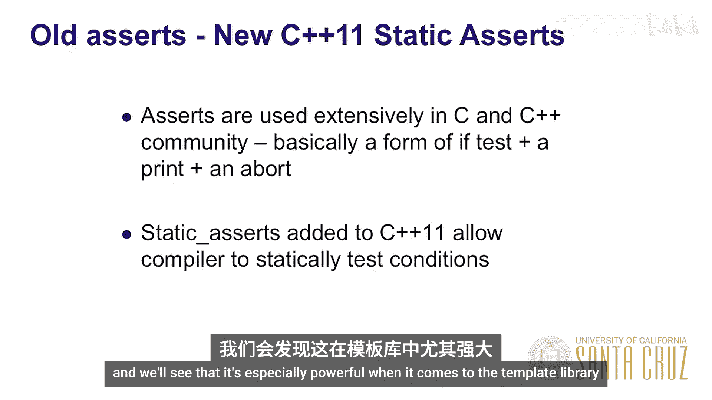
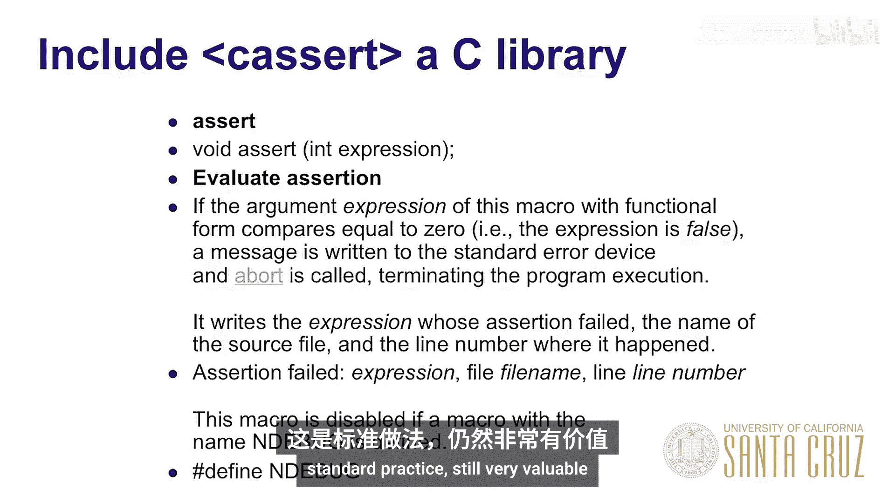
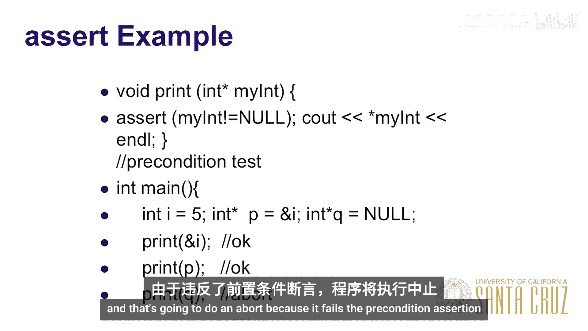
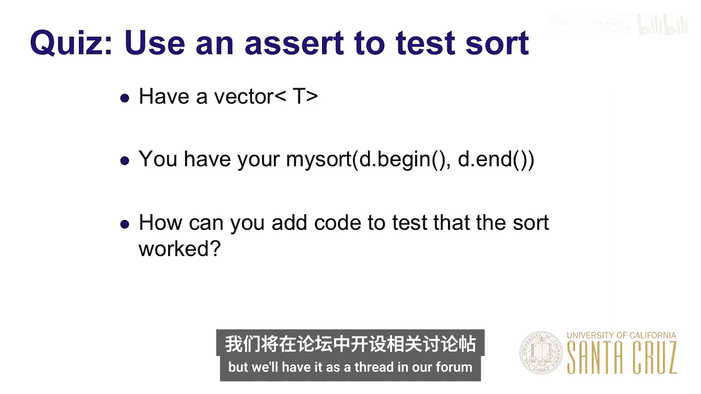
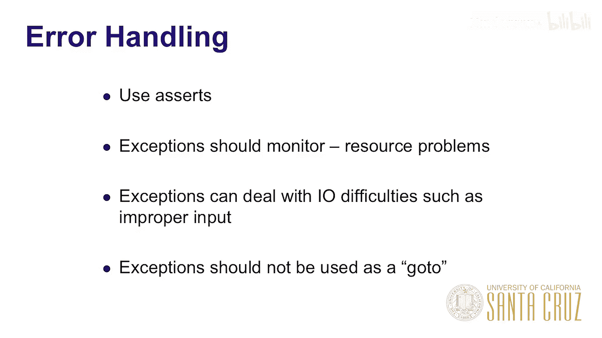

# C++编程：P47：断言与异常 🧠

在本节课中，我们将深入探讨C++中两个至关重要的概念：**断言**与**异常**。这两个工具在C/C++社区中常常未被充分利用，但如果能有效运用，将能帮助你编写出更健壮、更高质量的代码。

## 从理想世界到现实实践

上一节我们介绍了课程主题，本节中我们来看看断言与异常背后的思想渊源。在计算机科学的理想世界中，像迪克斯特拉这样的应用数学家认为，最好的情况是能够**证明程序的正确性**。如果能证明程序正确，那么它就不会进入错误状态，也无需在运行时进行错误测试。

然而在现实世界中，大多数程序员并非通过数学证明，而是通过**调试**来确保代码正确性。我们编写代码，然后用不同的数据进行测试，从简单案例开始，逐步过渡到复杂情况和压力测试，以检查所有可能的逻辑路径。甚至有些方案会将测试模块内置于代码中，以便在代码变更时复用。

这种对“证明正确性”的理想化追求，引导了迪克斯特拉等教授发展出一种包含**断言**的证明逻辑。

## 断言：运行时检查 🛡️



断言的核心思想是：在执行某段代码**之前**，某些参数必须处于特定值域内；执行**之后**，结果应满足特定条件。这分别被称为**前置条件**和**后置条件**。

以下是断言的一个典型应用场景：

*   **前置条件示例**：计算平方根 `sqrt(x)` 前，必须确保 `x >= 0`。
    *   代码表示：`assert(x >= 0);`
*   **后置条件示例**：计算得到平方根结果 `y` 后，应满足 `y * y == x`。
    *   代码表示：`assert(y * y == x);`

如果前置和后置条件都为真，我们就对代码的正确性有了信心。由于为复杂程序编写完整的数学证明非常困难，C/C++社区决定让计算机在代码实际运行和测试时来检查这些断言。

### 一个常见的错误示例

考虑以下 `for` 循环代码，它可能导致错误：



```cpp
for (int i = 0; i > n; ++i) { ... }
```

这里存在两个潜在问题：
1.  如果 `n` 为正数（例如 `n = 3`），条件 `i > n` 初始即为假，循环根本不会执行。这很可能是一个笔误，本意可能是 `i < n`。
2.  如果 `n` 为负数（例如 `n = -1`），条件 `i > n` 将始终为真，`i` 不断递增，导致一个**无限循环**。



如果在循环前使用断言进行前置条件检查，例如 `assert(n > 0);`，就可以在早期避免此类错误。

### C语言中的断言



断言在C语言中被广泛使用，并被视为良好的工业实践。C++社区继承了这一特性。传统的断言是一个**运行时测试**：它评估一个逻辑表达式，如果该表达式在程序运行时结果为假（即0），程序将中止并打印一条消息。

传统断言本质上是一个宏，通过包含 `<cassert>` 头文件来使用。它的一个关键特性是可以通过编译选项（如 `-DNDEBUG`）来**禁用**，这样在发布最终产品时就不会产生运行时开销。

尽管增加断言看似多余，但它就像写注释一样，是一种重要的编程纪律。断言能提醒你代码应有的行为，帮助你发现诸如将 `<` 误写为 `>` 的简单错误，从而产出更高质量、更易读的代码。

### 断言使用示例

以下是一个使用断言检查指针非空的简单例子：



```cpp
#include <cassert>
#include <iostream>

void print_value(const int* ptr) {
    assert(ptr != nullptr); // 前置条件：指针不能为空
    std::cout << *ptr << std::endl;
}

int main() {
    int i = 5;
    int* p = &i;
    int* q = nullptr;

    print_value(p); // 正确，打印 5
    print_value(q); // 触发断言失败，程序中止
    return 0;
}
```



### 思考练习

假设你正在为自己实现的 `my_sort` 函数（对 `vector<T>` 排序）编写测试。你应该如何设计**前置条件**和**后置条件**的断言，以确保排序函数工作正确？请将此作为一个思考题。

## 静态断言：编译时检查 ⚙️

C++11 标准引入了 **`static_assert`**，这实际上回到了迪克斯特拉和霍尔最初的想法：为何不将某种程度的证明检查嵌入到**编译器**中呢？

与运行时断言不同，静态断言在**编译时**进行评估。如果断言条件不满足，编译将失败并给出错误信息。你可以将其视为一个更强大的、内置的语法检查器。

静态断言的优势在于**零运行时开销**。但它也有局限性：它只能检查那些在编译时就能确定的**常量表达式**或类型特征。尽管如此，它仍然是一个非常强大的工具，尤其在模板元编程和泛型编程中，用于约束模板参数或检查类型属性时极其有用。



```cpp
static_assert(sizeof(int) == 4, “int must be 4 bytes on this platform.”);
static_assert(false, “This code path should not be instantiated.”);
```

## 异常：处理意外情况 🚨



上一节我们介绍了用于检查逻辑正确性的断言，本节中我们来看看用于处理运行时意外情况的**异常**机制。

首先必须明确：编写高质量专业代码的核心是**避免制造错误**。异常处理是一种错误**处理**机制，而非鼓励制造错误的借口。断言主要用于开发调试阶段，而异常处理则常被用于发布的代码中。

异常适用于处理那些并非代码逻辑错误，而是由**外部环境或资源限制**导致的问题，例如：
*   **内存不足**：尝试分配超出系统可用范围的堆内存。
*   **I/O 问题**：文件无法打开、网络连接中断。
*   **非法输入**：在棋盘游戏中，试图在已有棋子的位置落子。

### 关于异常的争议

在编程社区中，关于异常的使用存在很大争议。一种观点认为，异常是另一种形式的 **`goto`** 语句，它改变了程序正常的控制流。在早期的编程中，滥用 `goto` 会导致“面条式代码”，使得程序逻辑混乱、难以测试和维护。因此，许多组织甚至编程语言都禁止或取消了 `goto`。

异常通过 `throw` 关键字，同样可以突然跳转到程序的另一部分（`catch` 块），因此批评者认为这会带来类似的结构化问题。

### 最佳实践建议

我个人倾向于支持这种审慎的观点：应当**最小化异常的使用**，并将其限制在非常明确的情况下，例如处理I/O失败、资源耗尽等确实无法在本地处理的、真正的“异常”状况。对于可以通过参数检查、状态判断在本地处理的错误，应优先使用返回值或错误码等更清晰、可控的方式。

## 总结 📝



本节课中我们一起学习了C++中**断言**与**异常**这两个关键工具。
*   **断言**（特别是运行时断言 `assert`）是一种用于在开发阶段验证代码逻辑假设（前置/后置条件）的调试工具，能有效提升代码质量。
*   **静态断言**（`static_assert`）将检查提前到编译时，用于验证常量表达式和类型约束，无运行时开销。
*   **异常**是一种处理程序运行时意外错误状态（如资源不足、I/O失败）的机制，但应谨慎使用，避免滥用导致控制流混乱。

合理运用这些机制，将帮助你构建出更可靠、更易于维护的C++程序。