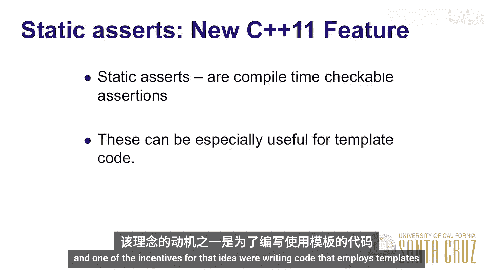
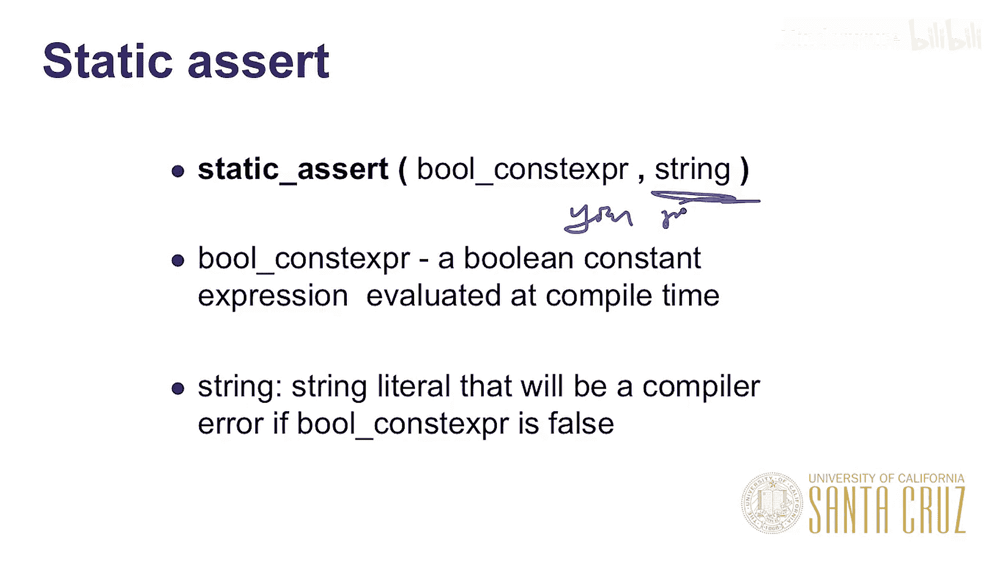
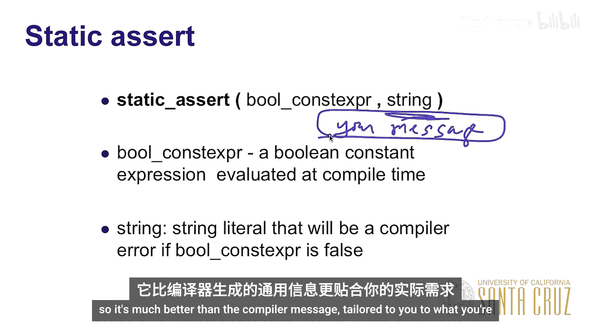
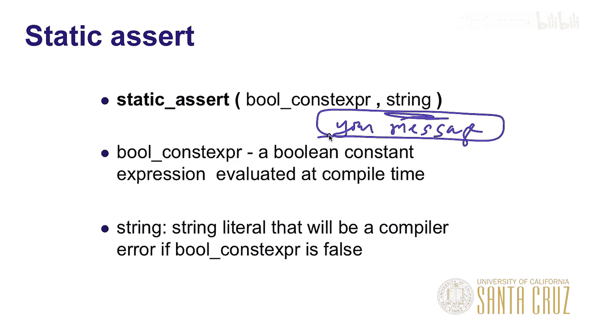
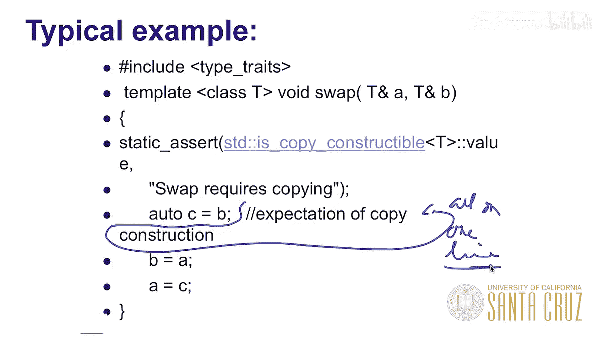
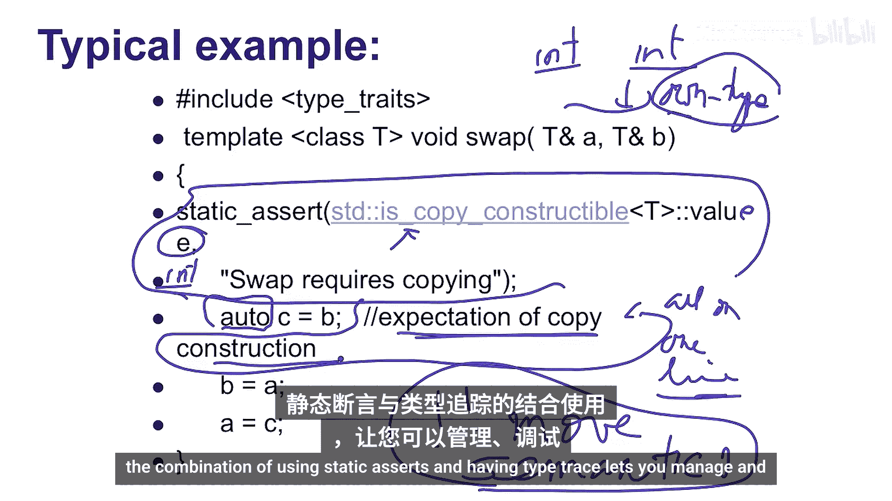
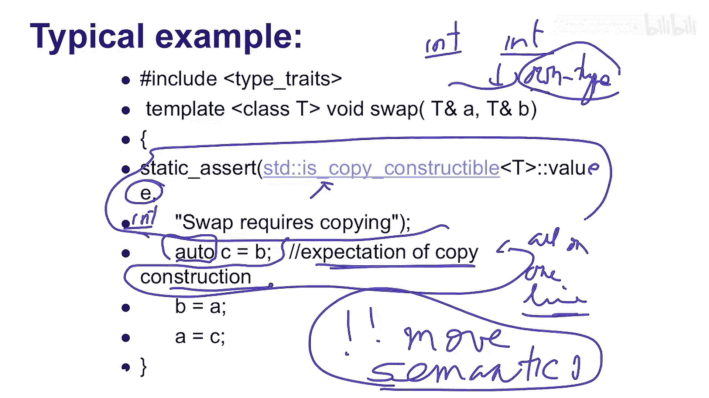

# 【加州大学】C++编程-｜-C-Plus-Plus-B-p48-P48_4-7-静态断言-C++11新特性_04_04_02--BV1KseJzqEbZ_p48-

Let's entertain again， let's return to this very new feature， this is sort of dramatic。Dramatic。

It's been tested now for。Several years because it was originally put into the Bo library。

 which was where many of the ideas for the new standard came from or were tested。

And in that library there were already static asserts， and these are again。

 compile time checkable assertions。So this is just such a clever idea。

 And one of the incentives for that idea where。

Writing code。That employs templates。And template code， unlike ordinary code， is supposed to be code。

 that's universal， regardless of type。So when you're writing a template。

 you're writing code that's reusable because the code。Might work on an integer type。

 but it might work on a double type， it might work on a complex type， It might work on a string type。

Or it might work on a user defined class。Now， as you know， with such code。

It is unlikely to work on every conceivable type of code。 So very simple example is。

Writing the standard template library function， the numeric function accumulate。

And when you do an accumulate on a standard container。

Then you're taking each item in the container and adding it， summing it。So if you have 100 items。

And what basically would be a vector。You just have， what's the sum？Of those elements。

And that template code lets you do it regardless of whether your integer type is a short， a long。

 a long， long。A complex number， all of those things work， why， because in all cases。

 they have a zero and they have an ability to have summation。

So there's a presumption that it's only being compiled on a type that you might call summable。

But there was no way to check that。 So old style C plus plus would be instead of saying in your template class T。

 you'd say class summable， and you'd indicate with the choice of the meta that you would use an identifier that gave you a sense of what the characteristics had to be。

But in C+ plus 11， you have in the standard library something called type traces。

And you can get the compiler。To check that the right characteristics are there， why is that useful。

 it's useful for two reasons。One， if you compile template code。That fails to compile。

Because operations for that type aren't defined like dissble operations。

So you try to pass it a type in which binary edition isn't allowed。

You are going to get a compile time error， but the compile time error is going to come from。

Compiling general templates and anybody who has seen any of the C plus plus compilers knows that those are。

Some of the most obscure， difficult， convoluted。Compilr error possible。

It would be much nicer to just have a compiler check through your static assertion that says。

Not compilable， this type is not summable， that could be a message you write specific to that template code and that static assert。

That's why it's so useful and then worse yet is what if the code was runnable？And it was。

 there was a meaning， but the type didn't have the characteristic you wanted。

 but there was a meaning to the code。Then you would have a much more insidious error。

 The code would run。 It would give some kind of incorrect behavior that would have to come out and de bugging rather than a compile time。

So these could be caught with the static asserts， here's what a static assert looks like。

You have a boolean constant expression and then。You're the guy that gets to design the message。

 it's your message。So it's much better than the compiler message tailored to you to what you're thinking。

And that's going to be checked at compiled time。And here's a typical example。

Here's a template that's doing a swap。And。呃。对。Yeah。Daad line break here。

 So this should be auto C equals B。 Remember， auto is new in C plus plus 11。

 It means whatever the type required is inferred from B， and B is going to be this type。

And you might think of the canonical case。 Remember， any time you write templates。

 think of a canonical taste。 So if we decide to instantiate this with int。

 it's going to be int reference to a int reference to B。 auto here is going to end up being int。

So this is going to say N equals B。B equals A， A equals C， and you get your normal swapping。Remember。

 you could also rewrite this。Knowing now， C 11。Move semantics， you might think about that。

 think about how this would be rewritten。 We've seen that move semantics。Unnecessary with simple。

Enterger types。And here's our static assert。It's also badly broken， that's because of the。

So in the T traits library in this standard library。

 there's something called is copy constructible it is copy constructible on the type。

 so before you get an instantiation， this type is checked to be copy constructstructible。

And that's not a problem for simple types like integer， so think of some of your your own type。

 so if you attempt to instantiate this with your own type，And for some reason， that own type。

Disabled copy construction。Then when you went to do C equals B。

 it would be illegal because this is expecting copy construction。And。This message would show up。

 swap requires copying， and that would be very clear to you。So that's the really ingenious idea here。

 the combination of using static asserts。And having type traits lets you manage。

And the bug。And enforce rules on that the compiler enforces for you rules on what gets。Templized。

Very， very useful idea。

