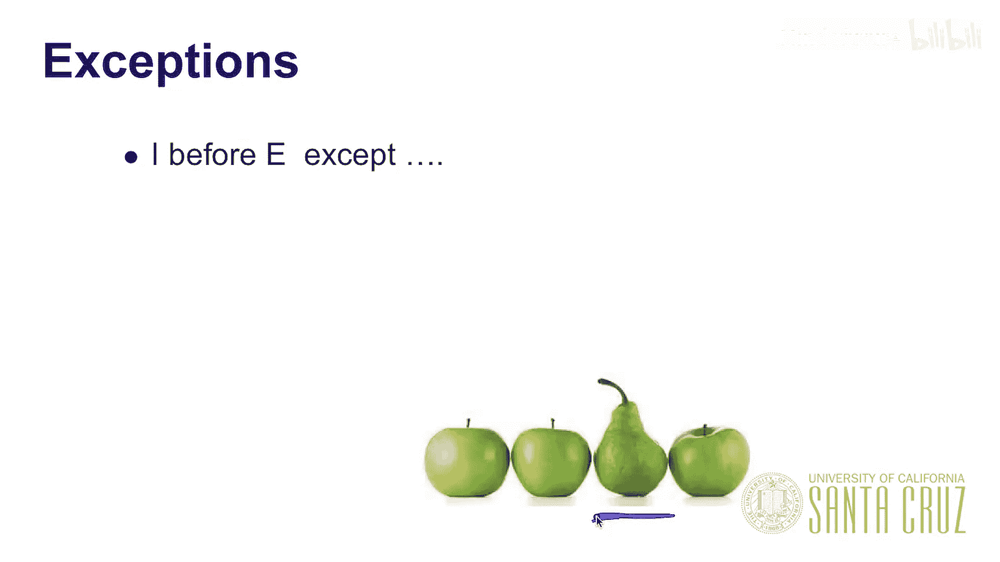
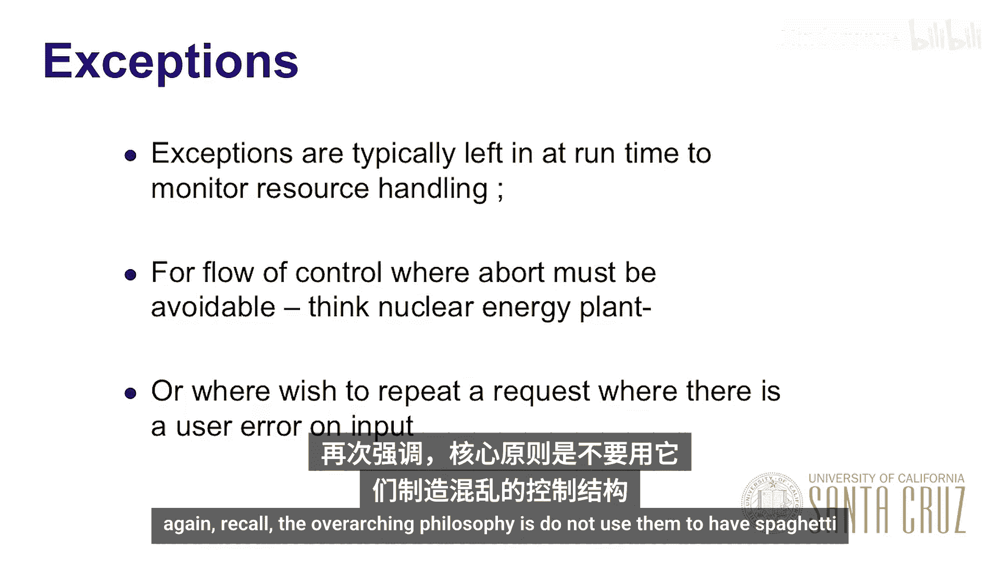
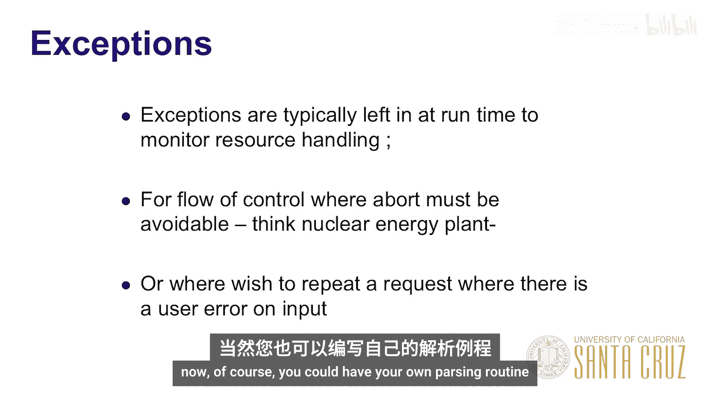
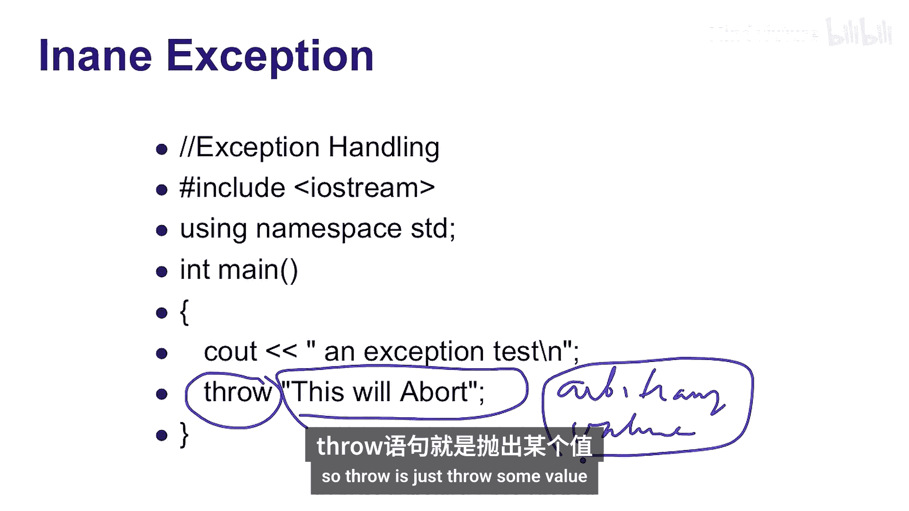
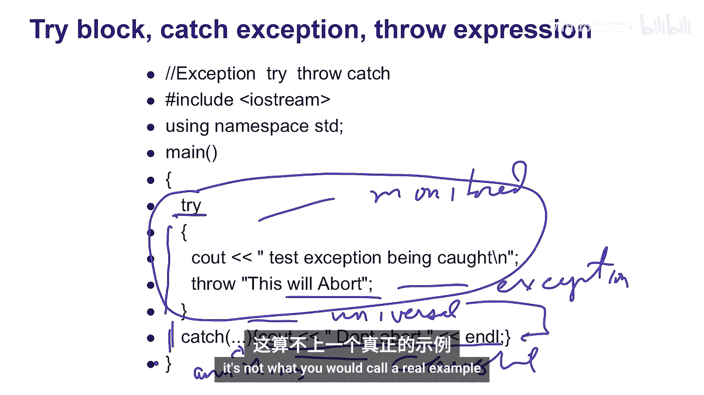
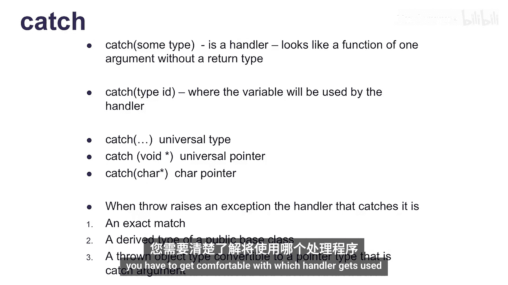
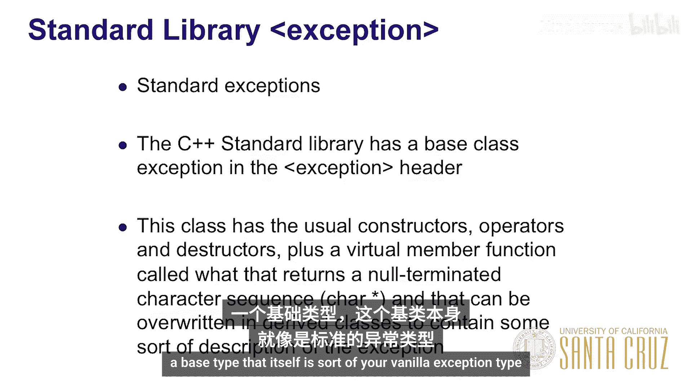
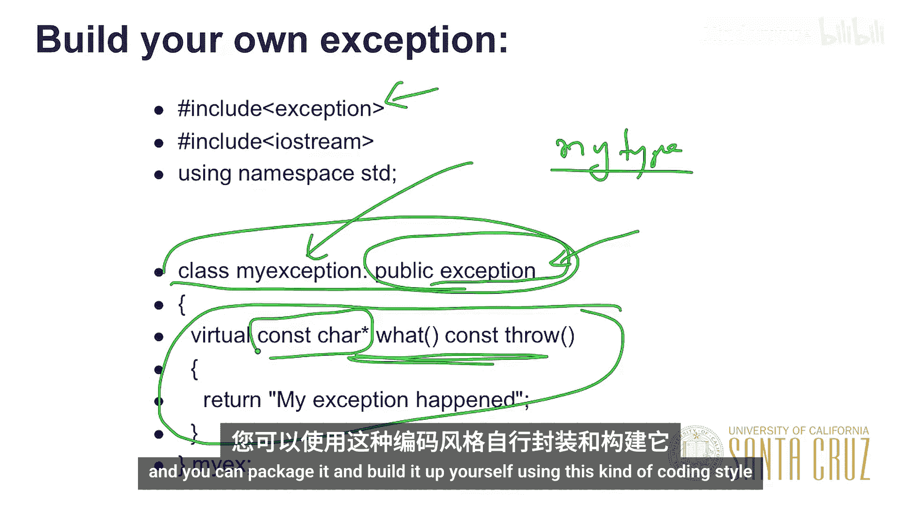
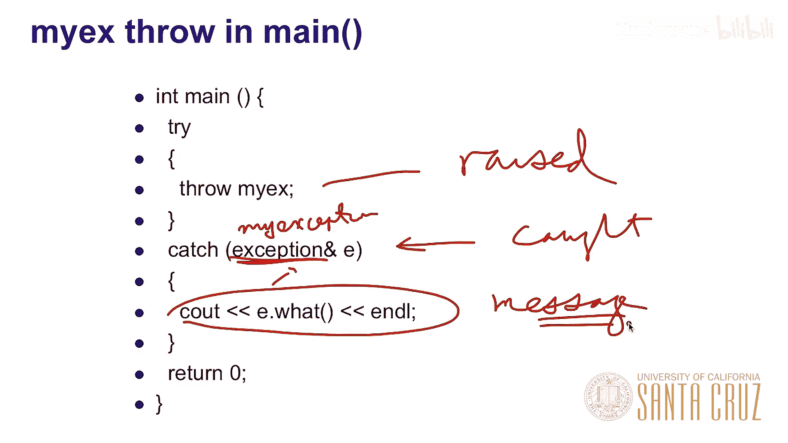

# 【加州大学】C++编程-｜-C-Plus-Plus-B-p49-P49_4-8-异常_04_04_03--BV1KseJzqEbZ_p49-

Exceptions in general， let's take up exceptions。We all know exceptions in the real world， I before E。

 except after C， blah， blah， blah， and you know， as somebody was a bad speller in elementary school。

 English is riddled with terrible exception rules， so it gets very， very hard。To。啊。

I was always sort of more of a logician and always expected everything to follow very basic rules。

And then to have to always find that there were all these exceptions and failure second grade spelling tests。

 very embarrassing。So exceptions occur in the world。 There's an exception。 Here's some。Okay wow。

 what's a pair doing there， it's an exception。So that's what exceptions are about。

They're typically left in at runtime to monitor resource handling。

They also here are characteristics of exceptions that are。Acceptable again。

 recall the overarching philosophy is do not use them to have spaghetti control structure。

Use them where they really are needed， while one of these places are really needed is a nuclear power plant。

You can't have your computers shut down。 and all of a sudden critical things in the power plant get turned off。

You have a radioactive accident you can't have on a space mission， your machine shut down。

 all of a sudden you lose。Some enormously expensive piece of equipment。 So in those instances。

 you have to have the ability to make sure that your computation recovers from an era even an unanticipated error。

 And if you think about the space program， a lot of the space programs， stuff like Apollo mission。

 some of that stuff was built with triplicate hardware and voting hardware。

 So the mission would run three programs， and two， at least two of the programs would have to agree。

And that meant that there was a fair degree of redundancy。 and even if one of the machines failed。

 either through hardware error or software error， the other two had the ability to keep the mission on track。

So exceptions are a mechanism。To keep。The algorithm on track regardless。

And then there's this question of repeating a request where there's a user input error。

 and we all know users chronically make input errors。And。

You can use an exception mechanism now of course you could have your own parsing routine and you could have that exceptions aren't absolutely required for this。

 so this isn't。

A complete argument for using exceptions， but it's enough of an idiom that you might as well use exceptions。

Let's see some basic exception code and for those of you who come from other programming languages。

More advanced than C。 So the background was C。 but I know a lot of you there have things like Python and ja in your background。

 and in some of those other languages， they have an exceptional handling mechanism that's quite similar。

 but you have to know where there's slight differences。

So the basic exception is shown here in this little program and this says， throw this willor。

 so we're going to have a simple print out and then this is going to end a computation。

 obviously pretty d cellular the computation would otherwise end but this is a way to make sure you know that the exception mechanism is working。

 there are ways in some compilers and systems to even turn off exceptions and not allow them。

So throw is the way to get an exception。Throw， you have a throw statement。

And you throw an arbitrary value。And that can be different。

 Some languages don't allow an arbitrary value。 They only allow something that has。

As its class basis an exception， that's probably a good rule。 But C plus plus goes back to its roots。

Its roots are sea， it wants to be able to use anything， so throw is just throw some value。

Here shows the full mechanism of the exception handling。

And we have in that mechanism what we call a tri block。

The area monitored by the tribe block is the area monitored。The exception being thrown。

And the exception being caught。Think of baseball， this is a pitcher， this is a catcher。

And this is the mound。This is the region in which the exception is current。 So try， open brace。

 close brace。 any time you put the key word try。That's the area。Under surveillance。

And then there's some series of catches that allow you to handle the exception。

 Here's a very simple one。 It' again， an exception test。This exception is throwing some string。

Were throwing the string this will abort。Catch。This is the ellipsis signature。

 So anything will be caught by it， anything。So this is the universal signature。And this says。

 don't aor。So an exception was caught。And rather than terminating the program， it says， oh。

 I'm catching that exception and not allowing it to abort。 And then， of course。

 it would boardt anyway because it's the end of the program。

 So this is just really to show you all the elements of the program。

 It's not what you would call a real example。

Okay。So the catch is somewhat special。In the catch。And a catch looks like a function。

 but it's not a function。First off， it can only have。Must have。One argument。

Though that argument could be universal。And catch。Doesn't have any return type， so there's no return。

Of an expression from catch in an ordinary sense。The catch is just some code。

 it could be an arbitrarily large block of code。It can be something that's an alternate computation to the existing。

 You can catch an exception， say， oh， method 1 didn't work。

 Let me go and execute method 2 and let me put method 2 in this catch。

So whatever you want can sit in the catch， but it itself will not have a return of an expression。

And the throw will raise an exception with a particular value。 So the throw has a particular value。

 That value has a type。That type will match what might be this signature。There'll be a match。

The match is the most precise。So you will have a series of possible things to catch， you will catch。

An int， if there was an int type before you would use the universal type。

 so you'll see some sequence of catches。And there may be a sequence of catches because you may have more than one throw in that body of coat。

 so more than one throw there might be different types being thrown。And also。

 you may want to do different things if you throw something。And then you may want to have a default。

 like an ellipsis default universal attach。And when you。

Do this catch much like other kinds of signature matching。 You want an exact match。

 You want a derived type of a public base class。 Again， we have these all these。

Categories of automatic。Promotions available。And you can also have convertibility to a pointer type that's in a catch argument。

So those are all parts of how that。啊。How that exception gets caught and what order it gets caught。

 which handler， which handler gets used， you have to get comfortable with which handler gets used。

The other thing I want you to get comfortable with is the fact that you already have a pre existinging set of exceptions and that pre existinging set of exceptions exist in the C plus plus Standard Library。

 It's been around for quite a while， but there are some new types。That are available in under C++ 11。

 so you should go and read up on that。And theyre a run type except。

 you know different kinds of run type errors， different types of errors like memory errors and IO errors。

 and they're all built into a hierarchy that starts with a base type that itself is sort of your vanilla exception type。

And if you want to， for your own class， develop specialized exceptions。

That get built into your own class。So your own class can have resource testing。Then。

The kind of code you want to write。Is based on inheritance。And so you want to get used to， okay。

 I have my exception， which I probably want to use for some reason。Possibly connected to my class。

 so I might have。My type。And then build an exception related to it。

 And I will build that on top of the already pre existing class。The exception class。And， for example。

 in the exception class。There is a special function which can be overloaded called the what function？

And the what function frequently can return a message。So you can examine if you want。

 based on the exception thrownr， a message related to that exception being thrown。

 and you can package it and build it up yourself using this kind of coding style。

 so that's recommended inside the C++ community。

And here is how it might be thrown。And here is how it might be caught。

 So you would get behavior here of wait a minute。 I raised the exception。This is its catcher。Why。

 because here's its type。And it's derived， so it could be as well。

 we could have had a more specialized。Type here， we could have had to type my exception。

 but because of the conversion opportunities， we can catch it using a generalized exception catcher and as part of it。

 we want to read out our message maybe that's all we want to do， we want a message read out。

