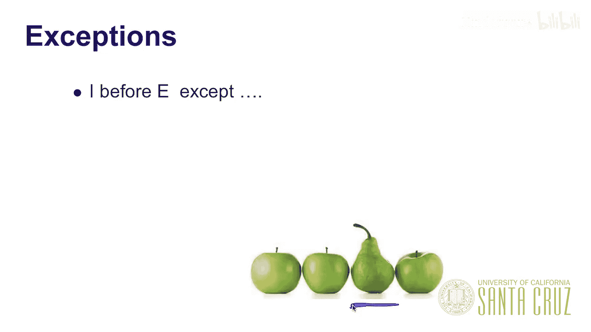
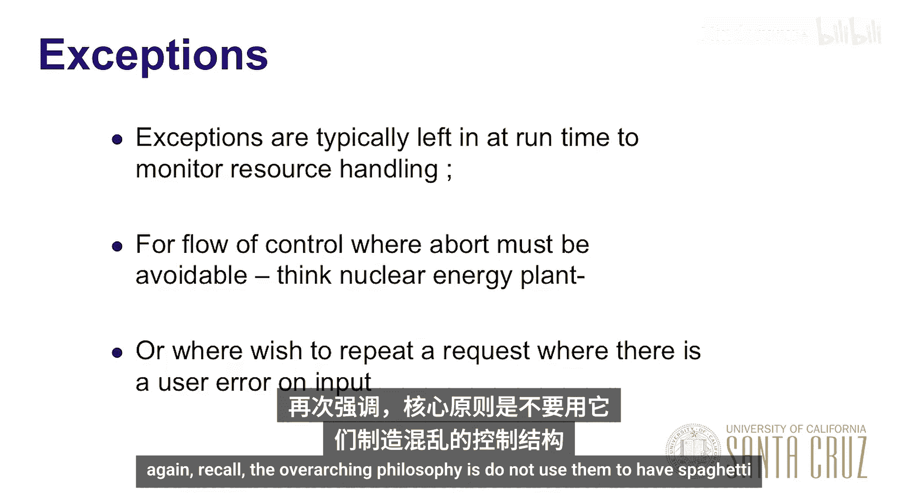
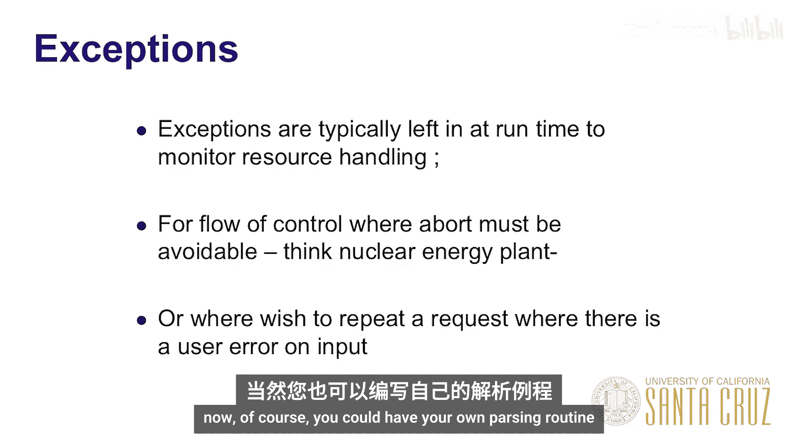
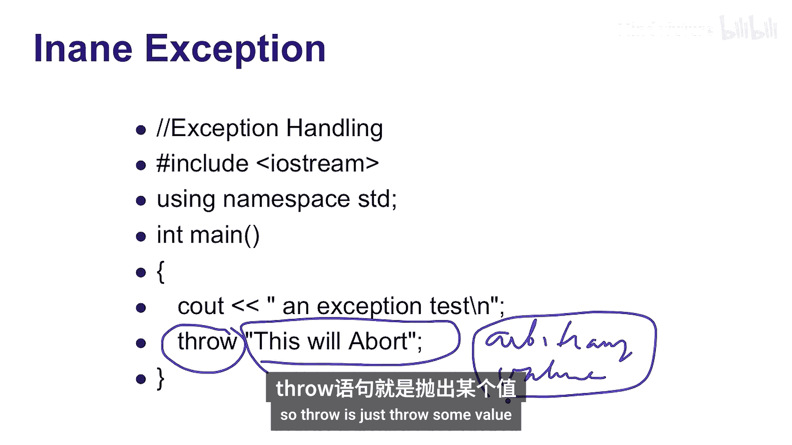
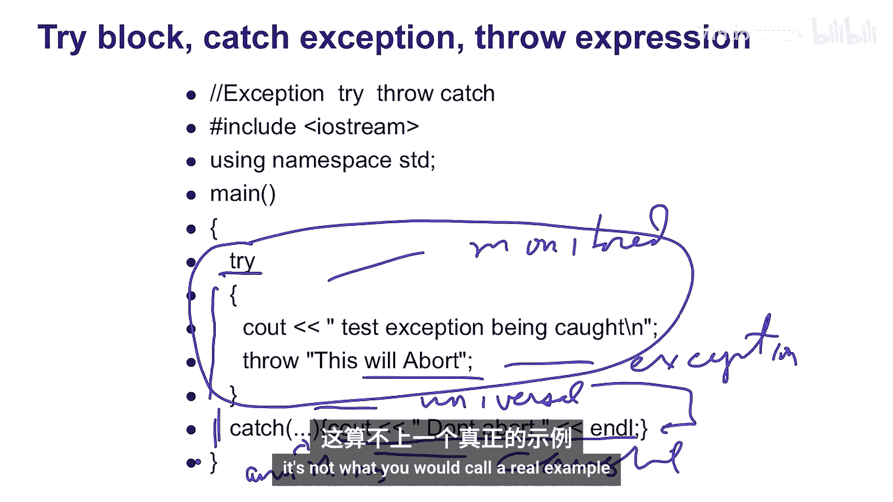
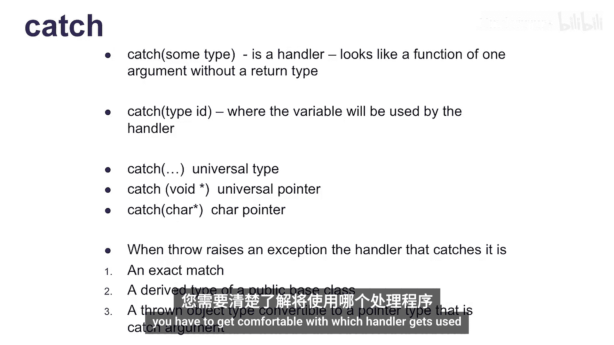
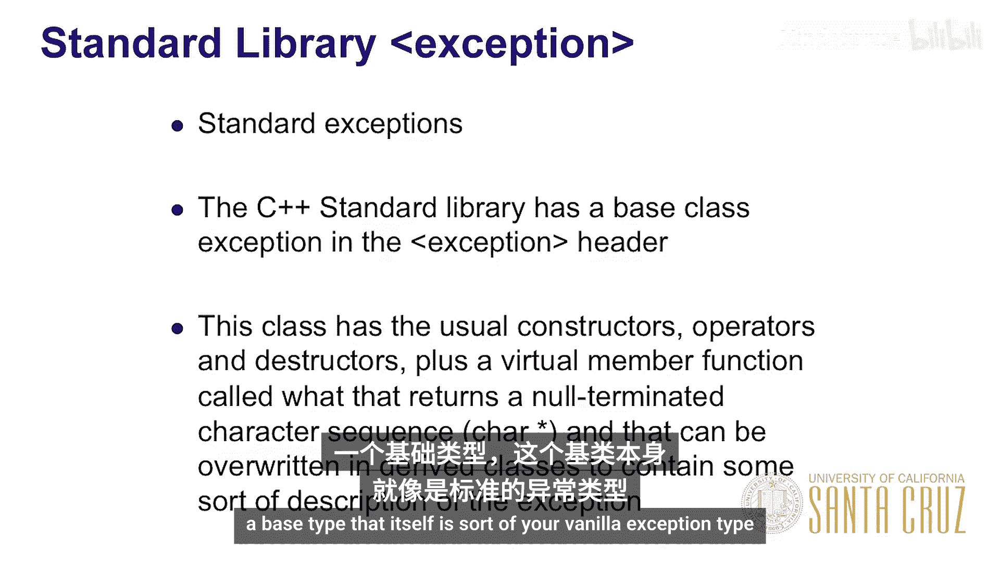
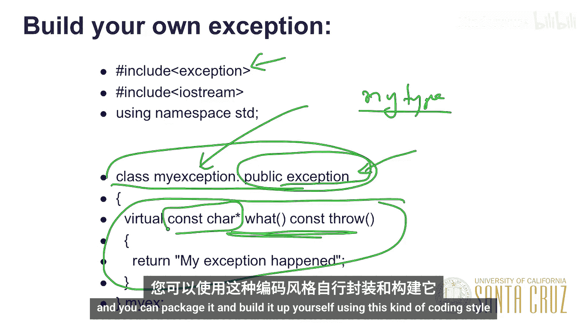
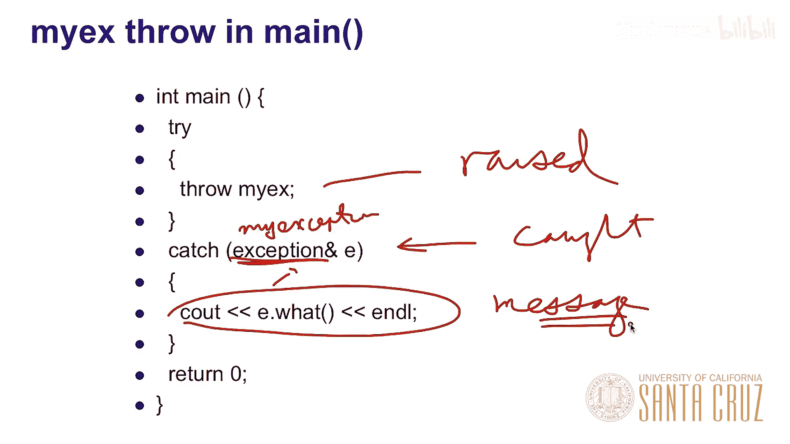

# C++编程：P49：异常处理

在本节课中，我们将要学习C++中的异常处理机制。异常是程序运行时可能发生的意外或错误情况。我们将了解如何抛出异常、捕获异常，以及如何利用标准库中的异常类来构建健壮的程序。



## 异常概述



上一节我们介绍了异常的基本概念，本节中我们来看看异常在编程中的具体应用。

异常在现实世界中普遍存在。在编程中，异常处理机制用于在运行时监控资源管理，并确保程序能从非预期的错误中恢复。其核心哲学是：**不要滥用异常来制造复杂的控制流**，而应在真正需要的地方使用它。

例如，在核电站或太空任务等关键系统中，计算机不能随意关闭。这些系统需要有能力从任何错误中恢复，即使是非预期的错误。阿波罗任务就使用了三冗余硬件和投票机制来确保即使一个系统失效，任务也能继续。

异常也是一种处理用户输入错误的机制。虽然不使用异常也能实现错误处理，但使用异常是一种更常见的编程范式。



## 基本异常机制

现在，我们来看看C++中异常处理的基本代码结构。

C++使用 `throw` 语句来抛出一个异常。你可以抛出任意类型的值。

```cpp
throw "This will abort";
```

完整的异常处理机制涉及 `try` 块和 `catch` 块。`try` 块定义了被监控的代码区域，`catch` 块用于捕获并处理抛出的异常。



```cpp
try {
    // 被监控的代码
    throw "This will abort";
} catch (...) {
    // 捕获所有类型的异常
    std::cout << "An exception was caught." << std::endl;
}
```

在上面的例子中，`catch (...)` 中的省略号是通用签名，可以捕获任何类型的异常。捕获异常后，程序不会立即终止，而是执行 `catch` 块中的代码。

## Catch 块的特性

接下来，我们详细了解一下 `catch` 块的特性。



`catch` 块看起来像一个函数，但它不是函数。它必须且只能有一个参数（尽管该参数可以是通用类型 `...`）。`catch` 块没有返回类型，它只是一段代码，可以包含任意复杂的逻辑，甚至可以作为主计算失败后的备用计算路径。

当 `throw` 抛出一个带有特定类型的值时，程序会尝试将其与一系列 `catch` 块的签名进行匹配。匹配规则遵循最精确原则。以下是匹配顺序的要点：

*   首先尝试匹配精确类型。
*   然后尝试匹配派生类的公共基类类型。
*   也可以匹配可转换为 `catch` 参数指针类型的异常。

因此，通常会将更具体的 `catch` 块放在前面，将通用的 `catch (...)` 块放在最后作为默认处理程序。

## 标准库异常与自定义异常

C++标准库提供了一组预定义的异常类型，它们构成了一个继承层次结构，基类是 `std::exception`。C++11引入了更多新的异常类型，用于处理运行时错误、内存错误、I/O错误等。



如果你想为自己的类创建专门的异常，建议基于继承来构建。通常的做法是创建一个继承自 `std::exception` 或其派生类的新异常类。

标准异常类中有一个可以重载的虚函数 `what()`，它通常返回一个描述异常信息的字符串。



```cpp
class MyException : public std::exception {
public:
    virtual const char* what() const noexcept override {
        return "My custom exception occurred!";
    }
};
```

以下是如何抛出和捕获自定义异常的示例：

```cpp
try {
    throw MyException();
} catch (const std::exception& e) { // 可以捕获派生类
    std::cout << "Caught: " << e.what() << std::endl;
}
```



因为 `MyException` 是 `std::exception` 的派生类，所以可以被基类引用捕获。在 `catch` 块中，我们可以调用 `e.what()` 来获取异常信息。

## 总结



本节课中我们一起学习了C++的异常处理机制。我们了解了如何使用 `throw` 抛出异常，如何使用 `try-catch` 块来监控代码和捕获异常。我们还探讨了异常匹配的规则，以及如何利用标准库中的异常基类来创建自定义的异常类型。正确使用异常可以帮助我们编写出更健壮、容错性更强的程序。