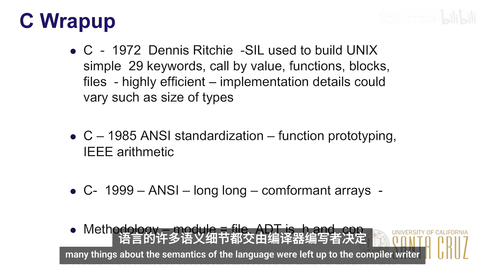
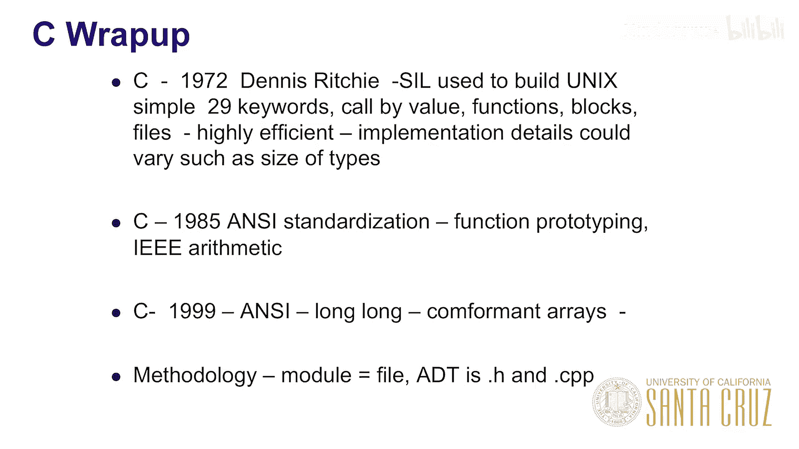
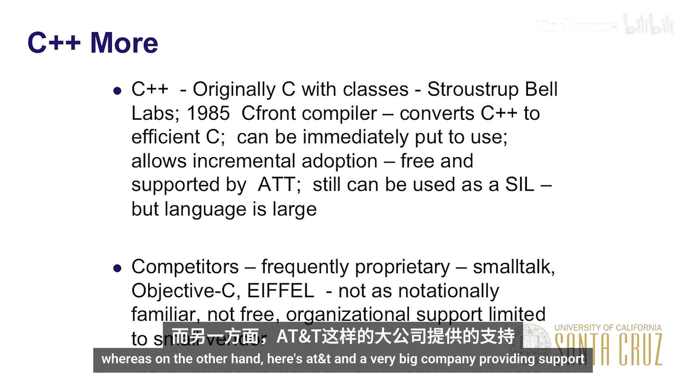
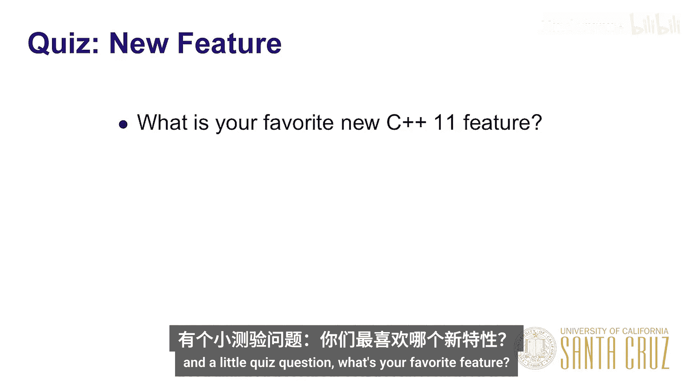
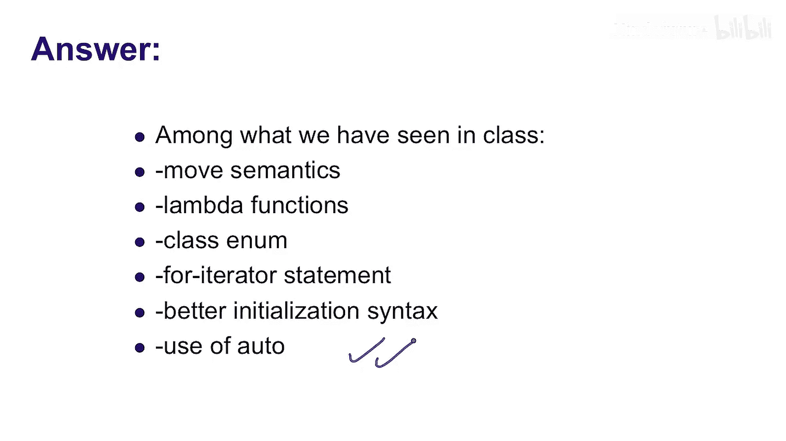

# 【加州大学】C++编程-｜-C-Plus-Plus-B-p50-P50_4-9-C++11设计模式_04_05_01--BV1KseJzqEbZ_p50-

Okay。Well， welcome today， we're going to deal with final topics for this class。

And those topics are going to be a continuation of some of the advanced features of C++ in the new standard 11 will emphasize some ideas。

That have been added through the libraries。啊。Give some example code。

And then we're going to give a bigger picture in how to。

Properly use a lot of this powerful technology， and that is a question of how you build bigger pieces of code。

And you do that。By。Using architectural ideas， so called design patterns for building your code。

And we will investigate。Some thoughts on design patterns as well。So let's go back to the beginning。

 C plus plus。Starts with C。See， of course， is。A language invented by Dennis Ritchie。

 systems implementationm language， SIL， it was built。It was used to build Uniuchx。呃。

It was a very simple and small language， originally 29 keywords。Only one form of parameter。

Function call was all called by value。 There was a simple modularity to it。

 The modularity was all file based modularity was highly， highly efficient。

Implementation details could vary from machine to machine architecture。

 many things about the semantics of the language were left up to the compiler writer。

So that the compiler writer for a particular architecture could make the language。Highly efficient。

So that it could replace in large measure having to program at the machine language level。Now。

The language。Which was used at Bell Lavs by the Euchx people， by Richie An Thompson。

For their own private purposes。Escape the layout。Why did it escape escape Because Uniix became popular。

 It was never an intention to have C as a。wideidely used general purpose programming language。

 but once Unix got very popular as an operating system。

 people wanted to add things to UniX and UniX rapidly became an environment where others contributed。

 for example， there was Berkeley Unix so everybody who wanted to do that， started to learn C。

And C became a very， very important language initially for working at the system level。

 but then because it was so efficient under Uni systems， it got used for other purposes。

Those purposes kept expanding。And people started to use it in an ordinary curriculum as a general purpose programming language。

 indeed， a colleague of mine， Al Kelly and I wrote a book on C which presented C as a general purpose language rather as a systems language rather than as an esoteric language。

This kind of popularity increased and it started to displace at that point。啊。

Almost universal teaching language Pascal。And there was a need to do more standardization。

 so there was a standardizing effort that led to sea in 1985 that made the language more uniform in behavior。

Had the semantics of the language。B。More constrained。The standardization processes continued。

 another big standardization effort was in 1999 things got added to it。

 in '85 you had function prototyping， you had a more careful analysis of how arithmetic would work in 1999。

 some added types like long long got added， there were data structures added like conformant arrays。

 making it easier to program and arrays safely。But still， the methodology。

 the ideas behind using C are fairly low level module is equivalent to file。

That's somewhat artificial after all， module languages like Moular 2 like Ada were already products of the 1980s。

 and this was much better software methodology for larger projects and sort of to do it in ac an ad hoc basis with make files and。

File constrained modularity。somewhatwhat artificial。Now。Yourn Swstrep。

Joined Bell Labs in the early 1980s。 and for his purposes， because he came from a。

Scaninavian training in which you learn Sim 7， and that was the original。Object oriented language。

 sort of alcohol with classes。啊。He found himself unhappy with sea， but was encouraged。

Through preprocessor add classes to city， much like he had in Sim。

That proved to be a very successful effort。 It proved so successful that his work shifted to being a programming。

😊，Language designer。And he put out from AT&T Bell Labs， the first commercially supported compiler。

 Seafront， but again， since AT&T at the time was constrained to not be a computer company。

 it was freely available much as Unix， it was really research product。

 and so it was readily available， but its competitors at the time such as small talk。Or objective C。

 or later Eiffel。Were either proprietary and supported by smallish organizations。Or were inefficient。

Or were。Too foreign in the character of how you did things。

And the thing that was brilliant about C++ was it was easy to use C++ if you were already a conventional C programmer。

 you could just adopt。What you needed， it was。A better C， a new version of C。 if you want to think。

 if you wanted to think of it that way。 So these other languages were not as notally familiar。

 They were frequently not free。 And again， organizational support by small vendors made adopters very nervous。

Whereas on the other hand， here's AT&T。

A very big company。Providing support。And again， distributing this readily with Unix。Now。

 what we've seen in C++ is。The original language。See with classes。

 so the big addition was we all of a sudden had objects。And then in 1989。

languageguage starts getting。I hate to say bureaucratize。

 but so many people buy in that there have to be industry standards and ISO committees。

To begin to adopt new things into the language。And key adoptions in 1989 were templates and exceptions and the language just kept getting bigger templates allowed the language to support generic program so again。

Bjorn's philosophy was this is a professional language for professionals。

 professionalss know the tools that they need， and this is not what you might call。

A monolingual culture。Was a multilingual culture actually multi paradigmatic in that it was going to support。

All sorts of programming， low level systems implementation programming。

 high level object oriented polymorphic programming and generic programming。

It was a Swiss army knife， a big tool set。The utility of templates。

Was dramatic when Alexander Stepanov， who has been doing profound research into generic programming。

 but didn't have quite the right programming language vehicle to do it。

Started to use C++ with templates to implement his generic ideas and have a proof of concept that was being built at HP labs。

 and that then got adopted into the wider C++ community namely the standard template library。

 Meanwhile， Java spawned off a major alternative freely available again back by a big organization at the time Sun microcrosystem currently Oracle and so began a competition between C++ and the newly right Java as to。

Which would be。In major use， and of course， both have succeeded。And both have spurred the other to。

Adopt。Newer ideas。So。C++ was largely intact with a whole bunch of these ideas。

 I think a standard got nailed down 1998 that was quite important。

And that has been the language of use for something like 15 years now。

 then in 2011 a very big major new change occurred， the new standard got it done。

The new standard as the old standards were， was adopted because there were continual practice and in that practice people tried things。

 one of the big important things that got tried were boost libraries where newer libraries were explored though they were not yet in the standard so there were hash-based searching and there was threading libraries and there were regular expression libraries and we'll see today。

 how some of those entered the standard。Other ideas that were quite unfamiliar to the sea crowdrowd were things like landda expressions。

So these things all entered the standard and we've already in this class touched on some of these ideas and how to use them Meanwhile。

 of course in the rest of the world things move on， there are are newer competitors。

 all of these things are quite important， there is some degree of convergence in programming and programming methodology。

 all these languages are getting very big Python， C sharpp， JavaScript。

 they're all getting more universal， they're all getting bigger。

If you want to think historically about programming languages and programming methodology。

 in the early days， if you were going to do systems programming。

 you would use C or you'd use macro assemblymbler or you'd use something like BCPL and then if you were going to do business programming。

 you'd use Cobalt， if you were do scientific programming， you'd do Fort。

So programming languages were。Smaller and tailored to a particular community。

And this is what's dramatically changed。Organizations have found that it's very expensive to train programmers。

 you have good programmers。They can adapt to whatever things you need program。

But to have multi platform multi programming languages supported all the time and integrate all that is a huge。

 huge expense， so it been a very big effort to make languages more universal among these of course。

 were some failed efforts。Or partially， I wouldn't say failed。

 PL1 the language that I as a graduate student used heavily was IBM's attempt at that。

Still around so in the 1980s， the military， for example， had a competition。

There were four final teams， they were all given different color name， color codes。

 and the one that succeeded was Ada was based on principles that were developed largely from languages like Pascal。

And there were date abstraction languages。And modular languages and languages in which you could try to provide proofive correctness。

 So anyway， we have this notion that。To the extent that we can， if you are an enterprise like。

Microsoft。Maybe you could do most of your coding in CS if you're an enterprise like Oracle， Java。

 if you're a web based company， Java。Again。Python。Another language that's had remarkable success in the last two decades and covers a spectrum。

Paras， so this is where we are in programming methodology and languages and certainly C+ plus。

 if not the most important is at least in the top two or three of all of these languages。Okay。

 so to date， you've learned a fair amount of c+ plus and c+ plus 11。And呃。Little quiz question。

 what's your favorite feature？

Here's a list of some of the things we've already talked about， it's not exhaustive。

We've seen move semantics， quite interesting， novel。We've seen lambmbda expressions。Not so novel。

 it's been around and listsp。Other languages for a while functional languages。

 still to see it show up in a sea based family of languages is pretty remarkable。

 We've seen a noome translate to class a no。 We've seen the new kind of foriterator statement。

Be better ways to do initialization， we've seen the use of auto change from a storage concept to a type inference concept。

These may have been some of your answers。If I had to provide a favorite。New feature。

I think I would say for a small amount of cost。The most payoff for me is in this new use of auto for。

Type inference。

