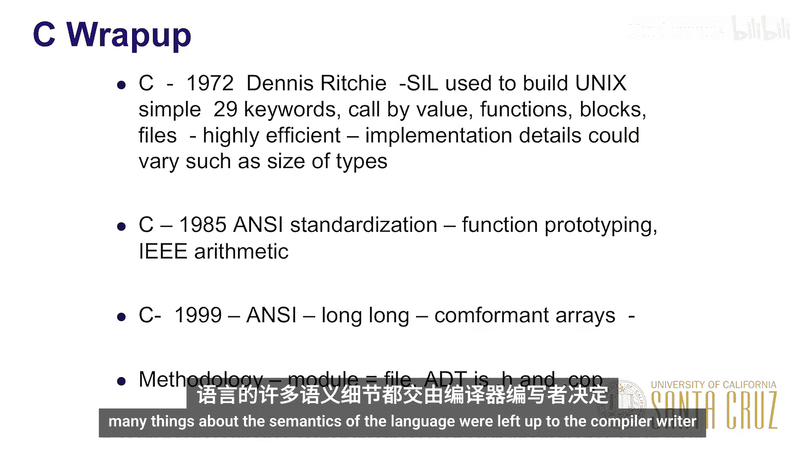
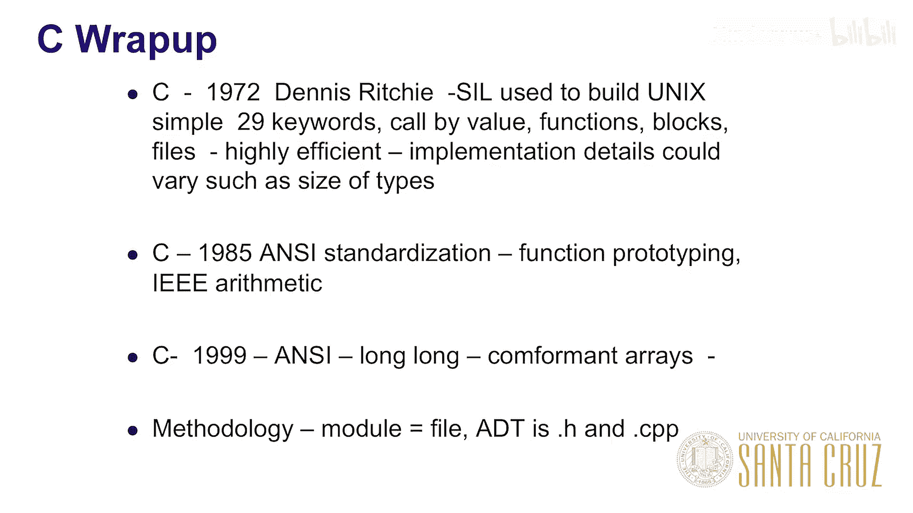
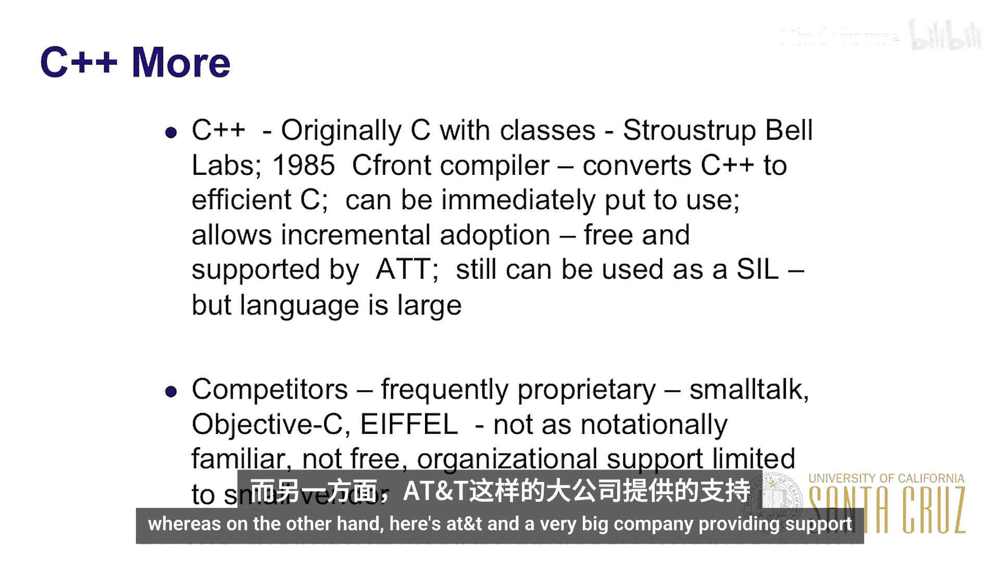
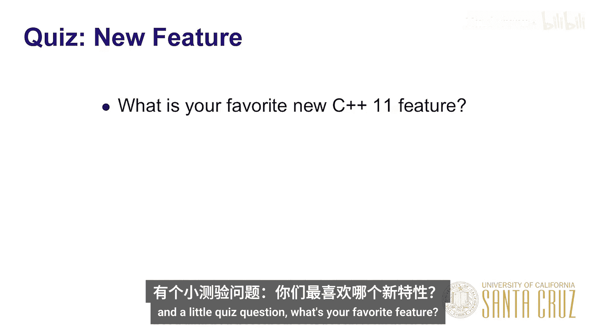
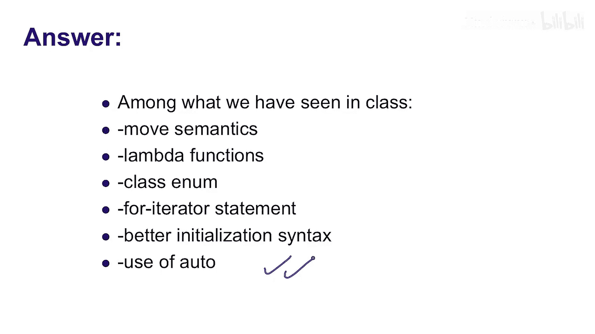

# C++编程：P50：C++11设计模式与语言演进

## 概述

在本节课中，我们将探讨C++语言的发展历程，从C语言的起源到C++11标准的引入，并介绍一些高级特性与设计模式的基本概念。我们将了解C++如何从一个系统实现语言演变为一个支持多范式编程的通用语言。

## C语言的起源与特点

C语言由丹尼斯·里奇发明，最初作为Unix操作系统的实现语言。它是一种系统级语言，设计简洁高效，最初只有29个关键字。

C语言的核心特点包括：
*   所有函数调用均采用**传值**方式。
*   模块化基于**文件**实现。
*   语言语义的许多方面留给编译器实现者决定，以便针对特定机器架构进行高度优化，从而在很大程度上替代机器语言级别的编程。

随着Unix操作系统的流行，C语言的应用范围从系统编程扩展到更广泛的用途，并开始在教学领域取代Pascal语言。

## 从C到C++的演进

比雅尼·斯特劳斯特鲁普在20世纪80年代初加入贝尔实验室。他借鉴了Simula语言中的类概念，通过预处理器为C语言添加了类，创造了“带类的C”，这后来演变为C++。

C++成功的关键在于它对C程序员的友好性：它被视为一个“更好的C”。与当时其他面向对象语言（如Smalltalk、Objective-C）相比，C++由AT&T这样的大公司支持，并且可以免费获取，这降低了用户的采用风险。

C++的发展遵循了“瑞士军刀”式的哲学，旨在成为一个支持多种编程范式的专业工具集：
*   **低级系统编程**
*   **高级面向对象多态编程**
*   **泛型编程**

## C++标准的演进与关键特性

C++通过ISO委员会进行标准化，不断引入新特性。1989年的关键新增内容包括**模板**和**异常处理**。

模板的实用性在亚历山大·斯捷潘诺夫的工作中得到充分体现。他利用C++模板实现了泛型编程思想，其成果最终发展为**标准模板库**。

与此同时，Java语言的出现带来了新的竞争，两者相互促进，共同发展。

2011年的C++11标准是一个重大更新，引入了许多源自实践（如Boost库）和函数式编程语言的新特性。

以下是C++11中一些我们已讨论过的重要特性：
*   **移动语义**
*   **Lambda表达式**
*   **`auto`** 关键字从存储概念转变为**类型推断**概念
*   **基于范围的for循环**
*   更好的初始化方式
*   **`nullptr`** 关键字

在这些特性中，**使用`auto`进行类型推断**被认为是以较小代价获得最大回报的特性之一。

## 编程语言的发展趋势

历史上，编程语言通常较小，且针对特定领域（如系统编程用C，商业编程用COBOL，科学计算用Fortran）。然而，现代趋势是语言的**通用化**。

企业发现，培训程序员掌握多种语言并整合不同平台的成本非常高昂。因此，出现了让单一语言变得更通用、以覆盖更广泛编程需求的努力。例如：
*   微软主要使用 **C#**
*   Oracle和许多Web公司使用 **Java**
*   **Python** 在过去二十年取得了显著成功，覆盖了广泛领域

C++无疑是当今最重要、使用最广泛的编程语言之一，位居前列。

## 总结

本节课我们一起回顾了C++从C语言起源到C++11标准的发展历程。我们了解了C++如何通过添加类、模板等特性，从一个系统语言演变为支持面向对象、泛型编程的多范式语言。我们还探讨了C++11引入的一些关键新特性，如`auto`类型推断和lambda表达式，并了解了编程语言向通用化发展的整体趋势。理解这些背景有助于我们更好地掌握和运用C++这门强大的工具。