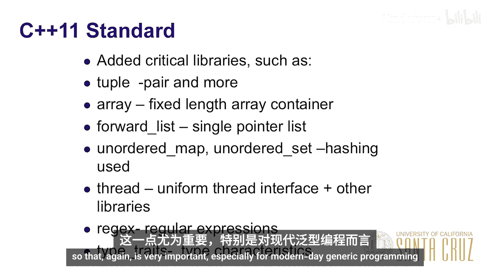
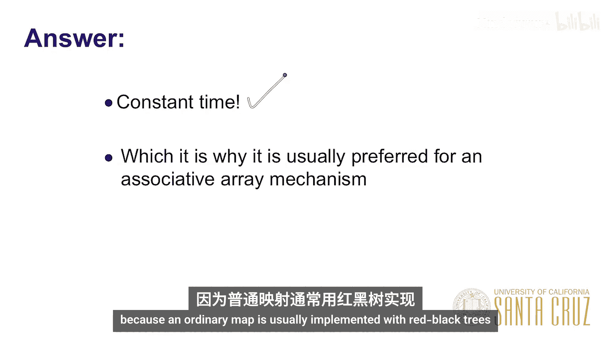
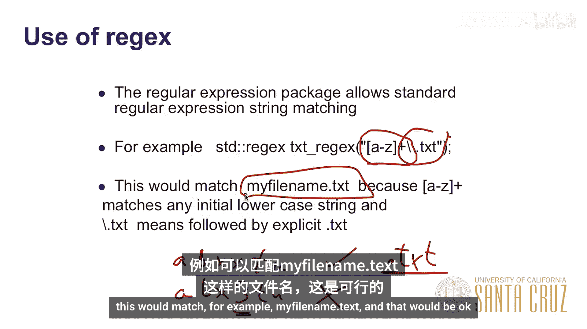
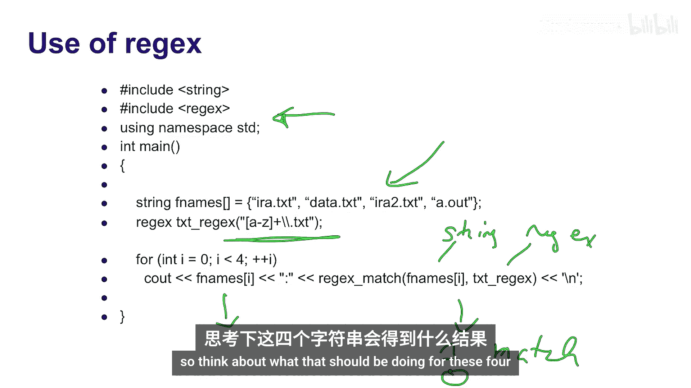
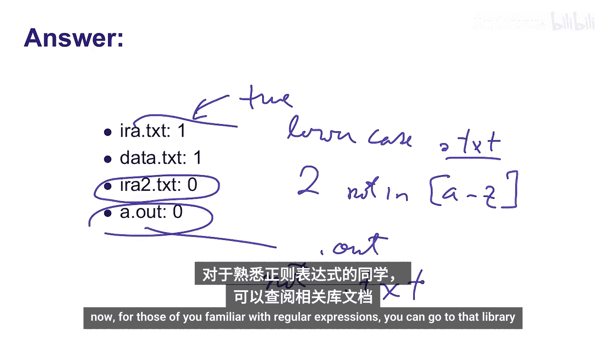

# 【加州大学】C++编程-｜-C-Plus-Plus-B-p51-P51_4-10-C++11标准_04_05_02--BV1KseJzqEbZ_p51-

So what else is going on in the standard？Here are some of the things that are going on and a few of these things we're going to also show you today。

 and it's just too big a group of things to we'd need two more courses of this size at least to go into detail on how to use everything in the new standard。

But。Some of you have different needs， and this will give you some sense of where you could go。

 what you further need to do to understand some of the new capabilities。

So they're added critical libraries， I said， there was a lot of experimentation over the last 10。

15 years with libraries such as the Boos library， and in that experimentation。

 the general C++ community said a these things work really well let's adopt them We have enough experience we know what we need and so they put。

Into the new standard。To top the library。I will show you an example later of tus。

 so we'll get to that。Theres a fixed length array container class。

 Why a fixed length array isn't vector just more flexible。 vector is more flexible。

 but it comes at a cost。 Remember， one of the principal reasons these libraries are so widely adopted is。

Because they're efficient。Because they fit。A critical need。

Sometimes the extra cost for having the flexibility of vector is not something you want to pay。

And you don't want to go to the primitive kind of array， the pointer based array that C is。

 is still with like nicer characteristics。And that can be had through a template based fixed length array in which the length itself is a component of the type。

啊。Doubly linked list， that was the list in the original STL。

 and now we're adding to it the forward list For list is something which is cheaper because it doesn't require a backward looking cursor。

 a backward pointer has only got a forward pointer， so it's singly linked， not doubly linked。

Now here's something that I think is。Of real value， the unordered map， an unordered set。

And we've already seen examples of that， and the unordered versions of map and set use hashing rather than log end based lookup methods。

So we generally get a performance enhancement。If we need that。For associative arrays。A big， big new。

Addition is。Threreadating libraries and other libraries such as Atomic that Mutex that。

Let you do concurrent programming， threaded based programming。

Within a C plus plus standard rather than what was always allowed。

You could always use whatever your current library was for most people in UniuchX。

 that might be a P threat。Library。And that still might be the basis for this， but now。

They've put into the standard at a little higher level what the concurrency primitives need to be。

 and then they let the implementation。Support that standard。

So now you can write more uniform core code across different platforms。

Another very valuable library is regular Express library。

 this is probably one of the first libraries that people immediately wanted that wasn't in the standard because regular expressions have been in use in computer science and programming forever。

And they're just an extremely useful way of parsing strings。And so just a natural addition。

And finally， among the interesting additional libraries is the Tpe traits library and the Tpe traits library can be used。

Yeah。Also to use static assertions and very helpful in writing more portable code and code that can be statically checked。

After you instantiate a template， so that again。Is very important。

 especially for modern day generic programming。 So all of this stuff。 and it's huge。 I mean， I'm not。

inI'm just going to give you the barest roadmap to this stuff and for your particular purposes。

 you're going to have to go and study at length， the good news is。

Lots of material available in studying this， lots of material already on the Web where you can where you can read about any of this。

Okay， anotherqui question， we've used an unordered map before。

It's a hash bass look up if there are no collisions。

And you're using an unordered map instead of a map。For n elements。

What is the order that the computation is going to take？For law， it is constant time。

And that means it's extremely efficient， especially if there are no collisions。

And that's going to be the normal case。And this is。

Typically prefer to an ordinary map because an ordinary map is usually implemented with red black trees。

 all the basic operations there are logarithmic as opposed to fixed time。

So this is going to dominate where you need that performance。Okay。

 let's take a look at one of these newer libraries。

Let's see how we can use the regular expression library。So regular expressions。

I don't know if you know your Chomsky hierarchy， but regular expressions are sort of。

Lowest level of formal language rule writing， hierarchical rule writing。Typically。

 a regular expression is something like repeatedly writing a series of A's and B's。

So any sequence of A's and B's can be expressed as a regular expression。啊。

W up from a library expression， again， if you have some computer science background。

Would be context free languages and they require more stringent rules and they're more difficult to parse。

 So regular expressions have very simple rules， but they encompass lots of different languages and they're very。

 very simple to parse and the regular expression package gives you a basis for expressing those rules。

 So here， for example， is a regular expression。And what it's saying in this little thing here is。

Any sequence that uses lower case characters is okay。So that would mean A B， X， X， T， U is okay。

 that's okay， but A B X。3 T you。Not okay， why， because that's not in that alphabet。

So this bracketing thing says here are the characters I'm allowing。

 the plus thing says you can repeat it as much as possible so you can get into that alphabet。

 repeat it as much as possible。And then this last part says explicitly in the string。

 I need dot T X T。So this would。This regular expression。啊。

Declared that way would be an arbitrary set of lower case letters followed by a periodoccttus was matched。

For example， my file name got text。

And that would be okay。She used it in a little piece of code。

So as with anything in the standard library。We import the standard library， it's now called Redx。

And it's typically used with strings。 So you'll， you'll almost always see string when you're seeing。

Red Xx。And here is a series of strengths。So we have。An array of strings。

 four element array initialized。Ia dot text， data to dot text。 Ia2 dot text， data dot out。

 We have that expression。 And now we're going to say for I equals 0 to 4。See。Print up。The string。

And then see if there's a match between the string and the regular expression。

 here's the regular expression， here's the string。This leads to if there's a match， you get one。

There's no match you get zero。So think about what that should be doing for these four。

What will get printed there？SoWe have IRA text， data text， IRA2 text， A dotL。All standard names。

 file names。And we're asking which matches that？Maybe for the text files of a certain kind。

 we want to do further processing。 so that again， so we want to differentiate in this way。

 that again， is one of the reasons this is so powerful。I read that text is okay。Right。

 series of lower case letters。And then followed by the appropriate extension。

So this shows that the match is true。But I too is not okay。Why is I Ratu not okay？To。啊。And。

A through C。And A dot out is not okay。Because。Got out。Not that text。Now。

 for those of you familiar with regular expressions。

You can go to that library and see all the ways you can express different kinds of regular expressions as let say we don't have enough time to show the full support in the library。

 but once you understand the fundamental idea or if you've used regular expressions。

In other circumstance with languages like。呃。Pearl。Pearl is a heavily based regular expression。

Language or UniX utilities like AC， this will be very familiar to you。

 you'll be able to use it directly in the language。

