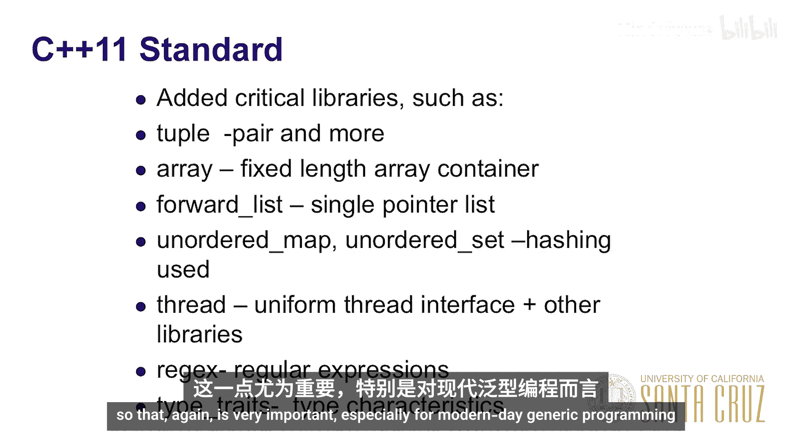
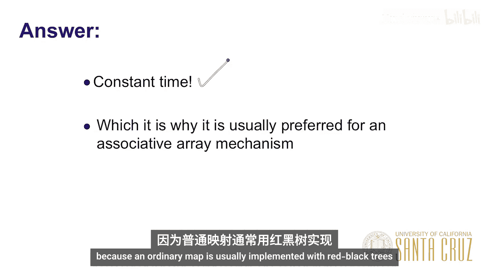
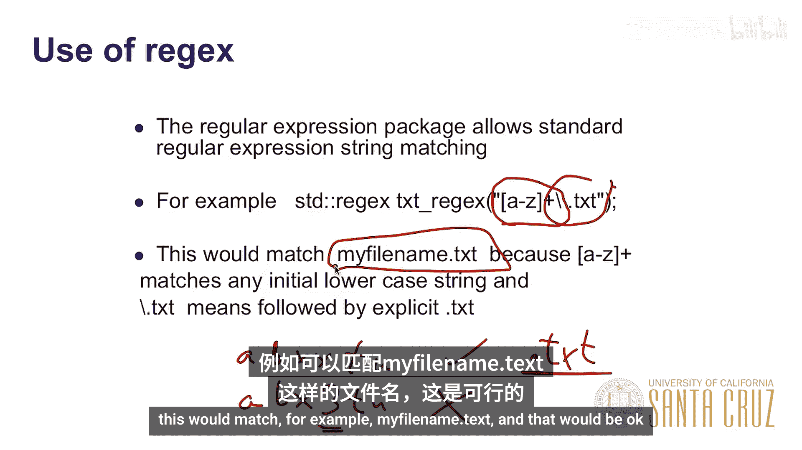
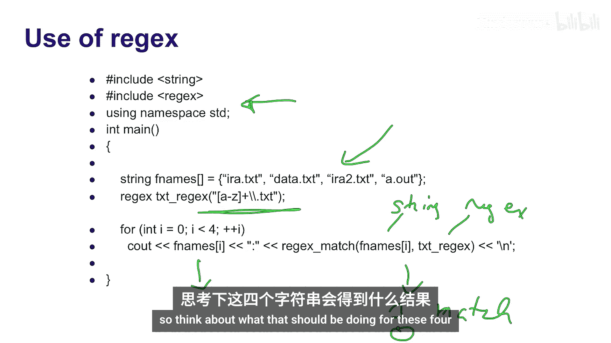
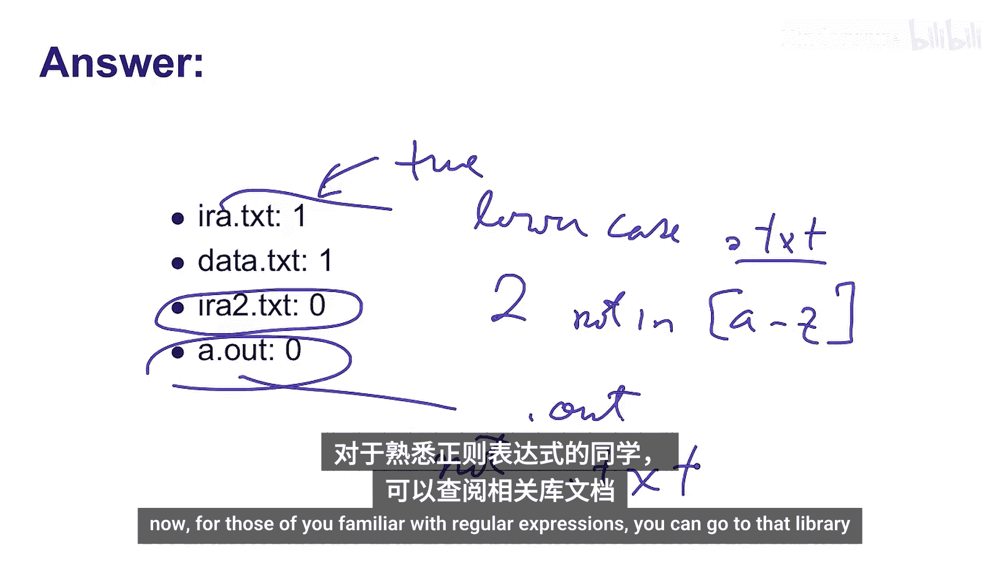

# C++编程：P51：C++11标准新特性概述

在本节课中，我们将学习C++11标准引入的一些关键新特性。我们将重点了解新增的标准库组件，并通过一个正则表达式的具体示例来展示其用法。

## 概述

C++11标准引入了大量新特性，其范围之广，足以再开设两门同等规模的课程来详细讲解。本课程无法涵盖所有细节，但会为你指明方向，帮助你了解在深入学习新标准能力时，可以探索哪些领域。

## 新增的关键库

上一节我们介绍了C++11标准的背景，本节中我们来看看它具体新增了哪些重要的库组件。许多库（如Boost库）在过去10到15年间经过了大量实验。C++社区认为其中一些组件非常有效，决定将其纳入新标准。

以下是部分新增库的简要介绍：

*   **固定长度数组容器类**：为什么需要它？`vector` 固然更灵活，但这种灵活性是有代价的。这些库被广泛采用的一个主要原因是其高效性。有时，你并不想为 `vector` 的灵活性付出额外开销，但也不想使用C语言中原始的、基于指针的数组。基于模板的固定长度数组可以满足这一需求，其长度本身是类型的一部分。
*   **单向链表**：原始STL中的 `list` 是双向链表。现在新增的 `forward_list` 是单向链表，它更廉价，因为它不需要向后的指针，只保留向前指针。
*   **无序容器**：`unordered_map` 和 `unordered_set` 具有重要价值。我们已经见过相关示例。无序版本的 `map` 和 `set` 使用哈希而非基于对数复杂度的查找方法，因此通常能获得性能提升。对于关联数组，如果需要高性能，这通常是首选。普通 `map` 通常用红黑树实现，基本操作是对数时间复杂度 `O(log n)`，而非固定时间 `O(1)`。
*   **并发库**：一个重大的新增内容是线程库以及其他如 `Atomic`、`Mutex` 等库，它们允许你在C++标准内进行并发编程、基于线程的编程。过去，你总是可以使用当前平台的库（如在Unix上可能是Pthread库）。现在，标准以更高层次定义了并发原语，并由实现来支持该标准，从而让你能编写跨平台更统一的代码。
*   **正则表达式库**：另一个非常有价值的库是正则表达式库。这可能是人们最初就希望拥有但标准中未曾包含的首批库之一，因为正则表达式在计算机科学和编程中一直使用，是解析字符串的极其有用的方式，因此是自然而然的补充。
*   **类型特征库**：最后，有趣的新增库之一是类型特征库。它可用于静态断言，对于编写更具可移植性、在实例化模板后可进行静态检查的代码非常有帮助。这对于现代泛型编程尤为重要。

所有这些内容非常庞大。我只是为你提供最粗略的路线图。针对你的特定目的，你需要去深入学习和研究。好消息是，有大量关于此的学习材料，网络上已有许多资料可供阅读。



## 正则表达式库示例

接下来，让我们具体看看如何使用其中一个新库：正则表达式库。



正则表达式是形式语言规则编写中最低的层次。通常，正则表达式用于描述像一系列A和B的重复序列。任何A和B的序列都可以用正则表达式表示。上下文无关语言需要更严格的规则且更难解析。正则表达式规则简单，涵盖多种不同语言，且非常易于解析。正则表达式包为你提供了表达这些规则的基础。

例如，这是一个正则表达式：`[a-z]+\\.txt`
它的含义是：允许使用任何小写字符序列。这意味着 `abxxtu` 是允许的，但 `abx3tu` 不允许，因为 `3` 不在该字母表中。方括号表示允许的字符集，加号表示可以尽可能重复。最后一部分明确要求字符串中必须有 `.txt`。因此，这个正则表达式将匹配任意小写字母序列后跟 `.txt` 扩展名，例如文件名 `myfile.txt`。

以下是一段使用该正则表达式的示例代码：

```cpp
#include <iostream>
#include <string>
#include <regex>

int main() {
    std::string filenames[] = {"ia.txt", "data2.txt", "ia2.txt", "data.out"};
    std::regex pattern("[a-z]+\\.txt");

    for (int i = 0; i < 4; ++i) {
        std::cout << filenames[i] << ": ";
        if (std::regex_match(filenames[i], pattern)) {
            std::cout << "匹配" << std::endl;
        } else {
            std::cout << "不匹配" << std::endl;
        }
    }
    return 0;
}
```



与标准库中的任何内容一样，我们导入头文件 `<regex>`。它通常与 `string` 一起使用。代码中有一个四元素字符串数组，并定义了正则表达式。循环检查每个字符串是否与正则表达式匹配，匹配则输出1，不匹配则输出0。

对于这四个文件名：
*   `ia.txt`：符合规则，匹配。
*   `data2.txt`：不符合，因为包含数字 `2`。
*   `ia2.txt`：不符合，因为包含数字 `2`。
*   `data.out`：不符合，因为扩展名是 `.out` 而非 `.txt`。



这样，我们就可以区分特定类型的文本文件以进行进一步处理，这正体现了该功能的强大之处。

对于熟悉正则表达式的开发者，可以查阅该库以了解表达各种正则表达式的所有方式。如果你曾在使用Perl（一种重度基于正则表达式的语言）或Unix工具（如`grep`）时用过正则表达式，那么你将能直接在C++中使用它。

## 总结



本节课中，我们一起学习了C++11标准引入的部分关键新特性，重点概述了新增的标准库组件，如固定长度数组、单向链表、无序容器、并发库、正则表达式库和类型特征库。我们还通过一个具体的代码示例，演示了如何使用正则表达式库来匹配和验证字符串格式。这些新工具极大地增强了C++的表达能力和效率，为现代软件开发提供了强大支持。