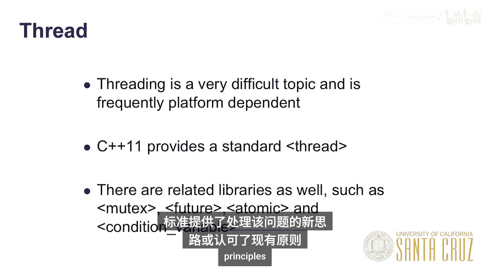
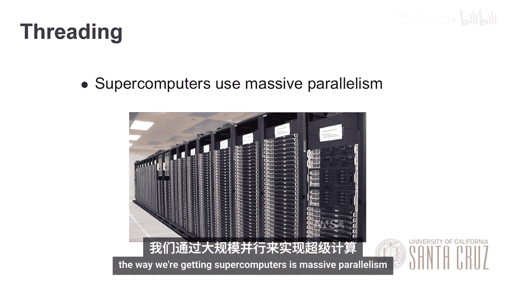
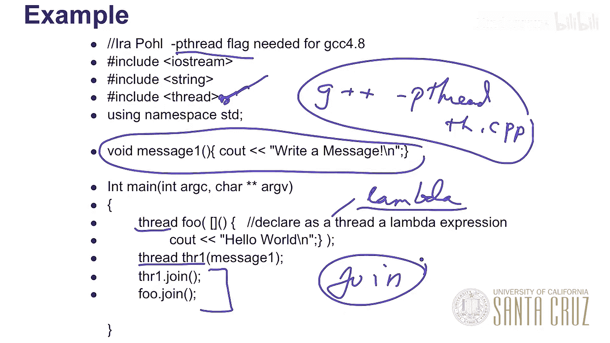
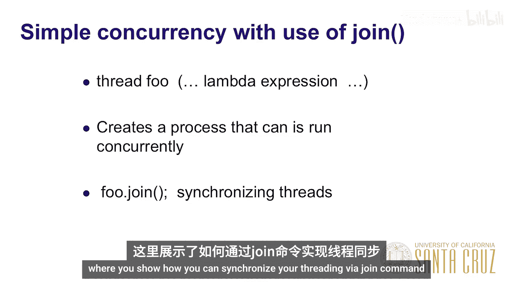

# 【加州大学】C++编程-｜-C-Plus-Plus-B-p52-P52_4-11-线程_04_05_03--BV1KseJzqEbZ_p52-

So here's a really big deal， but this is also very， very complicated threading， threading。

Difficult topic。Example in my own undergraduate。啊呃。

Department at the undergraduate level in our department。There is yet to be， of course。

 completely devoted currency。 We have some mention of concurrency。

 but nobody can get adequate agreement and again， maybe we're just not a large enough department to properly discuss。

 So we talked for 20 years about。How to get enough concurrency ideas into the program。

 some of that is just it's still difficult， there's still many approaches as frequently platform dependent。

And this is why it was。For a long time kept out of the C++ standard， a very difficult topic。

 frequently platform dependent， but now C+ plus 11 provides a standard and there are related libraries as well。

 mutual exclusion one of going back to people like Dykster and H。

 there were lots of discussions of mutual exclusion and semaphos and these are available in the muttex library。

 there's a library called Fus so that you can wait on a computation and get its answers there are a library called atomic in which you can get further synchronization primitives。

 and conditional variable library again some of this relates to to the way you manage memory between current process current processes are different difficult because it's hard for us。

To think about what stuff can you let run and what stuff？

Do you have to wait before you can execute so。Think about how you work in the kitchen or maybe you can。

Shop up a salad over here while you heat up some boiling water to toss your corn in。But you can't。

Fin， you can't toss the corn in until you dehusk it so that there's some sequential stuff。

And you must wait on that and there's some concurrent stuff that's available。

This is pretty natural in the real world and you can frequently see what your constraints are。

 but in the computer world you get race conditions。

 so if you're trying to use a shared variable and two processes don't realize it they might both change a variable and that variable will have an indeterminate value depending on when things get changed and you may have to。

Have some ability to share that value in a way in which。

Different processes can put a lock on the variables so that the result isn't non deterministic。

 all very difficult。 So， again， I don't recommend this for the average user out there。

 But this is becoming an increasingly important topic。

 and to the extent that the standard provides novel ideas about how to approach it or endorses existing principles and has been tried out heavily and can be used with P threads。

This is going to be more and more important。This is what computers in the future or even the present are looking like。

The way we're getting supercomputers is massive parallels。

We're getting petaflops and we're getting exaflops because we can put together。

Uuge numbers of cheap devices。And then。Divide up the computation。

 So imagine simulating a galaxy formation simulating weather。 all of these things are very。

 very hard or。But many things can be run concurrently if we know how all the concurrent processes can collaborate and some things are very naturally concurrent。

 They don't need anybody to。They don't need to share any existing variables so that they can interfere with each other。

All of this， as I say， increasingly important， it's even important in the local level because you can go to your local computer store whatever you want。

 a PC or a Mac， and now you're going to find yourself with at least a quad CPU。So， even。

On your desktop， even in your。New smartphone。呃。You have multi threaded programs at work。

Here's a very simple example again。Just the most basic of things。In compiling this example on Gcc 4。

8， which supports。The C 11 standard and has been the compiler I have recommended for this class where you're doing。

C+ plus 11。You need a sticker。嗯。You need to do something like G plus plus。Minus P thread。

That's going to be your compilation command or something in your make file。

Here's a threading library again。And the two things we're going to thread。

 one is going to be what you might call a classic function。Typical classic function， returning F。

And yet， a second function。 But this is a lambmbda。

 So we're going to use that new idea and C plus plus 11 of。Unnamed functions or lambmbda expressions。

And they're both trivial。 They both just show that these things can happen concurrently。

You have a threat declaration for each of these processes， you could think of these as processes。

 and now rather than have one execution stream that would be mainine。

 you're essentially having two execution streams and they're occurring and then rendezving and blocking and getting back together via a standard command called a join。

So a join is provided within the threading library to make sure that you get proper。

Synchronization and a multi threaded program。对。

Just to restate what we just saw， we allowed threat of food to be associated with a lambmbda expression that could be quite common。

 creates a process that can be run concurrently， and then we have something that goes back a long time to people like Dktren or where you show how you can synchronize your threading。

via Jo command。

