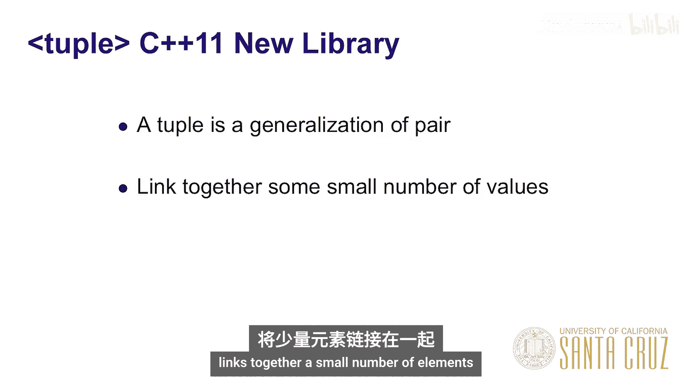
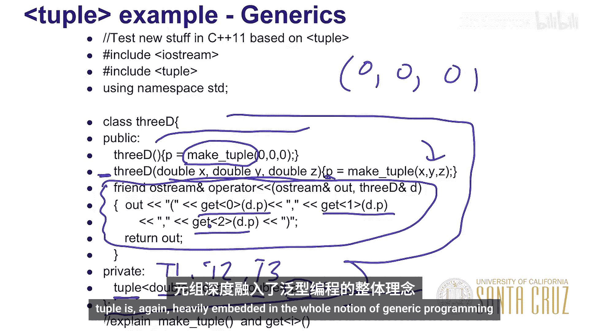
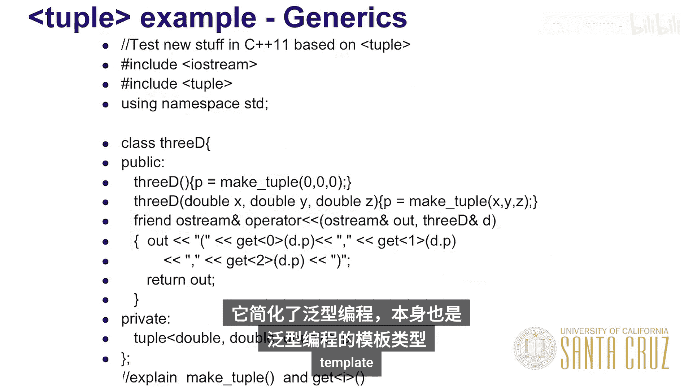
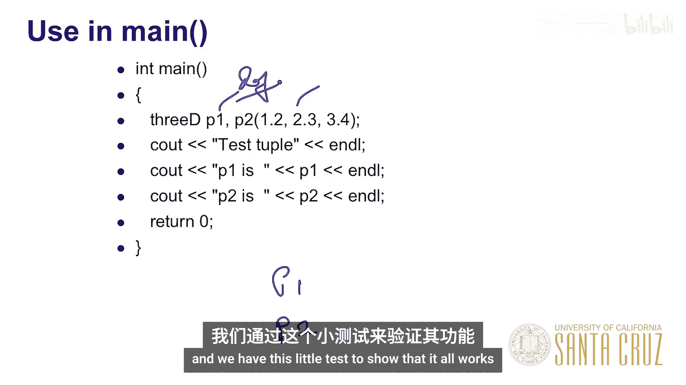
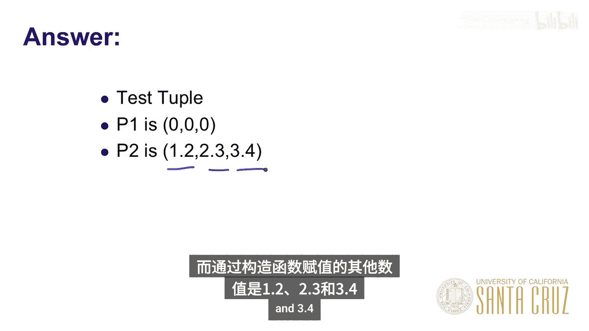
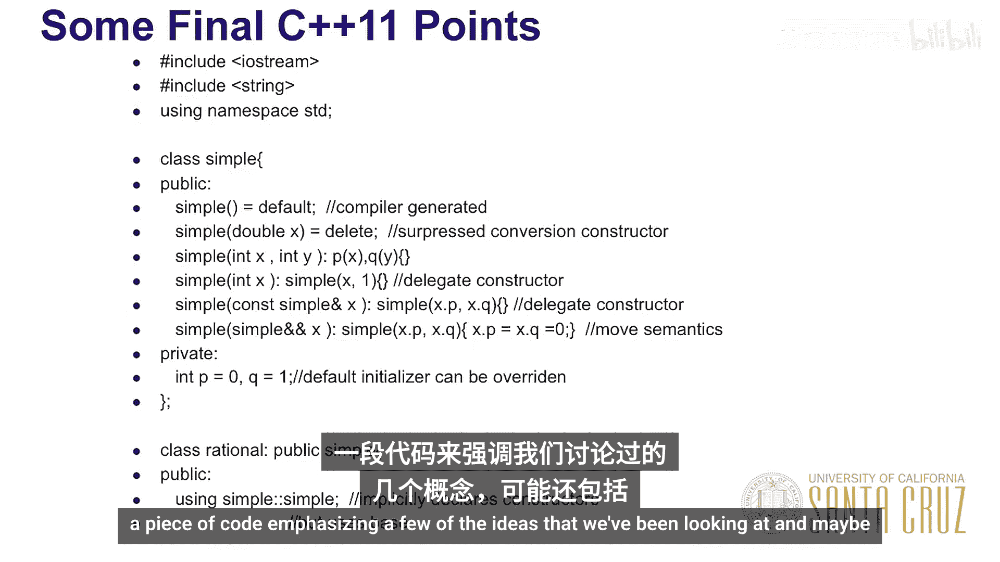
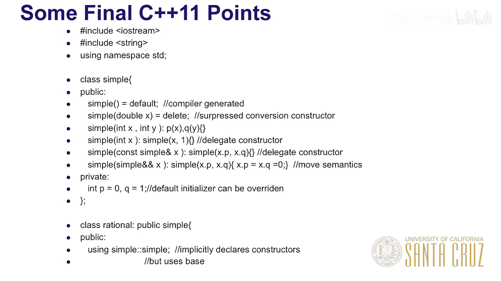
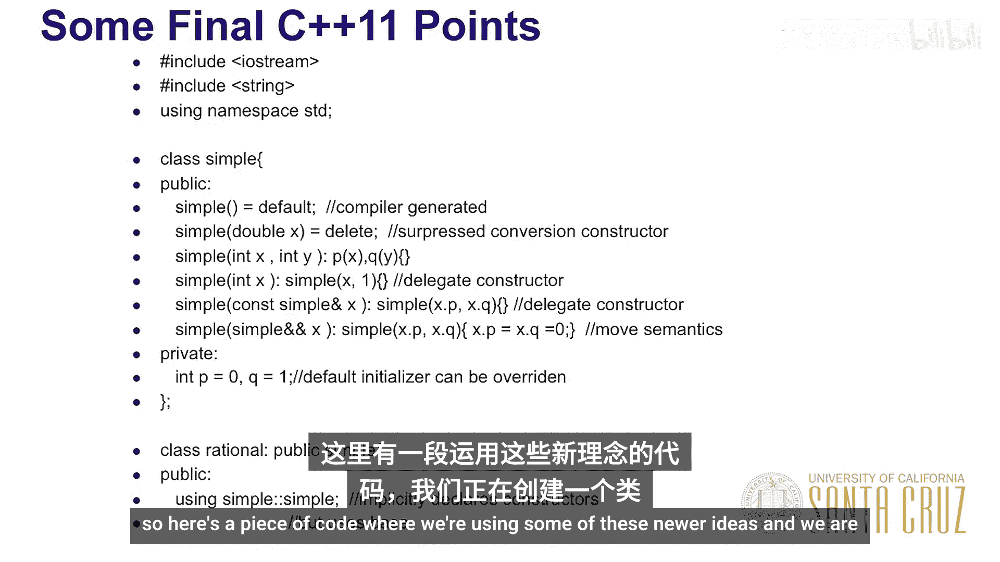
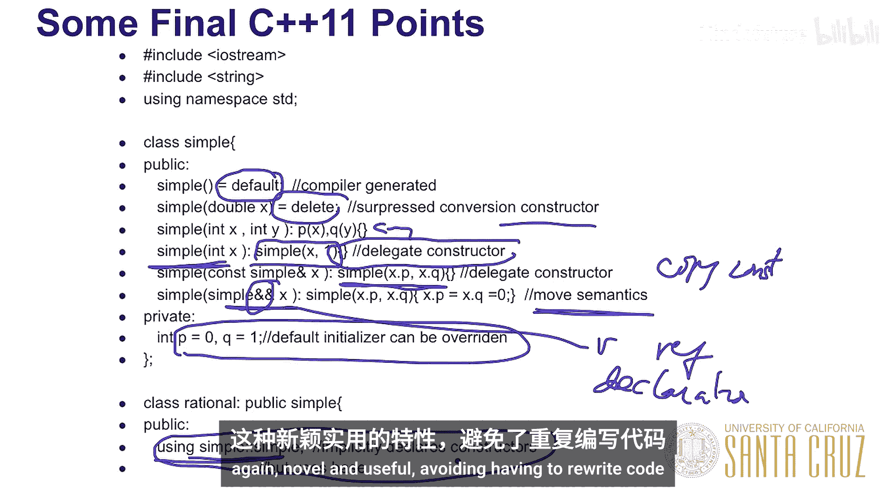

# 【加州大学】C++编程-｜-C-Plus-Plus-B-p53-P53_4-12-元组-C++11新库_04_05_04--BV1KseJzqEbZ_p53-

Okay。Again。嗯。The very bare bones， I say there are multiple libraries。Difficult topic。

 you have to be very conversant with threading in general。

 make sure you understand the machines you're running the threading on。

 probably you have to do timing to make sure that the threading overhead is actually not so significant that whatever computation you've decided to multithread actually has some benefit。

Now here's a much simpler library and very easy to use and very convenient， it's called a tuple。

 it's basically the generalization of something that's been around for a while called a pairar。

So as you know。You frequently want something that has multiple values in it。

 let's say you want to return from a function and you want to return with some multiple values that aggregate together。

 You don't always want to return。 You can always do that with something like an array。

But sometimes when there's a relatively small set of elements。

There should be a natural way to aggregate them， and that's the tuple。

Linkths together a small number of elements。

， here's the use。Of a couple。Think of wanting to do some plotting in a three dimensional space。

A three dimensional space has X， Y， and z coordinates。We want to think about such a 3D。Entity。

And indeed， we could， of course do this separately。

 but the tuple just gives us a natural functionality that makes it quite easy to implement this three dimensional point。

Now the many ways to do this， so it's not like the coupleple is unique。

It's not like it necessarily gives you an undue efficiency advantage。

But it just shows how it could be naturally incorporated。

It's not even clear that a tuple is as useful when you have essentially homogeneous elements tuple does not need to have homogeneous elements a tuple can be。

Each argument can come from quite a different set。Of types。So actually， all these types are distinct。

They can be instantiated distinctly。They don't have to be homogeneous。

So P is the internal way we're looking at the tuple， P is a tuple。

And its full type is a coupleple with three arguments， the three arguments happen to be double。

Now our 3D class is going to have some constructor。

And the constructor calls on something in the Tle library called make Tle。

And the default constructor is just going to say。Choose the zero values for that point。

 choose the values at the origin of the X， Y， and z axis。That's one constructor。

Here's another constructor。Is a constructor where we have all three arguments。 And again。

 we call on make tuple。And make Tple is going to store those values away in p。

And this friend function also shows some of the characteristics of how the Tu library works。And that。

We're going to have a small number。Of separate arguments。And in order to manipulate those arguments。

We have the ability to get the value in a particular position。

 so getting the zero gets us this value in a sense that the x value， getting one gets us to y value。

 getting two gets us to z value。So that's characteristics tuple is。Again。

 heavily embedded in the whole notion of generic programming， generic programming。

It makes generic programming easier， and it's a generic programming type， a template。

Here's the use。So I declare 2，3D points。Po1。2。You can see where this is going to be the default constructor。

And this is going to be that three argument constructor， and we have this little test。

To show that it all works。And I think you should have enough explanation there to pretty much。

Understand what's going to go on。 So what would be printed in that little man。So we had 3DP1 P2。

 and then we're going to print out P1 is P2 is testable， what are the values you're trying to find？

And the answer is first you'll print out explicitly test tuple。

 then you'll print out though this will be in lowercase， P1， it was the default constructor。

 remember it had the make tuple 000， so when the Ostream operator prints it out， it uses the get。

 the get of angle brackets1， the get of angle brackets 2。

 get get of angle bracket0 and you get this printed。

And then the other values that got assigned were by the constructor or 1。22。3 and 3。4。So。

Hopefully， this has given you a very good。Set of ideas about the new standard where there are。Really。

 some excellent value in adopting new practice。And I just want to look at some things。

 some of which we've already seen and give you one more final piece of code。

 emphasizing a few of the ideas that we've been looking at and maybe one or two things we didn't see in the earlier code。

So here's a。Pieceace of code where we're using some of these newer ideas and we are creating a class。

 I've called a class simple。

And in that class。I'm using some of the ideas now that。

Are specific to C++ 11 that have been introduced。One of them。

We can now say things like equal default。Equal default means。I expect the compiler to generate。

 I know the compiler has the ability to generate this constructor。

So that's directing the compiler to generate that constructor。After all。

 this is a relatively simple class， just has two values， P and Q。

And they can easily be placed on the stack。Another idea。Equal delete。

 suppress conversion constructor。One of the great difficulties that you get。That boooby trap。

C+ plus is anytime you have a of a constructor of one argument。You've basically introduced。

Into your objects， a conversion opportunity。And a lot of times those conversion opportunities are not what you want。

And if they're just randomly there without you thinking them true。Somewhere down the line。

 if people use your code。There's going to be an opportunity to really have a subtle runtime bug。

So if you do not intend。A particular signature。To be available for conversion opportunity。

 you can explicitly tell the compiler this signature cannot be。Cannot be converted。 cannot not be。

Another idea that's entered the language with the new standard is called a delegate constructor。

And here you see。Simple。With two arguments。嗯。In which。X and1 is one of the arguments。

And so you're saying， always use one， and that'll be。

By it's in effect referring back to an already pre existing constructor。 So this constructor。

Delegates， if you want the， you don't have to rewrite the code again， anytime you can reuse code。

 generally have a little more safety。And we see that delegate constructor idea again here in this copy constructor。

 So here's the ordinary copy constructor。Using delicate ideas。And here is yet， again。

The new our value Mo semantic's idea。So this is an R value。A right hand side。Reference。This， again。

 is this new kind of。呃。Declaration。And allows you to implement move semantics。Be a constructor。

And yet a final thing that you can do is you can have default initialization。

So if you didn't provide something in initialization， it'll default to those values。

All of these are very common， very useful， novel ideas， important and improvements， improvements。

 and they're not radical in some sense， maybe moose semantic is。

 but the rest of the stuff is very modest。And yet a final thing in this example。Is。

We can have the using statement。Provide the fact that inside this derived class。We can import。

 in effect， implicitly declare constructors using the base class， so that's an importation activity。

Again， novel and useful， avoiding having to rewrite code。

