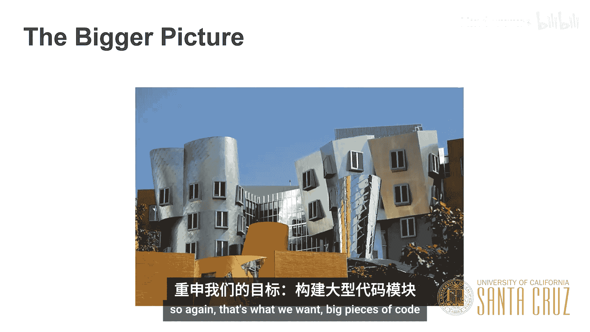
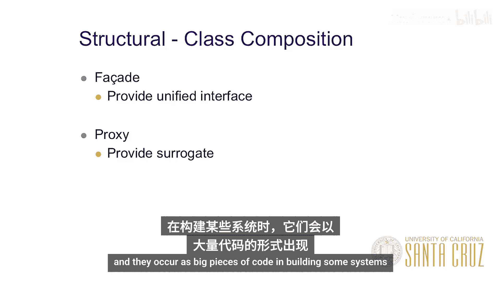

# 【加州大学】C++编程-｜-C-Plus-Plus-B-p54-P54_4-13-大局观_04_06_01--BV1KseJzqEbZ_p54-

Okay。So。That's it。For the language。The language is a say。Is a very big piece of work。

Let you do lots of things。But it doesn't。Let you do things necessarily in a good way。

How do you write a big piece of code so that you get an elegant result？Well。

Where do we see elegant results？We see elegant results when we merge。

An aesthetic component with a structural component。

Architects are not civil engineers and civil engineers aren't architects。But yet。

 the world has beautiful bridges。 The world has very anesthetic bridges。The world has。

Simple buildings， storage sheds。 and the world has。

Great buildings that have an artistic or aesthetic component。When we write code。

 code should also be aesthetic。 Big code should have an aesthetic。 We should be pleased with it。

 We should be able to sayG。That is elegant， that makes a lot of sense， that's comprehensible。

So one of the things we try to teach you in the large is how to put it all together。Architecture。

Here's a picture of the status building， it's where computer science lives at。MIT。

 I have several dear friends there， like the Turing Award winner， Barbara Liskoff。Marvin Minsky。

 another Turing award winner， and here is this very unusual building maybe a little bit controversial。

 but very much less than the older industrial motif for some of you who've visited MIT MITS in its older days of very much a little old brickyard industrial aesthetic。

 and here you have this modern sort of brilliant architecture in this very new computer science building。

So again， that's what we want， big pieces of code。

How do we put them together？Well。In the 80s。Several of the better programmers who were writing big pieces of code。

 and typically they were writing them with these newer languages like Ada or C++ or small talk。

They started to ask， what is it？That。Gets us something that we can reuse， structurally reuse。

 and that does the job well。And they ended up formulating this as what was called a design pattern。

 design pattern。These ideas coalesced， I say， in the last half of the 1980s。

The pioneers in the design pattern world。Decided that a design pattern should have four essential elements。

And they were inspired， by the way， by a true architect。So this came from them noticing。

That in the architectural literature。There were people who also thought about well。

It could have unique buildings， but also there are patterns that show up that are very useful。

 but they have to have a certain context， and we have to have a way to reference them。

So a pattern has to have a name。For example， a name could be an iterator。

 We see iterators as critical， critical in designing a big piece of software。

 namely the S T L container classes。 they all need iterators。 It's a way to make use of them。

 So a way to organize。Pieces of code and do it effectively。They have to solve a problem。

 we're not interested in patterns that you know， are somehow unique and maybe once in a blue moon get used。

 they have to solve a problem in which that problem recurs。We need a solution。

 so it's not just enough to identify the thing but we need something that works well。

 and we need to see what the consequences of using that pattern frequently a pattern is very general and not that efficient。

 sometimes it's really easy to use and you give up some things for ease of use。

So those are the four essential characteristics that were found by。the design pattern community。So。

Patterns occur in bigger classifications。 So one of the patterns， for example。

 one class of patterns is creational。Oh， by the way， much of this。Was brought to the fore。

By the gang of four， there were four authors， Velocities， Johnson。

 I'm forgetting a couple of the others。Who wrote the design pattern book in the early 1990s that created a great stir。

 all of a sudden people。Ha an aha moment， they said， I've been using ideas like that。 But， gee。

 I didn't know they were common， and I didn't know that I should。Try to systematize。

And the gang of four。In a beautiful book organized。A number of them， I don't know， 30 or 40 of them。

 organize them into different groupings， one， for example， creational。So in creational patterns。

One of those patterns called a factory method。 we're going to look at that in detail from the C point。

 from the C plus plus perspective， Pats aren't necessarily。Tied to any language。

 they are a bigger architectural construct。And so they can be used in the Python community or the C++ community or the Java community as well as C sharprp or C++。

A factory method is what is also known as virtual construction。

 a way to accomplish it is to defer construction to subclasses。

Another kind of creational method is a singleleton。

And the singleleton needs coat that assures that whatever is constructed。

 there's only a single instance of。So here are two creational patterns。We're going to see in detail。

How the factory method works， and you can also imagine how you would write。A singleton。

The singleingleton。And C++ would mean that if I created an instance or what creates an instance。

 well if it was class based， it would probably be created by a constructor。Well。

 there would have to be some guarding primitive in there that would say。

 I've already created the instance and would disable any further instances from being created。

 And that would be how you could manage a singleton pattern。 Sing pattern is pretty easy。

 but it has some important。Uses， for example， somebody is grabbing a resource in a system in which there is only one resource like writing to the screen and you can't have。

Multiple versions of that， so you have to disallow multiple versions。

Factory method again is something virtual constructor is not allowed。

 remember you can have virtual de structuress in C++ but you cannot have virtual construct and yet the idea is a natural one。

Why shouldn't you have polymorphic construction？As well as polymorphic de。And this。Pattern solves。

That commonplace problem。There were also patterns that fit into what are called。Structctionional。

 structural patterns。Such a pattern includes a pattern called the facade in which you provide a unified interface。

 another pattern that's very common， especially in multi threaded and current systems called a proxy in which you provide a surrogate。

 maybe to another machine。So these are structural patterns。And they get heavy use， and they occur。

As big pieces of code in building some systems， so again。

 this all architectural notice the character of the name like facade or proxy。

 they give you a vivid or factory method， they give you a vivid way to think of it。

Something natural。