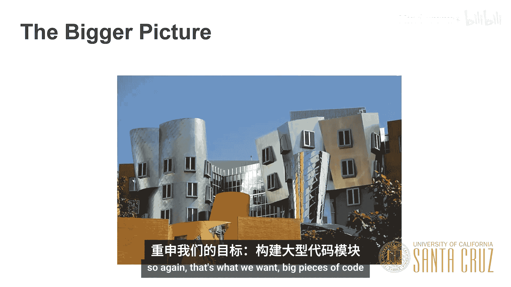
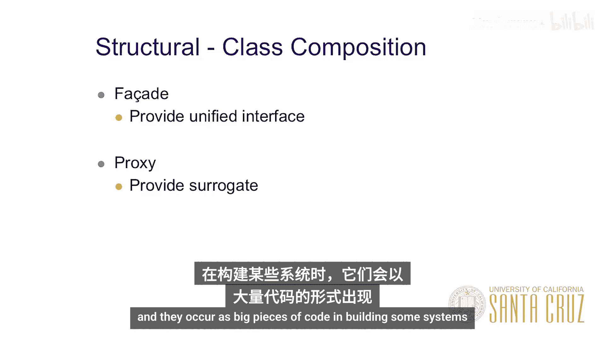

# C++编程：P54：大局观：设计模式

在本节课中，我们将要学习软件工程中的一个重要概念——设计模式。我们将了解什么是设计模式，它们为何重要，以及如何将它们应用于构建优雅、可维护的大型C++代码。

## 概述

上一节我们介绍了C++语言本身的能力与局限。本节中我们来看看如何将这些能力组织起来，构建出结构良好、优雅的大型软件。这涉及到软件架构的思想。

语言本身功能强大，能完成许多任务。但它并不保证你能以良好的方式完成任务。如何编写大型代码以获得优雅的结果？我们可以在建筑领域找到类比。建筑师不是土木工程师，土木工程师也不是建筑师。然而，世界上既有美丽的桥梁，也有非常实用的桥梁；既有简单的仓库，也有兼具艺术与美学价值的伟大建筑。编写代码也应如此。大型代码应当具有美感。我们应该对其感到满意，能够评价它“优雅、合理、易于理解”。因此，在宏观层面，我们试图教授如何将所有部分整合在一起，即软件架构。

那么，我们如何将大型代码组合在一起呢？

## 设计模式的起源与要素

在20世纪80年代，一些编写大型代码的优秀程序员（通常使用Ada、C++或Smalltalk等新语言）开始思考一个问题：是什么让我们能够结构性地复用代码，并出色地完成任务？他们最终将其表述为“设计模式”。

这些思想在20世纪80年代后半期逐渐成型。设计模式领域的先驱们认为，一个设计模式应包含四个基本要素。他们的灵感部分来源于真正的建筑学。他们注意到，在建筑学文献中，人们也思考类似的问题：可以有独特的建筑，但也存在一些反复出现且非常有用的模式，这些模式需要特定的上下文，并且需要有方法来引用它们。

以下是设计模式的四个基本特征：

1.  **名称**：模式必须有一个名字。例如，“迭代器”就是一个名称。迭代器在设计大型软件（如STL容器类）时至关重要，它是使用这些容器的一种组织方式。
2.  **问题**：模式必须解决一个反复出现的问题。我们不关心那些独特、可能极少用到的模式。
3.  **解决方案**：仅仅识别问题还不够，我们需要一个行之有效的解决方案。
4.  **后果**：我们需要了解使用该模式通常会带来的结果。有时模式非常通用但效率不高；有时它易于使用，但需要为易用性牺牲一些东西。

## 模式的分类与示例

模式有更广泛的分类。例如，一类模式是“创建型”模式。

顺便提一下，设计模式的概念因“四人组”（Gang of Four）而广为人知。这四位作者在20世纪90年代初撰写的设计模式书籍引起了巨大轰动。许多人突然有了“顿悟”时刻，意识到自己一直在使用类似的思想，但不知道它们是通用的，也不知道应该将其系统化。

“四人组”在一本优秀的书中组织了许多模式（大约30到40个），并将它们分为不同的组。其中一个组就是“创建型”模式。

以下是两种创建型模式的简要介绍：

*   **工厂方法**：我们稍后会从C++的角度详细探讨这个模式。它也被称为“虚拟构造”，其实现方式是将对象的构造延迟到子类中进行。
*   **单例模式**：这种模式需要确保无论构造什么，都只有一个实例。

我们将详细学习工厂方法的工作原理。你也可以想象如何用C++编写一个单例模式。在C++中，单例模式意味着，如果创建实例（通常通过类的构造函数），则必须在其中加入某种保护机制，声明“实例已经创建”，并禁止创建更多实例。这就是管理单例模式的方式。单例模式相当简单，但有一些重要用途。例如，在系统中获取唯一资源（如向屏幕写入内容）时，不能有多个副本，因此必须禁止创建多个实例。

再次强调，工厂方法解决了虚拟构造函数的问题。请记住，在C++中可以有虚拟析构函数，但不能有虚拟构造函数。然而，多态构造的想法是很自然的。为什么不能有多态构造和多态析构呢？这个模式解决了这个常见问题。

此外，还有属于“结构型”模式的类别。

结构型模式包括：

*   **外观模式**：提供一个统一的接口。
*   **代理模式**：提供一个替身或代理（可能指向另一台机器），这种模式在多线程和并发系统中非常常见。

这些结构型模式被大量使用，是构建某些系统时的重要组成部分。再次注意这些名称的特点，如“外观”、“代理”或“工厂方法”，它们为你提供了一种生动的方式来思考问题。

## 总结

本节课中，我们一起学习了软件设计模式的基本概念。我们了解了设计模式的四个核心要素：名称、问题、解决方案和后果。我们还探讨了模式的分类，特别是创建型模式（如工厂方法和单例模式）和结构型模式（如外观模式和代理模式）。理解并应用这些模式，能帮助我们将C++代码组织得更加优雅、可复用和易于维护，从而构建出更优秀的软件架构。