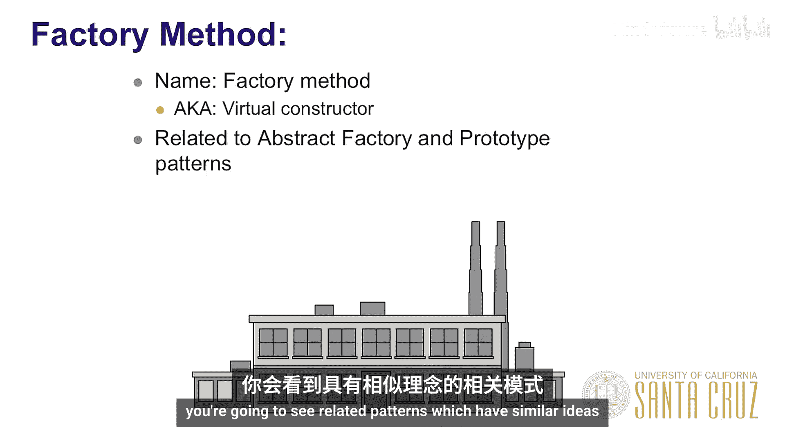
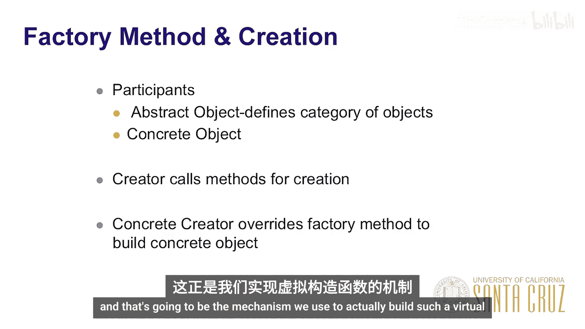
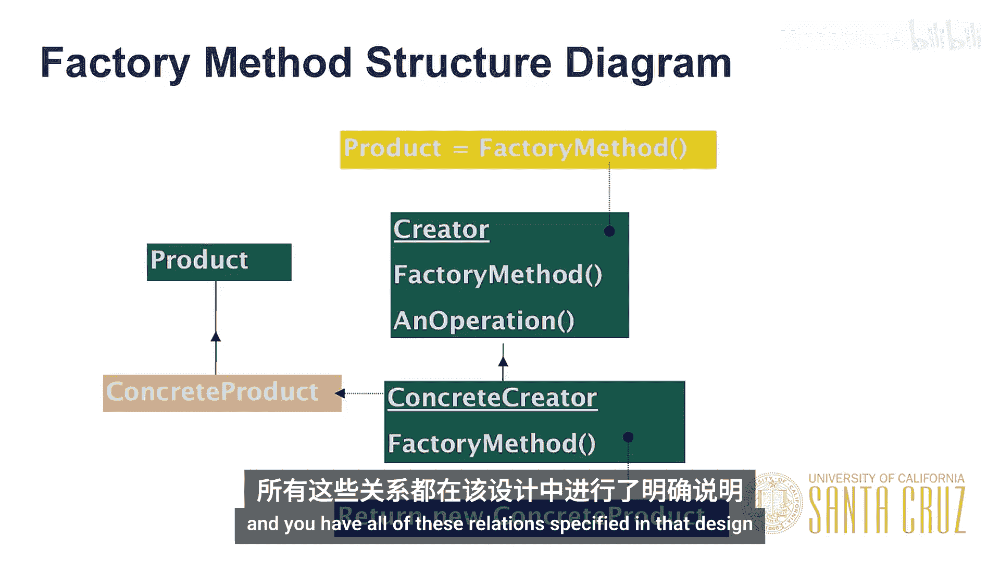
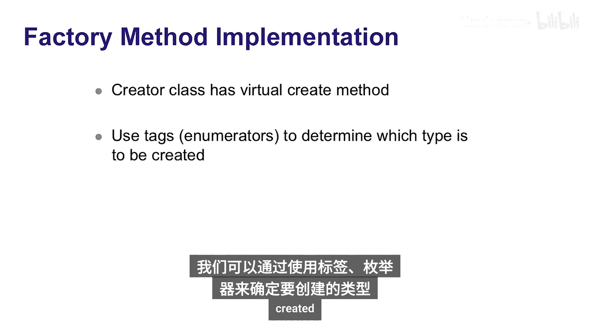

# 【加州大学】C++编程-｜-C-Plus-Plus-B-p55-P55_4-14-工厂方法_04_06_02--BV1KseJzqEbZ_p55-

So let's move on to actually constructing or actually seeing how one would provide a factory method in C++ code。

Again。We need a name。The gang of four。Were very clever about names So one of the nice things about their book is they thought long and hard about names they didn't use the name virtual constructor because that was going to be too technical。

Virtual， because virtual is a key word in C plus plus。 it's not a key word in Java。

It's not a key word。And Pisson or Ada。So the notion shouldn't be tied to a language。

 The notion should be tied to a wider idea， to an architectural idea。

 and among the things you want in the pattern is。An easy way to retrieve the pattern if you're a trained programmer。

AndF method。 Wow， it just。It's an easy p mneummonic， it's an easy way to think about it。

It has an al to name AK known as virtual constructor， so frequently in the pattern community。

 there are several ways to name the thing。There may be other patterns。That also do something similar。

 So again， when you're fishing for a solution to the problem， there might be several ways to go。

 and you're going to think about several ways to go debated inside your。

Programr team and come up with this。 and this again is a shorthand。

 So the fact that you can somebody else sit around and say let's use a factory method。

 somebody else say， no no， I think we can just have an abstract factory。That could do it。

 maybe that'll do it better。So， again。In the pattern encyclopedias， the pattern repositories。

 you're going to see。

Related patterns， which have similar ideas。The factory。

 the motivation for this and why it occurs and pops up frequently because again。

We only want patterns that provide solutions that are。Commonly occurring。

 commonly occurring situations。 We don't want that。It just would be too much to log everybody's。

Unique solution to some very uncommon problem。I think the pattern。

If I'm remembering right in the pattern community， they don't accept a pattern unless they're like three three or four already。

Kown situations in which the pattern comes up and can be used to solve the problem。So。

The motivation is code knows about an abstract based class， but not concrete subclasses。

And so you need to defer to the concrete subclasses， the creation of the items。

And that means creation is deferred until runtime when you actually know what you need。

Rather than start with some。Something。呃。An alternate solution。

Would be have the universal object for that type， but that would be too much。

 Maybe you would have something that could support everything。

And that would be relatively expensive and not very polymorphic。

The applicability of this is that there be runtime creation of objects and subclass creating objects rather than having it。

Created。In the base class。When we build that， we have a sort of blueprint。So again。

 if you go to the Gangga4 book。You will see basically UML style documents these their little hand drawn。

啊。Charts that show the relations of different。Chunks of code that you're going to need to use in the design。

And there'll be different things that may participate。In。That factory method。

 such as a concrete object。The concrete creator overs a factory method to build a concrete object。

 And that's going to be the mechanism we use to actually。

Build such a virtual constructor and here's something like a UML document some of you may。

ha even automated tools that can draw such documents very common in the object oriented community to use this in your documentation。

 you could do it with note cards or you can do it with some standard software。

 a package I used to use was rational rows and you could either abstract out of your code。

 the fact that you had these relations。So here's your factory method， there's a creator。

 factory method， a concrete creator， and you end up returning with the new product and you have all of these relations specified in that design。

And then that code would support an abstract object interface， an abstract object。

 and that could be extensible。So maybe you have a system that's growing， you don't need to know。

 let's say you have a windowing system， you don't know all the different kinds of windows you're going to build in that system。

 you want to build it in a way that it can grow。Factory methods might be the right approach。

How do we implement that？The creator class needs to have a polymorphic method。

 a polymorphic create method。So we can't have a virtual constructor。

 but we can have a method that simulates the virtual constructor。And we could do that by having tags。

 enumerators to determine which type is to be created。

