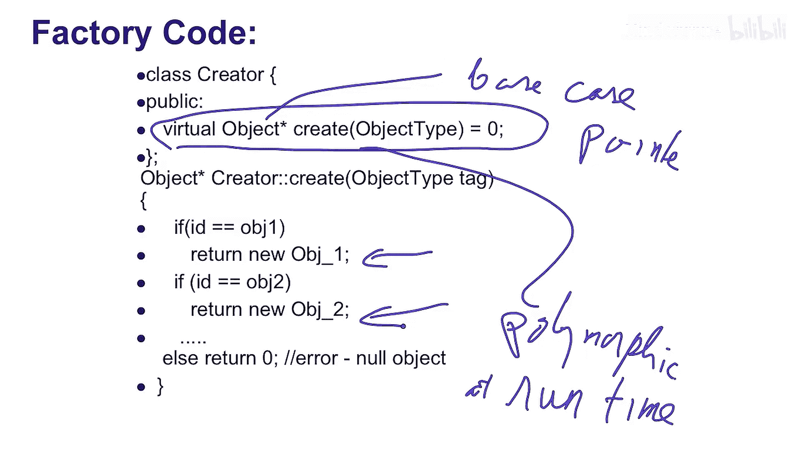
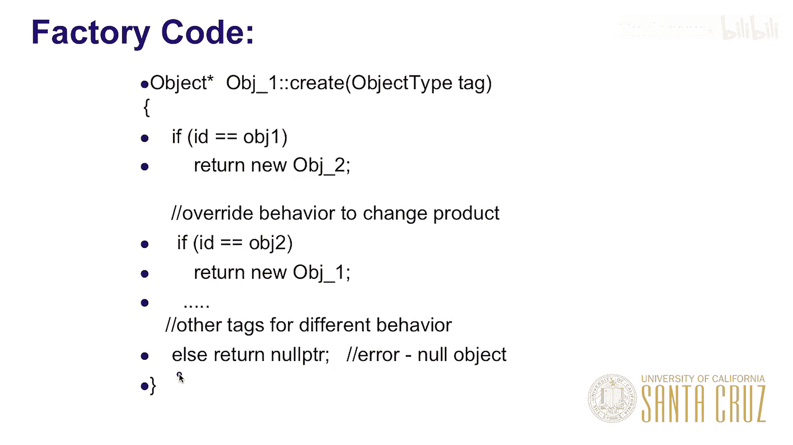
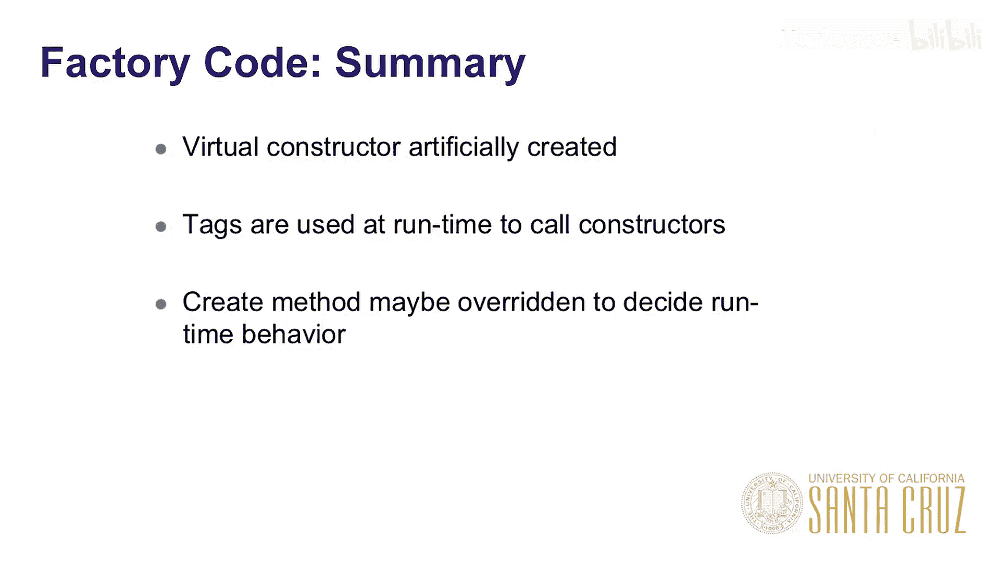
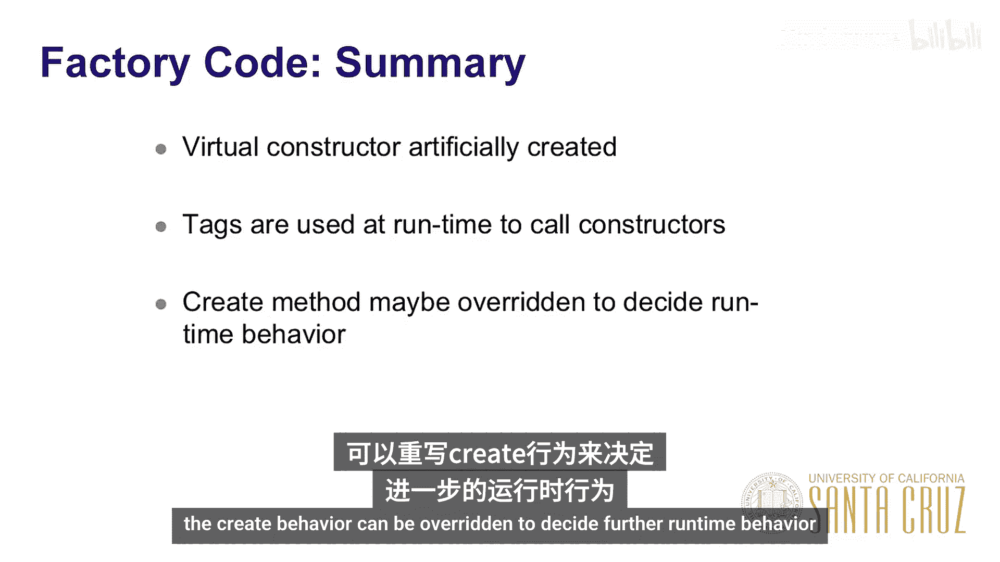
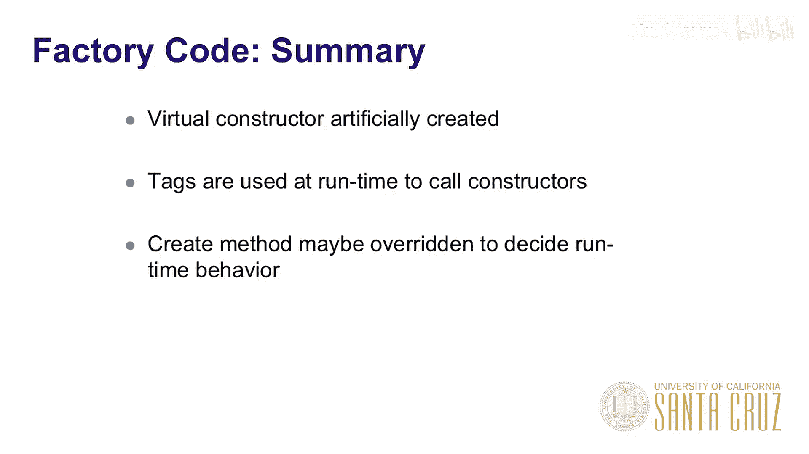
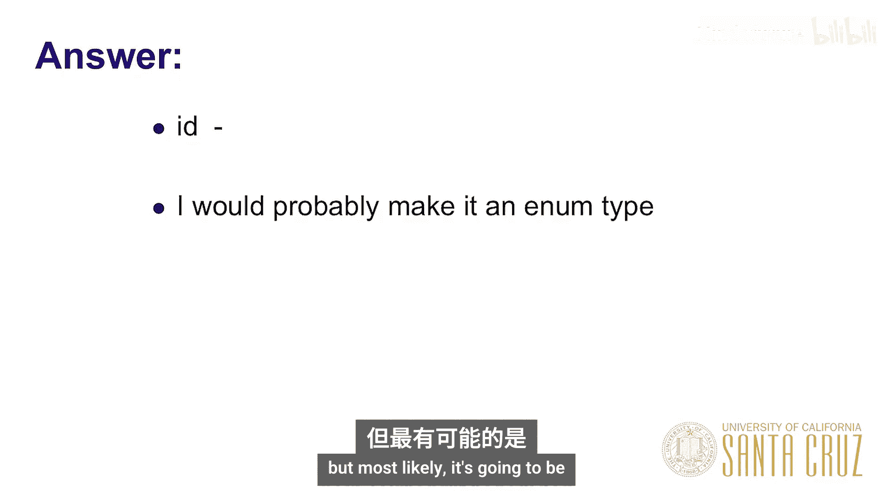
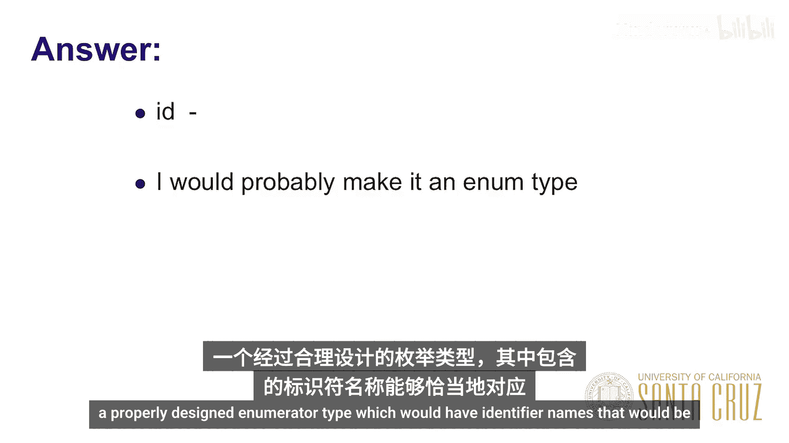

# 【加州大学】C++编程-｜-C-Plus-Plus-B-p56-P56_4-15-工厂代码-C++11示例_04_06_03--BV1KseJzqEbZ_p56-

So here's some concrete C plus plus code that exhibits。An actual implementation of what。Could be。

A factory method。Notice。That this is virtual。Its data type is the base class pointer。

And then the create method is going to be selected polymorphically。

And then we're going to do this test。And each of these tests will decide what object to create。

So here's object one， test for ID says if it's this。Return。

And we can also have overwritten behavior and other tags for yet different behavior。 And then。

If we have an error result， we can also return with a null object。

A virtual constructor， the factory code。Was built artificially， built by。

Having a create method that was virtual that returned a base pointer。

 why a base pointer because the base pointer is universal。So whatever the factory wants to produce。

Can be pointed at by the base pointer。So it's not an explicit。Concrete instance， right？

It's a base pointer instance， not a concrete instance。

That's what lets us do everything polymorphically。Tags are used at runtime to call the different constructors that we want。

To create behavior can be overridden to decide further on time behavior。

Again。You saw it earlier， but what。Do you think a type should be？For this to work with ID。

Very simple question， we already saw it in that earlier code。

Just checking if you're paying attention。And the answer was we would probably want to make it an en nuerator type。

 it could also be a set type。It could be a simple set of integers。

 but most likely it's going to be a properly designed enummerator type， which would have。

啊。IIentifier names that would be appropriate to， for example。

 the style of window we were creating if the factory method was creating a whole different style of windows in some windowing system。

