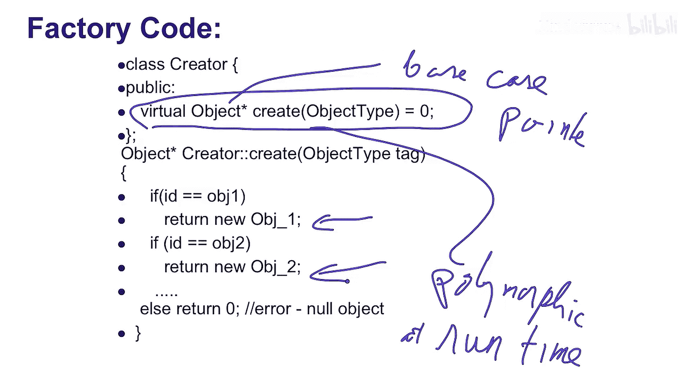
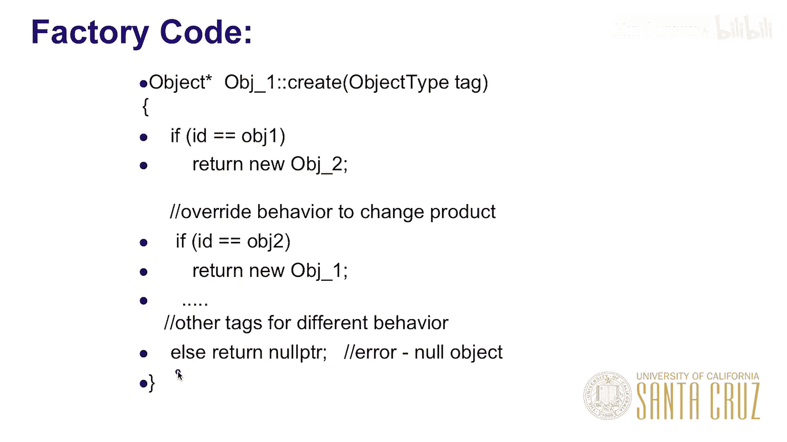
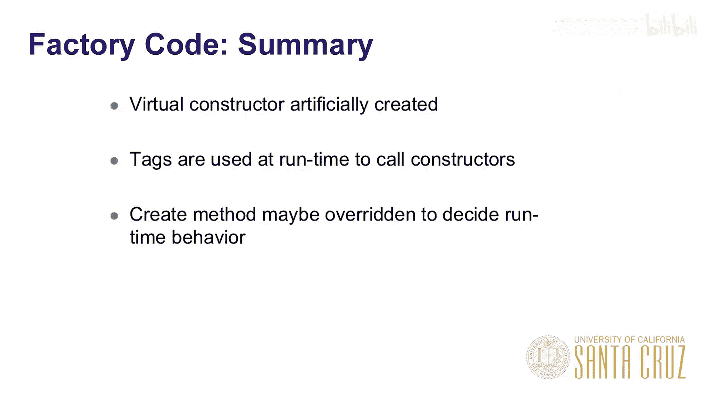
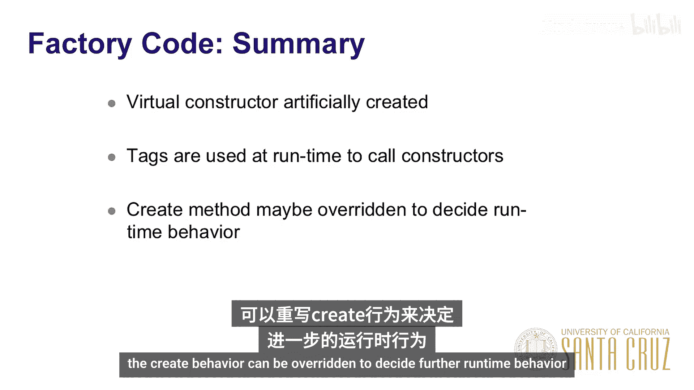
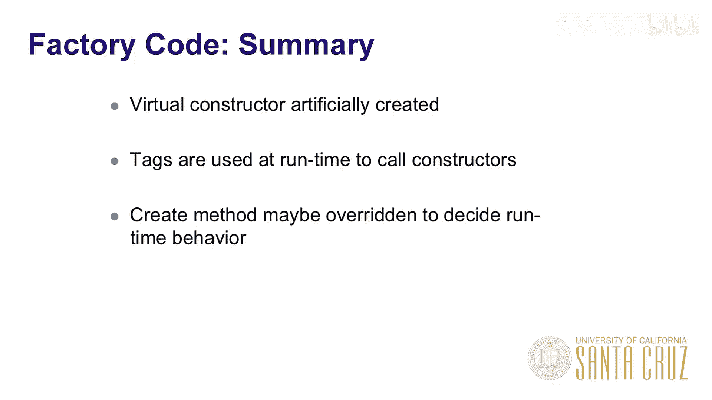
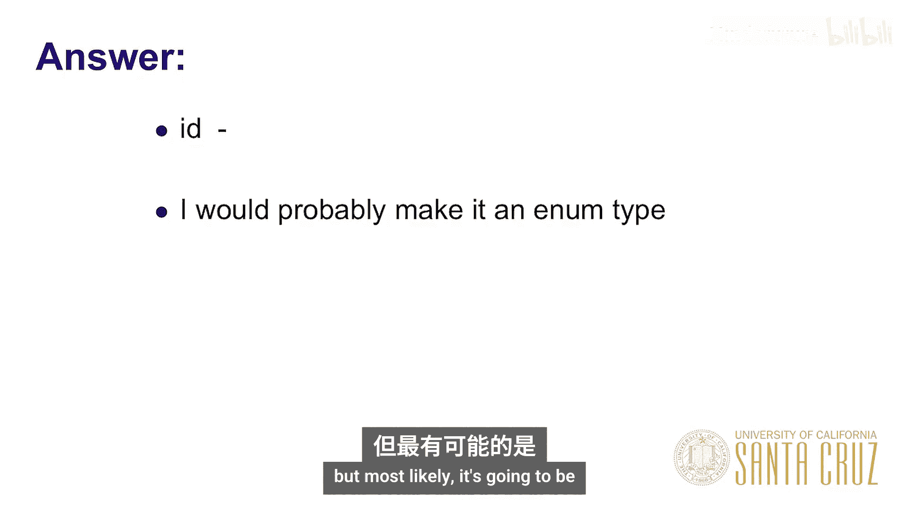
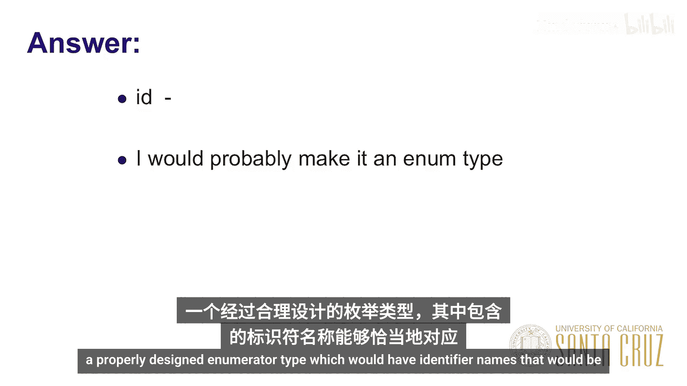

**C++编程：P56：工厂方法模式C++11代码示例**

在本节课程中，我们将学习一个具体的C++代码示例，它展示了工厂方法模式的实际实现。

---

上一节我们介绍了工厂方法模式的概念，本节中我们来看看它的具体C++实现。这段代码展示了一个实际的工厂方法实现。

请注意，这里的`create`方法是**虚函数**。它的返回类型是**基类指针**。然后，`create`方法将通过多态性被选择调用。



接着，我们将执行测试。每个测试将决定创建何种对象。

以下是代码示例：

```cpp
// 基类定义
class Base {
public:
    virtual Base* create(int id) = 0; // 虚工厂方法
    virtual ~Base() {}
};



// 派生类1
class Derived1 : public Base {
public:
    Base* create(int id) override {
        if (id == 1) {
            return new Derived1();
        }
        return nullptr; // 错误情况返回空对象
    }
};



// 派生类2
class Derived2 : public Base {
public:
    Base* create(int id) override {
        if (id == 2) {
            return new Derived2();
        }
        return nullptr;
    }
};
```

所以，对于对象一，测试ID：如果ID匹配，则返回相应的对象。

我们也可以重写行为，并为其他不同的行为设置标签。

如果遇到错误结果，我们也可以返回一个空对象。

---

**虚拟构造函数与工厂代码**

这个工厂代码是通过人工构建的。构建方式是：拥有一个返回基类指针的虚`create`方法。

为什么使用基类指针？因为基类指针是通用的。因此，无论工厂想要生产什么，都可以用基类指针指向它。所以，这不是一个显式的具体实例，而是一个基类指针实例，这让我们能够以多态方式处理一切。





在运行时，标签被用来调用我们想要的不同构造函数。`create`行为可以被重写，以进一步决定运行时的行为。

---

**关于标识符类型的思考**

再次强调，你之前已经看到过，但你认为这里的`ID`应该是什么类型？这是一个非常简单的问题，我们在之前的代码中已经见过。

只是为了检查你是否在注意听讲。答案是：我们很可能希望将其设为**枚举类型**。

它也可以是一个集合类型，或者一组简单的整数。但最有可能的是，它将是一个经过适当设计的枚举类型。



例如，如果工厂方法是在某个窗口系统中创建完全不同风格的窗口，那么枚举类型将包含适当的标识符名称。



---

**总结**

本节课中，我们一起学习了工厂方法模式在C++中的具体实现。我们看到了如何通过虚函数和基类指针来实现多态的对象创建，讨论了使用枚举类型作为对象标识符的合理性，并理解了工厂方法在运行时根据输入参数动态决定对象类型的能力。